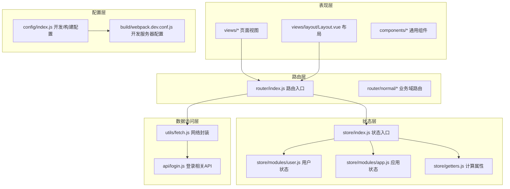
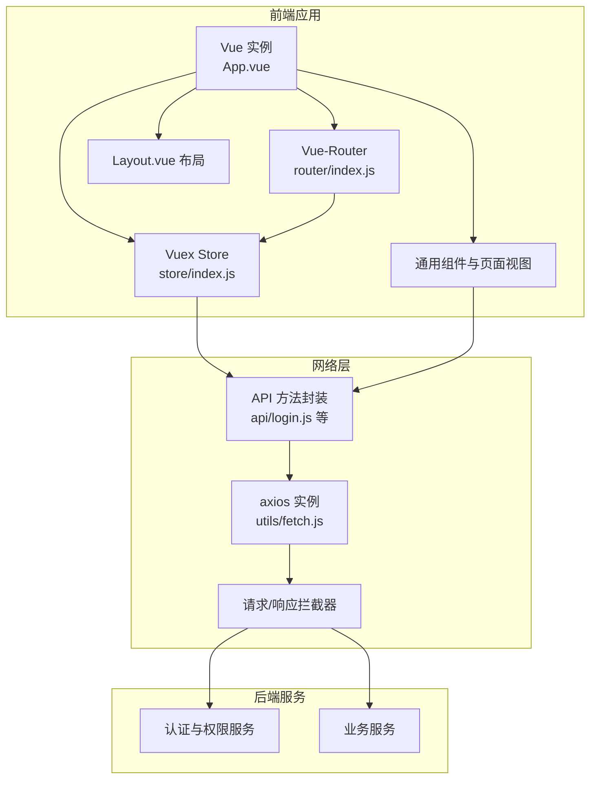
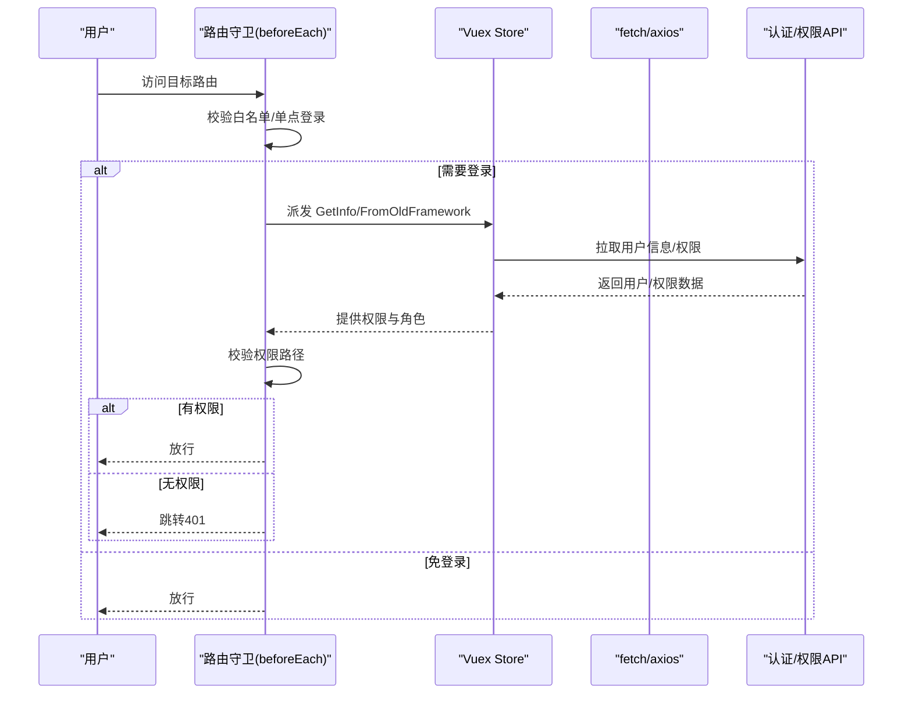
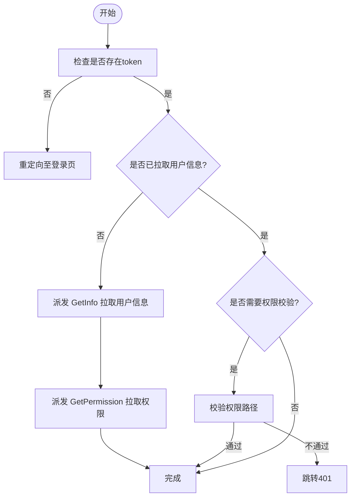
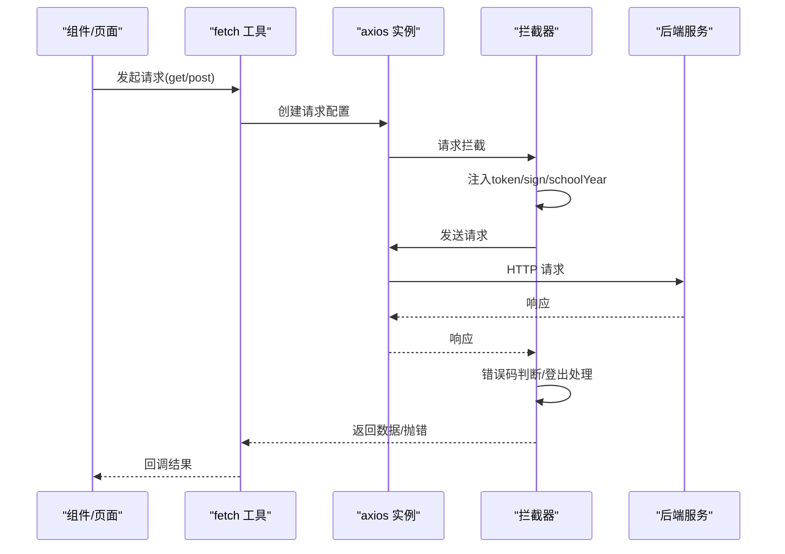
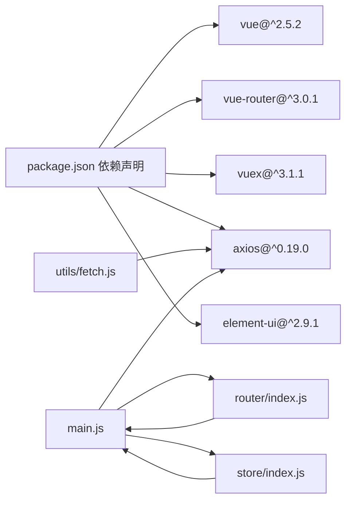

# 整体架构

<cite>
**本文引用的文件**
- [package.json](file://package.json)
- [main.js](file://src/main.js)
- [App.vue](file://src/App.vue)
- [router/index.js](file://src/router/index.js)
- [router/normal/homePage.js](file://src/router/normal/homePage.js)
- [store/index.js](file://src/store/index.js)
- [store/modules/user.js](file://src/store/modules/user.js)
- [store/modules/app.js](file://src/store/modules/app.js)
- [store/getters.js](file://src/store/getters.js)
- [utils/fetch.js](file://src/utils/fetch.js)
- [api/login.js](file://src/api/login.js)
- [views/layout/Layout.vue](file://src/views/layout/Layout.vue)
- [mixins/baseMixin.js](file://src/mixins/baseMixin.js)
- [config/index.js](file://config/index.js)
- [build/webpack.dev.conf.js](file://build/webpack.dev.conf.js)
</cite>

## 目录
1. [引言](#引言)
2. [项目结构](#项目结构)
3. [核心组件](#核心组件)
4. [架构总览](#架构总览)
5. [详细组件分析](#详细组件分析)
6. [依赖关系分析](#依赖关系分析)
7. [性能考量](#性能考量)
8. [故障排查指南](#故障排查指南)
9. [结论](#结论)
10. [附录](#附录)

## 引言
本架构文档面向“校园管理系统”前端工程，系统采用 Vue.js 技术栈，结合 Vue-Router 实现路由管理、Vuex 实现状态管理，并通过统一的网络层封装对接后端服务。系统遵循 MVVM 架构思想，以组件化为核心组织方式，按功能域划分模块，形成清晰的分层结构：表现层（视图与组件）、业务逻辑层（路由守卫与状态派发）、数据访问层（API 与网络拦截器）。同时，系统支持前后端分离部署，具备跨域与鉴权控制能力。

## 项目结构
项目采用“功能域+层次化”的组织方式：
- 表现层：views 目录下的页面视图与布局组件，配合 components 目录下的通用组件与业务组件。
- 路由层：router 目录按业务域拆分常驻路由与动态模块路由，集中于入口导出。
- 状态层：store 目录按模块拆分 app、user、org 等，通过 getters 统一对外暴露。
- 数据访问层：utils/fetch.js 提供 axios 实例与拦截器；api 目录按业务域拆分 API 方法。
- 配置层：config 与 build 提供开发与构建配置，支持代理、资源路径与打包策略。

图表来源
- [router/index.js:1-207](file://src/router/index.js#L1-L207)
- [store/index.js:1-20](file://src/store/index.js#L1-L20)
- [store/modules/user.js:1-447](file://src/store/modules/user.js#L1-L447)
- [store/modules/app.js:1-54](file://src/store/modules/app.js#L1-L54)
- [store/getters.js:1-26](file://src/store/getters.js#L1-L26)
- [utils/fetch.js:1-240](file://src/utils/fetch.js#L1-L240)
- [api/login.js:1-259](file://src/api/login.js#L1-L259)
- [config/index.js:1-72](file://config/index.js#L1-L72)
- [build/webpack.dev.conf.js:1-96](file://build/webpack.dev.conf.js#L1-L96)

章节来源
- [package.json:1-98](file://package.json#L1-L98)
- [config/index.js:1-72](file://config/index.js#L1-L72)
- [build/webpack.dev.conf.js:1-96](file://build/webpack.dev.conf.js#L1-L96)

## 核心组件
- 应用入口与全局初始化
  - main.js 注入 ElementUI、进度条、过滤器、全局组件与第三方插件，注册路由守卫与错误处理，挂载根实例。
- 路由系统
  - router/index.js 定义常驻路由与业务域路由集合，集中导出路由表；各业务域路由在 normal 子目录下按模块拆分。
- 状态管理
  - store/index.js 汇聚 app、user、org 模块；getters.js 提供统一的计算属性；user 模块负责登录态、权限、学校信息等。
- 网络层
  - utils/fetch.js 基于 axios 创建实例，统一注入 token、签名参数、归档年份等；拦截器处理错误码与登出逻辑。
- 布局与导航
  - views/layout/Layout.vue 提供顶部导航、用户下拉、切换学校、退出登录等交互；结合权限与模块能力控制显示。

章节来源
- [main.js:1-221](file://src/main.js#L1-L221)
- [router/index.js:1-207](file://src/router/index.js#L1-L207)
- [store/index.js:1-20](file://src/store/index.js#L1-L20)
- [store/getters.js:1-26](file://src/store/getters.js#L1-L26)
- [store/modules/user.js:1-447](file://src/store/modules/user.js#L1-L447)
- [utils/fetch.js:1-240](file://src/utils/fetch.js#L1-L240)
- [views/layout/Layout.vue:1-507](file://src/views/layout/Layout.vue#L1-L507)

## 架构总览
系统采用 MVVM 架构，Vue 作为视图模型驱动，路由与状态分别承担导航与数据管理职责。前后端通过统一的 API 层解耦，网络层负责鉴权、签名与错误处理。构建阶段通过 webpack 配置实现开发服务器、资源路径与代理策略。

图表来源
- [App.vue:1-183](file://src/App.vue#L1-L183)
- [router/index.js:1-207](file://src/router/index.js#L1-L207)
- [store/index.js:1-20](file://src/store/index.js#L1-L20)
- [utils/fetch.js:1-240](file://src/utils/fetch.js#L1-L240)
- [api/login.js:1-259](file://src/api/login.js#L1-L259)

## 详细组件分析

### 路由与导航（Vue-Router）
- 路由入口
  - constantRouterMap 定义常驻路由（登录、仪表盘、404/401 等），并聚合各业务域路由。
  - 业务域路由通过 import 动态加载，减少首屏体积。
- 导航守卫
  - beforeEach 中处理白名单、单点登录、权限校验、token 注入与错误跳转。
  - afterEach 控制进度条结束。
- 业务域路由
  - router/normal/homePage.js 等示例展示按模块拆分的路由组织方式。

图表来源
- [main.js:73-198](file://src/main.js#L73-L198)
- [store/modules/user.js:217-286](file://src/store/modules/user.js#L217-L286)
- [utils/fetch.js:104-169](file://src/utils/fetch.js#L104-L169)
- [api/login.js:16-24](file://src/api/login.js#L16-L24)

章节来源
- [router/index.js:1-207](file://src/router/index.js#L1-L207)
- [router/normal/homePage.js:1-18](file://src/router/normal/homePage.js#L1-L18)
- [main.js:73-198](file://src/main.js#L73-L198)

### 状态管理（Vuex）
- 模块划分
  - app：应用级分页、类型等状态。
  - user：登录态、用户信息、角色、权限、学校信息、学年等。
  - org：组织筛选参数等。
- 计算属性
  - getters.js 暴露 token、权限、学校信息、是否独立运行等常用派生状态。
- 登录流程
  - user 模块提供 Login、GetInfo、FromOldFramework 等动作，统一写入 Cookie 与本地存储，并拉取权限与学年信息。

图表来源
- [store/modules/user.js:120-325](file://src/store/modules/user.js#L120-L325)
- [store/getters.js:1-26](file://src/store/getters.js#L1-26)
- [main.js:142-176](file://src/main.js#L142-L176)

章节来源
- [store/index.js:1-20](file://src/store/index.js#L1-L20)
- [store/modules/app.js:1-54](file://src/store/modules/app.js#L1-L54)
- [store/modules/user.js:1-447](file://src/store/modules/user.js#L1-L447)
- [store/getters.js:1-26](file://src/store/getters.js#L1-L26)

### 网络层与API封装（axios + 拦截器）
- 实例配置
  - baseURL 通过 global.BasePath 注入；支持多实例（systemFetch、newcharge、card 等）适配不同服务域。
  - transformRequest 对特定场景（如 ucenter-web）进行参数序列化。
- 请求拦截
  - 自动注入 token、签名参数（sign）、归档年份（schoolYear）。
  - 白名单接口（withoutTokenList）不强制 token。
- 响应拦截
  - 统一错误码处理（1000 登录超时触发登出与跳转）；对阻断型错误弹出提示并拒绝。
  - 正常响应根据 isReturnData 返回 data 或完整 response。

图表来源
- [utils/fetch.js:13-174](file://src/utils/fetch.js#L13-L174)
- [utils/fetch.js:65-169](file://src/utils/fetch.js#L65-L169)
- [api/login.js:1-259](file://src/api/login.js#L1-L259)

章节来源
- [utils/fetch.js:1-240](file://src/utils/fetch.js#L1-L240)
- [api/login.js:1-259](file://src/api/login.js#L1-L259)

### 布局与导航（Layout.vue）
- 顶部导航
  - 根据模块权限控制导航项显示；支持外部链接与内部路由跳转。
- 用户中心
  - 个人信息、切换学校、退出登录；切换学校通过 API 派发 SetLoginInfo 并刷新页面。
- 首次加载优化
  - mounted 中根据侧边栏首个菜单自动跳转，提升首屏体验。

章节来源
- [views/layout/Layout.vue:1-507](file://src/views/layout/Layout.vue#L1-L507)

### 分层架构设计
- 表现层
  - 视图与组件负责渲染与交互；通过 keep-alive 缓存与路由 meta 控制缓存策略。
- 业务逻辑层
  - 路由守卫统一处理登录态、权限与跳转；mixin 提供通用方法（分页、导出、日期工具）。
- 数据访问层
  - API 方法按领域拆分；网络层统一处理鉴权、签名与错误。

章节来源
- [App.vue:1-183](file://src/App.vue#L1-L183)
- [mixins/baseMixin.js:1-103](file://src/mixins/baseMixin.js#L1-L103)

### 前后端分离与跨域处理
- 接口设计
  - API 方法统一通过 utils/fetch.js 的 axios 实例发起请求，避免硬编码域名。
- 跨域与鉴权
  - 通过 baseURL 与拦截器注入 token、签名参数；未登录与登录超时场景统一处理。
- 构建与开发
  - config/index.js 定义开发与生产资源路径；webpack devServer 支持代理与热更新。

章节来源
- [config/index.js:1-72](file://config/index.js#L1-L72)
- [build/webpack.dev.conf.js:1-96](file://build/webpack.dev.conf.js#L1-L96)
- [utils/fetch.js:13-174](file://src/utils/fetch.js#L13-L174)

## 依赖关系分析
- 技术栈
  - Vue 2.5、Vue-Router 3、Vuex 3、Element UI、axios、moment、lodash 等。
- 关键依赖
  - main.js 依赖 router、store、ElementUI、NProgress、filters、vue-resource、wy-webUploader 等。
  - router/index.js 依赖 Layout、各业务域路由模块。
  - store/index.js 依赖 modules 与 getters。
  - utils/fetch.js 依赖 axios、Cookies、Element Message、router、store。

图表来源
- [package.json:12-42](file://package.json#L12-L42)
- [main.js:1-50](file://src/main.js#L1-L50)
- [router/index.js:1-38](file://src/router/index.js#L1-L38)
- [store/index.js:1-17](file://src/store/index.js#L1-L17)
- [utils/fetch.js:1-12](file://src/utils/fetch.js#L1-L12)

章节来源
- [package.json:1-98](file://package.json#L1-L98)

## 性能考量
- 路由懒加载
  - 业务域路由采用动态 import，减少首屏包体。
- 组件缓存
  - App.vue 通过 keep-alive 与 meta.isCached 控制缓存策略，降低重复渲染成本。
- 网络优化
  - axios 实例复用与拦截器统一处理，避免重复逻辑；按需注入 token 与签名参数。
- 构建优化
  - 开发环境启用热更新与友好错误提示；生产环境关闭 source map 与启用压缩（按需）。

章节来源
- [router/index.js:24-36](file://src/router/index.js#L24-L36)
- [App.vue:3-6](file://src/App.vue#L3-L6)
- [utils/fetch.js:13-63](file://src/utils/fetch.js#L13-L63)
- [config/index.js:28-56](file://config/index.js#L28-L56)
- [build/webpack.dev.conf.js:20-46](file://build/webpack.dev.conf.js#L20-L46)

## 故障排查指南
- 登录超时与权限错误
  - 响应拦截器对 code=1000 触发 FedLogOut 并跳转登录；检查 token 是否过期或被撤销。
- 白名单与免登录
  - 白名单数组包含无需登录即可访问的路径；确认目标路由是否命中白名单。
- 网络请求失败
  - 查看拦截器错误分支与 Message 提示；核对 baseURL、token、sign 参数是否正确。
- 路由跳转异常
  - 检查 beforeEach 中权限路径匹配与 meta.permissionPath；确认用户权限是否正确拉取。

章节来源
- [utils/fetch.js:104-169](file://src/utils/fetch.js#L104-L169)
- [main.js:58-72](file://src/main.js#L58-L72)
- [main.js:120-137](file://src/main.js#L120-L137)

## 结论
该校园管理系统基于 Vue.js 生态构建，采用 MVVM 与组件化设计，通过 Vue-Router 与 Vuex 实现清晰的导航与状态管理。统一的网络层封装提升了可维护性与一致性。整体架构在保证功能扩展的同时兼顾了性能与可运维性，适合在多业务域场景下持续演进。

## 附录
- 技术栈选择依据
  - Vue 生态成熟、组件化与模板语法易上手；Vue-Router/Vuex 与 Element UI 组合稳定可靠。
- 架构决策权衡
  - 路由与状态模块化拆分提升可维护性；动态导入平衡首屏体积与功能加载速度；拦截器集中处理鉴权与错误，降低页面侵入性。