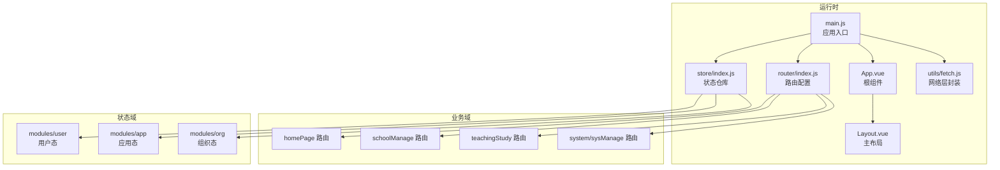
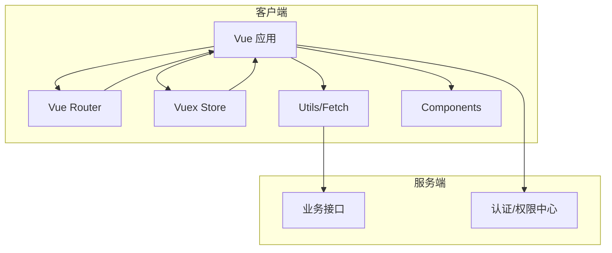
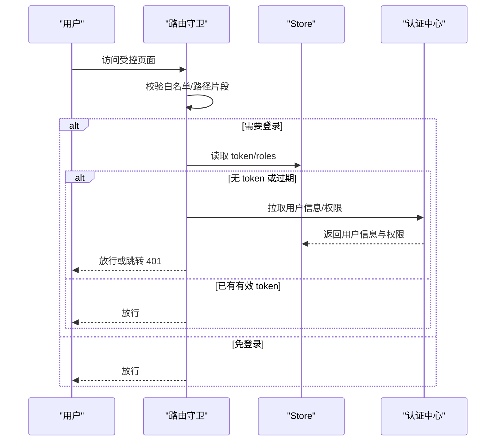
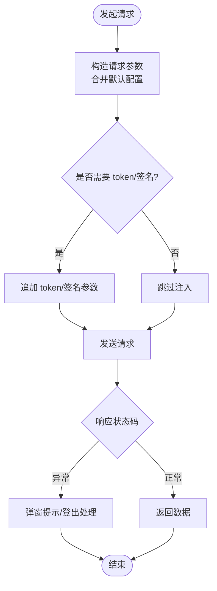
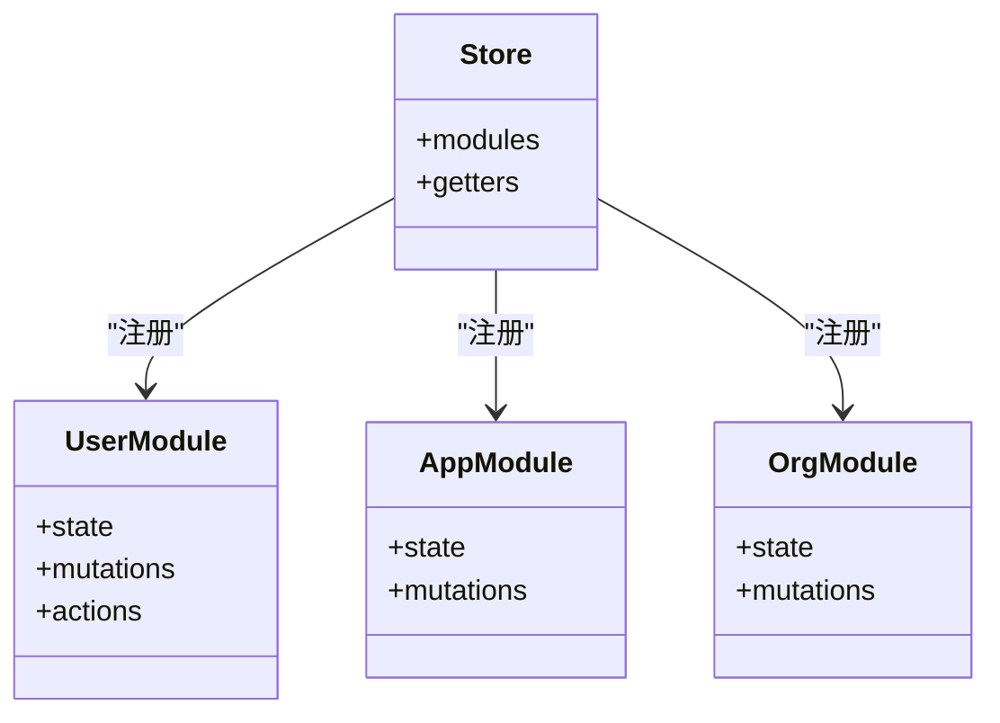
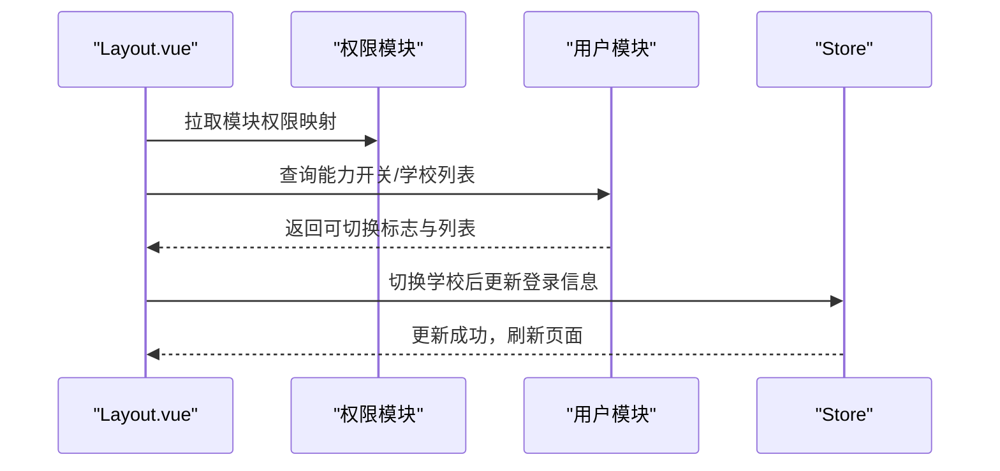
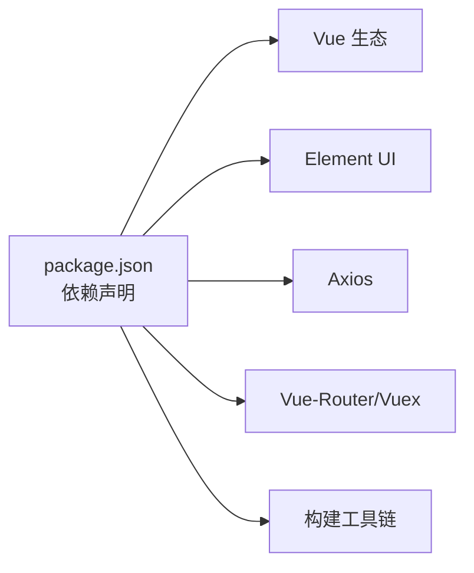
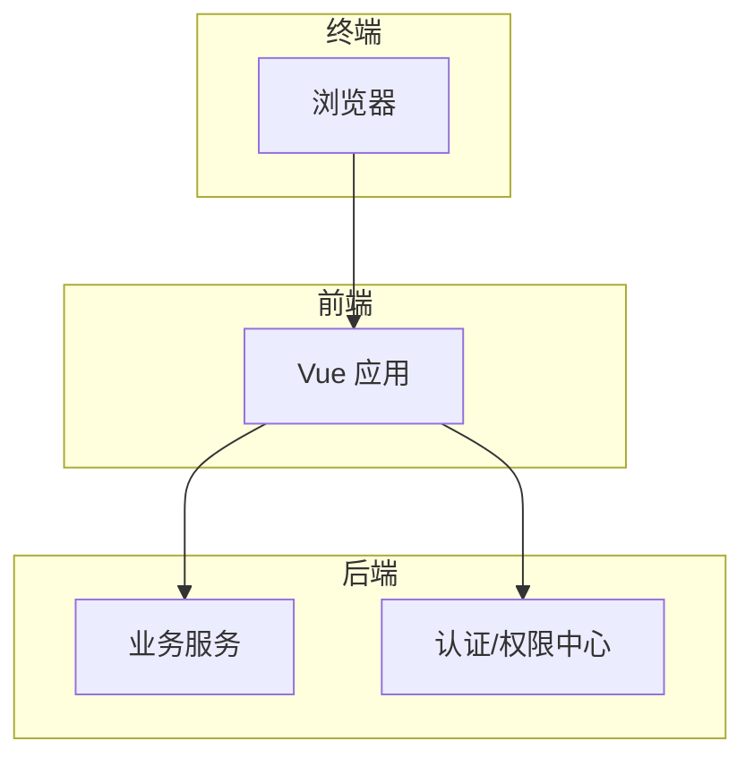

# 架构设计

<cite>
**本文引用的文件**   
- [package.json](file://package.json)
- [main.js](file://src/main.js)
- [App.vue](file://src/App.vue)
- [router/index.js](file://src/router/index.js)
- [router/moduleList.js](file://src/router/moduleList.js)
- [router/normal/homePage.js](file://src/router/normal/homePage.js)
- [router/normal/schoolManage.js](file://src/router/normal/schoolManage.js)
- [store/index.js](file://src/store/index.js)
- [store/modules/app.js](file://src/store/modules/app.js)
- [store/modules/user.js](file://src/store/modules/user.js)
- [store/modules/org.js](file://src/store/modules/org.js)
- [utils/fetch.js](file://src/utils/fetch.js)
- [views/layout/Layout.vue](file://src/views/layout/Layout.vue)
- [mixins/baseMixin.js](file://src/mixins/baseMixin.js)
- [components/Icon-svg/index.js](file://src/components/Icon-svg/index.js)
- [styles/index.scss](file://src/styles/index.scss)
- [config/index.js](file://config/index.js)
</cite>

## 目录
1. [引言](#引言)
2. [项目结构](#项目结构)
3. [核心组件](#核心组件)
4. [架构总览](#架构总览)
5. [详细组件分析](#详细组件分析)
6. [依赖分析](#依赖分析)
7. [性能考虑](#性能考虑)
8. [故障排查指南](#故障排查指南)
9. [结论](#结论)
10. [附录](#附录)

## 引言
本项目是一个基于 Vue.js 的校园管理系统前端工程，采用 Vue 2.x + Vue-Router + Vuex 的经典组合，围绕“模块化 + 组件化”的架构理念构建。系统通过统一的路由与权限体系、集中化的状态管理与网络层封装，实现多业务场景（家校互动、教学教务、校园办公、系统管理等）的解耦与复用，并通过 Element UI 与自定义主题样式保证一致的交互体验。

## 项目结构
项目采用“按功能域划分 + 模块化路由”的组织方式，核心目录与职责如下：
- src/api：按业务域拆分的接口层，统一由网络层封装进行请求与鉴权
- src/views：页面视图，按模块组织，配合布局组件实现统一入口
- src/router：路由定义，分为常量路由与动态模块路由，支持权限控制
- src/store：状态管理，按领域拆分模块（app/user/org），集中管理用户态与应用态
- src/components：通用组件库，如图表、上传、富文本、流程图等
- src/utils：工具与网络层封装，统一处理鉴权、签名、错误与多域名请求
- src/styles：全局样式与主题，统一 UI 规范
- config：构建配置，区分开发与生产环境资源路径

**图表来源**
- [main.js:1-221](file://src/main.js#L1-L221)
- [App.vue:1-183](file://src/App.vue#L1-L183)
- [router/index.js:1-207](file://src/router/index.js#L1-L207)
- [store/index.js:1-20](file://src/store/index.js#L1-L20)
- [utils/fetch.js:1-240](file://src/utils/fetch.js#L1-L240)

**章节来源**
- [package.json:1-98](file://package.json#L1-L98)
- [config/index.js:1-72](file://config/index.js#L1-L72)

## 核心组件
- 应用入口与全局初始化：在入口文件中注册 Element UI、进度条、全局过滤器、打印插件、上传组件等；配置路由守卫与登录态校验、权限拦截与错误日志上报。
- 根组件与缓存策略：根组件对路由视图进行条件缓存，结合 keep-alive 实现页面级缓存，减少重复渲染与请求。
- 主布局与导航：主布局负责顶部导航、用户下拉、学校切换、权限控制与跳转；支持独立运行模式（standalone）与外部打开场景。
- 网络层封装：统一创建 Axios 实例，注入基础路径、token、签名参数；集中处理错误码与登出逻辑；提供多域名请求别名。
- 状态管理：用户态（登录信息、角色、权限、学校信息）、应用态（分页、页面参数）、组织态（组织架构过滤参数）三大模块协同，支撑权限与业务参数。

**章节来源**
- [main.js:1-221](file://src/main.js#L1-L221)
- [App.vue:1-183](file://src/App.vue#L1-L183)
- [views/layout/Layout.vue:1-507](file://src/views/layout/Layout.vue#L1-L507)
- [utils/fetch.js:1-240](file://src/utils/fetch.js#L1-L240)
- [store/modules/user.js:1-447](file://src/store/modules/user.js#L1-L447)
- [store/modules/app.js:1-54](file://src/store/modules/app.js#L1-L54)
- [store/modules/org.js:1-34](file://src/store/modules/org.js#L1-L34)

## 架构总览
系统采用“路由驱动 + 权限控制 + 状态管理 + 统一网络层”的架构模式，围绕以下设计原则：
- 模块化：按业务域拆分路由与视图，降低耦合，提升可维护性
- 组件化：通用组件沉淀于 components，统一交互与视觉规范
- 数据流：单向数据流，从路由守卫到 store，再到视图渲染
- 可扩展：多域名请求别名、多环境配置、多登录来源兼容

**图表来源**
- [router/index.js:1-207](file://src/router/index.js#L1-L207)
- [store/index.js:1-20](file://src/store/index.js#L1-L20)
- [utils/fetch.js:1-240](file://src/utils/fetch.js#L1-L240)

## 详细组件分析

### 路由与权限控制
- 常量路由：登录页、仪表盘、错误页、系统管理入口等
- 动态模块路由：homePage、homeSchool、teachingStudy、schoolManage、stuEvaluate、generalLogistics、sysManage 等
- 权限控制：通过路由元信息与 store 中的权限集合进行匹配，未授权跳转 401
- 白名单：免登录路由集合，支持扫码登录、外部直连等场景
- 登录态：支持多种登录来源（普通、系统、第三方），并兼容 standalone 模式

**图表来源**
- [main.js:73-198](file://src/main.js#L73-L198)
- [store/modules/user.js:218-237](file://src/store/modules/user.js#L218-L237)

**章节来源**
- [router/index.js:1-207](file://src/router/index.js#L1-L207)
- [main.js:58-198](file://src/main.js#L58-L198)
- [store/modules/user.js:120-324](file://src/store/modules/user.js#L120-L324)

### 网络层与鉴权
- Axios 实例：统一设置 baseURL、超时、参数序列化策略
- 自动注入：自动追加 token、签名参数（针对特定接口前缀）
- 错误处理：统一拦截错误码，对登录失效进行登出与跳转
- 多域名别名：提供多个 fetch 别名以适配不同业务域接口
- 归档查询：支持按学年筛选的归档请求

**图表来源**
- [utils/fetch.js:13-174](file://src/utils/fetch.js#L13-L174)
- [utils/fetch.js:104-169](file://src/utils/fetch.js#L104-L169)

**章节来源**
- [utils/fetch.js:1-240](file://src/utils/fetch.js#L1-L240)

### 状态管理与模块边界
- 用户模块：登录、获取用户信息、权限拉取、学校信息、角色与部门信息、地图密钥注入
- 应用模块：分页参数、页面搜索条件、PC 类型标记
- 组织模块：组织架构过滤参数、组织树结构
- Getter：对外暴露计算属性，供视图层消费

**图表来源**
- [store/index.js:1-20](file://src/store/index.js#L1-L20)
- [store/modules/user.js:1-447](file://src/store/modules/user.js#L1-L447)
- [store/modules/app.js:1-54](file://src/store/modules/app.js#L1-L54)
- [store/modules/org.js:1-34](file://src/store/modules/org.js#L1-L34)

**章节来源**
- [store/index.js:1-20](file://src/store/index.js#L1-L20)
- [store/modules/user.js:1-447](file://src/store/modules/user.js#L1-L447)
- [store/modules/app.js:1-54](file://src/store/modules/app.js#L1-L54)
- [store/modules/org.js:1-34](file://src/store/modules/org.js#L1-L34)

### 布局与导航
- 顶部导航：模块入口、外部链接、返回旧版、用户下拉
- 权限控制：根据模块权限映射决定菜单显示
- 学校切换：支持多学校切换登录，切换后刷新页面
- 独立运行：支持 standalone 模式下的登录与跳转

**图表来源**
- [views/layout/Layout.vue:94-261](file://src/views/layout/Layout.vue#L94-L261)
- [store/modules/user.js:239-285](file://src/store/modules/user.js#L239-L285)

**章节来源**
- [views/layout/Layout.vue:1-507](file://src/views/layout/Layout.vue#L1-L507)
- [store/modules/user.js:120-324](file://src/store/modules/user.js#L120-L324)

### 通用组件与混入
- 通用组件：图表、上传、富文本、流程图、图片裁剪、拖拽等
- 混入：统一分页、导出 Excel、日期工具、页面跳转、表格布局修复等

**章节来源**
- [components/Icon-svg/index.js:1-12](file://src/components/Icon-svg/index.js#L1-L12)
- [mixins/baseMixin.js:1-103](file://src/mixins/baseMixin.js#L1-L103)

## 依赖分析
- 运行时依赖：Vue 2.x、Vue-Router、Vuex、Element UI、Axios、Moment、Lodash、NProgress、Swiper、InteractJS、QrCode、ECharts 等
- 构建依赖：Webpack 3、Babel、Sass、PostCSS、UglifyJS 等
- 环境配置：开发与生产环境的静态资源路径、SourceMap、Gzip 等

**图表来源**
- [package.json:12-42](file://package.json#L12-L42)
- [package.json:44-86](file://package.json#L44-L86)

**章节来源**
- [package.json:1-98](file://package.json#L1-L98)
- [config/index.js:1-72](file://config/index.js#L1-L72)

## 性能考虑
- 路由缓存：通过 keep-alive 与路由 meta.isCached 控制页面缓存，减少重复渲染
- 网络层优化：统一参数序列化、按需注入 token/签名，避免冗余请求
- 组件懒加载：路由级异步加载视图，降低首屏体积
- 样式与资源：统一主题与样式，减少重复定义；按需引入第三方库
- 构建优化：SourceMap、Gzip、Bundle 分析，便于定位性能瓶颈

[本节为通用指导，无需具体文件引用]

## 故障排查指南
- 登录失效：网络层拦截到登录失效错误码时，自动执行登出并跳转登录页
- 权限不足：路由守卫检测到权限缺失时，跳转 401 页面
- 请求异常：统一弹窗提示错误信息，便于快速定位
- 独立运行：standalone 模式下登录来源与跳转逻辑需特别关注

**章节来源**
- [utils/fetch.js:104-169](file://src/utils/fetch.js#L104-L169)
- [main.js:131-139](file://src/main.js#L131-L139)

## 结论
本系统以 MVVM 为核心，结合模块化与组件化设计，形成清晰的路由、状态与网络三层架构。通过统一的权限控制与网络层封装，实现了多业务域的高内聚低耦合；通过布局与混入的抽象，提升了开发效率与一致性。建议在后续迭代中进一步完善模块间通信契约、增强单元测试覆盖，并持续优化首屏性能与跨端适配体验。

[本节为总结性内容，无需具体文件引用]

## 附录
- 系统上下文图（概念示意）

[本图为概念示意，无需图表来源]