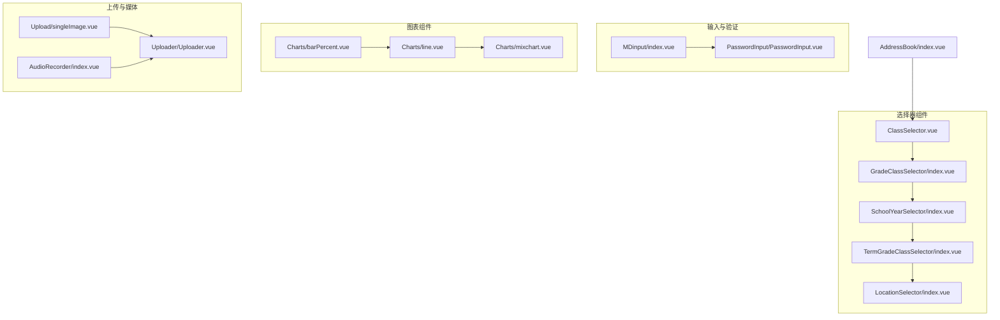
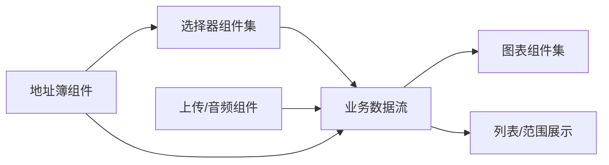
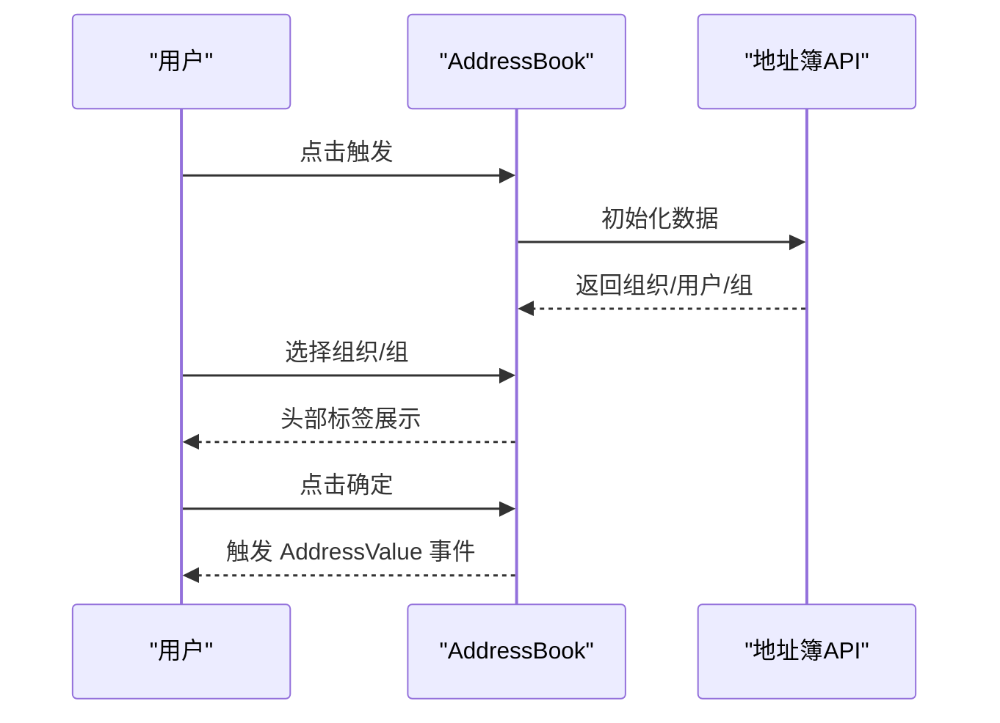
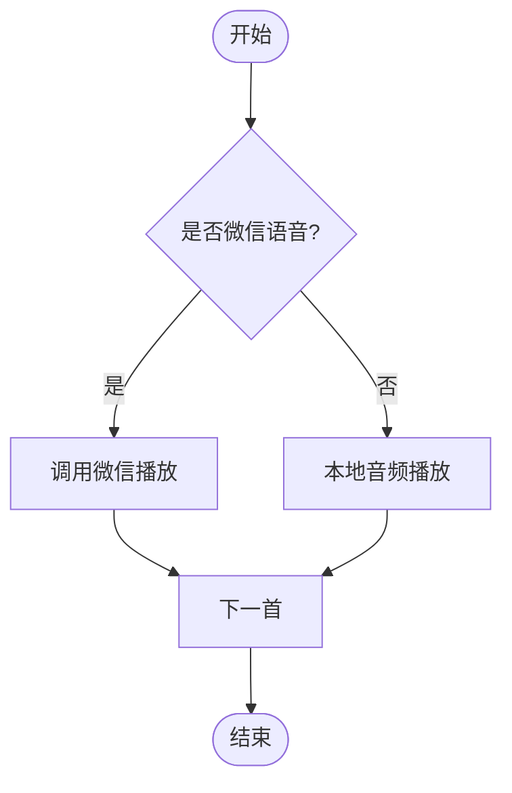
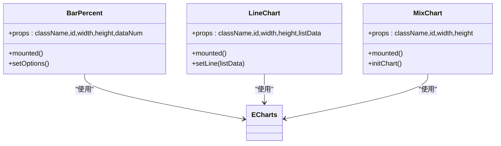
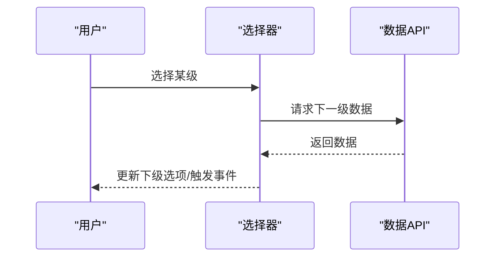
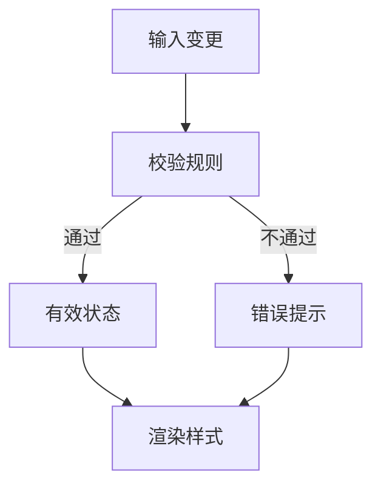
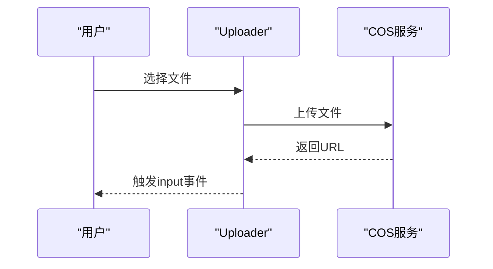
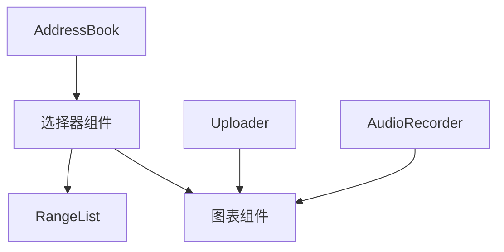

# UI组件

<cite>
**本文引用的文件**
- [src/components/AddressBook/index.vue](file://src/components/AddressBook/index.vue)
- [src/components/AudioRecorder/index.vue](file://src/components/AudioRecorder/index.vue)
- [src/components/Charts/barPercent.vue](file://src/components/Charts/barPercent.vue)
- [src/components/Charts/line.vue](file://src/components/Charts/line.vue)
- [src/components/Charts/mixchart.vue](file://src/components/Charts/mixchart.vue)
- [src/components/ClassSelector/ClassSelector.vue](file://src/components/ClassSelector/ClassSelector.vue)
- [src/components/GradeClassSelector/index.vue](file://src/components/GradeClassSelector/index.vue)
- [src/components/SchoolYearSelector/index.vue](file://src/components/SchoolYearSelector/index.vue)
- [src/components/TermGradeClassSelector/index.vue](file://src/components/TermGradeClassSelector/index.vue)
- [src/components/LocationSelector/index.vue](file://src/components/LocationSelector/index.vue)
- [src/components/RangeList/RangeList.vue](file://src/components/RangeList/RangeList.vue)
- [src/components/MDinput/index.vue](file://src/components/MDinput/index.vue)
- [src/components/PasswordInput/PasswordInput.vue](file://src/components/PasswordInput/PasswordInput.vue)
- [src/components/Upload/singleImage.vue](file://src/components/Upload/singleImage.vue)
- [src/components/Uploader/Uploader.vue](file://src/components/Uploader/Uploader.vue)
</cite>

## 目录
1. [简介](#简介)
2. [项目结构](#项目结构)
3. [核心组件](#核心组件)
4. [架构总览](#架构总览)
5. [详细组件分析](#详细组件分析)
6. [依赖关系分析](#依赖关系分析)
7. [性能考量](#性能考量)
8. [故障排查指南](#故障排查指南)
9. [结论](#结论)
10. [附录](#附录)

## 简介
本文件系统性梳理校园管理系统中的UI组件，围绕地址簿、音频录制、图表、选择器、输入与上传等模块，提供设计理念、分类体系、属性与事件、插槽与样式定制、使用示例与最佳实践、生命周期与性能优化策略等。旨在帮助开发者快速理解与高效复用这些组件。

## 项目结构
UI组件主要位于 src/components 下，按功能域分层组织，便于维护与扩展。下图展示与本文件相关的核心组件及其职责概览：

**图表来源**
- [src/components/ClassSelector/ClassSelector.vue](file://src/components/ClassSelector/ClassSelector.vue)
- [src/components/GradeClassSelector/index.vue](file://src/components/GradeClassSelector/index.vue)
- [src/components/SchoolYearSelector/index.vue](file://src/components/SchoolYearSelector/index.vue)
- [src/components/TermGradeClassSelector/index.vue](file://src/components/TermGradeClassSelector/index.vue)
- [src/components/LocationSelector/index.vue](file://src/components/LocationSelector/index.vue)
- [src/components/MDinput/index.vue](file://src/components/MDinput/index.vue)
- [src/components/PasswordInput/PasswordInput.vue](file://src/components/PasswordInput/PasswordInput.vue)
- [src/components/Charts/barPercent.vue](file://src/components/Charts/barPercent.vue)
- [src/components/Charts/line.vue](file://src/components/Charts/line.vue)
- [src/components/Charts/mixchart.vue](file://src/components/Charts/mixchart.vue)
- [src/components/Upload/singleImage.vue](file://src/components/Upload/singleImage.vue)
- [src/components/Uploader/Uploader.vue](file://src/components/Uploader/Uploader.vue)
- [src/components/AudioRecorder/index.vue](file://src/components/AudioRecorder/index.vue)
- [src/components/AddressBook/index.vue](file://src/components/AddressBook/index.vue)

**章节来源**
- [src/components/ClassSelector/ClassSelector.vue](file://src/components/ClassSelector/ClassSelector.vue)
- [src/components/GradeClassSelector/index.vue](file://src/components/GradeClassSelector/index.vue)
- [src/components/SchoolYearSelector/index.vue](file://src/components/SchoolYearSelector/index.vue)
- [src/components/TermGradeClassSelector/index.vue](file://src/components/TermGradeClassSelector/index.vue)
- [src/components/LocationSelector/index.vue](file://src/components/LocationSelector/index.vue)
- [src/components/MDinput/index.vue](file://src/components/MDinput/index.vue)
- [src/components/PasswordInput/PasswordInput.vue](file://src/components/PasswordInput/PasswordInput.vue)
- [src/components/Charts/barPercent.vue](file://src/components/Charts/barPercent.vue)
- [src/components/Charts/line.vue](file://src/components/Charts/line.vue)
- [src/components/Charts/mixchart.vue](file://src/components/Charts/mixchart.vue)
- [src/components/Upload/singleImage.vue](file://src/components/Upload/singleImage.vue)
- [src/components/Uploader/Uploader.vue](file://src/components/Uploader/Uploader.vue)
- [src/components/AudioRecorder/index.vue](file://src/components/AudioRecorder/index.vue)
- [src/components/AddressBook/index.vue](file://src/components/AddressBook/index.vue)

## 核心组件
- 地址簿组件：提供组织架构树与常用组的多选交互，支持面包屑导航、头部标签展示与确认回调。
- 音频录制组件：封装微信语音播放与本地音频播放，支持循环播放与状态切换。
- 图表组件：基于 ECharts 的柱状、折线与混合图表，支持动态数据更新与主题配置。
- 选择器组件：班级、年级/班级、学年、学期/学年/年级/班级、省市区联动等多类选择器，统一事件与数据流。
- 输入与验证：Material 风格输入框与密码强度校验组件，支持错误提示与等级指示。
- 上传与媒体：单图上传与通用文件上传，集成 COS 与预览能力。

**章节来源**
- [src/components/AddressBook/index.vue](file://src/components/AddressBook/index.vue)
- [src/components/AudioRecorder/index.vue](file://src/components/AudioRecorder/index.vue)
- [src/components/Charts/barPercent.vue](file://src/components/Charts/barPercent.vue)
- [src/components/Charts/line.vue](file://src/components/Charts/line.vue)
- [src/components/Charts/mixchart.vue](file://src/components/Charts/mixchart.vue)
- [src/components/ClassSelector/ClassSelector.vue](file://src/components/ClassSelector/ClassSelector.vue)
- [src/components/GradeClassSelector/index.vue](file://src/components/GradeClassSelector/index.vue)
- [src/components/SchoolYearSelector/index.vue](file://src/components/SchoolYearSelector/index.vue)
- [src/components/TermGradeClassSelector/index.vue](file://src/components/TermGradeClassSelector/index.vue)
- [src/components/LocationSelector/index.vue](file://src/components/LocationSelector/index.vue)
- [src/components/RangeList/RangeList.vue](file://src/components/RangeList/RangeList.vue)
- [src/components/MDinput/index.vue](file://src/components/MDinput/index.vue)
- [src/components/PasswordInput/PasswordInput.vue](file://src/components/PasswordInput/PasswordInput.vue)
- [src/components/Upload/singleImage.vue](file://src/components/Upload/singleImage.vue)
- [src/components/Uploader/Uploader.vue](file://src/components/Uploader/Uploader.vue)

## 架构总览
组件间通过 props 与事件实现解耦，选择器组件作为上游数据源，图表与列表组件作为下游消费方；上传组件与音频组件作为媒体输入输出节点，地址簿作为复杂选择入口。

**图表来源**
- [src/components/ClassSelector/ClassSelector.vue](file://src/components/ClassSelector/ClassSelector.vue)
- [src/components/GradeClassSelector/index.vue](file://src/components/GradeClassSelector/index.vue)
- [src/components/SchoolYearSelector/index.vue](file://src/components/SchoolYearSelector/index.vue)
- [src/components/TermGradeClassSelector/index.vue](file://src/components/TermGradeClassSelector/index.vue)
- [src/components/LocationSelector/index.vue](file://src/components/LocationSelector/index.vue)
- [src/components/Charts/barPercent.vue](file://src/components/Charts/barPercent.vue)
- [src/components/Charts/line.vue](file://src/components/Charts/line.vue)
- [src/components/Charts/mixchart.vue](file://src/components/Charts/mixchart.vue)
- [src/components/RangeList/RangeList.vue](file://src/components/RangeList/RangeList.vue)
- [src/components/Upload/singleImage.vue](file://src/components/Upload/singleImage.vue)
- [src/components/Uploader/Uploader.vue](file://src/components/Uploader/Uploader.vue)
- [src/components/AudioRecorder/index.vue](file://src/components/AudioRecorder/index.vue)
- [src/components/AddressBook/index.vue](file://src/components/AddressBook/index.vue)

## 详细组件分析

### 地址簿组件（AddressBook）
- 设计理念：以弹窗对话框承载组织树与常用组，支持面包屑导航与头部标签展示，简化复杂选择流程。
- 关键特性
  - 组织架构树与常用组双标签页切换
  - 面包屑导航定位当前层级
  - 头部标签可逐项删除
  - 确定后通过事件回传选中数据
- Props
  - default: 默认选中数据（JSON 字符串）
  - config: 配置对象（如是否显示组织/组）
  - isbutton: 是否以按钮形式触发
- 事件
  - AddressValue: 确定时回传选中参数
- 插槽
  - 默认插槽用于自定义按钮内容
- 样式定制
  - 支持 scoped 样式覆盖，如宽度、高度、滚动条等
- 使用示例
  - 在页面中引入组件，绑定 default 与 config，监听 AddressValue 事件获取结果
- 最佳实践
  - 合理设置 config 控制可见标签页
  - 使用默认插槽自定义按钮文案
  - 确保 default 数据格式与接口一致
- 生命周期与性能
  - created 中初始化数据，避免重复请求
  - 列表渲染采用虚拟滚动或分页（建议）

**图表来源**
- [src/components/AddressBook/index.vue](file://src/components/AddressBook/index.vue)

**章节来源**
- [src/components/AddressBook/index.vue](file://src/components/AddressBook/index.vue)

### 音频录制组件（AudioRecorder）
- 设计理念：统一微信语音与本地音频播放体验，支持循环播放与状态切换。
- 关键特性
  - 微信语音播放与停止
  - 本地音频播放与自动续播
  - 状态指示与播放索引管理
- Props
  - audios: 音频资源数组
  - onlyPlayAudio: 仅播放模式
- 事件
  - 无（内部状态驱动）
- 插槽
  - 无
- 样式定制
  - 支持 scoped 样式覆盖播放器外观
- 使用示例
  - 传入 audios 数组，调用 playVoice 切换播放状态
- 最佳实践
  - 在播放前检查资源可用性
  - 提供播放失败回退方案
- 生命周期与性能
  - mounted 时初始化播放器
  - 避免频繁创建/销毁实例

**图表来源**
- [src/components/AudioRecorder/index.vue](file://src/components/AudioRecorder/index.vue)

**章节来源**
- [src/components/AudioRecorder/index.vue](file://src/components/AudioRecorder/index.vue)

### 图表组件（Charts）
- 设计理念：基于 ECharts 的轻量封装，支持动态数据更新与主题配置。
- 组件族
  - barPercent: 百分比柱状图
  - line: 折线图（含标记点/线）
  - mixchart: 混合图表（柱/线/缩放）
- 共同特性
  - props: className/id/width/height/dataNum/listData
  - mounted 初始化并 setOption
  - watch 监听数据变化并重绘
- 使用示例
  - 传入 listData 或 dataNum，组件自动渲染
- 最佳实践
  - 合理设置宽高与网格
  - 使用 dataZoom 提升大数据可视体验
- 生命周期与性能
  - 避免频繁 setOption，建议合并更新
  - 大数据场景考虑分页或采样

**图表来源**
- [src/components/Charts/barPercent.vue](file://src/components/Charts/barPercent.vue)
- [src/components/Charts/line.vue](file://src/components/Charts/line.vue)
- [src/components/Charts/mixchart.vue](file://src/components/Charts/mixchart.vue)

**章节来源**
- [src/components/Charts/barPercent.vue](file://src/components/Charts/barPercent.vue)
- [src/components/Charts/line.vue](file://src/components/Charts/line.vue)
- [src/components/Charts/mixchart.vue](file://src/components/Charts/mixchart.vue)

### 选择器组件（ClassSelector / GradeClassSelector / SchoolYearSelector / TermGradeClassSelector / LocationSelector）
- 设计理念：统一权限判断与数据拉取，提供灵活的筛选与联动能力。
- ClassSelector
  - 功能：班级选择，支持“全部”选项与权限控制
  - Props: inline/isShowText/schoolManagerRoles/schoolManagerPermissions/isShowAll
  - 事件：change
- GradeClassSelector
  - 功能：年级/班级两级联动，支持学校/年级管理员角色
  - 事件：grade-change/class-change/change
- SchoolYearSelector
  - 功能：学年选择，与全局状态联动
  - 事件：change
- TermGradeClassSelector
  - 功能：学期/日期/年级/班级四维选择，支持日期范围限制
  - Props: value/queryArgs/isShowDuration/isGradeShowAll/isClassShow
  - 事件：input
- LocationSelector
  - 功能：省市区三级联动，支持“全部”与“请选择”
  - Props: value/hasProvinceAll/hasCityAll/hasDistAll/allCityValue/allProvinceValue/allDistValue/hasProvinceNone/noDist/showProvince/showCity
  - 事件：input/change
- 使用示例
  - 在页面中引入对应组件，绑定 value/props，监听 change/input 事件
- 最佳实践
  - 权限判断前置，减少无效请求
  - 使用 disabled 状态提升交互反馈
- 生命周期与性能
  - created 中拉取数据，mounted 后再渲染
  - 大数据量时启用分页或懒加载

**图表来源**
- [src/components/ClassSelector/ClassSelector.vue](file://src/components/ClassSelector/ClassSelector.vue)
- [src/components/GradeClassSelector/index.vue](file://src/components/GradeClassSelector/index.vue)
- [src/components/SchoolYearSelector/index.vue](file://src/components/SchoolYearSelector/index.vue)
- [src/components/TermGradeClassSelector/index.vue](file://src/components/TermGradeClassSelector/index.vue)
- [src/components/LocationSelector/index.vue](file://src/components/LocationSelector/index.vue)

**章节来源**
- [src/components/ClassSelector/ClassSelector.vue](file://src/components/ClassSelector/ClassSelector.vue)
- [src/components/GradeClassSelector/index.vue](file://src/components/GradeClassSelector/index.vue)
- [src/components/SchoolYearSelector/index.vue](file://src/components/SchoolYearSelector/index.vue)
- [src/components/TermGradeClassSelector/index.vue](file://src/components/TermGradeClassSelector/index.vue)
- [src/components/LocationSelector/index.vue](file://src/components/LocationSelector/index.vue)

### 输入与验证组件（MDinput / PasswordInput）
- 设计理念：Material 风格输入与密码强度校验，提供即时反馈与错误提示。
- MDinput
  - 功能：多类型输入框，支持占位动画、焦点状态、错误样式
  - Props: id/name/type/value/placeholder/readonly/disabled/min/max/minlength/maxlength/required/autocomplete/errorMessages
  - 事件：input
- PasswordInput
  - 功能：密码强度校验与等级指示，支持与旧密码对比
  - Props: value/oldPassword
  - 方法：validate()/inputHandler()
- 使用示例
  - 绑定 v-model，监听 input 事件，配合表单校验
- 最佳实践
  - 错误消息数组化，便于国际化
  - 密码强度规则可配置化
- 生命周期与性能
  - 基于原生 validity 校验，避免额外开销

**图表来源**
- [src/components/MDinput/index.vue](file://src/components/MDinput/index.vue)
- [src/components/PasswordInput/PasswordInput.vue](file://src/components/PasswordInput/PasswordInput.vue)

**章节来源**
- [src/components/MDinput/index.vue](file://src/components/MDinput/index.vue)
- [src/components/PasswordInput/PasswordInput.vue](file://src/components/PasswordInput/PasswordInput.vue)

### 上传与媒体组件（Upload / Uploader / AudioRecorder）
- 设计理念：统一上传流程与媒体播放体验，支持多种文件类型与预览。
- Upload/singleImage
  - 功能：拖拽上传单图，支持预览与删除
  - Props: value
  - 事件：input
- Uploader
  - 功能：通用文件上传，支持 COS、进度显示、图标映射
  - Props: value/multiple/lineList/showMode/mode/extList
  - 事件：input/delete
- 使用示例
  - 传入 value 数组，监听 input 事件更新父组件状态
- 最佳实践
  - 严格校验文件类型与大小
  - 提供上传失败重试机制
- 生命周期与性能
  - mounted 加载 SDK，避免阻塞主线程
  - 进度回调节流处理

**图表来源**
- [src/components/Upload/singleImage.vue](file://src/components/Upload/singleImage.vue)
- [src/components/Uploader/Uploader.vue](file://src/components/Uploader/Uploader.vue)
- [src/components/AudioRecorder/index.vue](file://src/components/AudioRecorder/index.vue)

**章节来源**
- [src/components/Upload/singleImage.vue](file://src/components/Upload/singleImage.vue)
- [src/components/Uploader/Uploader.vue](file://src/components/Uploader/Uploader.vue)
- [src/components/AudioRecorder/index.vue](file://src/components/AudioRecorder/index.vue)

### 范围展示组件（RangeList）
- 设计理念：以卡片形式展示选中范围（部门/组/用户），支持纯文本风格。
- Props
  - plain: 纯文本风格
  - departJson/groupJson/userJson: 三类数据数组
- 使用示例
  - 将地址簿或选择器的选中数据传入，即可渲染范围列表
- 最佳实践
  - 与地址簿组件配合使用，形成闭环
  - 支持横向滚动与换行

**章节来源**
- [src/components/RangeList/RangeList.vue](file://src/components/RangeList/RangeList.vue)

## 依赖关系分析
- 组件内聚：各组件职责单一，通过 props 与事件解耦
- 组件耦合：选择器组件为上游数据源，图表与列表为下游消费方
- 外部依赖：ECharts、Element UI、COS SDK、微信 JS-SDK（音频播放）
- 可能的循环依赖：未发现直接循环导入

**图表来源**
- [src/components/AddressBook/index.vue](file://src/components/AddressBook/index.vue)
- [src/components/ClassSelector/ClassSelector.vue](file://src/components/ClassSelector/ClassSelector.vue)
- [src/components/GradeClassSelector/index.vue](file://src/components/GradeClassSelector/index.vue)
- [src/components/Charts/barPercent.vue](file://src/components/Charts/barPercent.vue)
- [src/components/Charts/line.vue](file://src/components/Charts/line.vue)
- [src/components/Charts/mixchart.vue](file://src/components/Charts/mixchart.vue)
- [src/components/RangeList/RangeList.vue](file://src/components/RangeList/RangeList.vue)
- [src/components/Uploader/Uploader.vue](file://src/components/Uploader/Uploader.vue)
- [src/components/AudioRecorder/index.vue](file://src/components/AudioRecorder/index.vue)

**章节来源**
- [src/components/AddressBook/index.vue](file://src/components/AddressBook/index.vue)
- [src/components/ClassSelector/ClassSelector.vue](file://src/components/ClassSelector/ClassSelector.vue)
- [src/components/GradeClassSelector/index.vue](file://src/components/GradeClassSelector/index.vue)
- [src/components/Charts/barPercent.vue](file://src/components/Charts/barPercent.vue)
- [src/components/Charts/line.vue](file://src/components/Charts/line.vue)
- [src/components/Charts/mixchart.vue](file://src/components/Charts/mixchart.vue)
- [src/components/RangeList/RangeList.vue](file://src/components/RangeList/RangeList.vue)
- [src/components/Uploader/Uploader.vue](file://src/components/Uploader/Uploader.vue)
- [src/components/AudioRecorder/index.vue](file://src/components/AudioRecorder/index.vue)

## 性能考量
- 懒加载
  - 图表组件按需初始化，避免首屏阻塞
  - 上传组件在需要时才加载 COS SDK
- 虚拟滚动
  - 大列表场景建议采用虚拟滚动或分页
- 防抖/节流
  - 上传进度回调与搜索输入建议节流
  - 图表 resize 事件建议防抖
- 缓存与复用
  - 选择器数据缓存，避免重复请求
  - 地址簿面包屑导航状态持久化

[本节为通用指导，无需特定文件来源]

## 故障排查指南
- 图表不显示
  - 检查容器宽高是否正确设置
  - 确认 mounted 后 setOption 已执行
- 上传失败
  - 校验文件类型与大小
  - 检查 COS 凭据与跨域配置
- 音频无法播放
  - 确认资源 URL 可访问
  - 微信环境需在安全域名内
- 选择器无数据
  - 检查权限与角色配置
  - 确认 API 返回数据结构

**章节来源**
- [src/components/Charts/barPercent.vue](file://src/components/Charts/barPercent.vue)
- [src/components/Charts/line.vue](file://src/components/Charts/line.vue)
- [src/components/Charts/mixchart.vue](file://src/components/Charts/mixchart.vue)
- [src/components/Uploader/Uploader.vue](file://src/components/Uploader/Uploader.vue)
- [src/components/AudioRecorder/index.vue](file://src/components/AudioRecorder/index.vue)
- [src/components/ClassSelector/ClassSelector.vue](file://src/components/ClassSelector/ClassSelector.vue)
- [src/components/GradeClassSelector/index.vue](file://src/components/GradeClassSelector/index.vue)

## 结论
本文件对校园管理系统的UI组件进行了系统化梳理，明确了组件分类、职责边界与协作方式。通过统一的 props/事件模型与样式定制能力，组件具备良好的可复用性与可维护性。建议在实际项目中结合权限与数据流，遵循懒加载、虚拟滚动与防抖节流等性能策略，持续优化用户体验。

[本节为总结性内容，无需特定文件来源]

## 附录
- 组件命名规范：采用 PascalCase，功能域前缀区分
- 样式规范：优先使用 scoped 与 mixin，避免全局污染
- 文档规范：每个组件提供 props、事件、插槽、样式定制说明与使用示例

[本节为通用规范说明，无需特定文件来源]