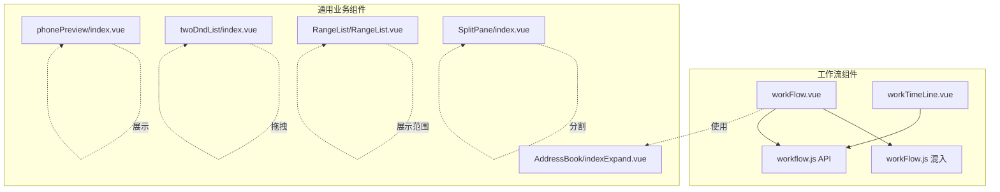
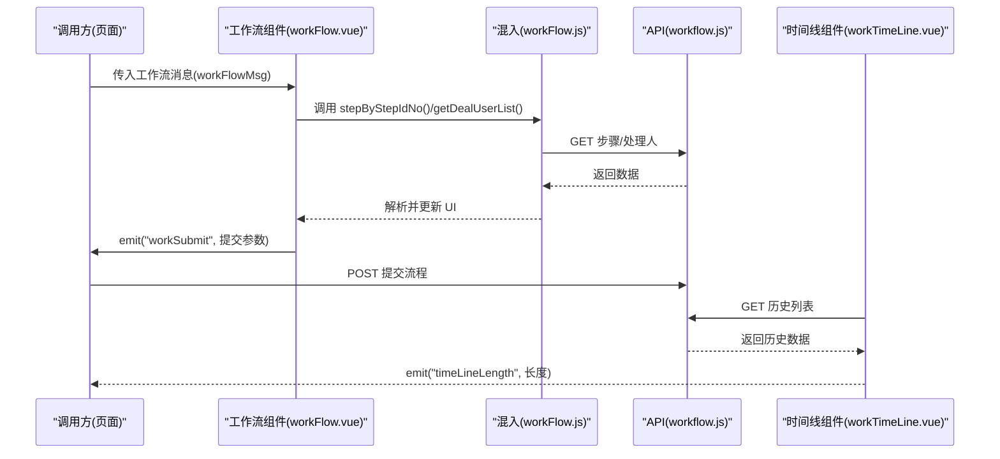
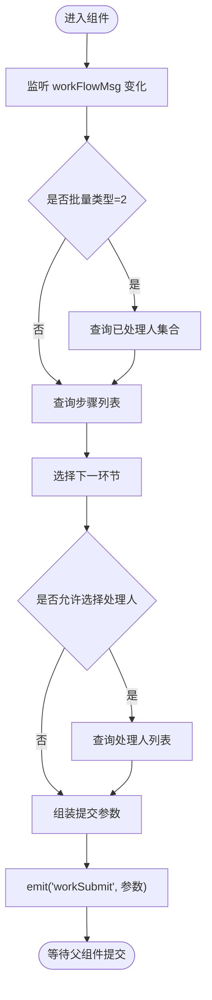
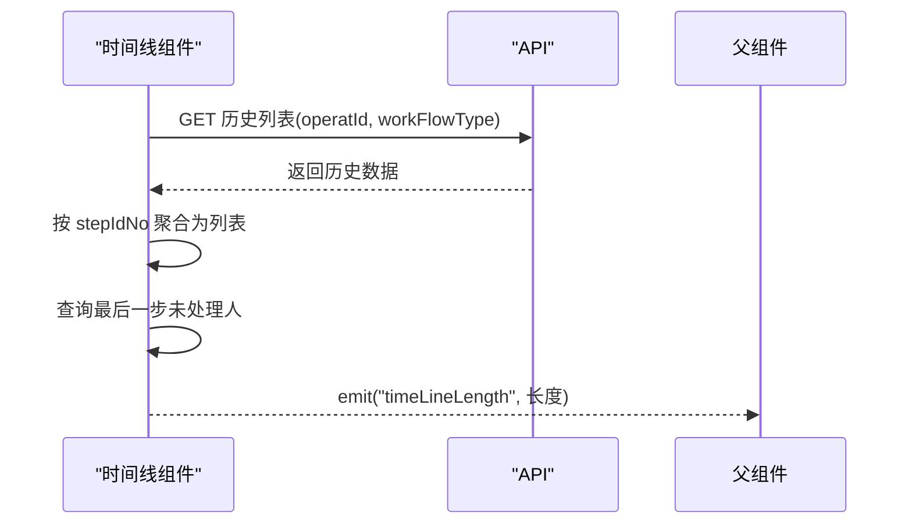
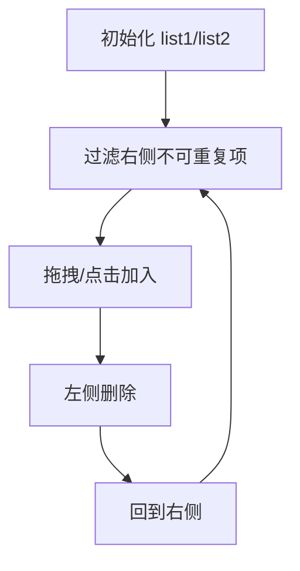
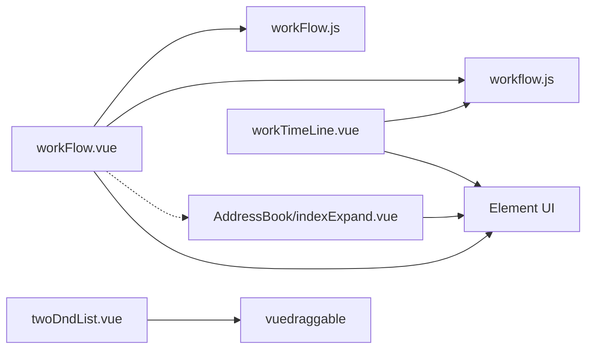

# 业务组件

<cite>
**本文引用的文件**   
- [src/components/workFlow/workFlow.vue](file://src/components/workFlow/workFlow.vue)
- [src/components/workFlow/workTimeLine.vue](file://src/components/workFlow/workTimeLine.vue)
- [src/mixins/workFlow.js](file://src/mixins/workFlow.js)
- [src/api/workflow.js](file://src/api/workflow.js)
- [src/components/phonePreview/index.vue](file://src/components/phonePreview/index.vue)
- [src/components/twoDndList/index.vue](file://src/components/twoDndList/index.vue)
- [src/components/AddressBook/indexExpand.vue](file://src/components/AddressBook/indexExpand.vue)
- [src/components/RangeList/RangeList.vue](file://src/components/RangeList/RangeList.vue)
- [src/components/SplitPane/index.vue](file://src/components/SplitPane/index.vue)
</cite>

## 目录
1. [引言](#引言)
2. [项目结构](#项目结构)
3. [核心组件](#核心组件)
4. [架构总览](#架构总览)
5. [详细组件分析](#详细组件分析)
6. [依赖分析](#依赖分析)
7. [性能考虑](#性能考虑)
8. [故障排查指南](#故障排查指南)
9. [结论](#结论)
10. [附录](#附录)

## 引言
本文件聚焦于校园管理系统中的“业务组件”，围绕以下目标展开：工作流组件、电话预览组件、拖拽列表组件等的设计模式与实现原理；业务组件与业务逻辑的结合方式（数据绑定、状态管理、事件驱动）；扩展接口与定制化方案（主题配置、行为调整、功能增强）；以及在不同业务场景下的应用模式（流程审批、数据展示、交互体验）的最佳实践。

## 项目结构
业务组件主要分布在 src/components 下，配合 src/mixins 与 src/api 实现跨页面复用与后端对接。工作流相关组件位于 workFlow 子目录，电话预览与拖拽列表分别位于 phonePreview 与 twoDndList 子目录；地址簿组件用于复杂人员/组织选择，常作为工作流下一环节处理人的选择器；RangeList 用于以卡片形式展示可读的范围集合；SplitPane 提供可拖拽分割面板能力。

图表来源
- [src/components/workFlow/workFlow.vue:1-294](file://src/components/workFlow/workFlow.vue#L1-L294)
- [src/components/workFlow/workTimeLine.vue:1-147](file://src/components/workFlow/workTimeLine.vue#L1-L147)
- [src/mixins/workFlow.js:1-103](file://src/mixins/workFlow.js#L1-L103)
- [src/api/workflow.js:1-150](file://src/api/workflow.js#L1-L150)
- [src/components/phonePreview/index.vue:1-158](file://src/components/phonePreview/index.vue#L1-L158)
- [src/components/twoDndList/index.vue:1-157](file://src/components/twoDndList/index.vue#L1-L157)
- [src/components/AddressBook/indexExpand.vue:1-779](file://src/components/AddressBook/indexExpand.vue#L1-L779)
- [src/components/RangeList/RangeList.vue:1-106](file://src/components/RangeList/RangeList.vue#L1-L106)
- [src/components/SplitPane/index.vue:1-112](file://src/components/SplitPane/index.vue#L1-L112)

章节来源
- [src/components/workFlow/workFlow.vue:1-294](file://src/components/workFlow/workFlow.vue#L1-L294)
- [src/components/workFlow/workTimeLine.vue:1-147](file://src/components/workFlow/workTimeLine.vue#L1-L147)
- [src/mixins/workFlow.js:1-103](file://src/mixins/workFlow.js#L1-L103)
- [src/api/workflow.js:1-150](file://src/api/workflow.js#L1-L150)
- [src/components/phonePreview/index.vue:1-158](file://src/components/phonePreview/index.vue#L1-L158)
- [src/components/twoDndList/index.vue:1-157](file://src/components/twoDndList/index.vue#L1-L157)
- [src/components/AddressBook/indexExpand.vue:1-779](file://src/components/AddressBook/indexExpand.vue#L1-L779)
- [src/components/RangeList/RangeList.vue:1-106](file://src/components/RangeList/RangeList.vue#L1-L106)
- [src/components/SplitPane/index.vue:1-112](file://src/components/SplitPane/index.vue#L1-L112)

## 核心组件
- 工作流组件（workFlow.vue）
  - 功能：根据当前步骤动态呈现“处理意见”“下一环节”“下一环节处理人”等控件，支持单选/多选处理人，并通过混入封装的 API 完成查询与提交。
  - 关键点：watch 监听工作流消息变化，自动触发步骤查询与处理人查询；通过 emit 向父组件传递组装好的提交参数。
- 时间线组件（workTimeLine.vue）
  - 功能：按时间轴展示流程历史，合并同一步骤的多次处理记录，并在流程结束时追加“结束”节点；展示未处理人。
  - 关键点：调用历史查询 API，对数据进行分组聚合，最后通过事件向父组件反馈时间轴长度。
- 电话预览组件（phonePreview/index.vue）
  - 功能：在 PC 端内嵌手机端预览容器，渲染传入的 HTML 内容并带标题，便于移动端内容预览与校验。
  - 关键点：props 接收 title 与 phoneContent，内部以 v-html 渲染，样式限定固定尺寸。
- 拖拽列表组件（twoDndList/index.vue）
  - 功能：双列表拖拽，左侧已选，右侧待选；支持从右侧点击加入左侧，或在左侧删除回到右侧；计算过滤右侧不可重复项。
  - 关键点：基于 vuedraggable 的 group 配置实现跨列表拖拽；提供宽度与标题等可配置项。
- 地址簿组件（AddressBook/indexExpand.vue）
  - 功能：组织架构树、常用组、搜索三合一的人员/组织选择器，支持全选、反选、分组加载、多类型数据展示与提交。
  - 关键点：通过 init/queryByDepartId/queryByGroupId 等 API 加载数据，内部维护已选集合并通过事件输出。
- 范围列表组件（RangeList/RangeList.vue）
  - 功能：以卡片形式展示部门/群组/用户集合，支持简洁/plain 模式。
  - 关键点：接收 departJson/groupJson/userJson 三个数组，循环渲染。
- 分割面板组件（SplitPane/index.vue）
  - 功能：支持水平/垂直分割，拖拽调整比例，点击重置为默认比例。
  - 关键点：通过鼠标事件计算百分比，限制最小边距，发射 resize 事件。

章节来源
- [src/components/workFlow/workFlow.vue:34-281](file://src/components/workFlow/workFlow.vue#L34-L281)
- [src/components/workFlow/workTimeLine.vue:28-115](file://src/components/workFlow/workTimeLine.vue#L28-L115)
- [src/components/phonePreview/index.vue:21-39](file://src/components/phonePreview/index.vue#L21-L39)
- [src/components/twoDndList/index.vue:28-96](file://src/components/twoDndList/index.vue#L28-L96)
- [src/components/AddressBook/indexExpand.vue:127-559](file://src/components/AddressBook/indexExpand.vue#L127-L559)
- [src/components/RangeList/RangeList.vue:31-58](file://src/components/RangeList/RangeList.vue#L31-L58)
- [src/components/SplitPane/index.vue:30-111](file://src/components/SplitPane/index.vue#L30-L111)

## 架构总览
工作流组件通过混入统一调用 API，实现“查询步骤—查询处理人—组装提交参数—提交”的闭环；时间线组件独立负责历史展示；电话预览与拖拽列表作为通用 UI 组件被业务页面复用；地址簿组件作为复杂选择器与工作流联动；范围列表与分割面板用于信息展示与布局优化。

图表来源
- [src/components/workFlow/workFlow.vue:138-279](file://src/components/workFlow/workFlow.vue#L138-L279)
- [src/mixins/workFlow.js:8-101](file://src/mixins/workFlow.js#L8-L101)
- [src/api/workflow.js:106-149](file://src/api/workflow.js#L106-L149)
- [src/components/workFlow/workTimeLine.vue:62-114](file://src/components/workFlow/workTimeLine.vue#L62-L114)

## 详细组件分析

### 工作流组件（workFlow.vue）
- 设计模式
  - 混入模式：将工作流通用 API 封装到混入中，降低组件重复代码，提升复用性。
  - 观察者模式：通过 watch 监听外部传入的工作流消息，自动刷新步骤与处理人。
  - 事件驱动：通过 emit 向父组件传递组装后的提交参数，解耦 UI 与业务。
- 数据绑定与状态管理
  - props 接收工作流类型、操作 ID、流程状态、流程信息与消息；data 维护处理人勾选、下一步骤列表、是否末级处理等状态。
  - 计算与联动：radio 选择下一环节后，动态决定是否允许选择处理人、是否为结束环节，并查询处理人列表。
- 事件与提交
  - 输入处理意见、勾选处理人、选择地址簿成员时，均会触发 toSubmitWorkFlow 并 emit 到父组件。
  - 提交参数包含：批处理内容、批次类型、操作 ID、步骤信息、目标步骤与处理人集合、是否结束等。
- 可扩展点
  - 支持“批量内容”“下一环节”“下一环节处理人（单选/多选/地址簿）”三种模式切换。
  - 可通过 props 扩展更多工作流类型与状态字段，或在混入中增加更多 API 方法。

图表来源
- [src/components/workFlow/workFlow.vue:92-279](file://src/components/workFlow/workFlow.vue#L92-L279)
- [src/mixins/workFlow.js:54-86](file://src/mixins/workFlow.js#L54-L86)

章节来源
- [src/components/workFlow/workFlow.vue:34-281](file://src/components/workFlow/workFlow.vue#L34-L281)
- [src/mixins/workFlow.js:8-101](file://src/mixins/workFlow.js#L8-L101)
- [src/api/workflow.js:66-149](file://src/api/workflow.js#L66-L149)

### 时间线组件（workTimeLine.vue）
- 设计模式
  - 单一职责：仅负责历史展示与未处理人提示，不参与业务提交。
  - 过滤器：对时间戳做格式化处理，保证展示一致性。
- 数据处理
  - 对历史数据按 stepIdNo 聚合，相同步骤的多次处理记录放入 sameStepList。
  - 若最后一步未结束，额外插入一个占位时间轴项以指示后续流向。
- 事件与集成
  - 在获取历史后，向父组件发出时间轴长度事件，便于父组件控制其他 UI 行为。

图表来源
- [src/components/workFlow/workTimeLine.vue:62-114](file://src/components/workFlow/workTimeLine.vue#L62-L114)
- [src/api/workflow.js:20-30](file://src/api/workflow.js#L20-L30)

章节来源
- [src/components/workFlow/workTimeLine.vue:28-115](file://src/components/workFlow/workTimeLine.vue#L28-L115)
- [src/api/workflow.js:20-30](file://src/api/workflow.js#L20-L30)

### 电话预览组件（phonePreview/index.vue）
- 设计模式
  - 纯展示组件：通过 props 接收标题与 HTML 内容，内部以 v-html 渲染，样式固定尺寸，便于在 PC 端预览移动端效果。
- 应用场景
  - 新闻发布、公告发布等需要预览移动端展示效果的页面。
- 定制化
  - 可通过传入不同的 title 与 phoneContent 实现不同内容的预览。
  - 样式层可通过覆盖类名实现主题适配。

章节来源
- [src/components/phonePreview/index.vue:21-39](file://src/components/phonePreview/index.vue#L21-L39)

### 拖拽列表组件（twoDndList/index.vue）
- 设计模式
  - 双列表模式：左侧已选，右侧待选；通过 vuedraggable 实现跨列表拖拽。
  - 过滤策略：右侧列表过滤掉已在左侧存在的条目，避免重复。
- 交互细节
  - 支持点击右侧条目加入左侧；支持在左侧删除条目并回到右侧。
  - 提供宽度与标题等 props，便于在不同页面灵活布局。

图表来源
- [src/components/twoDndList/index.vue:33-96](file://src/components/twoDndList/index.vue#L33-L96)

章节来源
- [src/components/twoDndList/index.vue:28-96](file://src/components/twoDndList/index.vue#L28-L96)

### 地址簿组件（AddressBook/indexExpand.vue）
- 设计模式
  - 复合选择器：组织架构树、常用组、搜索三合一；支持全选/反选、分组加载、多类型数据展示。
  - 事件输出：通过 input/confirm 事件输出最终选择结果。
- 业务结合
  - 与工作流组件配合，作为“下一环节处理人”的选择器，支持单选/多选与分组选择。
- 可扩展点
  - 通过 config 控制目标类型（用户/部门/群组）、可见标签页、忽略年级/部门等策略。

章节来源
- [src/components/AddressBook/indexExpand.vue:127-559](file://src/components/AddressBook/indexExpand.vue#L127-L559)

### 范围列表组件（RangeList/RangeList.vue）
- 设计模式
  - 卡片化展示：以小图标+名称的方式展示部门/群组/用户集合。
  - 简洁模式：plain 模式下去除背景与内边距，适合内联展示。
- 业务结合
  - 常用于审批/发布页面的“可见范围”“抄送范围”等场景。

章节来源
- [src/components/RangeList/RangeList.vue:31-58](file://src/components/RangeList/RangeList.vue#L31-L58)

### 分割面板组件（SplitPane/index.vue）
- 设计模式
  - 可拖拽分割：支持水平/垂直分割，拖动中间条调节左右/上下区域占比。
  - 点击重置：点击分割条可恢复默认比例。
- 业务结合
  - 适用于详情页/编辑页的左右布局，如“表单 + 预览/历史”。

章节来源
- [src/components/SplitPane/index.vue:30-111](file://src/components/SplitPane/index.vue#L30-L111)

## 依赖分析
- 组件间依赖
  - workFlow.vue 依赖 AddressBook 作为处理人选择器；依赖混入 workFlow.js；依赖 workflow.js API。
  - workTimeLine.vue 依赖 workflow.js API。
  - 其他组件相对独立，可直接被页面引入使用。
- 外部依赖
  - vuedraggable：用于两列表拖拽。
  - Element UI：时间轴、单选/多选、对话框、面包屑等 UI 组件。
  - jQuery/Cookies：地址簿组件中用于对话框拖拽与 Cookie 读取。

图表来源
- [src/components/workFlow/workFlow.vue:35-91](file://src/components/workFlow/workFlow.vue#L35-L91)
- [src/mixins/workFlow.js:1](file://src/mixins/workFlow.js#L1)
- [src/api/workflow.js:1](file://src/api/workflow.js#L1)
- [src/components/twoDndList/index.vue:29](file://src/components/twoDndList/index.vue#L29)
- [src/components/AddressBook/indexExpand.vue:127-129](file://src/components/AddressBook/indexExpand.vue#L127-L129)

章节来源
- [src/components/workFlow/workFlow.vue:35-91](file://src/components/workFlow/workFlow.vue#L35-L91)
- [src/components/twoDndList/index.vue:29](file://src/components/twoDndList/index.vue#L29)
- [src/components/AddressBook/indexExpand.vue:127-129](file://src/components/AddressBook/indexExpand.vue#L127-L129)

## 性能考虑
- API 调用节流
  - 地址簿搜索采用防抖（debounce），减少频繁请求。
- 列表渲染优化
  - 使用 v-for 渲染列表，建议为每个元素提供稳定 key，避免不必要的重排。
- DOM 操作
  - 地址簿对话框拖拽使用原生事件，注意在组件销毁时解除事件绑定，防止内存泄漏。
- 图片与内容
  - phonePreview 组件使用 v-html 渲染，需确保输入内容安全，避免 XSS；图片资源建议使用 CDN 或本地静态资源。

## 故障排查指南
- 工作流无法提交
  - 检查 workSubmit 事件是否正确 emit，确认提交参数中 toStepUserIds/selectMemberList 是否为空。
  - 确认 isLastDeal 与 stepDealSelected 的状态是否符合预期。
- 处理人列表为空
  - 检查 getDealUserList 的参数（stepIdNo、workFlowId、batchTypeEnd）是否正确。
- 时间线未显示
  - 确认 operatId 与 workFlowType 是否传入；检查历史接口返回码与数据结构。
- 地址簿无法加载
  - 检查 init/queryByDepartId/queryByGroupId 的返回数据结构；确认 token 是否有效。
- 拖拽无效
  - 确认 vuedraggable 的 group 配置一致；检查列表项是否提供唯一标识。

章节来源
- [src/components/workFlow/workFlow.vue:226-279](file://src/components/workFlow/workFlow.vue#L226-L279)
- [src/components/workFlow/workTimeLine.vue:62-114](file://src/components/workFlow/workTimeLine.vue#L62-L114)
- [src/mixins/workFlow.js:42-86](file://src/mixins/workFlow.js#L42-L86)
- [src/components/AddressBook/indexExpand.vue:237-559](file://src/components/AddressBook/indexExpand.vue#L237-L559)

## 结论
上述业务组件以“混入 + API + 组件”的分层设计实现了高内聚低耦合：工作流组件通过混入统一封装流程 API，时间线组件专注历史展示，电话预览与拖拽列表提供通用交互能力，地址簿组件承担复杂选择场景。通过 props/事件/混入等方式，组件与业务逻辑紧密结合，具备良好的扩展性与可定制性。在实际业务中，建议遵循“单一职责、事件驱动、参数化配置”的原则进行二次开发与集成。

## 附录
- 最佳实践清单
  - 工作流：在父组件中集中处理提交成功/失败回调，统一提示与跳转。
  - 时间线：在父组件中根据时间轴长度控制按钮可用状态与下一步流程。
  - 电话预览：在内容变更时及时更新 phoneContent，避免 v-html 导致的安全问题。
  - 拖拽列表：为列表项提供稳定 key，避免重复渲染；在业务提交前校验必选项。
  - 地址簿：通过 config 精细控制可选范围与显示策略；在确定时统一输出 JSON。
  - 范围列表：在 plain 模式下注意行内元素的对齐与间距。
  - 分割面板：在窗口大小变化时监听 resize 事件，必要时重置比例。