# 可复用组件

<cite>
**本文引用的文件**
- [main.js](file://src/main.js)
- [baseMixin.js](file://src/mixins/baseMixin.js)
- [windowResize.js](file://src/mixins/windowResize.js)
- [windowResizeForBoe.js](file://src/mixins/windowResizeForBoe.js)
- [workFlow.js](file://src/mixins/workFlow.js)
- [sticky.js](file://src/directive/sticky.js)
- [waves.js](file://src/directive/waves.js)
- [waves.css](file://src/directive/waves.css)
- [index.js](file://src/filters/index.js)
- [index.vue](file://src/components/Sticky/index.vue)
- [index.vue](file://src/components/MDinput/index.vue)
- [barPercent.vue](file://src/components/Charts/barPercent.vue)
- [singleImage.vue](file://src/components/Upload/singleImage.vue)
</cite>

## 目录
1. [引言](#引言)
2. [项目结构](#项目结构)
3. [核心组件](#核心组件)
4. [架构总览](#架构总览)
5. [详细组件分析](#详细组件分析)
6. [依赖关系分析](#依赖关系分析)
7. [性能考量](#性能考量)
8. [故障排查指南](#故障排查指南)
9. [结论](#结论)
10. [附录](#附录)

## 引言
本文件面向校园管理系统中的可复用组件库，系统化梳理组件设计理念与分类体系，明确UI组件、业务组件、功能组件的划分边界；阐释单一职责原则、props设计规范、事件传递机制、插槽使用模式；总结混入(mixins)的设计思路与通用能力抽象；解析自定义指令的设计模式与实现要点；并给出组件开发的最佳实践建议，帮助团队在复杂业务场景中高效、一致地构建高质量前端界面。

## 项目结构
组件库围绕“全局注册 + 分类组织”的方式构建：
- 全局注册：在应用入口集中注册全局组件、指令、过滤器与混入，确保各页面按需使用。
- 组件分类：以功能域划分目录，如图表、上传、输入、布局等，便于维护与复用。
- 指令与混入：通过独立文件提供横切关注点，降低重复代码，提升可测试性与可维护性。
- 过滤器：统一时间、数字、文本等格式化逻辑，减少模板与业务层重复处理。

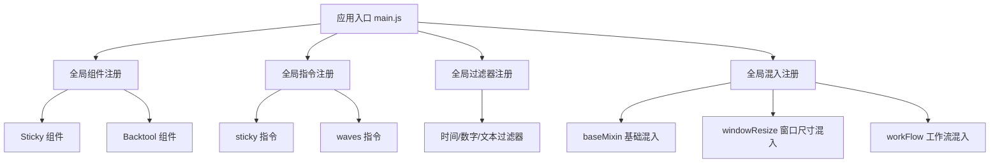

**图示来源**
- [main.js:1-221](file://src/main.js#L1-L221)

**章节来源**
- [main.js:1-221](file://src/main.js#L1-L221)

## 核心组件
本节从“单一职责”“props设计”“事件与插槽”“混入与指令配合”四个维度，对代表性组件进行剖析。

- Sticky 粘性容器
  - 单一职责：提供粘性定位的容器包装，支持top、zIndex、className等配置。
  - Props 设计：stickyTop(Number，默认0)、zIndex(Number，默认1)、className(String)。
  - 事件与插槽：内部通过滚动事件控制定位状态，对外不暴露额外事件；通过默认插槽承载内容。
  - 与指令对比：组件版更易封装与复用，指令版更轻量且可直接作用于任意元素。

- Material Input 材料风格输入框
  - 单一职责：统一输入框的视觉与交互行为，包含焦点、占位、禁用、错误态与v-model同步。
  - Props 设计：类型、值、占位、只读/禁用、最大最小长度、必填、自动完成、错误消息数组/字符串等。
  - 事件与插槽：通过input事件向外抛出值变更；label作为插槽承载标签文本。
  - 校验与状态：基于原生validity进行有效性校验，计算类名驱动样式切换。

- 图表组件 Bar Percent
  - 单一职责：渲染一个进度对比的双色柱状图，支持数据动态更新。
  - Props 设计：容器类名、DOM ID、宽高、展示数值等。
  - 数据绑定：通过watch监听数据变化，重新setOption刷新图表。

- 上传组件 Single Image
  - 单一职责：单图上传与预览，集成令牌生成与图片缩略预览。
  - Props 设计：value(String)，用于双向绑定。
  - 事件与插槽：通过input事件向外抛出选中值；内部通过Element UI的Upload组件实现上传交互。

**章节来源**
- [index.vue:1-74](file://src/components/Sticky/index.vue#L1-L74)
- [index.vue:1-298](file://src/components/MDinput/index.vue#L1-L298)
- [barPercent.vue:1-105](file://src/components/Charts/barPercent.vue#L1-L105)
- [singleImage.vue:1-128](file://src/components/Upload/singleImage.vue#L1-L128)

## 架构总览
组件库整体采用“入口集中注册 + 指令/混入横切 + 组件分层”的架构：
- 入口注册：全局组件、指令、过滤器、打印、HTTP资源等在入口统一安装。
- 指令层：sticky提供粘性定位能力，waves提供点击波纹动效。
- 混入层：baseMixin提供分页、路由跳转、权限判断、导出、日期工具等；windowResize系列提供窗口尺寸监听与高度计算；workFlow提供工作流API封装。
- 组件层：按功能域拆分，覆盖UI、业务、功能三大类。

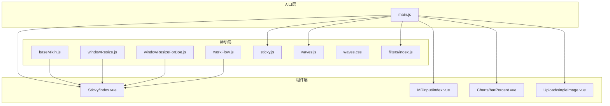

**图示来源**
- [main.js:1-221](file://src/main.js#L1-L221)
- [baseMixin.js:1-103](file://src/mixins/baseMixin.js#L1-L103)
- [windowResize.js:1-63](file://src/mixins/windowResize.js#L1-L63)
- [windowResizeForBoe.js:1-34](file://src/mixins/windowResizeForBoe.js#L1-L34)
- [workFlow.js:1-103](file://src/mixins/workFlow.js#L1-L103)
- [sticky.js:1-100](file://src/directive/sticky.js#L1-L100)
- [waves.js:1-55](file://src/directive/waves.js#L1-L55)
- [waves.css:1-26](file://src/directive/waves.css#L1-L26)
- [index.js:1-121](file://src/filters/index.js#L1-L121)
- [index.vue:1-74](file://src/components/Sticky/index.vue#L1-L74)
- [index.vue:1-298](file://src/components/MDinput/index.vue#L1-L298)
- [barPercent.vue:1-105](file://src/components/Charts/barPercent.vue#L1-L105)
- [singleImage.vue:1-128](file://src/components/Upload/singleImage.vue#L1-L128)

## 详细组件分析

### 组件：Sticky 粘性容器
- 设计理念：提供统一的粘性布局容器，避免重复实现滚动监听与定位切换逻辑。
- 关键点：
  - Props：stickyTop、zIndex、className，满足不同场景的定位与层级需求。
  - 生命周期：mounted时缓存容器尺寸，监听scroll事件动态切换fixed与普通定位。
  - 与指令对比：组件版具备更强的封装性与可测试性，适合复杂布局；指令版更轻量，适合简单元素。

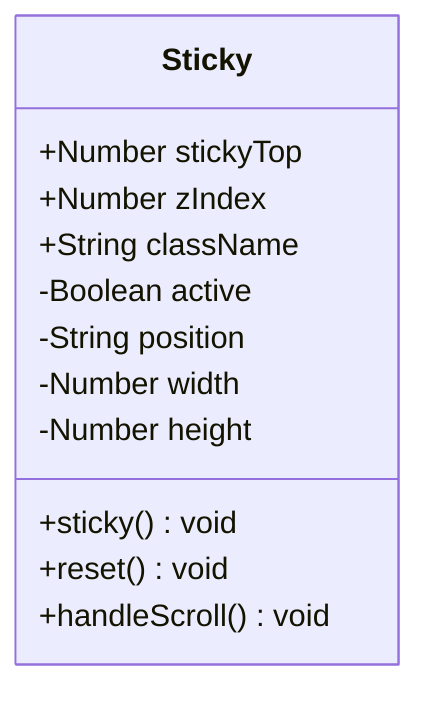

**图示来源**
- [index.vue:1-74](file://src/components/Sticky/index.vue#L1-L74)

**章节来源**
- [index.vue:1-74](file://src/components/Sticky/index.vue#L1-L74)

### 组件：Material Input 材料风格输入框
- 设计理念：以最小的props与事件暴露，最大化复用性；通过计算类名驱动视觉状态。
- 关键点：
  - Props：类型、值、占位、只读/禁用、最大最小长度、必填、自动完成、错误消息等。
  - 事件：input事件向外抛出值与事件对象；focus/blur控制激活态。
  - 校验：基于原生validity进行有效性校验，错误态通过类名切换。
  - 插槽：label插槽承载标签文本，增强可读性与可定制性。

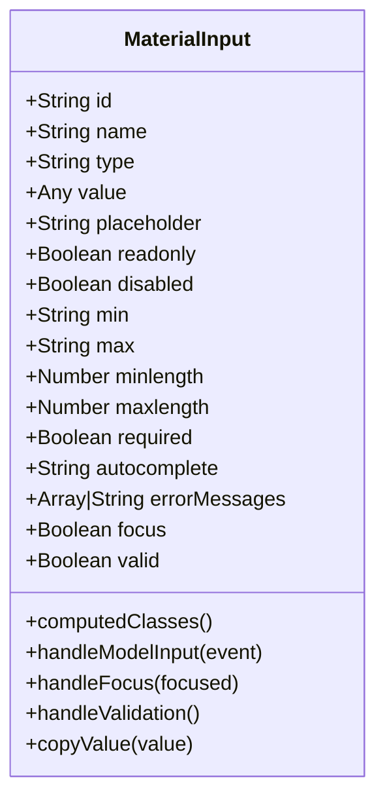

**图示来源**
- [index.vue:1-298](file://src/components/MDinput/index.vue#L1-L298)

**章节来源**
- [index.vue:1-298](file://src/components/MDinput/index.vue#L1-L298)

### 组件：图表组件 Bar Percent
- 设计理念：以props驱动数据，通过watch监听数据变化，自动刷新图表。
- 关键点：
  - Props：容器类名、ID、宽高、展示数值等。
  - 数据绑定：watch监听数据变化，调用setOptions刷新。
  - 场景适配：通过series配置实现叠加与对比，适合进度类可视化。

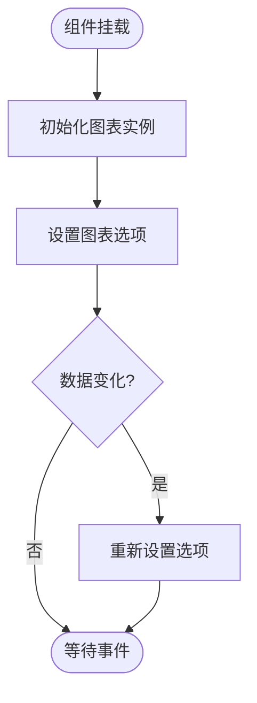

**图示来源**
- [barPercent.vue:1-105](file://src/components/Charts/barPercent.vue#L1-L105)

**章节来源**
- [barPercent.vue:1-105](file://src/components/Charts/barPercent.vue#L1-L105)

### 组件：上传组件 Single Image
- 设计理念：将上传令牌生成、上传、预览等流程封装为单一职责组件。
- 关键点：
  - Props：value(String)，用于双向绑定。
  - 事件：input事件向外抛出最终URL；删除按钮触发清空。
  - 流程：上传前获取令牌与Key，成功后回填临时URL并最终提交。

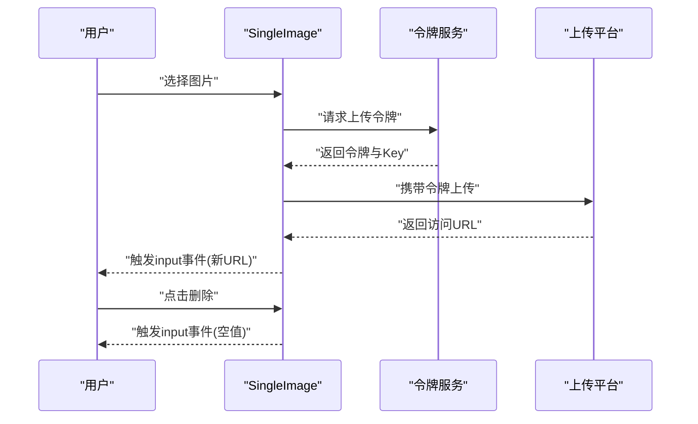

**图示来源**
- [singleImage.vue:1-128](file://src/components/Upload/singleImage.vue#L1-L128)

**章节来源**
- [singleImage.vue:1-128](file://src/components/Upload/singleImage.vue#L1-L128)

### 指令：sticky 粘性指令
- 设计理念：为任意元素提供粘性定位能力，兼容滚动与占位插入，避免重复实现。
- 关键点：
  - 参数：stickyTop、zIndex等，通过binding.value传入。
  - 机制：插入占位节点保持布局稳定；根据滚动位置切换fixed与普通定位。
  - 生命周期：inserted注册监听，unbind移除监听。

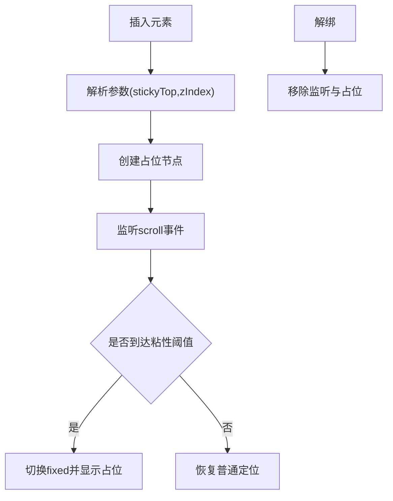

**图示来源**
- [sticky.js:1-100](file://src/directive/sticky.js#L1-L100)

**章节来源**
- [sticky.js:1-100](file://src/directive/sticky.js#L1-L100)

### 指令：waves 波纹指令
- 设计理念：为点击元素添加波纹扩散动效，统一交互反馈。
- 关键点：
  - 参数：ele、type(点击/中心)、color等，通过binding.value传入。
  - 样式：依赖waves.css，通过类名切换实现scale与透明度动画。
  - 事件：绑定click事件，动态创建与定位波纹元素。

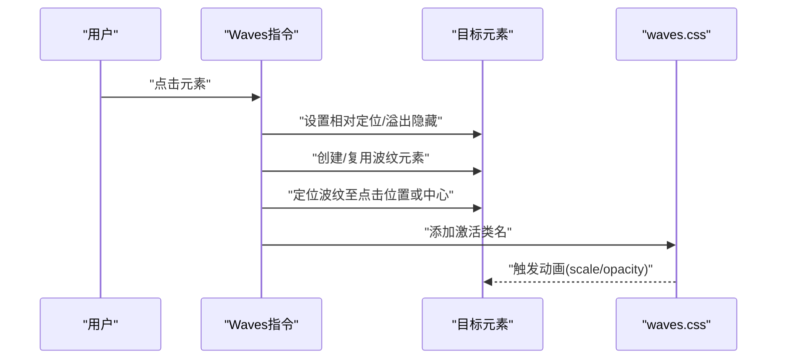

**图示来源**
- [waves.js:1-55](file://src/directive/waves.js#L1-L55)
- [waves.css:1-26](file://src/directive/waves.css#L1-L26)

**章节来源**
- [waves.js:1-55](file://src/directive/waves.js#L1-L55)
- [waves.css:1-26](file://src/directive/waves.css#L1-L26)

### 混入：baseMixin.js
- 设计理念：抽取跨页面的通用能力，如分页、路由跳转、权限判断、导出、日期工具等。
- 关键点：
  - 分页：changeSize、changeCurrent统一管理页码与页大小。
  - 路由：jumpToPage支持push/replace与可选刷新。
  - 导出：exportExcel基于xlsx与file-saver实现。
  - 日期：getDate、getStrDate、fillZero提供日期格式化工具。
  - 生命周期：activated中触发表格布局重算，解决keep-alive下的布局错位问题。

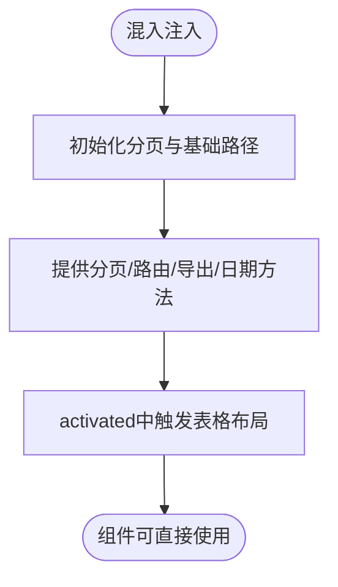

**图示来源**
- [baseMixin.js:1-103](file://src/mixins/baseMixin.js#L1-L103)

**章节来源**
- [baseMixin.js:1-103](file://src/mixins/baseMixin.js#L1-L103)

### 混入：windowResize.js
- 设计理念：统一页面高度计算与窗口尺寸监听，适配不同路由与嵌入场景。
- 关键点：
  - 计算：根据body尺寸与固定偏移量计算maxH/maxW/boxH等。
  - 监听：mounted注册resize监听，beforeDestroy移除。
  - 路由联动：监听$route变化，动态调整偏移量以适配不同页面布局。

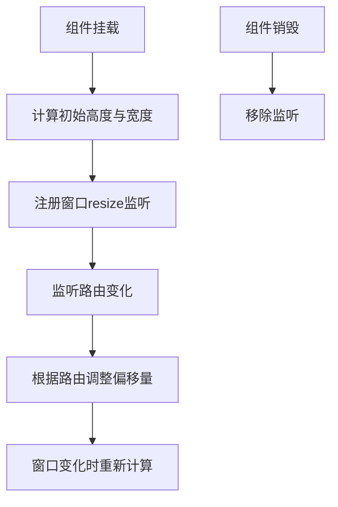

**图示来源**
- [windowResize.js:1-63](file://src/mixins/windowResize.js#L1-L63)

**章节来源**
- [windowResize.js:1-63](file://src/mixins/windowResize.js#L1-L63)

### 混入：windowResizeForBoe.js
- 设计理念：针对特定业务场景的高度计算与响应式布局。
- 关键点：
  - 定义多组高度变量，分别适配不同页面结构。
  - 通过mounted与windowResize方法实现动态高度更新。

**章节来源**
- [windowResizeForBoe.js:1-34](file://src/mixins/windowResizeForBoe.js#L1-L34)

### 混入：workFlow.js
- 设计理念：封装工作流相关API，统一Promise返回与错误处理，提供日期工具。
- 关键点：
  - API封装：getWorkFlow、getStartStep、getNowStep、getDealUserList、getStepByStepIdNo、submitWorkFlow、getYesHisUserList等。
  - 日期工具：getDate、getStrDate、fillZero，便于流程表单日期选择。

**章节来源**
- [workFlow.js:1-103](file://src/mixins/workFlow.js#L1-L103)

## 依赖关系分析
- 组件依赖：
  - Sticky 组件依赖浏览器滚动事件与DOM尺寸测量，适合在容器内使用。
  - Material Input 组件依赖原生表单校验与v-model双向绑定。
  - 图表组件依赖ECharts库，通过props与watch驱动渲染。
  - 上传组件依赖外部上传服务与令牌接口，完成上传与预览。
- 指令依赖：
  - sticky 指令依赖浏览器滚动与DOM测量，需保证元素可见性。
  - waves 指令依赖waves.css提供的动画类名。
- 混入依赖：
  - baseMixin 依赖全局BasePath、Element UI表格组件、xlsx与file-saver。
  - windowResize 依赖store中的isStandalone状态与路由信息。
  - workFlow 依赖工作流API模块与Cookies。

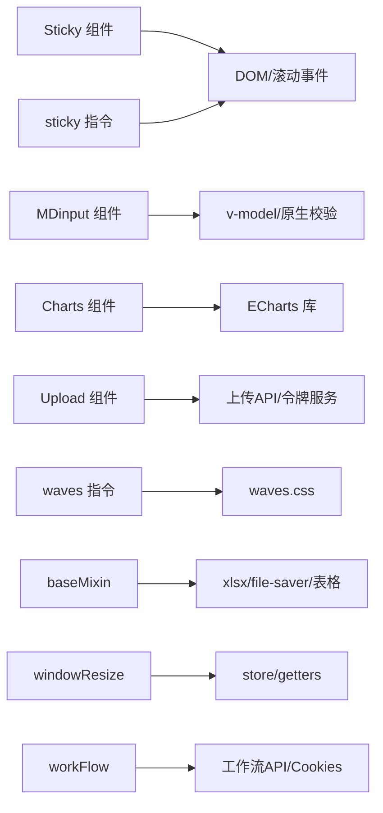

**图示来源**
- [index.vue:1-74](file://src/components/Sticky/index.vue#L1-L74)
- [index.vue:1-298](file://src/components/MDinput/index.vue#L1-L298)
- [barPercent.vue:1-105](file://src/components/Charts/barPercent.vue#L1-L105)
- [singleImage.vue:1-128](file://src/components/Upload/singleImage.vue#L1-L128)
- [sticky.js:1-100](file://src/directive/sticky.js#L1-L100)
- [waves.js:1-55](file://src/directive/waves.js#L1-L55)
- [waves.css:1-26](file://src/directive/waves.css#L1-L26)
- [baseMixin.js:1-103](file://src/mixins/baseMixin.js#L1-L103)
- [windowResize.js:1-63](file://src/mixins/windowResize.js#L1-L63)
- [workFlow.js:1-103](file://src/mixins/workFlow.js#L1-L103)

**章节来源**
- [main.js:1-221](file://src/main.js#L1-L221)

## 性能考量
- 组件层面
  - 图表组件：通过watch监听数据变化再setOption，避免不必要的全量重绘；建议在父组件层合并多次更新，减少setOption次数。
  - 输入组件：利用原生validity进行快速校验，避免复杂正则；错误消息数组/字符串统一分发，减少模板开销。
  - 上传组件：令牌与Key在上传前一次性生成，上传成功后再回填URL，避免重复请求。
- 指令层面
  - sticky 指令：仅在滚动时触发检查，建议在大列表中谨慎使用，避免频繁DOM测量；可结合防抖策略。
  - waves 指令：波纹元素按需创建与复用，注意移除时清理样式类名，防止内存泄漏。
- 混入层面
  - windowResize：在mounted中注册监听，在beforeDestroy中移除，避免内存泄漏；路由切换时动态调整偏移量，减少无效计算。
  - baseMixin：导出Excel时捕获异常并记录日志，避免阻塞主线程。

[本节为通用指导，无需具体文件引用]

## 故障排查指南
- 组件渲染错位
  - 现象：keep-alive后表格列错位。
  - 处理：确认组件是否使用了baseMixin的activated钩子，确保在激活时触发表格布局重算。
  - 参考：[baseMixin.js:21-28](file://src/mixins/baseMixin.js#L21-L28)
- 粘性容器失效
  - 现象：滚动时元素不粘性。
  - 处理：检查是否正确引入指令或组件；确认父容器高度与滚动容器匹配；确保元素可见且存在占位节点。
  - 参考：[sticky.js:67-77](file://src/directive/sticky.js#L67-L77)、[index.vue:55-63](file://src/components/Sticky/index.vue#L55-L63)
- 波纹动效不生效
  - 现象：点击无波纹。
  - 处理：确认已引入waves.css；检查指令绑定参数与事件绑定顺序；确保目标元素有相对定位。
  - 参考：[waves.js:6-42](file://src/directive/waves.js#L6-L42)、[waves.css:1-26](file://src/directive/waves.css#L1-L26)
- 上传失败或URL为空
  - 现象：上传成功但未回填URL。
  - 处理：检查令牌获取接口与上传回调；确认tempUrl赋值与input事件触发时机。
  - 参考：[singleImage.vue:54-68](file://src/components/Upload/singleImage.vue#L54-L68)
- 窗口尺寸异常
  - 现象：表格高度不正确或溢出。
  - 处理：确认windowResize混入是否注册；检查路由切换时的偏移量调整逻辑。
  - 参考：[windowResize.js:17-28](file://src/mixins/windowResize.js#L17-L28)、[windowResize.js:33-46](file://src/mixins/windowResize.js#L33-L46)

**章节来源**
- [baseMixin.js:21-28](file://src/mixins/baseMixin.js#L21-L28)
- [sticky.js:67-77](file://src/directive/sticky.js#L67-L77)
- [index.vue:55-63](file://src/components/Sticky/index.vue#L55-L63)
- [waves.js:6-42](file://src/directive/waves.js#L6-L42)
- [waves.css:1-26](file://src/directive/waves.css#L1-L26)
- [singleImage.vue:54-68](file://src/components/Upload/singleImage.vue#L54-L68)
- [windowResize.js:17-28](file://src/mixins/windowResize.js#L17-L28)
- [windowResize.js:33-46](file://src/mixins/windowResize.js#L33-L46)

## 结论
本组件库通过“入口集中注册 + 指令/混入横切 + 组件分层”的架构，实现了UI、业务、功能三大类组件的清晰划分与高复用性。遵循单一职责、简洁的props设计、明确的事件与插槽约定，辅以混入与指令的横切能力，能够在复杂校园管理场景中快速搭建一致、可靠、易维护的前端界面。建议在后续迭代中持续完善类型约束、错误边界与性能监控，进一步提升组件的健壮性与可观测性。

[本节为总结，无需具体文件引用]

## 附录

### 组件分类与划分标准
- UI组件：强调外观与交互，如输入框、图表、上传等，通常具备明确的props与事件契约。
- 业务组件：封装业务规则与流程，如工作流混入，提供API封装与状态管理辅助。
- 功能组件：提供通用能力，如粘性容器、波纹指令，通过指令或混入在任意组件中复用。

[本节为概念说明，无需具体文件引用]

### 最佳实践清单
- 命名规范
  - 组件：采用帕斯卡命名，如Sticky、MaterialInput、BarPercent。
  - 指令：采用驼峰命名，如sticky、waves。
  - 混入：采用语义化命名，如baseMixin、windowResize、workFlow。
- 属性验证
  - 明确类型、默认值与必填项；对复杂对象使用binding.value传参时，提供默认参数合并。
- 错误处理
  - 对外部API调用使用Promise封装并catch错误；对文件导出、上传等异步操作增加try/catch与降级提示。
- 性能优化
  - 指令与组件中避免频繁DOM测量；对高频事件使用防抖/节流；合理拆分组件，减少不必要的重渲染。
- 事件与插槽
  - 事件命名采用小驼峰，尽量提供上下文参数；插槽用于内容分发，避免过度耦合。

[本节为通用指导，无需具体文件引用]