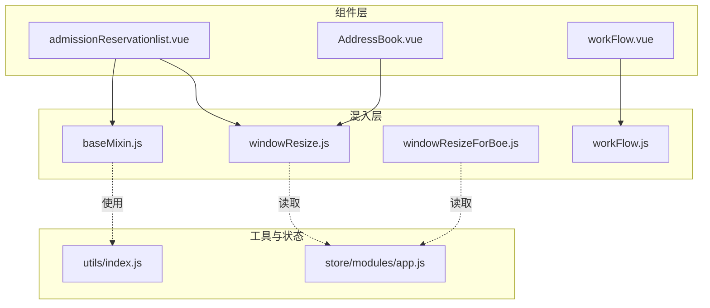
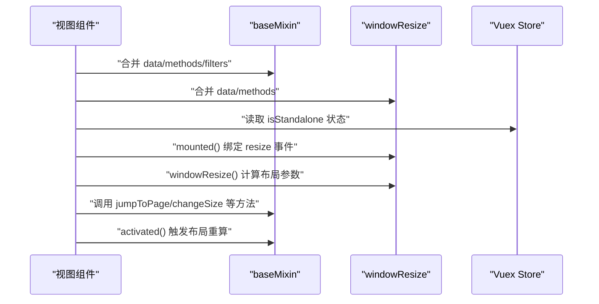
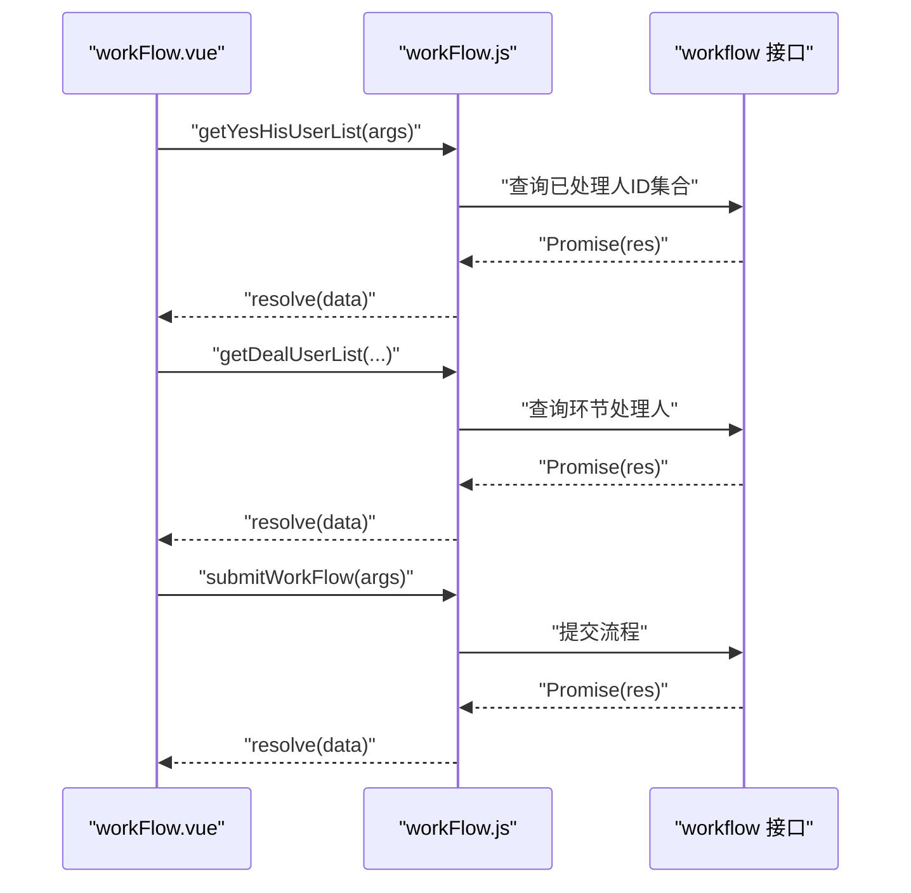
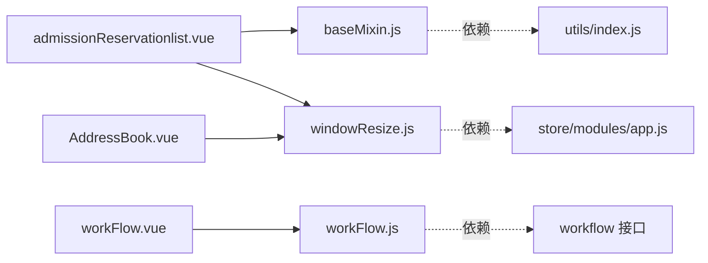

# 混入和辅助工具

<cite>
**本文引用的文件**
- [baseMixin.js](file://src/mixins/baseMixin.js)
- [windowResize.js](file://src/mixins/windowResize.js)
- [windowResizeForBoe.js](file://src/mixins/windowResizeForBoe.js)
- [workFlow.js](file://src/mixins/workFlow.js)
- [admissionReservationlist.vue](file://src/views/admissionReservation/admissionReservationlist.vue)
- [AddressBook.vue](file://src/components/AddressBook/AddressBook.vue)
- [workFlow.vue](file://src/components/workFlow/workFlow.vue)
- [index.js](file://src/utils/index.js)
- [app.js](file://src/store/modules/app.js)
</cite>

## 目录
1. [引言](#引言)
2. [项目结构](#项目结构)
3. [核心组件](#核心组件)
4. [架构总览](#架构总览)
5. [详细组件分析](#详细组件分析)
6. [依赖分析](#依赖分析)
7. [性能考量](#性能考量)
8. [故障排查指南](#故障排查指南)
9. [结论](#结论)
10. [附录](#附录)

## 引言
本文件聚焦于校园管理系统中的“混入与辅助工具”，系统性梳理以下混入的设计理念、实现原理与使用模式：
- 基础混入 baseMixin.js：统一的数据结构、通用方法与生命周期适配，覆盖分页、路由跳转、权限判断、导出、日期工具等。
- 窗口尺寸监听混入 windowResize.js：动态计算页面布局高度与宽度，适配不同路由场景与独立运行环境，提供响应式布局能力。
- 工作流混入 workFlow.js：封装工作流查询、环节处理人获取、提交流程等业务方法，支撑流程审批类视图与组件。

同时，本文给出混入的组合使用方式、生命周期钩子、数据共享机制等技术细节，并提供最佳实践与扩展指导，帮助开发者在现有混入基础上高效构建新功能。

## 项目结构
混入集中位于 src/mixins 目录，典型使用方式是在具体组件的 mixins 数组中引入一个或多个混入，从而获得其 data、methods、filters、生命周期钩子等能力。部分组件还结合 store/getters 与 utils 工具函数进行状态与数据处理。

图表来源
- [baseMixin.js:1-103](file://src/mixins/baseMixin.js#L1-L103)
- [windowResize.js:1-63](file://src/mixins/windowResize.js#L1-L63)
- [windowResizeForBoe.js:1-34](file://src/mixins/windowResizeForBoe.js#L1-L34)
- [workFlow.js:1-103](file://src/mixins/workFlow.js#L1-L103)
- [admissionReservationlist.vue:95-126](file://src/views/admissionReservation/admissionReservationlist.vue#L95-L126)
- [AddressBook.vue:150-251](file://src/components/AddressBook/AddressBook.vue#L150-L251)
- [workFlow.vue:34-91](file://src/components/workFlow/workFlow.vue#L34-L91)
- [index.js:1-385](file://src/utils/index.js#L1-L385)
- [app.js:1-54](file://src/store/modules/app.js#L1-L54)

章节来源
- [baseMixin.js:1-103](file://src/mixins/baseMixin.js#L1-L103)
- [windowResize.js:1-63](file://src/mixins/windowResize.js#L1-L63)
- [windowResizeForBoe.js:1-34](file://src/mixins/windowResizeForBoe.js#L1-L34)
- [workFlow.js:1-103](file://src/mixins/workFlow.js#L1-L103)
- [admissionReservationlist.vue:95-126](file://src/views/admissionReservation/admissionReservationlist.vue#L95-L126)
- [AddressBook.vue:150-251](file://src/components/AddressBook/AddressBook.vue#L150-L251)
- [workFlow.vue:34-91](file://src/components/workFlow/workFlow.vue#L34-L91)
- [index.js:1-385](file://src/utils/index.js#L1-L385)
- [app.js:1-54](file://src/store/modules/app.js#L1-L54)

## 核心组件
本节对三个核心混入进行深入解析，涵盖职责边界、关键数据结构、方法族与生命周期钩子。

- 基础混入 baseMixin.js
  - 数据与过滤器：提供分页参数、时间过滤器；在 keep-alive 场景中自动刷新表格布局。
  - 方法族：路由跳转（支持 replace 与刷新）、分页变更、权限判断、Excel 导出、日期格式化工具。
  - 生命周期：activated 钩子中触发表格布局重算，解决缓存激活导致的列宽错位问题。

- 窗口尺寸监听混入 windowResize.js
  - 数据：定义多组高度/宽度基准（顶部/底部/文件预览等），并根据 store.getters.isStandalone 动态调整。
  - 生命周期：mounted 绑定 resize 事件，beforeDestroy 解绑；$route 监听中按路径动态调整偏移量。
  - 方法：windowResize 计算 maxH/maxW/boxH 等，确保表格、对话框等容器自适应。

- 工作流混入 workFlow.js
  - 方法族：获取流程、起始环节、当前环节、环节处理人、按环节查询、提交流程、历史处理人集合等。
  - 日期工具：与 baseMixin 同构的日期格式化方法，便于流程表单与时间字段处理。

章节来源
- [baseMixin.js:4-101](file://src/mixins/baseMixin.js#L4-L101)
- [windowResize.js:3-61](file://src/mixins/windowResize.js#L3-L61)
- [workFlow.js:5-101](file://src/mixins/workFlow.js#L5-L101)

## 架构总览
混入与组件的交互遵循“声明式引入 + 生命周期协同”的模式。组件通过 mixins 字段声明所需能力，混入注入 data/methods/filters/生命周期钩子，形成可复用的横切关注点。

图表来源
- [admissionReservationlist.vue:95-126](file://src/views/admissionReservation/admissionReservationlist.vue#L95-L126)
- [AddressBook.vue:150-251](file://src/components/AddressBook/AddressBook.vue#L150-L251)
- [windowResize.js:17-32](file://src/mixins/windowResize.js#L17-L32)
- [windowResize.js:48-61](file://src/mixins/windowResize.js#L48-L61)
- [baseMixin.js:21-28](file://src/mixins/baseMixin.js#L21-L28)
- [baseMixin.js:37-54](file://src/mixins/baseMixin.js#L37-L54)

## 详细组件分析

### 基础混入 baseMixin.js
- 设计要点
  - 统一分页参数：pageSize/pageNo/total/pages，便于表格与分页组件对接。
  - 时间过滤器：去除时间后缀“.”，保持显示一致性。
  - keep-alive 适配：activated 中触发表格布局重算，避免缓存恢复导致的列宽错位。
  - 路由跳转：支持 push/replace 与可选刷新，满足不同导航需求。
  - 权限判断：基于权限列表快速判断路径权限。
  - Excel 导出：基于 xlsx 与 file-saver 实现表格导出。
  - 日期工具：统一日期格式化与补零逻辑，便于流程与报表场景。

- 关键方法与数据结构
  - data(): pagination、basePath
  - filters: timeSuffixFilter
  - lifecycle: activated
  - methods: jumpToPage、changeSize、changeCurrent、checkIndexPermission、exportExcel、getDate、getStrDate、fillZero

- 典型使用
  - 在 AdmissionReservationlist 视图中，通过 mixins 引入 baseMixin，直接使用分页与跳转能力。

章节来源
- [baseMixin.js:4-101](file://src/mixins/baseMixin.js#L4-L101)
- [admissionReservationlist.vue:95-126](file://src/views/admissionReservation/admissionReservationlist.vue#L95-L126)

### 窗口尺寸监听混入 windowResize.js
- 设计要点
  - 多场景布局参数：cutH/cutW/headerH 等，适配不同页面结构（含/不含顶部操作区、分页区）。
  - 独立运行环境适配：读取 store.getters.isStandalone 动态加减高度，保证嵌入式页面布局正确。
  - 路由感知：$route 监听中按路径调整偏移量，覆盖系统设置等特殊页面。
  - 生命周期：mounted 绑定 resize，beforeDestroy 解绑，防止内存泄漏。

- 关键方法与数据结构
  - data(): maxH/maxW/boxH/notopmaxH/nobottommaxH/notbmaxH/filemaxH 等
  - mounted()/beforeDestroy()
  - methods: windowResize()

- 典型使用
  - AddressBook 组件通过 mixins 引入 windowResize，配合 jQuery/样式控制实现弹窗内表格高度自适应。

章节来源
- [windowResize.js:3-61](file://src/mixins/windowResize.js#L3-L61)
- [AddressBook.vue:150-251](file://src/components/AddressBook/AddressBook.vue#L150-L251)

### 工作流混入 workFlow.js
- 设计要点
  - 业务方法封装：获取流程、起始环节、当前环节、环节处理人、按环节查询、提交流程、历史处理人集合。
  - 日期工具：与 baseMixin 同构的日期格式化方法，便于流程表单与时间字段处理。
  - Promise 化：所有 API 调用均返回 Promise，便于在组件中链式处理与错误捕获。

- 关键方法与数据结构
  - methods: getWorkFlow、getStartStep、getNowStep、getDealUserList、getStepByStepIdNo、submitWorkFlow、getYesHisUserList、getDate、getStrDate、fillZero

- 典型使用
  - workFlow 组件通过 mixins 引入 workFlow，结合 props 与 watch，在挂载阶段查询流程与处理人，并在交互变化时提交流程。

章节来源
- [workFlow.js:5-101](file://src/mixins/workFlow.js#L5-L101)
- [workFlow.vue:34-91](file://src/components/workFlow/workFlow.vue#L34-L91)

### 混入组合使用与生命周期协同
- 组合使用
  - 组件可在 mixins 数组中引入多个混入，如 AdmissionReservationlist 同时引入 baseMixin 与 windowResize。
  - 混入之间相互独立，通过各自 data/methods/filters/lifecycle 形成叠加能力。

- 生命周期钩子
  - windowResize 的 mounted/beforeDestroy 负责事件绑定与清理。
  - baseMixin 的 activated 负责表格布局重算。
  - 组件自身生命周期与混入生命周期共同作用，形成稳定的运行时行为。

- 数据共享机制
  - 混入通过 data 返回共享状态（如 pagination、布局参数），组件与混入共享同一份数据引用。
  - 通过 store.getters 读取全局状态（如 isStandalone），实现跨模块共享。

章节来源
- [admissionReservationlist.vue:95-126](file://src/views/admissionReservation/admissionReservationlist.vue#L95-L126)
- [AddressBook.vue:150-251](file://src/components/AddressBook/AddressBook.vue#L150-L251)
- [baseMixin.js:21-28](file://src/mixins/baseMixin.js#L21-L28)
- [windowResize.js:17-32](file://src/mixins/windowResize.js#L17-L32)
- [windowResize.js:33-47](file://src/mixins/windowResize.js#L33-L47)

### API/服务组件调用序列（以工作流为例）

图表来源
- [workFlow.vue:173-197](file://src/components/workFlow/workFlow.vue#L173-L197)
- [workFlow.vue:226-225](file://src/components/workFlow/workFlow.vue#L226-L225)
- [workFlow.js:77-86](file://src/mixins/workFlow.js#L77-L86)
- [workFlow.js:199-209](file://src/mixins/workFlow.js#L199-L209)
- [workFlow.js:66-75](file://src/mixins/workFlow.js#L66-L75)

## 依赖分析
- 组件对混入的依赖
  - AdmissionReservationlist 引入 baseMixin 与 windowResize，获得分页、跳转、布局能力。
  - AddressBook 引入 windowResize，实现弹窗内表格高度自适应。
  - workFlow 引入 workFlow，获得流程查询与提交能力。

- 混入对工具与状态的依赖
  - baseMixin 依赖 utils 工具（如日期格式化）与全局 BasePath。
  - windowResize 依赖 store.getters.isStandalone 与路由参数，动态调整布局。
  - workFlow 依赖 workflow API 与 Cookies。

图表来源
- [admissionReservationlist.vue:95-126](file://src/views/admissionReservation/admissionReservationlist.vue#L95-L126)
- [AddressBook.vue:150-251](file://src/components/AddressBook/AddressBook.vue#L150-L251)
- [workFlow.vue:34-91](file://src/components/workFlow/workFlow.vue#L34-L91)
- [baseMixin.js:1-103](file://src/mixins/baseMixin.js#L1-L103)
- [windowResize.js:1-63](file://src/mixins/windowResize.js#L1-L63)
- [workFlow.js:1-103](file://src/mixins/workFlow.js#L1-L103)
- [index.js:1-385](file://src/utils/index.js#L1-L385)
- [app.js:1-54](file://src/store/modules/app.js#L1-L54)

章节来源
- [admissionReservationlist.vue:95-126](file://src/views/admissionReservation/admissionReservationlist.vue#L95-L126)
- [AddressBook.vue:150-251](file://src/components/AddressBook/AddressBook.vue#L150-L251)
- [workFlow.vue:34-91](file://src/components/workFlow/workFlow.vue#L34-L91)
- [baseMixin.js:1-103](file://src/mixins/baseMixin.js#L1-L103)
- [windowResize.js:1-63](file://src/mixins/windowResize.js#L1-L63)
- [workFlow.js:1-103](file://src/mixins/workFlow.js#L1-L103)
- [index.js:1-385](file://src/utils/index.js#L1-L385)
- [app.js:1-54](file://src/store/modules/app.js#L1-L54)

## 性能考量
- 事件绑定与解绑
  - windowResize 在 mounted 绑定 resize 事件，beforeDestroy 解绑，避免重复绑定与内存泄漏。
- 布局计算开销
  - windowResize 的 windowResize 方法在每次窗口变化时重新计算布局参数，建议在高频变化场景中结合防抖策略（可参考 utils/index.js 中的工具函数模式）。
- keep-alive 与布局重算
  - baseMixin 的 activated 自动触发表格布局重算，避免缓存恢复导致的视觉错位，但需注意在大量表格场景下的重绘成本。
- 导出与大表格
  - baseMixin 的 Excel 导出基于 xlsx 与 file-saver，大表格导出可能产生内存压力，建议分页导出或后台异步导出。

## 故障排查指南
- 表格列宽错位
  - 现象：keep-alive 缓存后，表格列宽不正确。
  - 处理：确认组件已引入 baseMixin，且 activated 钩子生效；必要时手动触发表格布局重算。
  - 参考：[baseMixin.js:21-28](file://src/mixins/baseMixin.js#L21-L28)

- 窗口尺寸异常
  - 现象：弹窗内表格高度不正确或滚动条异常。
  - 处理：检查 windowResize 的 mounted 是否执行；确认 store.getters.isStandalone 与 $route 路径匹配；核对 cutH/cutW/headerH 的计算逻辑。
  - 参考：[windowResize.js:17-32](file://src/mixins/windowResize.js#L17-L32)，[windowResize.js:33-47](file://src/mixins/windowResize.js#L33-L47)

- 工作流提交失败
  - 现象：提交流程时报错或无响应。
  - 处理：检查 workFlow.js 的 submitWorkFlow Promise 链路；确认接口返回与参数传递；查看控制台错误堆栈。
  - 参考：[workFlow.js:66-75](file://src/mixins/workFlow.js#L66-L75)，[workFlow.vue:226-225](file://src/components/workFlow/workFlow.vue#L226-L225)

- 权限判断失效
  - 现象：按钮/菜单未按预期显示。
  - 处理：确认 permissionList 与 permissionPath 的匹配关系；使用 baseMixin 的 checkIndexPermission 或 utils/index.js 的工具函数。
  - 参考：[baseMixin.js:62-64](file://src/mixins/baseMixin.js#L62-L64)，[index.js:233-235](file://src/utils/index.js#L233-L235)

章节来源
- [baseMixin.js:21-28](file://src/mixins/baseMixin.js#L21-L28)
- [windowResize.js:17-32](file://src/mixins/windowResize.js#L17-L32)
- [windowResize.js:33-47](file://src/mixins/windowResize.js#L33-L47)
- [workFlow.js:66-75](file://src/mixins/workFlow.js#L66-L75)
- [workFlow.vue:226-225](file://src/components/workFlow/workFlow.vue#L226-L225)
- [baseMixin.js:62-64](file://src/mixins/baseMixin.js#L62-L64)
- [index.js:233-235](file://src/utils/index.js#L233-L235)

## 结论
- baseMixin 提供了统一的基础能力与生命周期适配，适合在大多数页面中作为“基础设施”混入。
- windowResize 专注于布局自适应，通过 store 状态与路由感知实现灵活的尺寸计算。
- workFlow 将复杂的工作流 API 进行方法级封装，显著降低组件侧的接入成本。
- 在实际开发中，应遵循“单一职责、最小耦合”的原则，合理组合混入，避免命名冲突与重复计算，持续优化性能与可维护性。

## 附录

### 最佳实践指南
- 命名规范
  - 混入文件采用语义化命名（如 baseMixin、windowResize、workFlow），方法与数据字段清晰表达意图。
- 冲突避免
  - 避免在多个混入中定义同名 data 字段；若确需共享，建议通过 props 或 store 统一管理。
  - 在组件中引入多个混入时，优先使用更通用的混入（如 baseMixin）在前，特定功能混入在后。
- 性能考虑
  - 对高频事件（如 resize）进行节流/防抖；在大量表格场景中谨慎使用 keep-alive 的 activated 布局重算。
  - 导出与大列表处理建议采用分页或后台任务。
- 扩展新混入
  - 接口设计：以 data/methods/filters/lifecycle 的形式组织能力，尽量保持无副作用。
  - 代码复用：优先抽取公共逻辑与常量，减少重复代码。
  - 测试验证：为关键方法编写单元测试，覆盖正常与异常分支；在组件中集成端到端验证。

### 基于现有混入开发新混入的步骤
- 明确目标：确定新混入要解决的问题域（如权限、导出、图表、时间轴等）。
- 抽象能力：将通用逻辑抽象为 data/methods/filters/lifecycle，避免与具体组件紧耦合。
- 引入与验证：在目标组件中以 mixins 方式引入，观察生命周期钩子与数据共享效果。
- 优化与测试：针对性能与边界条件进行优化，并补充测试用例。