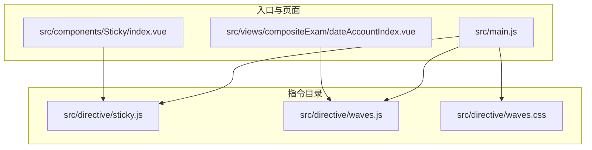
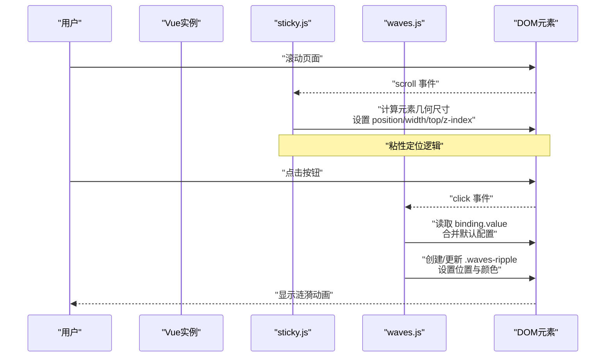
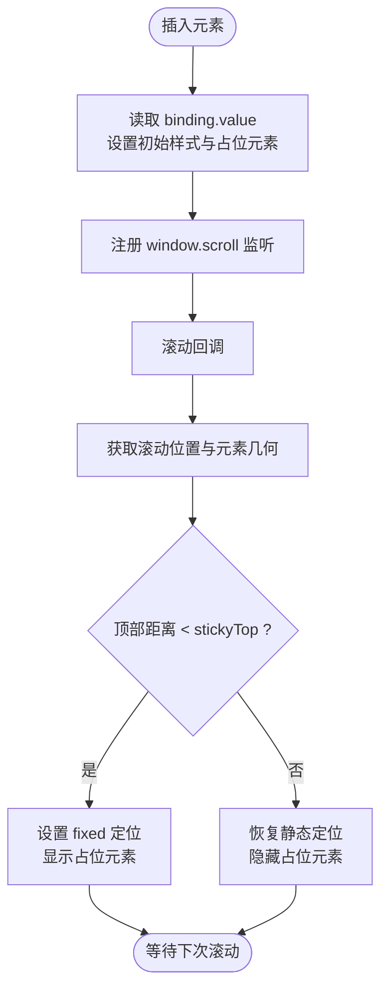
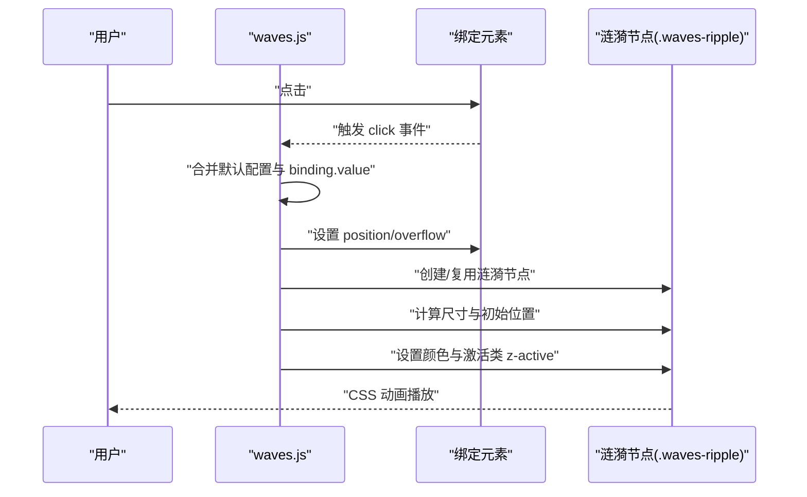
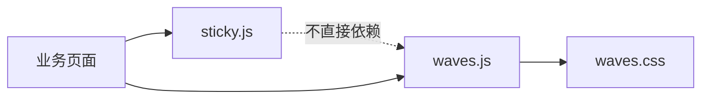

# 自定义指令

<cite>
**本文引用的文件**   
- [src/directive/sticky.js](file://src/directive/sticky.js)
- [src/directive/waves.js](file://src/directive/waves.js)
- [src/directive/waves.css](file://src/directive/waves.css)
- [src/main.js](file://src/main.js)
- [src/views/compositeExam/dateAccountIndex.vue](file://src/views/compositeExam/dateAccountIndex.vue)
- [src/components/Sticky/index.vue](file://src/components/Sticky/index.vue)
</cite>

## 目录
1. [引言](#引言)
2. [项目结构](#项目结构)
3. [核心组件](#核心组件)
4. [架构概览](#架构概览)
5. [详细组件分析](#详细组件分析)
6. [依赖关系分析](#依赖关系分析)
7. [性能考虑](#性能考虑)
8. [故障排查指南](#故障排查指南)
9. [结论](#结论)
10. [附录](#附录)

## 引言
本文件围绕校园管理系统中的自定义指令展开，重点解析两个指令的设计模式与实现原理：
- 粘性定位指令 sticky.js：基于原生滚动事件与 DOM 几何尺寸计算，实现“粘性”布局行为。
- 波纹效果指令 waves.js：通过点击事件在目标元素上生成涟漪动画，配合 CSS 类实现视觉反馈。

同时，文档将阐述指令的生命周期钩子、参数传递、DOM 操作等技术细节，并给出使用示例、配置选项、组合使用方式、性能优化与浏览器兼容性建议。

## 项目结构
自定义指令位于 src/directive 目录，包含三个文件：
- sticky.js：粘性定位指令实现
- waves.js：波纹效果指令实现
- waves.css：波纹动画所需的样式

此外，项目入口文件 main.js 中未直接注册上述指令，但提供了全局组件注册与路由守卫等上下文；在具体业务页面中可按需使用指令。

**图表来源**
- [src/directive/sticky.js:1-100](file://src/directive/sticky.js#L1-L100)
- [src/directive/waves.js:1-55](file://src/directive/waves.js#L1-L55)
- [src/directive/waves.css:1-26](file://src/directive/waves.css#L1-L26)
- [src/main.js:1-221](file://src/main.js#L1-L221)
- [src/views/compositeExam/dateAccountIndex.vue:40-239](file://src/views/compositeExam/dateAccountIndex.vue#L40-L239)
- [src/components/Sticky/index.vue:1-74](file://src/components/Sticky/index.vue#L1-L74)

**章节来源**
- [src/directive/sticky.js:1-100](file://src/directive/sticky.js#L1-L100)
- [src/directive/waves.js:1-55](file://src/directive/waves.js#L1-L55)
- [src/directive/waves.css:1-26](file://src/directive/waves.css#L1-L26)
- [src/main.js:1-221](file://src/main.js#L1-L221)

## 核心组件
- 粘性定位指令 sticky.js
  - 功能：在滚动到指定阈值时，将元素切换为固定定位，模拟粘性布局。
  - 关键点：监听 window.scroll，计算元素几何尺寸，动态设置 position、top、z-index、width 等样式；使用占位元素避免布局抖动。
  - 生命周期钩子：inserted（插入时初始化）、unbind（解绑时移除监听）。
  - 参数：通过 binding.value 接收对象，支持 stickyTop（距离顶部偏移）、zIndex（层级）等。
- 波纹效果指令 waves.js
  - 功能：在元素点击时生成涟漪动画，覆盖在元素上。
  - 关键点：绑定 click 事件，根据点击位置或中心位置计算涟漪初始位置与尺寸，动态创建/复用 .waves-ripple 元素，应用 CSS 动画类。
  - 生命周期钩子：bind（绑定时注册事件）。
  - 参数：通过 binding.value 合并默认配置，支持 ele（作用元素）、type（hit/center）、color（颜色）等。

**章节来源**
- [src/directive/sticky.js:1-100](file://src/directive/sticky.js#L1-L100)
- [src/directive/waves.js:1-55](file://src/directive/waves.js#L1-L55)
- [src/directive/waves.css:1-26](file://src/directive/waves.css#L1-L26)

## 架构概览
以下序列图展示了两个指令在页面中的典型工作流程：

**图表来源**
- [src/directive/sticky.js:6-87](file://src/directive/sticky.js#L6-L87)
- [src/directive/waves.js:6-42](file://src/directive/waves.js#L6-L42)

## 详细组件分析

### 粘性定位指令 sticky.js
- 设计模式
  - 原生滚动监听：在 inserted 钩子中注册 window.scroll 监听，在 unbind 中移除，避免内存泄漏。
  - 占位元素策略：插入一个与原元素同尺寸的隐藏占位节点，防止固定定位导致的布局塌陷。
  - 条件定位：当元素顶部距离小于 stickyTop 时启用 fixed 定位，否则恢复静态定位。
- 关键实现要点
  - 计算与缓存：首次滚动前缓存元素高度与宽度，避免重复测量引发回流。
  - 滚动检测：通过 getScroll 获取滚动位置，结合 getBoundingClientRect().top 判断是否需要切换粘性状态。
  - 样式控制：动态设置 position、top、z-index、width 等，确保视觉一致性。
- 生命周期与参数
  - inserted(el, binding)：初始化，读取 binding.value.stickyTop、zIndex，设置初始样式与占位元素。
  - unbind()：移除 scroll 监听。
  - 参数对象字段：stickyTop（数字，默认 0）、zIndex（数字，默认 1000）。
- 性能与兼容性
  - 使用 requestAnimationFrame 或节流可进一步优化滚动回调频率。
  - 对于不支持 CSS sticky 的旧浏览器，代码保留了注释化的原生支持分支，实际实现优先采用 JS 控制。
- 使用示例
  - 在模板中使用 v-sticky 并传入参数对象，如 v-sticky="{ stickyTop: 80, zIndex: 100 }"。

**图表来源**
- [src/directive/sticky.js:6-87](file://src/directive/sticky.js#L6-L87)

**章节来源**
- [src/directive/sticky.js:1-100](file://src/directive/sticky.js#L1-L100)

### 波纹效果指令 waves.js
- 设计模式
  - 事件驱动：在 bind 钩子中为元素绑定 click 事件，点击时动态生成/复用涟漪节点。
  - 配置合并：默认配置与 binding.value 合并，支持自定义作用元素、类型（hit/center）、颜色。
  - 视觉反馈：通过 CSS 类 .waves-ripple 与 .z-active 实现缩放与透明度过渡动画。
- 关键实现要点
  - 作用元素：默认对绑定元素本身生效，可通过 ele 覆盖。
  - 类型选择：type='center' 时涟漪从元素中心扩散；type='hit' 时从点击位置扩散。
  - 动态尺寸：涟漪尺寸取元素宽高最大值，保证覆盖整个容器。
  - 事件清理：指令销毁时无需额外清理，因为仅在点击时临时创建节点。
- 生命周期与参数
  - bind(el, binding)：注册 click 事件，处理涟漪生成与动画。
  - 参数对象字段：ele（作用元素，默认 el）、type（'hit' | 'center'）、color（颜色字符串）。
- 使用示例
  - 在模板中使用 v-waves，如 v-waves="{ type: 'center', color: 'rgba(33, 150, 243, 0.4)' }"。
  - 也可作为全局插件注册后直接使用。

**图表来源**
- [src/directive/waves.js:6-42](file://src/directive/waves.js#L6-L42)
- [src/directive/waves.css:1-26](file://src/directive/waves.css#L1-L26)

**章节来源**
- [src/directive/waves.js:1-55](file://src/directive/waves.js#L1-L55)
- [src/directive/waves.css:1-26](file://src/directive/waves.css#L1-L26)

### 组件协作与页面使用
- 页面示例
  - 在业务页面中可直接使用 v-waves 指令为按钮添加点击波纹效果。
  - 粘性定位指令通常用于需要在滚动时保持可见的工具栏、筛选器等区域。
- 与组件的关系
  - 项目中存在一个粘性布局组件 Sticky/index.vue，其内部也实现了滚动监听与定位切换逻辑，可与指令版粘性定位形成互补或替代关系。

**章节来源**
- [src/views/compositeExam/dateAccountIndex.vue:40-239](file://src/views/compositeExam/dateAccountIndex.vue#L40-L239)
- [src/components/Sticky/index.vue:1-74](file://src/components/Sticky/index.vue#L1-L74)

## 依赖关系分析
- 文件间依赖
  - waves.js 依赖 waves.css 提供动画样式。
  - sticky.js 与 waves.js 均为独立的指令模块，不互相依赖。
  - 页面中对指令的使用不依赖 main.js 的全局注册（指令未在 main.js 中显式 Vue.use 注册）。
- 潜在循环依赖
  - 当前文件结构未发现循环依赖。
- 外部依赖
  - 两个指令均为纯前端实现，不依赖第三方库。

**图表来源**
- [src/directive/waves.js:1-55](file://src/directive/waves.js#L1-L55)
- [src/directive/waves.css:1-26](file://src/directive/waves.css#L1-L26)
- [src/directive/sticky.js:1-100](file://src/directive/sticky.js#L1-L100)
- [src/views/compositeExam/dateAccountIndex.vue:40-239](file://src/views/compositeExam/dateAccountIndex.vue#L40-L239)

**章节来源**
- [src/directive/waves.js:1-55](file://src/directive/waves.js#L1-L55)
- [src/directive/waves.css:1-26](file://src/directive/waves.css#L1-L26)
- [src/directive/sticky.js:1-100](file://src/directive/sticky.js#L1-L100)
- [src/views/compositeExam/dateAccountIndex.vue:40-239](file://src/views/compositeExam/dateAccountIndex.vue#L40-L239)

## 性能考虑
- 滚动监听优化
  - 将 sticky.js 的滚动回调进行节流/防抖，减少高频滚动带来的重排与重绘。
  - 使用 requestAnimationFrame 包裹 DOM 更新逻辑，提升流畅度。
- DOM 操作最小化
  - 占位元素仅在必要时显示/隐藏，避免频繁插入/移除节点。
  - 波纹节点按需创建与复用，避免重复 DOM 操作。
- 样式与动画
  - 使用 transform 与 opacity 控制动画，尽量避免触发布局与重绘。
  - CSS 动画时长与缓动函数应适中，兼顾视觉体验与性能。

## 故障排查指南
- 指令未生效
  - 确认指令已在页面中正确使用，且未被全局注册覆盖。
  - 检查 binding.value 是否传入正确的参数对象。
- 滚动异常
  - 检查 stickyTop 设置是否合理，避免与页面布局冲突。
  - 确保父级容器未设置 overflow 影响滚动。
- 波纹不显示
  - 确认元素具备相对定位与溢出裁剪，以便涟漪节点正确绘制。
  - 检查 CSS 类 .waves-ripple 是否被覆盖或禁用。
- 内存泄漏
  - 确保 unbind 钩子正确移除了事件监听器与定时器（如有）。

**章节来源**
- [src/directive/sticky.js:85-87](file://src/directive/sticky.js#L85-L87)
- [src/directive/waves.js:6-42](file://src/directive/waves.js#L6-L42)

## 结论
本项目中的自定义指令通过简洁的实现与明确的生命周期钩子，分别解决了“粘性定位”与“点击波纹”两类常见交互需求。指令以参数化配置与最小 DOM 操作为核心，兼顾易用性与性能。在实际开发中，建议结合业务场景选择指令或组件方案，并注意滚动监听的性能优化与样式兼容性。

## 附录
- 指令使用清单
  - v-sticky：用于需要在滚动时保持可见的区域，支持 stickyTop 与 zIndex 参数。
  - v-waves：用于按钮等可点击元素，支持 type 与 color 参数。
- 最佳实践
  - 参数化配置优于硬编码样式。
  - 在复杂页面中对滚动回调进行节流。
  - 注意浏览器兼容性与样式覆盖。