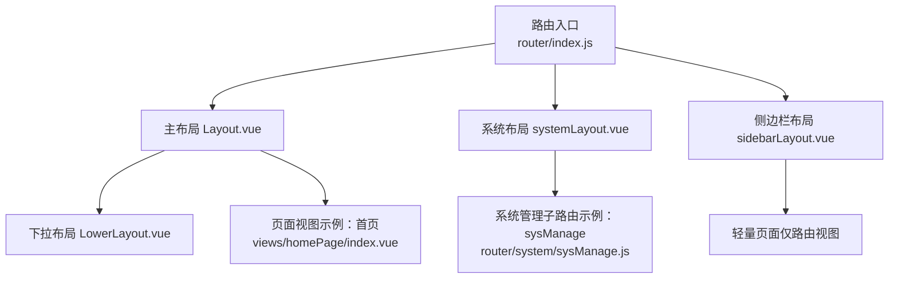
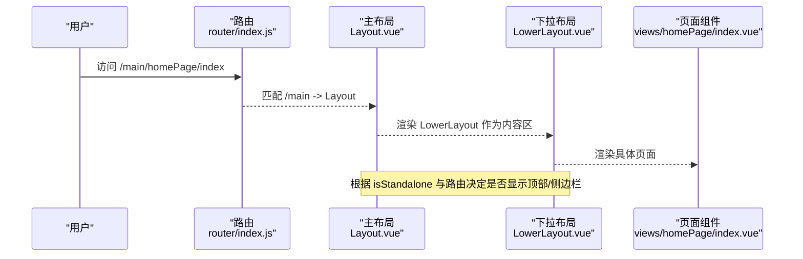
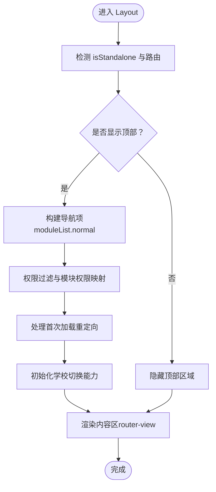
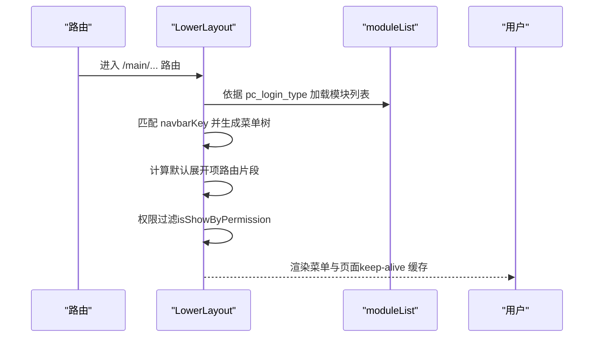
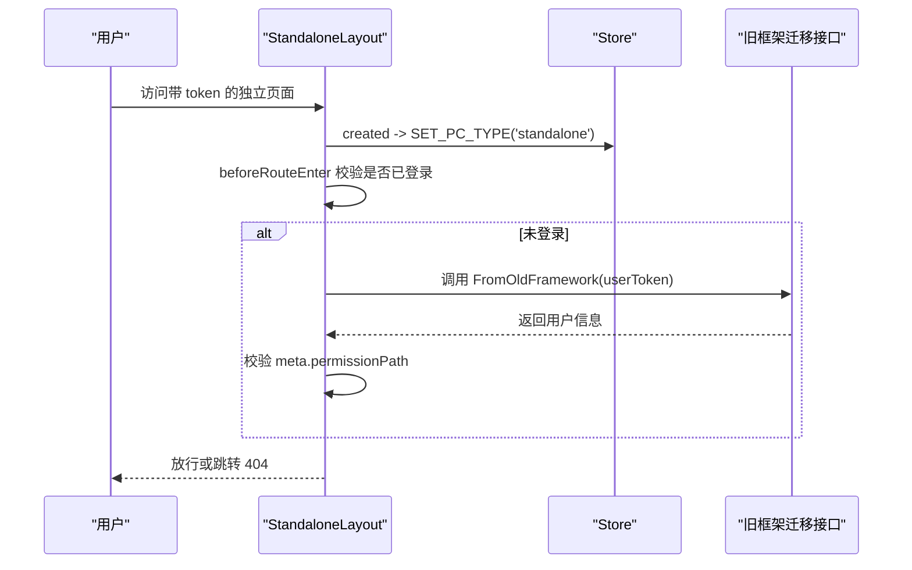
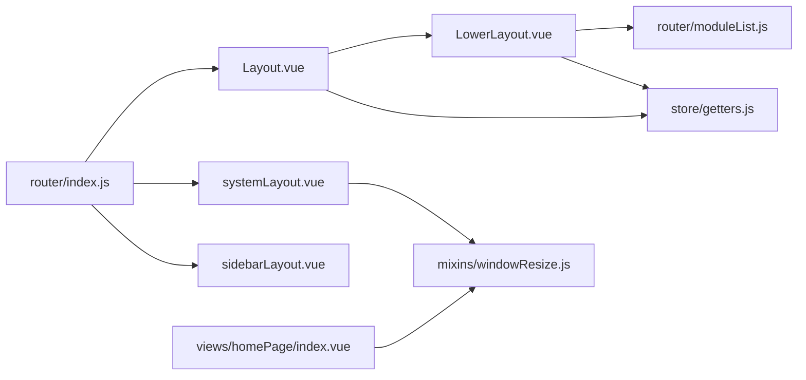

# 布局组件

<cite>
**本文引用的文件**
- [Layout.vue](file://src/views/layout/Layout.vue)
- [LowerLayout.vue](file://src/views/layout/LowerLayout.vue)
- [StandaloneLayout.vue](file://src/views/layout/StandaloneLayout.vue)
- [systemLayout.vue](file://src/views/layout/systemLayout.vue)
- [sidebarLayout.vue](file://src/views/sidebarLayout.vue)
- [router/index.js](file://src/router/index.js)
- [router/moduleList.js](file://src/router/moduleList.js)
- [store/modules/app.js](file://src/store/modules/app.js)
- [store/modules/user.js](file://src/store/modules/user.js)
- [store/getters.js](file://src/store/getters.js)
- [mixins/windowResize.js](file://src/mixins/windowResize.js)
- [utils/index.js](file://src/utils/index.js)
- [homePage/index.vue](file://src/views/homePage/index.vue)
</cite>

## 目录
1. [引言](#引言)
2. [项目结构](#项目结构)
3. [核心组件](#核心组件)
4. [架构总览](#架构总览)
5. [详细组件分析](#详细组件分析)
6. [依赖分析](#依赖分析)
7. [性能考虑](#性能考虑)
8. [故障排查指南](#故障排查指南)
9. [结论](#结论)
10. [附录](#附录)

## 引言
本文件面向校园管理系统中的布局组件，系统性梳理主布局、下拉布局、独立布局、系统布局与侧边栏布局的设计模式、职责边界、嵌套关系、路由匹配规则、条件渲染逻辑，并总结可扩展性设计（主题切换、布局模式切换、移动端适配）。目标是帮助开发者快速理解并正确使用这些布局组件，以支撑复杂的业务页面组合与权限控制。

## 项目结构
- 布局组件集中于 views/layout 目录，包含主布局、下拉布局、独立布局、系统布局等。
- 路由在 router/index.js 中定义，主应用路径 /main 使用主布局 Layout.vue；系统管理路径 /system 使用 systemLayout.vue；部分页面使用 sidebarLayout.vue 作为轻量容器。
- 权限与状态通过 store 管理，isStandalone 等标志位影响布局显示与行为。
- 响应式能力通过 windowResize mixin 提供，支持动态计算内容区域尺寸。

图表来源
- [router/index.js:136-159](file://src/router/index.js#L136-L159)
- [Layout.vue:1-507](file://src/views/layout/Layout.vue#L1-L507)
- [systemLayout.vue:1-48](file://src/views/layout/systemLayout.vue#L1-L48)
- [sidebarLayout.vue:1-5](file://src/views/sidebarLayout.vue#L1-L5)
- [homePage/index.vue:1-82](file://src/views/homePage/index.vue#L1-L82)

章节来源
- [router/index.js:136-159](file://src/router/index.js#L136-L159)

## 核心组件
- 主布局 Layout.vue
  - 职责：提供顶部导航、用户下拉、返回旧版、学校切换弹窗、全局 keep-alive 缓存策略、条件渲染顶部与侧边栏。
  - 关键点：根据 isStandalone 与特定路由隐藏顶部；根据权限与模块配置生成导航项；支持多学校切换。
- 下拉布局 LowerLayout.vue
  - 职责：提供左侧菜单树、面包屑/展开项控制、权限过滤、缓存策略、外部链接跳转、“仅维修”场景增强。
  - 关键点：根据路由动态确定 navbarKey 并加载 moduleList；watch 路由变更更新默认展开项；beforeRouteUpdate 控制 keep-alive 缓存列表。
- 独立布局 StandaloneLayout.vue
  - 职责：独立运行模式下的路由守卫与权限校验、从旧框架迁移登录态、标记 pcType 为 standalone。
  - 关键点：beforeRouteEnter 校验权限与 token，未登录时从 hash 提取 userToken 并调用旧框架迁移接口。
- 系统布局 systemLayout.vue
  - 职责：系统管理模块专用布局，设置 pc_login_type 为 system，混入 windowResize 以适配系统设置类页面。
  - 关键点：created 设置登录类型；混入窗口尺寸计算；可选保留旧框架迁移逻辑注释。
- 侧边栏布局 sidebarLayout.vue
  - 职责：极简布局，仅承载 router-view，适用于无需侧边栏的页面。
  - 关键点：无额外逻辑，直接透传路由视图。

章节来源
- [Layout.vue:1-507](file://src/views/layout/Layout.vue#L1-L507)
- [LowerLayout.vue:1-561](file://src/views/layout/LowerLayout.vue#L1-L561)
- [StandaloneLayout.vue:1-63](file://src/views/layout/StandaloneLayout.vue#L1-L63)
- [systemLayout.vue:1-48](file://src/views/layout/systemLayout.vue#L1-L48)
- [sidebarLayout.vue:1-5](file://src/views/sidebarLayout.vue#L1-L5)

## 架构总览
布局组件围绕“路由 -> 布局 -> 页面”的层级展开，主布局负责顶层 UI 与全局行为，下拉布局负责菜单与内容区域，独立与系统布局分别服务于独立运行与系统管理场景，侧边栏布局提供轻量容器。

图表来源
- [router/index.js:136-148](file://src/router/index.js#L136-L148)
- [Layout.vue:1-507](file://src/views/layout/Layout.vue#L1-L507)
- [LowerLayout.vue:1-561](file://src/views/layout/LowerLayout.vue#L1-L561)
- [homePage/index.vue:1-82](file://src/views/homePage/index.vue#L1-L82)

## 详细组件分析

### 主布局 Layout.vue
- 设计模式
  - 组合布局：顶部导航 + 内容区（router-view），内容区再由 LowerLayout 承载菜单与页面。
  - 条件渲染：isShowTop 根据 isStandalone 与特定路由隐藏顶部；isStandalone 影响整体布局样式。
  - 权限与模块：基于 moduleList.normal 动态生成导航项；支持权限过滤与模块级权限映射。
  - 多学校切换：通过 ability 与 switchSchoollist 动态获取可切换学校列表，支持切换后刷新。
- 关键逻辑
  - 顶部导航项：包含“家校互动、教学教务、校园办公、总务后勤、学生评价、系统管理”等模块入口。
  - 用户下拉：支持个人信息、切换学校、退出登录；支持返回旧版入口。
  - 首页插入：根据 pcModuleCode 与环境变量动态插入“首页”入口。
  - 首次加载重定向：mounted 时根据首个导航或侧边菜单自动重定向，提升首屏体验。
- 嵌套关系
  - Layout -> LowerLayout -> 页面组件
- 路由匹配
  - /main -> Layout；/system -> systemLayout；部分页面 -> sidebarLayout
- 条件渲染
  - isShowTop：排除特定路由且非独立模式时显示顶部
  - isStandalone：影响 isShowTop 与 isShowSide 的默认行为
- 可扩展性
  - 支持主题与布局模式扩展（当前样式与布局结构已预留）
  - 移动端适配：通过 windowResize mixin 与样式媒体查询实现自适应

图表来源
- [Layout.vue:136-196](file://src/views/layout/Layout.vue#L136-L196)
- [utils/index.js:241-243](file://src/utils/index.js#L241-L243)

章节来源
- [Layout.vue:1-507](file://src/views/layout/Layout.vue#L1-L507)
- [utils/index.js:241-243](file://src/utils/index.js#L241-L243)

### 下拉布局 LowerLayout.vue
- 设计模式
  - 菜单驱动：基于 moduleList 动态生成菜单树，支持多级子菜单与图标映射。
  - 权限驱动：每个菜单项可绑定 permissionPath，按 isShowByPermission 过滤。
  - 缓存策略：结合 keep-alive 与 beforeRouteUpdate 控制缓存白名单，避免频繁重建。
  - 外部链接：支持外部系统跳转（如 schoolSignup），统一注入 token。
- 关键逻辑
  - 菜单生成：根据当前路由匹配 navbarKey，加载对应 moduleList；支持 pc_login_type 切换。
  - 默认展开：根据路由路径片段生成默认展开数组，确保当前页面所在目录可见。
  - 权限过滤：isShowSideitem 同时考虑父级与子级权限，以及 menuSettingKey 对应的开关。
  - “仅维修”增强：当仅拥有报修列表权限时，自动注入“报修统计/设置”菜单项。
  - keep-alive：beforeRouteUpdate 动态维护 include 列表，支持按 meta.isCached 控制缓存。
- 嵌套关系
  - LowerLayout -> 页面组件（router-view）
- 路由匹配
  - /main 下的所有子路由均使用 Layout -> LowerLayout
- 条件渲染
  - isShowSide：排除特定路由且满足 isStandalone 或显式开启时显示侧边栏
  - isShowTop：与 isOnlySys、isStandalone 共同决定顶部显示
- 可扩展性
  - 菜单开关：通过 menuSettingKey 与后台返回的开关字段联动
  - 外部系统：通过 externalLinkId 映射统一跳转

图表来源
- [LowerLayout.vue:190-211](file://src/views/layout/LowerLayout.vue#L190-L211)
- [router/moduleList.js:1-800](file://src/router/moduleList.js#L1-L800)

章节来源
- [LowerLayout.vue:1-561](file://src/views/layout/LowerLayout.vue#L1-L561)
- [router/moduleList.js:1-800](file://src/router/moduleList.js#L1-L800)

### 独立布局 StandaloneLayout.vue
- 设计模式
  - 独立运行：用于在非主框架环境下独立访问，自动注入 pcType 为 standalone。
  - 登录迁移：从旧框架迁移 token，校验权限后放行。
- 关键逻辑
  - beforeRouteEnter：若未登录且 hash 中携带 userToken，则写入 Cookie 并调用旧框架迁移接口，随后校验 meta.permissionPath。
  - created：提交 SET_PC_TYPE('standalone')，配合 store/getters.js 的 isStandalone 判定。
- 适用场景
  - 外部系统集成、第三方页面嵌入、旧框架到新框架的过渡期访问

图表来源
- [StandaloneLayout.vue:29-56](file://src/views/layout/StandaloneLayout.vue#L29-L56)
- [store/modules/app.js:45-47](file://src/store/modules/app.js#L45-L47)
- [store/modules/user.js:239-285](file://src/store/modules/user.js#L239-L285)

章节来源
- [StandaloneLayout.vue:1-63](file://src/views/layout/StandaloneLayout.vue#L1-L63)
- [store/modules/app.js:45-47](file://src/store/modules/app.js#L45-L47)
- [store/modules/user.js:239-285](file://src/store/modules/user.js#L239-L285)

### 系统布局 systemLayout.vue
- 设计模式
  - 专用布局：系统管理模块专用，设置 pc_login_type 为 system，便于 LowerLayout 识别“仅系统”模式。
  - 响应式：混入 windowResize，适配系统设置类页面的窗口尺寸变化。
- 关键逻辑
  - created：将 pc_login_type 写入 sessionStorage，影响 LowerLayout 的 isOnlySys 与侧边栏显示。
  - mixins：windowResize 提供 maxH/maxW 等尺寸计算，配合页面组件使用。
- 与普通布局区别
  - 普通布局（Layout）面向业务模块；系统布局面向系统管理，二者在 moduleList 与侧边栏行为上存在差异。

章节来源
- [systemLayout.vue:1-48](file://src/views/layout/systemLayout.vue#L1-L48)
- [mixins/windowResize.js:1-63](file://src/mixins/windowResize.js#L1-L63)

### 侧边栏布局 sidebarLayout.vue
- 设计模式
  - 轻量容器：仅承载 router-view，适合无需侧边栏的页面。
- 适用场景
  - 短流程页面、纯展示页面、移动端适配页面等

章节来源
- [sidebarLayout.vue:1-5](file://src/views/sidebarLayout.vue#L1-L5)

## 依赖分析
- 路由与布局
  - /main -> Layout；Layout 内部包含 LowerLayout；/system -> systemLayout；部分页面 -> sidebarLayout
- 权限与状态
  - isStandalone 由 store/getters.js 基于 app.pcType 与 sessionStorage 判定；LowerLayout 与 Layout 均依赖该判定进行条件渲染
  - 权限过滤函数 isShowByPermission 与 isShowByPermissionList 在 utils/index.js 中定义
- 模块与菜单
  - moduleList.normal 与 moduleList.system 提供菜单树，LowerLayout 根据 pc_login_type 选择加载源
- 响应式
  - windowResize mixin 提供尺寸计算，systemLayout 与页面组件（如 homePage/index.vue）共同使用

图表来源
- [router/index.js:136-159](file://src/router/index.js#L136-L159)
- [Layout.vue:1-507](file://src/views/layout/Layout.vue#L1-L507)
- [LowerLayout.vue:1-561](file://src/views/layout/LowerLayout.vue#L1-L561)
- [systemLayout.vue:1-48](file://src/views/layout/systemLayout.vue#L1-L48)
- [sidebarLayout.vue:1-5](file://src/views/sidebarLayout.vue#L1-L5)
- [router/moduleList.js:1-800](file://src/router/moduleList.js#L1-L800)
- [store/getters.js:19-19](file://src/store/getters.js#L19-L19)
- [mixins/windowResize.js:1-63](file://src/mixins/windowResize.js#L1-L63)
- [homePage/index.vue:1-82](file://src/views/homePage/index.vue#L1-L82)

章节来源
- [router/index.js:136-159](file://src/router/index.js#L136-L159)
- [store/getters.js:19-19](file://src/store/getters.js#L19-L19)
- [utils/index.js:241-243](file://src/utils/index.js#L241-L243)

## 性能考虑
- keep-alive 缓存
  - LowerLayout 通过 beforeRouteUpdate 动态维护 include 列表，避免频繁重建，减少资源消耗
- 权限过滤
  - 在菜单生成阶段即进行权限过滤，减少无效 DOM 渲染
- 模块化菜单
  - moduleList 按模块拆分，按需加载，降低初始渲染压力
- 响应式尺寸
  - windowResize mixin 在 resize 事件中批量计算尺寸，避免频繁重排

## 故障排查指南
- 无法显示顶部或侧边栏
  - 检查 isStandalone 与路由是否命中隐藏列表；确认 Layout 与 LowerLayout 的 isShowTop/isShowSide 计算逻辑
- 权限不足导致 401
  - LowerLayout 在 watch $route 时对 meta.permissionPath 进行校验，若无权限将跳转 401；检查权限列表与 permissionPath 是否匹配
- 独立模式登录失败
  - StandaloneLayout 在 beforeRouteEnter 中校验 userToken 与权限；确认 hash 中 token 存在且旧框架迁移接口返回成功
- 尺寸异常或滚动条问题
  - systemLayout 与页面组件混入 windowResize；检查 mixin 的尺寸计算与页面样式是否冲突

章节来源
- [LowerLayout.vue:189-196](file://src/views/layout/LowerLayout.vue#L189-L196)
- [StandaloneLayout.vue:32-56](file://src/views/layout/StandaloneLayout.vue#L32-L56)
- [mixins/windowResize.js:48-61](file://src/mixins/windowResize.js#L48-L61)

## 结论
本系统采用“主布局 + 下拉布局 + 专用布局”的分层设计，结合权限与模块化菜单，实现了灵活的页面组合与权限控制。通过 keep-alive 缓存、条件渲染与响应式 mixin，兼顾了性能与用户体验。独立与系统布局分别覆盖了外部集成与系统管理的特殊需求，具备良好的可扩展性。

## 附录
- 布局模式扩展建议
  - 主题切换：在现有样式基础上引入主题变量与动态样式注入
  - 布局模式切换：通过 store 状态切换 Layout 的显示模式（如紧凑/宽松）
  - 移动端适配：结合 windowResize 与媒体查询，优化菜单折叠与内容区布局
- 最佳实践
  - 页面 meta.permissionPath 与权限列表保持一致
  - 合理使用 keep-alive 的 include 列表，避免缓存过多页面
  - 外部系统跳转统一走 externalLinkId 映射，保证安全与一致性