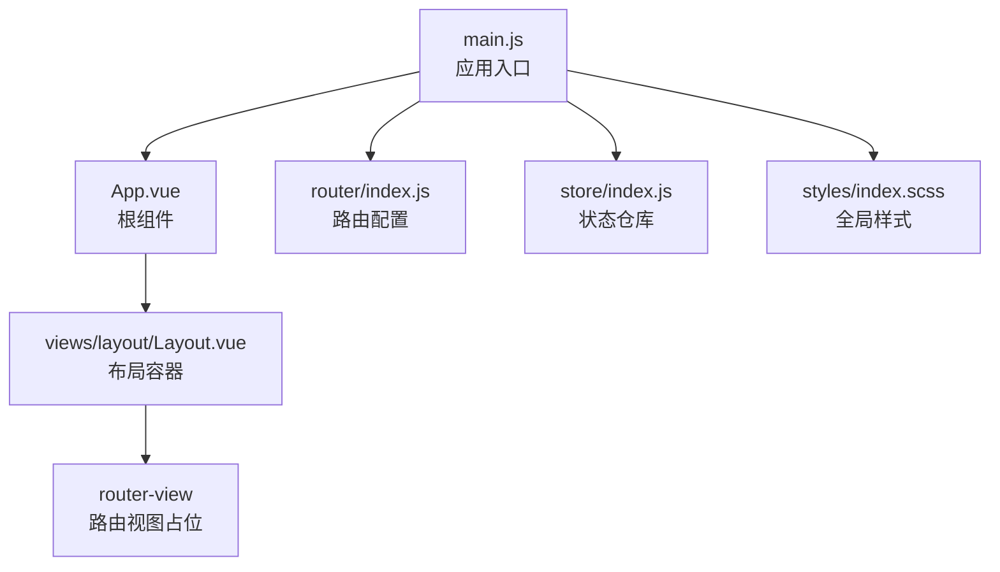
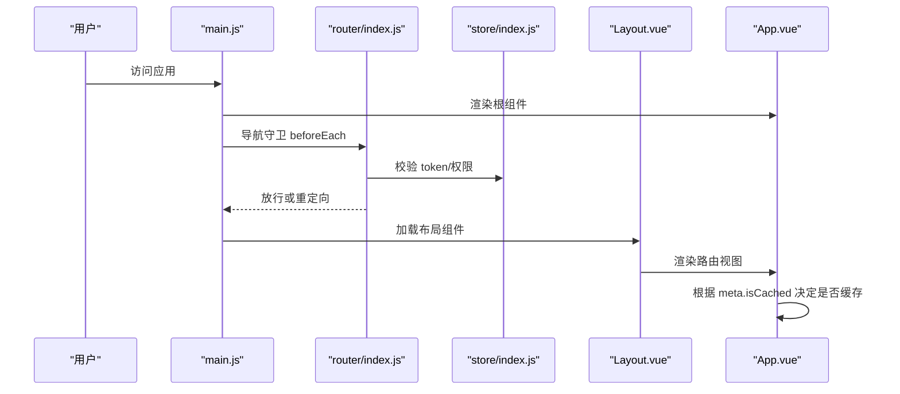
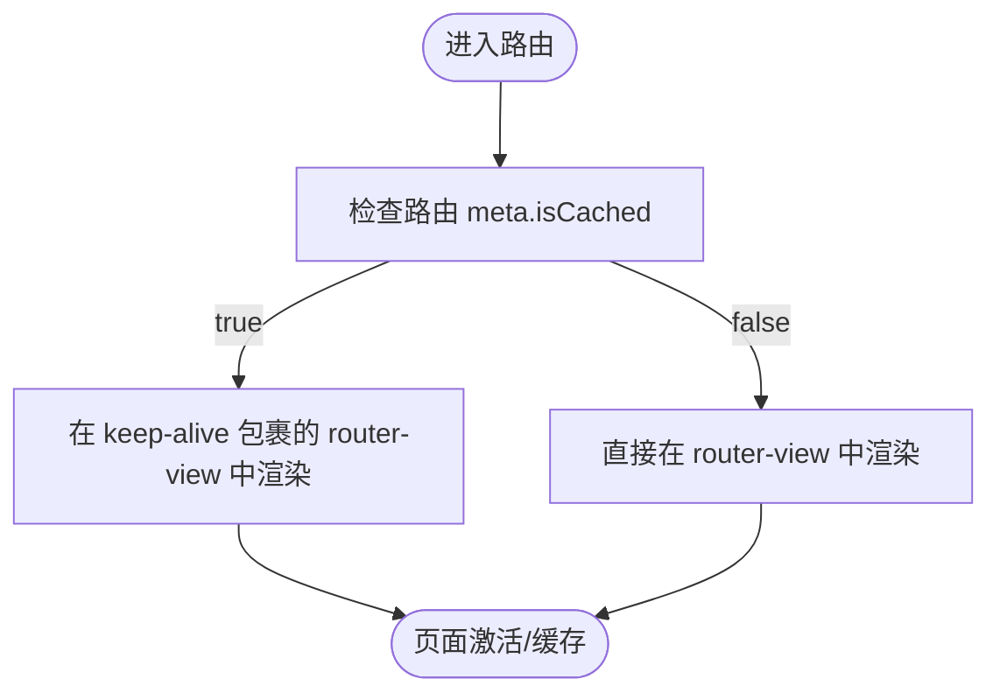
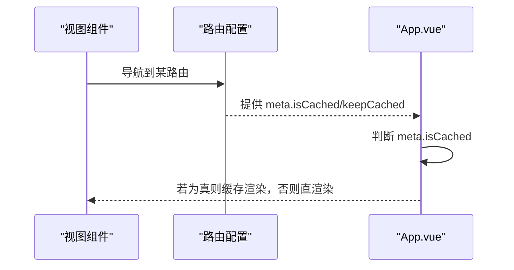
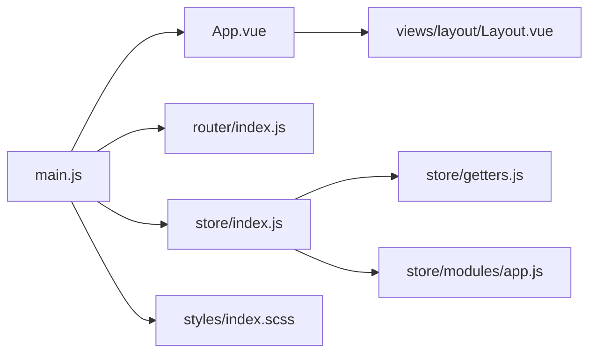

# 根组件设计

<cite>
**本文引用的文件**
- [App.vue](file://src/App.vue)
- [main.js](file://src/main.js)
- [router/index.js](file://src/router/index.js)
- [store/index.js](file://src/store/index.js)
- [store/modules/app.js](file://src/store/modules/app.js)
- [store/getters.js](file://src/store/getters.js)
- [views/layout/Layout.vue](file://src/views/layout/Layout.vue)
- [styles/index.scss](file://src/styles/index.scss)
- [router/normal/homeSchool.js](file://src/router/normal/homeSchool.js)
- [router/modules/studentAwarding/studentAwarding.js](file://src/router/modules/studentAwarding/studentAwarding.js)
- [views/homePage/index.vue](file://src/views/homePage/index.vue)
</cite>

## 目录
1. [引言](#引言)
2. [项目结构](#项目结构)
3. [核心组件](#核心组件)
4. [架构总览](#架构总览)
5. [详细组件分析](#详细组件分析)
6. [依赖分析](#依赖分析)
7. [性能考虑](#性能考虑)
8. [故障排查指南](#故障排查指南)
9. [结论](#结论)
10. [附录](#附录)

## 引言
本设计文档聚焦于校园管理系统的根组件 App.vue 的设计理念与实现方式，围绕以下主题展开：
- 路由缓存机制的实现原理与策略
- keep-alive 组件的使用与条件渲染逻辑
- 根组件生命周期管理与全局样式配置
- 响应式设计适配与打印样式
- 性能优化策略（命中率优化、内存泄漏防护）
- 扩展最佳实践（全局状态管理集成、错误边界处理、国际化支持）

## 项目结构
应用采用典型的 Vue 单页应用结构，入口文件负责挂载根组件，路由与状态管理分别在独立模块中组织，布局组件承载页面骨架，样式通过全局样式文件统一规范。

图表来源
- [main.js:216-220](file://src/main.js#L216-L220)
- [App.vue:1-9](file://src/App.vue#L1-L9)
- [router/index.js:1-207](file://src/router/index.js#L1-L207)
- [store/index.js:1-20](file://src/store/index.js#L1-L20)
- [views/layout/Layout.vue:1-92](file://src/views/layout/Layout.vue#L1-L92)
- [styles/index.scss:1-349](file://src/styles/index.scss#L1-L349)

章节来源
- [main.js:1-221](file://src/main.js#L1-L221)
- [router/index.js:1-207](file://src/router/index.js#L1-L207)
- [store/index.js:1-20](file://src/store/index.js#L1-L20)
- [styles/index.scss:1-349](file://src/styles/index.scss#L1-L349)

## 核心组件
- 根组件 App.vue：提供路由视图的条件渲染与基础样式，通过 meta 字段控制是否启用 keep-alive 缓存。
- 布局组件 Layout.vue：承载导航栏、侧边栏与主内容区域，负责权限控制与页面跳转。
- 全局样式 index.scss：统一字体、滚动条、表格、按钮等基础样式，并提供打印相关样式规则。
- 路由与状态：路由配置集中管理，状态通过 Vuex 模块化管理，包含用户、应用、组织等模块。

章节来源
- [App.vue:1-183](file://src/App.vue#L1-L183)
- [views/layout/Layout.vue:1-507](file://src/views/layout/Layout.vue#L1-L507)
- [styles/index.scss:1-349](file://src/styles/index.scss#L1-L349)
- [store/index.js:1-20](file://src/store/index.js#L1-L20)

## 架构总览
应用启动流程如下：main.js 创建 Vue 实例并挂载根组件；路由守卫在导航前进行鉴权与权限校验；布局组件根据权限与模块配置渲染导航与内容；根组件根据路由 meta 控制是否缓存当前视图。

图表来源
- [main.js:73-198](file://src/main.js#L73-L198)
- [router/index.js:40-199](file://src/router/index.js#L40-L199)
- [store/index.js:10-17](file://src/store/index.js#L10-L17)
- [views/layout/Layout.vue:1-92](file://src/views/layout/Layout.vue#L1-L92)
- [App.vue:3-6](file://src/App.vue#L3-L6)

## 详细组件分析

### 根组件 App.vue 设计与实现
- 路由视图条件渲染
  - 使用两个 router-view：一个包裹在 keep-alive 中，仅当路由 meta.isCached 为真时渲染；另一个在 meta.isCached 为假时渲染。
  - 这种策略允许开发者对需要保持状态的页面启用缓存，对不需要的状态页面直接销毁重建。
- 生命周期管理
  - 提供 beforeDestroy 生命周期钩子，清理会话存储标记，防止遗留状态影响后续会话。
- 全局样式与响应式
  - 定义通用样式类与 Element UI 相关样式覆盖，确保按钮、表格、滚动条等一致表现。
  - 提供媒体查询与打印样式，适配不同屏幕尺寸与打印场景。

图表来源
- [App.vue:3-6](file://src/App.vue#L3-L6)

章节来源
- [App.vue:1-183](file://src/App.vue#L1-L183)

### 路由缓存机制与策略
- 缓存控制字段
  - 路由元信息中使用 isCached 与 keepCached 字段共同控制缓存行为，其中 isCached 更贴近根组件的判断逻辑。
- 路由配置示例
  - 在多个模块路由中为列表页、详情页等设置 meta.keepCached 或 meta.isCached，以启用缓存。
- 与布局的关系
  - 布局组件 Layout.vue 作为主容器，其内部的 router-view 由根组件的条件渲染策略决定是否缓存。

图表来源
- [router/normal/homeSchool.js:1082-1116](file://src/router/normal/homeSchool.js#L1082-L1116)
- [router/modules/studentAwarding/studentAwarding.js:120-163](file://src/router/modules/studentAwarding/studentAwarding.js#L120-L163)
- [App.vue:3-6](file://src/App.vue#L3-L6)

章节来源
- [router/normal/homeSchool.js:1082-1116](file://src/router/normal/homeSchool.js#L1082-L1116)
- [router/modules/studentAwarding/studentAwarding.js:120-163](file://src/router/modules/studentAwarding/studentAwarding.js#L120-L163)
- [App.vue:3-6](file://src/App.vue#L3-L6)

### keep-alive 使用策略
- 适用场景
  - 列表页、筛选条件复杂且需要保留分页与搜索状态的页面。
- 不适用场景
  - 需要每次进入都刷新最新数据的页面，或存在敏感信息需强制销毁的页面。
- 策略建议
  - 对高频访问且状态稳定的页面启用缓存，避免重复请求与初始化开销。
  - 对需要严格数据隔离的页面禁用缓存，确保安全与一致性。

章节来源
- [App.vue:3-6](file://src/App.vue#L3-L6)

### 路由视图条件渲染逻辑
- 判断依据
  - 以路由 meta.isCached 为判断依据，true 时由 keep-alive 包裹的 router-view 渲染，false 时由普通 router-view 渲染。
- 与布局组件关系
  - 布局组件内部的 router-view 由根组件的条件渲染策略决定是否缓存，从而实现对整个主内容区域的缓存控制。

章节来源
- [App.vue:3-6](file://src/App.vue#L3-L6)
- [views/layout/Layout.vue:77-77](file://src/views/layout/Layout.vue#L77-L77)

### 根组件生命周期管理
- beforeDestroy 钩子
  - 在组件销毁前清理会话存储标记，避免跨会话状态污染。
- 与路由守卫配合
  - 路由守卫在导航过程中可能修改会话状态，根组件负责在合适时机清理，保证应用状态一致性。

章节来源
- [App.vue:14-16](file://src/App.vue#L14-L16)
- [main.js:73-198](file://src/main.js#L73-L198)

### 全局样式配置与响应式设计
- 全局样式
  - 统一字体、字号、颜色与间距，确保组件间视觉一致性。
  - 覆盖 Element UI 默认样式，如按钮、表格、滚动条等。
- 响应式与打印
  - 提供媒体查询适配不同屏幕尺寸，优化表格与滚动条显示。
  - 提供打印样式，隐藏打印无关元素，突出打印内容。

章节来源
- [styles/index.scss:1-349](file://src/styles/index.scss#L1-L349)
- [App.vue:98-182](file://src/App.vue#L98-L182)

### 视图组件与窗口尺寸适配
- 视图组件示例
  - 首页视图组件通过混入实现窗口尺寸监听，动态计算页面高度，提升在不同分辨率下的体验。
- 与根组件关系
  - 根组件负责顶层布局与缓存策略，具体页面的交互与适配由各视图组件实现。

章节来源
- [views/homePage/index.vue:1-82](file://src/views/homePage/index.vue#L1-L82)

## 依赖分析
- 入口依赖
  - main.js 依赖 App.vue、router、store、Element UI、全局样式与过滤器等。
- 路由依赖
  - router/index.js 组织常量路由与模块化路由，导出路由实例。
- 状态依赖
  - store/index.js 汇聚 app、user、org 模块与 getters，提供全局状态访问。
- 根组件依赖
  - App.vue 依赖路由元信息控制缓存，依赖全局样式保证一致外观。

图表来源
- [main.js:1-221](file://src/main.js#L1-L221)
- [router/index.js:1-207](file://src/router/index.js#L1-L207)
- [store/index.js:1-20](file://src/store/index.js#L1-L20)
- [store/getters.js:1-26](file://src/store/getters.js#L1-L26)
- [store/modules/app.js:1-54](file://src/store/modules/app.js#L1-L54)
- [App.vue:1-183](file://src/App.vue#L1-L183)
- [views/layout/Layout.vue:1-507](file://src/views/layout/Layout.vue#L1-L507)
- [styles/index.scss:1-349](file://src/styles/index.scss#L1-L349)

章节来源
- [main.js:1-221](file://src/main.js#L1-L221)
- [router/index.js:1-207](file://src/router/index.js#L1-L207)
- [store/index.js:1-20](file://src/store/index.js#L1-L20)
- [store/getters.js:1-26](file://src/store/getters.js#L1-L26)
- [store/modules/app.js:1-54](file://src/store/modules/app.js#L1-L54)
- [App.vue:1-183](file://src/App.vue#L1-L183)
- [views/layout/Layout.vue:1-507](file://src/views/layout/Layout.vue#L1-L507)
- [styles/index.scss:1-349](file://src/styles/index.scss#L1-L349)

## 性能考虑
- 路由缓存命中率优化
  - 对频繁切换但状态稳定的页面启用缓存，减少重复初始化与网络请求。
  - 对需要实时数据的页面禁用缓存，确保数据新鲜度。
- 内存泄漏防护
  - 在根组件销毁阶段清理会话存储标记，避免跨会话状态残留。
  - 在视图组件中及时清理定时器、事件监听器与订阅，防止内存泄漏。
- 渲染与样式优化
  - 使用媒体查询与打印样式，减少不必要的 DOM 与样式计算。
  - 合理使用 keep-alive 缓存，避免缓存过多导致内存占用过高。

章节来源
- [App.vue:14-16](file://src/App.vue#L14-L16)
- [App.vue:3-6](file://src/App.vue#L3-L6)
- [styles/index.scss:107-182](file://src/styles/index.scss#L107-L182)

## 故障排查指南
- 路由守卫与权限
  - 检查路由守卫中的白名单与权限路径匹配逻辑，确保放行与重定向正确。
- 缓存异常
  - 若发现页面状态未更新，确认路由 meta.isCached/keepCached 配置是否符合预期。
- 样式冲突
  - 若出现样式错乱，检查全局样式与组件局部样式的优先级，必要时使用作用域与深度选择器。
- 错误处理
  - 生产环境下可通过全局错误处理器记录错误日志，便于定位问题。

章节来源
- [main.js:73-198](file://src/main.js#L73-L198)
- [main.js:205-214](file://src/main.js#L205-L214)
- [styles/index.scss:1-349](file://src/styles/index.scss#L1-L349)

## 结论
App.vue 作为根组件，通过 meta.isCached 字段实现了灵活的路由缓存控制，结合 keep-alive 与条件渲染，既提升了用户体验，又兼顾了性能与安全性。配合全局样式与路由守卫，系统在功能完整性与运行效率之间取得了良好平衡。后续可在国际化、错误边界与全局状态集成方面进一步完善。

## 附录
- 最佳实践清单
  - 明确区分需要缓存与不需要缓存的页面，避免滥用缓存。
  - 在视图组件中做好资源清理，防止内存泄漏。
  - 使用媒体查询与打印样式提升多端体验。
  - 在生产环境启用全局错误处理，完善日志收集。