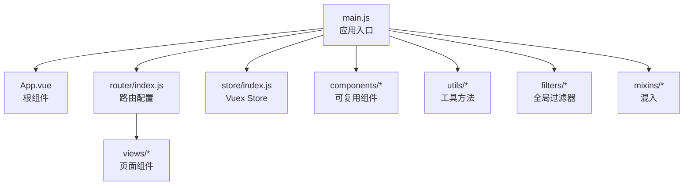
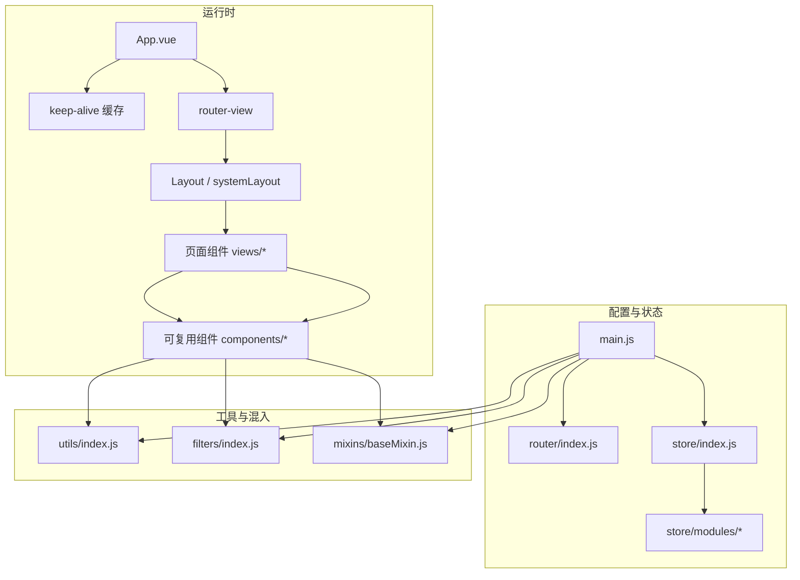
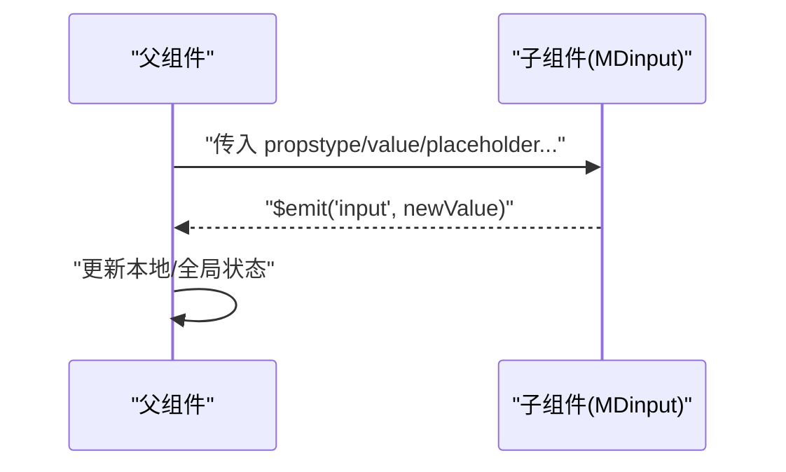
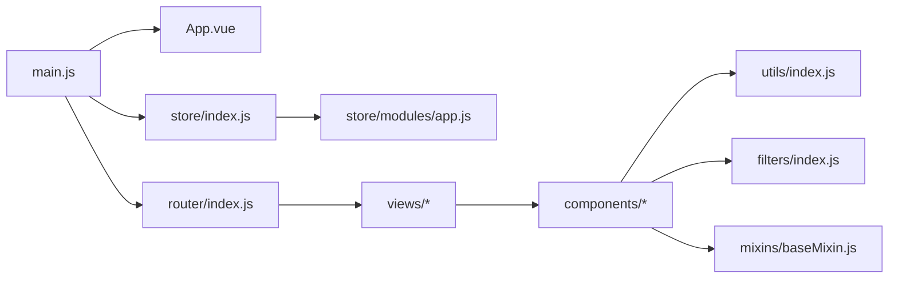
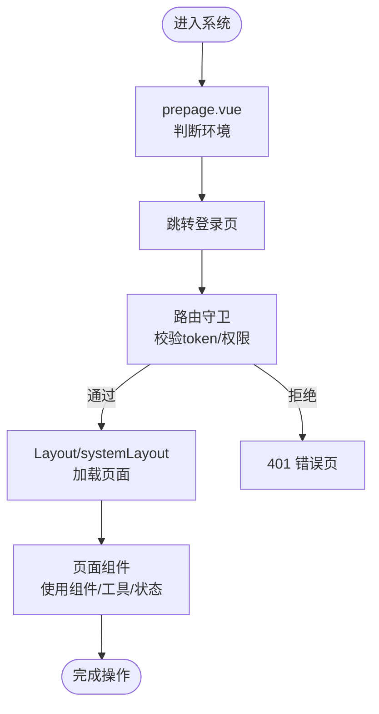

# 组件架构

<cite>
**本文引用的文件**
- [App.vue](file://src/App.vue)
- [main.js](file://src/main.js)
- [router/index.js](file://src/router/index.js)
- [store/index.js](file://src/store/index.js)
- [store/modules/app.js](file://src/store/modules/app.js)
- [components/DefaultPage/index.vue](file://src/components/DefaultPage/index.vue)
- [components/Charts/barPercent.vue](file://src/components/Charts/barPercent.vue)
- [components/MDinput/index.vue](file://src/components/MDinput/index.vue)
- [components/Upload/singleImage.vue](file://src/components/Upload/singleImage.vue)
- [mixins/baseMixin.js](file://src/mixins/baseMixin.js)
- [utils/index.js](file://src/utils/index.js)
- [filters/index.js](file://src/filters/index.js)
- [views/login/prepage.vue](file://src/views/login/prepage.vue)
</cite>

## 目录
1. [引言](#引言)
2. [项目结构](#项目结构)
3. [核心组件](#核心组件)
4. [架构总览](#架构总览)
5. [组件详细分析](#组件详细分析)
6. [依赖关系分析](#依赖关系分析)
7. [性能考量](#性能考量)
8. [故障排查指南](#故障排查指南)
9. [结论](#结论)
10. [附录](#附录)

## 引言
本文件面向校园管理系统前端的组件架构，聚焦于根组件 App.vue 的设计理念、布局组件的职责划分、页面组件的组织方式；总结可复用组件的设计原则（单一职责、props 设计、事件传递）；梳理组件间通信模式（父子、兄弟、跨层级）；阐述生命周期管理、组件注册机制与动态组件加载策略；并结合项目实际给出设计模式、组合式 API 使用建议与性能优化策略。

## 项目结构
项目采用典型的 Vue 单页应用结构，入口在 main.js 中挂载根组件 App.vue；路由由 router/index.js 统一配置，按业务域拆分为多个模块；状态管理通过 Vuex store/modules 进行模块化；通用工具、过滤器、混入与可复用组件分别位于 utils、filters、mixins、components 目录；页面组件集中于 views 下按功能域组织。

图表来源
- [main.js:1-221](file://src/main.js#L1-L221)
- [App.vue:1-183](file://src/App.vue#L1-L183)
- [router/index.js:1-207](file://src/router/index.js#L1-L207)
- [store/index.js:1-20](file://src/store/index.js#L1-L20)

章节来源
- [main.js:1-221](file://src/main.js#L1-L221)
- [router/index.js:1-207](file://src/router/index.js#L1-L207)
- [store/index.js:1-20](file://src/store/index.js#L1-L20)

## 核心组件
- 根组件 App.vue：负责页面缓存控制与全局样式，通过 keep-alive 包裹 router-view，并根据路由 meta 控制是否缓存，减少重复渲染开销。
- 应用入口 main.js：全局引入 ElementUI、打印插件、全局过滤器、多选组件等；统一注册全局组件；配置路由守卫与进度条；挂载根实例。
- 路由 router/index.js：集中声明常量路由与业务模块路由，支持懒加载与权限路径校验；提供系统管理与主模块的布局嵌套。
- 状态 store/index.js：聚合 app、user、org 模块；通过 getters 提供派生状态访问。
- 可复用组件：如 DefaultPage（默认占位页）、Charts（图表封装）、MDinput（输入框）、Upload（上传）等，均以单一职责、明确 props、事件发射的方式设计，便于跨页面复用。

章节来源
- [App.vue:1-183](file://src/App.vue#L1-L183)
- [main.js:1-221](file://src/main.js#L1-L221)
- [router/index.js:1-207](file://src/router/index.js#L1-L207)
- [store/index.js:1-20](file://src/store/index.js#L1-L20)
- [store/modules/app.js:1-54](file://src/store/modules/app.js#L1-L54)

## 架构总览
整体采用“入口 -> 路由 -> 布局/页面 -> 组件”的层次化结构。路由层负责导航与权限拦截；布局层承载菜单、面包屑、内容区域；页面层承载具体业务逻辑；组件层提供可复用能力。状态层通过 Vuex 提供跨组件共享数据与行为。

图表来源
- [App.vue:1-183](file://src/App.vue#L1-L183)
- [main.js:1-221](file://src/main.js#L1-L221)
- [router/index.js:1-207](file://src/router/index.js#L1-L207)
- [store/index.js:1-20](file://src/store/index.js#L1-L20)
- [store/modules/app.js:1-54](file://src/store/modules/app.js#L1-L54)
- [utils/index.js:1-385](file://src/utils/index.js#L1-L385)
- [filters/index.js:1-121](file://src/filters/index.js#L1-L121)
- [mixins/baseMixin.js:1-103](file://src/mixins/baseMixin.js#L1-L103)

## 组件详细分析

### 根组件 App.vue
- 设计理念
  - 通过 keep-alive 与条件渲染 router-view，依据路由 meta.isCached 决定是否启用缓存，降低频繁切换带来的渲染成本。
  - 提供全局样式与打印样式适配，保证跨页面一致性。
- 生命周期
  - beforeDestroy 中清理登录态标记，避免历史状态残留。
- 与路由/状态协作
  - 与路由守卫配合，确保页面切换时的权限与登录态处理生效。

章节来源
- [App.vue:1-183](file://src/App.vue#L1-L183)

### 布局与页面组织
- 布局组件
  - 通过 router/index.js 中的 Layout 与 systemLayout 定义主框架与系统管理框架，子路由承载各业务模块页面。
- 页面组件组织
  - views 下按业务域划分，每个页面组件独立负责自身视图与交互；通过 props、事件与状态进行解耦。
- 登录前置页
  - views/login/prepage.vue 根据环境跳转至不同登录页，承担入口分流职责。

章节来源
- [router/index.js:1-207](file://src/router/index.js#L1-L207)
- [views/login/prepage.vue:1-26](file://src/views/login/prepage.vue#L1-L26)

### 可复用组件设计原则
- 单一职责
  - DefaultPage：仅负责默认占位展示；Charts：仅负责图表渲染；MDinput：仅负责输入体验与校验；Upload：仅负责图片上传流程。
- Props 设计
  - 明确类型与默认值，如 DefaultPage 的 Mes、Charts 的 className/id/width/height/dataNum、MDinput 的 type/value/placeholder/readonly/disabled 等。
- 事件传递
  - 通过 $emit 触发父组件回调，如 Upload 的 input 事件、MDinput 的 input 事件，形成清晰的自底向上反馈通道。
- 数据流
  - 组件内部通过 props 接收外部数据，通过事件向上传递变更，必要时通过 Vuex 或全局工具进行跨层通信。

章节来源
- [components/DefaultPage/index.vue:1-35](file://src/components/DefaultPage/index.vue#L1-L35)
- [components/Charts/barPercent.vue:1-105](file://src/components/Charts/barPercent.vue#L1-L105)
- [components/MDinput/index.vue:1-298](file://src/components/MDinput/index.vue#L1-L298)
- [components/Upload/singleImage.vue:1-128](file://src/components/Upload/singleImage.vue#L1-L128)

### 组件间通信模式

#### 父子组件通信
- 父传子：通过 props 传递数据与配置（如 DefaultPage.Mes、Charts.dataNum、MDinput 的属性集合）。
- 子传父：通过 $emit 触发事件，父组件监听并更新状态（如 Upload.input、MDinput.input）。

图表来源
- [components/MDinput/index.vue:66-86](file://src/components/MDinput/index.vue#L66-L86)

章节来源
- [components/MDinput/index.vue:1-298](file://src/components/MDinput/index.vue#L1-L298)
- [components/Upload/singleImage.vue:44-53](file://src/components/Upload/singleImage.vue#L44-L53)

#### 兄弟组件通信
- 借助共同父组件进行事件转发，或通过全局状态（Vuex）共享数据。
- 通过 utils/index.js 的工具方法（如跳转、权限判断）在兄弟间传递指令。

章节来源
- [utils/index.js:247-252](file://src/utils/index.js#L247-L252)

#### 跨层级通信
- 全局状态：store/modules/app.js 提供主题、分页、作业等跨页面共享状态；通过 mutations 修改。
- 全局工具：utils/index.js 提供权限判断、跳转、解析时间等工具，供任意层级调用。
- 全局过滤器：filters/index.js 提供时间、格式化等过滤器，跨组件复用。

章节来源
- [store/modules/app.js:1-54](file://src/store/modules/app.js#L1-L54)
- [utils/index.js:1-385](file://src/utils/index.js#L1-L385)
- [filters/index.js:1-121](file://src/filters/index.js#L1-L121)

### 生命周期管理
- 组件生命周期钩子
  - activated：在 baseMixin.js 中统一处理表格布局刷新，避免路由切换导致的表格错位。
  - beforeMount/beforeDestroy：在 MDinput 中初始化值与清理登录态标记。
- 页面级生命周期
  - main.js 中在路由 beforeEach/afterEach 中处理登录态、权限与进度条，保障页面切换的一致性。

章节来源
- [mixins/baseMixin.js:21-28](file://src/mixins/baseMixin.js#L21-L28)
- [components/MDinput/index.vue:61-65](file://src/components/MDinput/index.vue#L61-L65)
- [main.js:73-203](file://src/main.js#L73-L203)

### 组件注册机制与动态组件加载
- 全局注册
  - main.js 中通过 Vue.component 注册全局组件（Multiselect、Sticky、Backtool），并通过 Vue.use 安装插件（ElementUI、Print、VueResource）。
- 动态组件加载
  - 路由层大量使用 import() 实现懒加载，减少首屏体积；App.vue 中根据路由 meta.isCached 控制 keep-alive 缓存策略。

章节来源
- [main.js:16-55](file://src/main.js#L16-L55)
- [router/index.js:104-125](file://src/router/index.js#L104-L125)
- [App.vue:3-6](file://src/App.vue#L3-L6)

### 设计模式与组合式 API 使用
- 设计模式
  - 混入（Mixin）：baseMixin.js 抽取分页、导出、跳转、日期等通用逻辑，提升代码复用性。
  - 组件职责分离：图表、输入、上传等组件各自专注单一能力，通过 props/事件解耦。
- 组合式 API 建议
  - 当前项目主要基于选项式 API；若需进一步增强逻辑复用与类型推断，可在新组件中逐步引入组合式 API（如使用 <script setup> 与 ref/computed/watch），并与现有 Vuex/mixins 协同。

章节来源
- [mixins/baseMixin.js:1-103](file://src/mixins/baseMixin.js#L1-L103)

## 依赖关系分析

图表来源
- [main.js:1-221](file://src/main.js#L1-L221)
- [router/index.js:1-207](file://src/router/index.js#L1-L207)
- [store/index.js:1-20](file://src/store/index.js#L1-L20)
- [store/modules/app.js:1-54](file://src/store/modules/app.js#L1-L54)
- [utils/index.js:1-385](file://src/utils/index.js#L1-L385)
- [filters/index.js:1-121](file://src/filters/index.js#L1-L121)
- [mixins/baseMixin.js:1-103](file://src/mixins/baseMixin.js#L1-L103)

章节来源
- [main.js:1-221](file://src/main.js#L1-L221)
- [router/index.js:1-207](file://src/router/index.js#L1-L207)
- [store/index.js:1-20](file://src/store/index.js#L1-L20)
- [store/modules/app.js:1-54](file://src/store/modules/app.js#L1-L54)
- [utils/index.js:1-385](file://src/utils/index.js#L1-L385)
- [filters/index.js:1-121](file://src/filters/index.js#L1-L121)
- [mixins/baseMixin.js:1-103](file://src/mixins/baseMixin.js#L1-L103)

## 性能考量
- 路由缓存
  - App.vue 中对可缓存页面使用 keep-alive，减少重复渲染；建议对大数据列表、复杂图表等页面合理设置缓存策略。
- 懒加载
  - 路由层广泛使用 import() 按需加载，降低首屏资源压力。
- 渲染优化
  - baseMixin.js 在 activated 中触发表格布局刷新，避免布局错位；建议在大数据场景下结合虚拟滚动与分页。
- 状态与工具
  - 将跨页面共享的状态收敛至 Vuex，避免重复请求；将通用逻辑抽离至 utils/filters/mixins，减少重复计算与 DOM 操作。

章节来源
- [App.vue:3-6](file://src/App.vue#L3-L6)
- [router/index.js:104-125](file://src/router/index.js#L104-L125)
- [mixins/baseMixin.js:21-28](file://src/mixins/baseMixin.js#L21-L28)
- [utils/index.js:1-385](file://src/utils/index.js#L1-L385)

## 故障排查指南
- 登录与权限
  - main.js 中的路由守卫对白名单、token、角色权限进行判断；若出现 401，检查 to.meta.permissionPath 与 store.getters.permission 的匹配。
- 页面空白或布局错位
  - 检查 activated 钩子是否触发表格布局刷新；确认路由 meta.isCached 配置是否符合预期。
- 组件事件未响应
  - 确认子组件是否正确 $emit 事件名与参数；父组件是否正确监听。
- 上传失败
  - 检查 Upload 组件的 token/key 获取流程与 action 地址；确认 beforeUpload 的 Promise 是否正确 resolve/reject。

章节来源
- [main.js:73-203](file://src/main.js#L73-L203)
- [mixins/baseMixin.js:21-28](file://src/mixins/baseMixin.js#L21-L28)
- [components/Upload/singleImage.vue:44-68](file://src/components/Upload/singleImage.vue#L44-L68)

## 结论
该校园管理系统采用清晰的层次化组件架构：根组件负责缓存与全局样式，路由与布局承载导航与页面组织，页面组件聚焦业务逻辑，可复用组件提供高内聚低耦合的能力。通过 Vuex、工具方法与混入实现跨层级通信与通用逻辑复用；路由懒加载与 keep-alive 缓存策略有效平衡了首屏性能与交互体验。建议在后续迭代中逐步引入组合式 API，持续优化状态管理与数据流设计。

## 附录
- 关键流程示意：登录前置页跳转至登录页，路由守卫校验权限后进入主布局，页面组件通过 props/事件与状态协同工作。

图表来源
- [views/login/prepage.vue:1-26](file://src/views/login/prepage.vue#L1-L26)
- [main.js:73-203](file://src/main.js#L73-L203)
- [router/index.js:1-207](file://src/router/index.js#L1-L207)