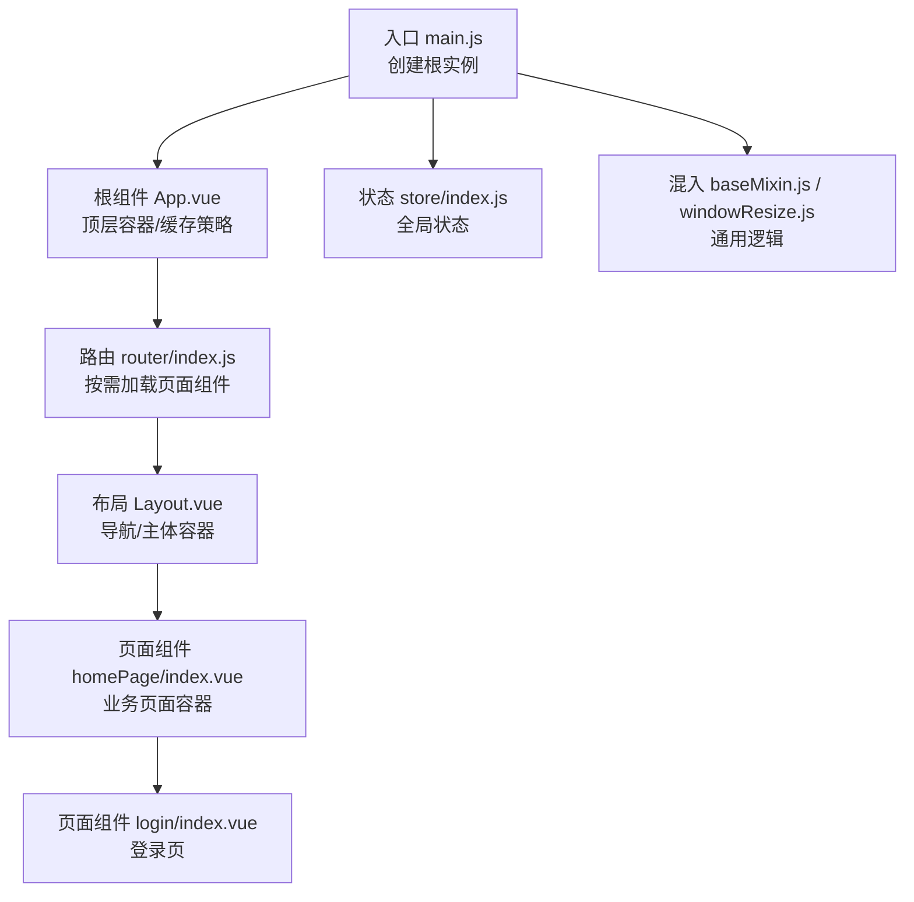
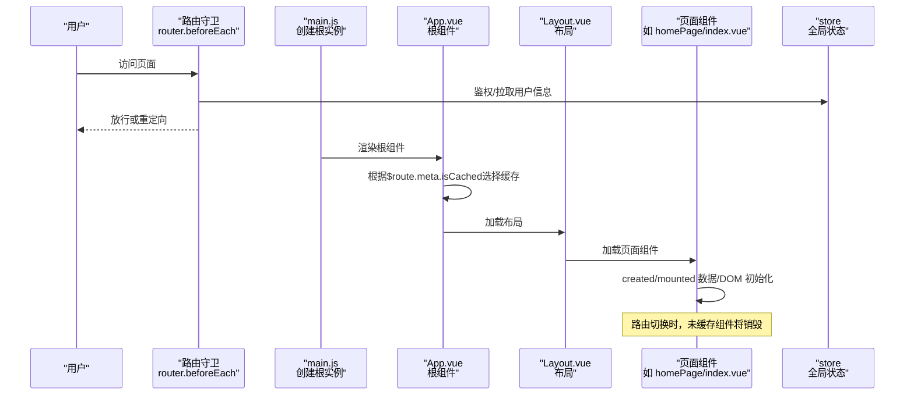
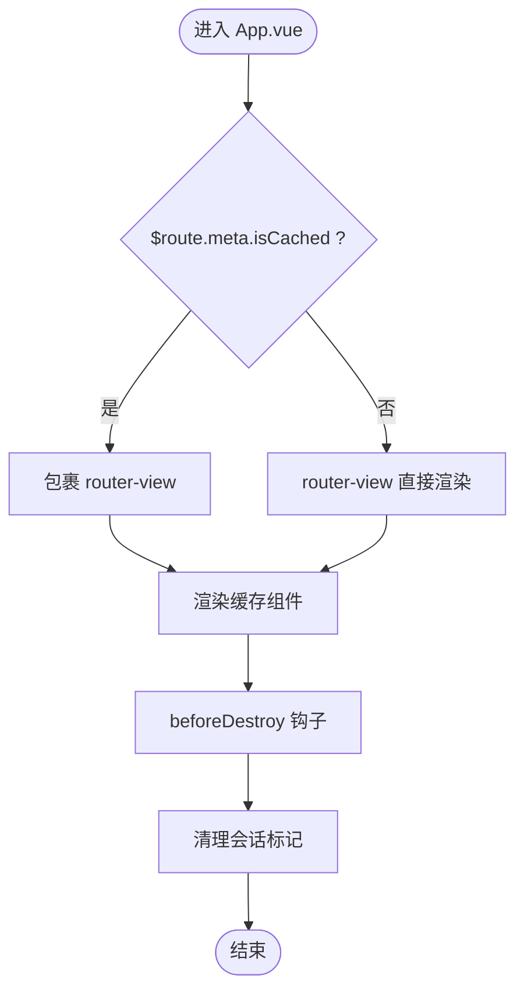
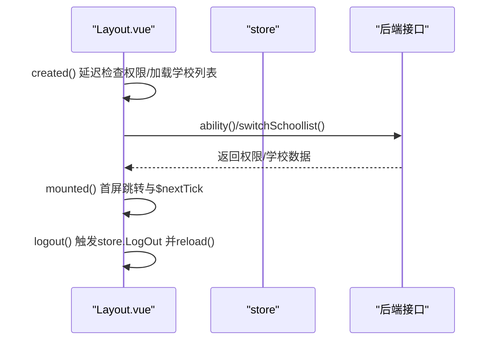
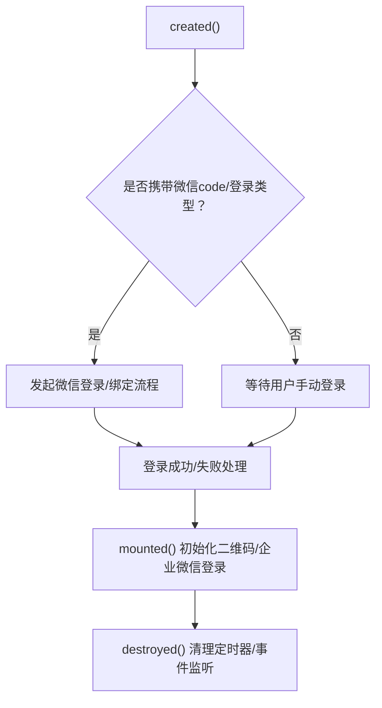
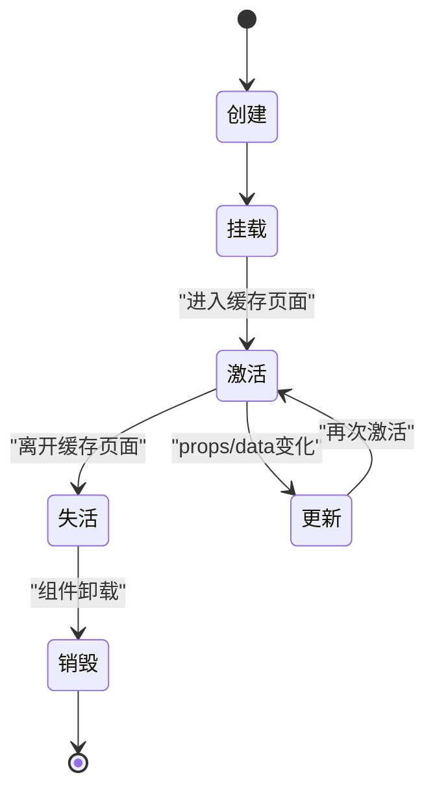
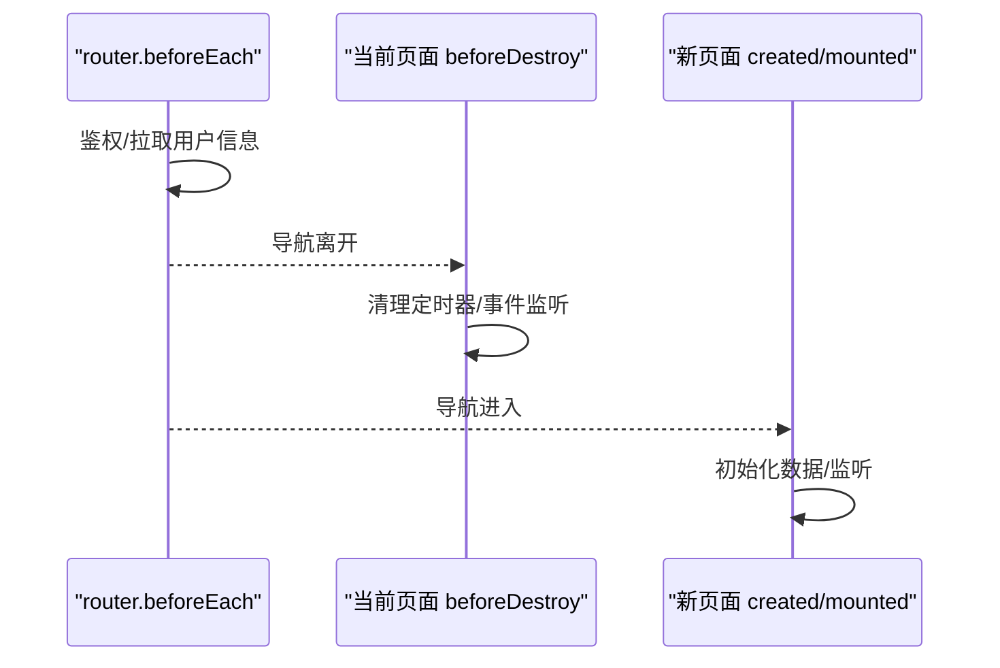
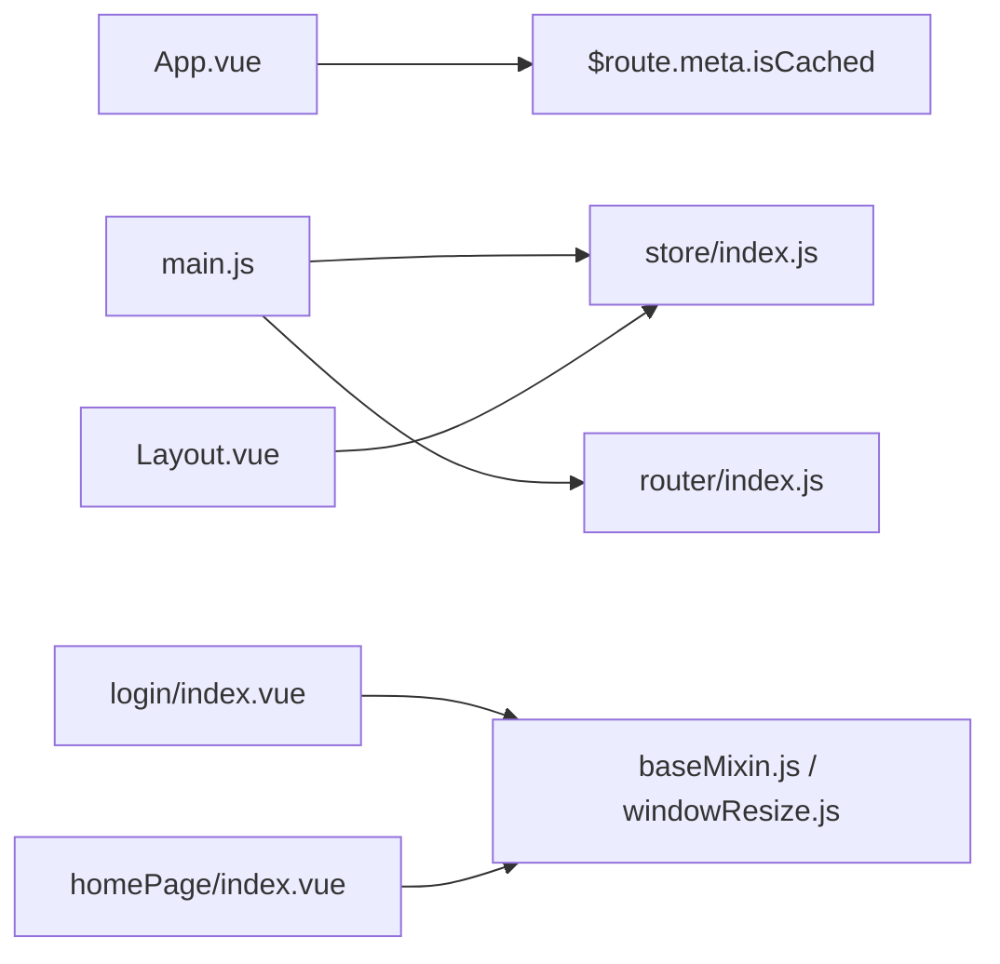

# 组件生命周期

<cite>
**本文引用的文件**
- [App.vue](file://src/App.vue)
- [main.js](file://src/main.js)
- [router/index.js](file://src/router/index.js)
- [views/layout/Layout.vue](file://src/views/layout/Layout.vue)
- [views/homePage/index.vue](file://src/views/homePage/index.vue)
- [views/login/index.vue](file://src/views/login/index.vue)
- [mixins/baseMixin.js](file://src/mixins/baseMixin.js)
- [mixins/windowResize.js](file://src/mixins/windowResize.js)
- [store/index.js](file://src/store/index.js)
</cite>

## 目录
1. [引言](#引言)
2. [项目结构](#项目结构)
3. [核心组件](#核心组件)
4. [架构总览](#架构总览)
5. [详细组件分析](#详细组件分析)
6. [依赖分析](#依赖分析)
7. [性能考量](#性能考量)
8. [故障排查指南](#故障排查指南)
9. [结论](#结论)

## 引言
本文件聚焦于校园管理系统的Vue.js组件生命周期管理，系统梳理从根组件到页面组件、布局组件、混入（mixin）以及路由守卫在生命周期阶段的职责与协作关系。重点覆盖以下方面：
- 根组件App.vue的生命周期管理与清理策略
- 页面组件在创建、挂载、更新、销毁阶段的数据预加载与资源释放
- keep-alive缓存与动态组件的激活/失活处理
- 路由切换时的组件销毁策略与状态清理
- 生命周期相关的调试技巧与性能监控建议

## 项目结构
项目采用经典的Vue CLI结构，包含入口文件、路由配置、Vuex状态管理、全局混入与大量页面组件。根组件负责顶层视图容器与缓存策略；路由负责页面级组件的装载；布局组件承载导航与主体内容；页面组件通过混入复用通用逻辑。

图表来源
- [main.js:216-221](file://src/main.js#L216-L221)
- [App.vue:1-183](file://src/App.vue#L1-L183)
- [router/index.js:1-207](file://src/router/index.js#L1-L207)
- [views/layout/Layout.vue:1-507](file://src/views/layout/Layout.vue#L1-L507)
- [views/homePage/index.vue:1-82](file://src/views/homePage/index.vue#L1-L82)
- [views/login/index.vue:1-769](file://src/views/login/index.vue#L1-L769)
- [store/index.js:1-20](file://src/store/index.js#L1-L20)
- [mixins/baseMixin.js:1-103](file://src/mixins/baseMixin.js#L1-L103)
- [mixins/windowResize.js:1-63](file://src/mixins/windowResize.js#L1-L63)

章节来源
- [main.js:1-221](file://src/main.js#L1-L221)
- [router/index.js:1-207](file://src/router/index.js#L1-L207)

## 核心组件
- 根组件 App.vue：作为应用的顶层容器，负责根据路由元信息决定是否启用keep-alive缓存，并在beforeDestroy中进行必要的清理（如登录态标记）。
- 布局组件 Layout.vue：在created/mounted阶段完成权限能力初始化、导航栏构建与首屏跳转等；在mounted中处理首屏加载与路由替换。
- 页面组件：如homePage/index.vue、login/index.vue等，在各自生命周期中进行数据预加载、事件监听与资源释放。

章节来源
- [App.vue:1-183](file://src/App.vue#L1-L183)
- [views/layout/Layout.vue:143-196](file://src/views/layout/Layout.vue#L143-L196)
- [views/homePage/index.vue:26-39](file://src/views/homePage/index.vue#L26-L39)
- [views/login/index.vue:121-178](file://src/views/login/index.vue#L121-L178)

## 架构总览
应用通过路由守卫在导航前进行鉴权与用户信息拉取，渲染阶段由App.vue结合路由元信息决定是否使用keep-alive缓存。页面组件通过混入复用通用逻辑，如表格布局修复、窗口尺寸监听与清理。

图表来源
- [main.js:73-198](file://src/main.js#L73-L198)
- [main.js:201-203](file://src/main.js#L201-L203)
- [App.vue:3-7](file://src/App.vue#L3-L7)
- [views/layout/Layout.vue:1-92](file://src/views/layout/Layout.vue#L1-L92)
- [views/homePage/index.vue:1-82](file://src/views/homePage/index.vue#L1-L82)

## 详细组件分析

### 根组件 App.vue 的生命周期管理
- 缓存策略：通过router-view条件渲染配合$route.meta.isCached，实现对部分页面的keep-alive缓存，减少重复渲染与数据请求开销。
- 清理工作：在beforeDestroy中写入会话状态，确保离开应用时清理登录相关标记，避免遗留状态影响后续流程。

图表来源
- [App.vue:3-7](file://src/App.vue#L3-L7)
- [App.vue:14-16](file://src/App.vue#L14-L16)

章节来源
- [App.vue:1-183](file://src/App.vue#L1-L183)

### 布局组件 Layout.vue 的生命周期优化
- created阶段：
  - 延迟拉取权限能力，判断是否允许切换学校并加载学校列表。
  - 动态注入首页导航项与外部链接，基于环境变量与令牌状态。
- mounted阶段：
  - 首次加载场景下，利用$nextTick与DOM查询进行路由替换，确保首屏跳转至首个可用导航项。
  - 提供切换学校功能，完成后刷新页面以重建路由对象，避免历史路由导致的异常。

图表来源
- [views/layout/Layout.vue:143-151](file://src/views/layout/Layout.vue#L143-L151)
- [views/layout/Layout.vue:176-195](file://src/views/layout/Layout.vue#L176-L195)
- [views/layout/Layout.vue:198-218](file://src/views/layout/Layout.vue#L198-L218)
- [views/layout/Layout.vue:247-252](file://src/views/layout/Layout.vue#L247-L252)

章节来源
- [views/layout/Layout.vue:143-196](file://src/views/layout/Layout.vue#L143-L196)

### 页面组件生命周期优化（以homePage/index.vue为例）
- 组件职责：作为主页容器，引入Main与Aside两个子组件，自身在created/mounted阶段保持简洁，将复杂逻辑下沉至子组件与混入。
- 推荐实践：
  - 在created阶段进行轻量数据预加载（如查询参数准备），避免阻塞首屏渲染。
  - 在mounted阶段进行DOM相关操作，如表格布局修复（通过混入activated钩子）。
  - 在beforeDestroy阶段移除事件监听与定时器，释放资源。

章节来源
- [views/homePage/index.vue:26-39](file://src/views/homePage/index.vue#L26-L39)

### 登录页组件生命周期与资源释放（以login/index.vue为例）
- created阶段：
  - 微信登录场景下，根据路由参数发起登录流程，处理首次绑定微信与多学校选择等分支。
- mounted阶段：
  - 初始化二维码登录与企业微信登录链接，拉取初始化数据并创建登录实例。
- destroyed阶段：
  - 可在此处补充清理逻辑（如定时器、事件监听），确保组件销毁时不会残留副作用。

图表来源
- [views/login/index.vue:121-178](file://src/views/login/index.vue#L121-L178)
- [views/login/index.vue:312-538](file://src/views/login/index.vue#L312-L538)

章节来源
- [views/login/index.vue:121-178](file://src/views/login/index.vue#L121-L178)
- [views/login/index.vue:312-538](file://src/views/login/index.vue#L312-L538)

### keep-alive 与动态组件的生命周期控制
- 缓存策略：App.vue通过$route.meta.isCached控制router-view是否包裹在<keep-alive>中，从而实现对特定页面的缓存。
- 激活/失活：
  - 缓存命中时，组件进入activated钩子，适合做表格布局修复、滚动位置恢复等轻量操作。
  - 组件销毁时进入beforeDestroy/beforeUnmount，适合移除事件监听、清理定时器、释放媒体流等。

图表来源
- [App.vue:3-7](file://src/App.vue#L3-L7)
- [mixins/baseMixin.js:21-28](file://src/mixins/baseMixin.js#L21-L28)

章节来源
- [App.vue:1-183](file://src/App.vue#L1-L183)
- [mixins/baseMixin.js:21-28](file://src/mixins/baseMixin.js#L21-L28)

### 路由切换时的组件销毁策略
- 导航守卫：main.js中的router.beforeEach与router.afterEach分别负责鉴权与进度条收尾，确保每次路由切换都有明确的前置处理与后置收尾。
- 组件销毁：未被keep-alive缓存的页面在路由切换时会被销毁，应在beforeDestroy中统一清理副作用；已缓存的页面通过activated/deactivated进行状态恢复与清理。

图表来源
- [main.js:73-198](file://src/main.js#L73-L198)
- [main.js:201-203](file://src/main.js#L201-L203)

章节来源
- [main.js:73-198](file://src/main.js#L73-L198)
- [main.js:201-203](file://src/main.js#L201-L203)

### 生命周期相关的混入与工具
- baseMixin.js：
  - activated钩子中对表格组件进行布局修复，避免因缓存导致的列宽错位。
  - 提供跳转方法、分页参数变更、导出Excel等通用能力。
- windowResize.js：
  - mounted阶段注册窗口尺寸监听，beforeDestroy阶段移除监听，避免内存泄漏与重复绑定。

章节来源
- [mixins/baseMixin.js:21-28](file://src/mixins/baseMixin.js#L21-L28)
- [mixins/baseMixin.js:36-101](file://src/mixins/baseMixin.js#L36-L101)
- [mixins/windowResize.js:17-32](file://src/mixins/windowResize.js#L17-L32)

## 依赖分析
- 根组件App.vue依赖路由元信息$route.meta.isCached决定缓存策略。
- 布局组件Layout.vue依赖store获取用户信息与权限，同时在created/mounted阶段进行数据与DOM初始化。
- 页面组件通过混入复用通用逻辑，降低重复代码与提升一致性。
- 路由守卫在main.js中集中处理鉴权与进度条，保证导航过程可控。

图表来源
- [App.vue:3-7](file://src/App.vue#L3-L7)
- [views/layout/Layout.vue:95-142](file://src/views/layout/Layout.vue#L95-L142)
- [store/index.js:1-20](file://src/store/index.js#L1-L20)
- [views/homePage/index.vue:18-29](file://src/views/homePage/index.vue#L18-L29)
- [views/login/index.vue:113-119](file://src/views/login/index.vue#L113-L119)
- [main.js:1-221](file://src/main.js#L1-L221)
- [router/index.js:1-207](file://src/router/index.js#L1-L207)

章节来源
- [store/index.js:1-20](file://src/store/index.js#L1-L20)
- [views/layout/Layout.vue:95-142](file://src/views/layout/Layout.vue#L95-L142)
- [views/homePage/index.vue:18-29](file://src/views/homePage/index.vue#L18-L29)
- [views/login/index.vue:113-119](file://src/views/login/index.vue#L113-L119)
- [main.js:1-221](file://src/main.js#L1-L221)
- [router/index.js:1-207](file://src/router/index.js#L1-L207)

## 性能考量
- keep-alive缓存：对频繁切换但数据稳定的页面启用缓存，减少重复渲染与网络请求；对数据实时性强的页面避免缓存。
- 轻量created：尽量将耗时任务延迟到mounted或异步执行，避免阻塞首屏渲染。
- 事件与定时器：在beforeDestroy中统一清理，防止内存泄漏与重复绑定。
- 表格布局修复：通过activated钩子在缓存激活时修复布局，避免频繁重排。
- 路由守卫：在导航前后合理使用进度条与鉴权，避免不必要的重复请求。

## 故障排查指南
- 登录页无法跳转或卡死：
  - 检查created阶段的微信登录流程与多学校选择逻辑，确认登录成功回调与路由跳转链路。
  - 确认destroyed阶段是否存在未清理的定时器或事件监听。
- 首屏跳转异常：
  - 检查Layout.vue的mounted中$nextTick与DOM查询逻辑，确保在真实DOM渲染后再进行路由替换。
- 表格列宽错位：
  - 确认baseMixin.js的activated钩子是否在缓存激活时触发布局修复。
- 窗口尺寸监听导致内存泄漏：
  - 确认windowResize.js的beforeDestroy是否移除了resize监听。

章节来源
- [views/login/index.vue:121-178](file://src/views/login/index.vue#L121-L178)
- [views/login/index.vue:538](file://src/views/login/index.vue#L538)
- [views/layout/Layout.vue:176-195](file://src/views/layout/Layout.vue#L176-L195)
- [mixins/baseMixin.js:21-28](file://src/mixins/baseMixin.js#L21-L28)
- [mixins/windowResize.js:30-32](file://src/mixins/windowResize.js#L30-L32)

## 结论
本项目的生命周期管理遵循“根组件统一容器与缓存策略、布局组件承担导航与初始化、页面组件专注业务、混入复用通用逻辑”的设计原则。通过路由守卫保障导航安全与体验，结合keep-alive与activated/deactivated钩子实现缓存页面的状态恢复与清理。建议在实际开发中持续关注资源释放、事件监听与定时器清理，确保应用在复杂交互下的稳定性与性能表现。