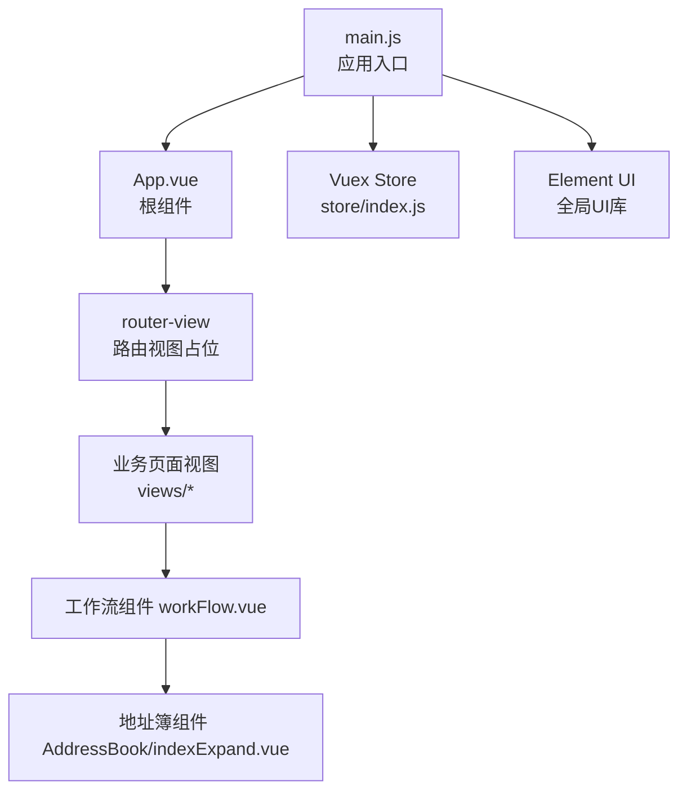
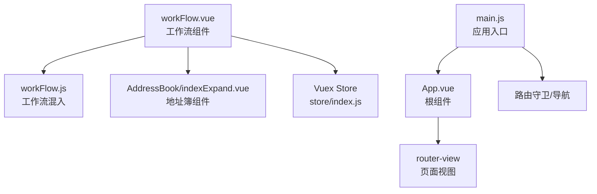
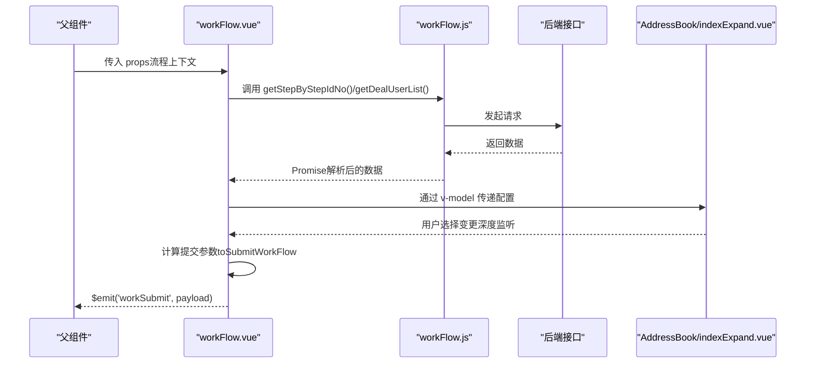
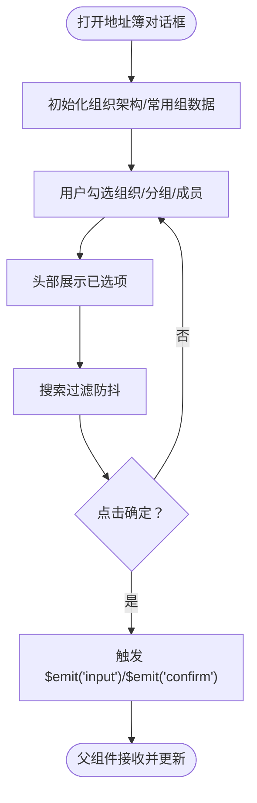
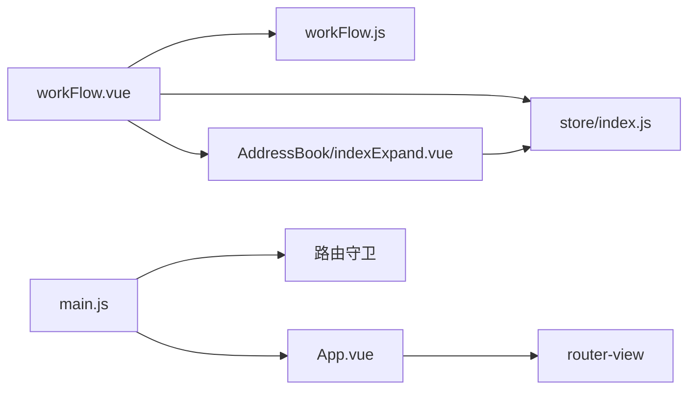

# 组件通信

<cite>
**本文引用的文件**
- [workFlow.vue](file://src/components/workFlow/workFlow.vue)
- [workFlow.js（混入）](file://src/mixins/workFlow.js)
- [indexExpand.vue（地址簿）](file://src/components/AddressBook/indexExpand.vue)
- [main.js（应用入口）](file://src/main.js)
- [App.vue（根组件）](file://src/App.vue)
- [index.js（Vuex Store）](file://src/store/index.js)
- [baseMixin.js（通用混入）](file://src/mixins/baseMixin.js)
</cite>

## 目录
1. [引言](#引言)
2. [项目结构](#项目结构)
3. [核心组件](#核心组件)
4. [架构总览](#架构总览)
5. [详细组件分析](#详细组件分析)
6. [依赖关系分析](#依赖关系分析)
7. [性能考量](#性能考量)
8. [故障排查指南](#故障排查指南)
9. [结论](#结论)
10. [附录](#附录)

## 引言
本文件面向校园管理系统中的Vue.js组件通信，围绕以下目标展开：
- 父子组件通信：props/events机制
- 兄弟组件通信：事件总线模式
- 跨层级通信：provide/inject实现
- 设计原则：数据流向、状态提升、事件冒泡控制
- 复杂业务场景：工作流组件workFlow.vue的通信模式、多层级嵌套组件的状态同步、异步数据传递最佳实践
- 性能优化：事件监听器正确销毁、内存泄漏预防、通信频率控制

## 项目结构
本项目采用典型的Vue单页应用结构，组件位于src/components，页面视图位于src/views，全局状态通过Vuex集中管理，路由在src/router中配置。根组件App.vue包裹整个应用，应用入口main.js负责挂载Vue实例、注册全局插件与指令。

图表来源
- [main.js:1-221](file://src/main.js#L1-L221)
- [App.vue:1-183](file://src/App.vue#L1-L183)
- [index.js:1-20](file://src/store/index.js#L1-L20)

章节来源
- [main.js:1-221](file://src/main.js#L1-L221)
- [App.vue:1-183](file://src/App.vue#L1-L183)
- [index.js:1-20](file://src/store/index.js#L1-L20)

## 核心组件
- 工作流组件 workFlow.vue：负责流程步骤选择、处理人选择、批量意见输入，并通过事件向上提交工作流数据。
- 地址簿组件 AddressBook/indexExpand.vue：提供组织架构与常用组选择能力，支持双向绑定v-model，向外抛出确认事件。
- 通用混入 baseMixin.js：提供分页、导出、日期工具等通用能力。
- 工作流混入 workFlow.js：封装工作流相关API调用，统一Promise封装，供工作流组件复用。
- 应用入口 main.js：全局插件注册、路由守卫、错误处理、Vue实例挂载。
- 根组件 App.vue：页面缓存与路由视图容器。
- Vuex Store：集中状态管理。

章节来源
- [workFlow.vue:1-294](file://src/components/workFlow/workFlow.vue#L1-L294)
- [indexExpand.vue:1-779](file://src/components/AddressBook/indexExpand.vue#L1-L779)
- [baseMixin.js:1-103](file://src/mixins/baseMixin.js#L1-L103)
- [workFlow.js:1-103](file://src/mixins/workFlow.js#L1-L103)
- [main.js:1-221](file://src/main.js#L1-L221)
- [App.vue:1-183](file://src/App.vue#L1-L183)
- [index.js:1-20](file://src/store/index.js#L1-L20)

## 架构总览
工作流组件与地址簿组件之间通过标准的父子通信（props/events）协作，同时借助混入模块化API逻辑，实现清晰的职责分离。全局状态通过Vuex集中管理，路由守卫与生命周期钩子保障组件的正确挂载与卸载。

图表来源
- [workFlow.vue:34-91](file://src/components/workFlow/workFlow.vue#L34-L91)
- [workFlow.js:1-103](file://src/mixins/workFlow.js#L1-L103)
- [indexExpand.vue:126-166](file://src/components/AddressBook/indexExpand.vue#L126-L166)
- [index.js:1-20](file://src/store/index.js#L1-L20)
- [main.js:1-221](file://src/main.js#L1-L221)
- [App.vue:1-9](file://src/App.vue#L1-L9)

## 详细组件分析

### 工作流组件 workFlow.vue 的通信模式
- 父子通信（props/events）
  - 接收父组件传入的流程上下文（如工作流类型、操作ID、流程状态、流程信息、当前步骤消息等），作为只读输入。
  - 通过事件向父组件提交工作流数据（如处理意见、下一环节、处理人列表、结束标志等）。
- 异步数据与状态提升
  - 通过混入封装的API获取“下一步骤列表”、“已处理人员”、“环节处理人”等，这些数据在组件内部维护为响应式状态，并通过事件向上抛出，由父组件决定如何持久化或跳转。
- 事件冒泡控制
  - 组件内部对输入变化进行节流/防抖处理（如地址簿v-model变更深度监听），避免频繁触发父组件更新；同时在watch中按需触发toSubmitWorkFlow，减少无效提交。
- 跨层级通信
  - 通过混入访问API层，间接使用全局状态（如用户信息）以生成提交参数；必要时可结合provide/inject在更深层级共享配置或服务。

图表来源
- [workFlow.vue:92-121](file://src/components/workFlow/workFlow.vue#L92-L121)
- [workFlow.vue:226-262](file://src/components/workFlow/workFlow.vue#L226-L262)
- [workFlow.vue:34-91](file://src/components/workFlow/workFlow.vue#L34-L91)
- [workFlow.js:54-64](file://src/mixins/workFlow.js#L54-L64)
- [indexExpand.vue:132-166](file://src/components/AddressBook/indexExpand.vue#L132-L166)

章节来源
- [workFlow.vue:1-294](file://src/components/workFlow/workFlow.vue#L1-L294)
- [workFlow.js:1-103](file://src/mixins/workFlow.js#L1-L103)
- [indexExpand.vue:1-779](file://src/components/AddressBook/indexExpand.vue#L1-L779)

### 地址簿组件 AddressBook/indexExpand.vue 的通信模式
- 双向绑定与事件
  - 通过v-model接收外部传入的初始值，并在“确定”时通过$input与$emit('confirm')向外抛出最终选择结果。
- 子孙组件状态同步
  - 内部维护复杂的树形结构与分组选择状态，通过watch与计算逻辑保证头部展示与列表勾选的一致性。
- 事件冒泡控制
  - 使用防抖函数处理搜索输入，降低高频输入带来的渲染压力；在全选/反选时批量更新内部状态，避免逐项触发watch。

图表来源
- [indexExpand.vue:190-200](file://src/components/AddressBook/indexExpand.vue#L190-L200)
- [indexExpand.vue:416-429](file://src/components/AddressBook/indexExpand.vue#L416-L429)
- [indexExpand.vue:512-533](file://src/components/AddressBook/indexExpand.vue#L512-L533)

章节来源
- [indexExpand.vue:1-779](file://src/components/AddressBook/indexExpand.vue#L1-L779)

### 兄弟组件通信（事件总线模式）
- 在本项目中，兄弟组件之间的通信主要通过父子链路完成（例如workFlow.vue与AddressBook/indexExpand.vue）。若需要跨层级或非父子关系的兄弟组件通信，可在根实例上挂载一个事件总线（如Vue.prototype.$bus），并在组件mounted中订阅、beforeDestroy中解绑，确保生命周期内事件正确清理。
- 建议：
  - 在main.js中定义$bus并注入全局
  - 在组件mounted中订阅事件
  - 在beforeDestroy中移除事件监听
  - 对高频事件使用节流/防抖

[本小节为通用设计建议，不直接分析具体文件，故无章节来源]

### 跨层级通信（provide/inject）
- 当存在多层嵌套但仅需向下传递少量配置或服务时，可使用provide/inject。例如在App.vue或某一层级的容器组件中provide配置对象，在深层组件中inject使用。
- 建议：
  - provide的值应稳定且轻量，避免频繁变更导致深层组件重复渲染
  - inject默认值可设置为工厂函数，确保每个注入实例独立
  - 与Vuex配合使用，避免过度侵入组件树

[本小节为通用设计建议，不直接分析具体文件，故无章节来源]

### 设计原则与最佳实践
- 数据流向
  - 单向数据流：父组件向子组件传递props，子组件通过事件向父组件反馈。
- 状态提升
  - 将多个子组件共享的状态提升至最近公共父组件，避免跨层级共享导致的耦合。
- 事件冒泡控制
  - 对高频事件使用防抖/节流；在watch中按需触发计算；通过深监听谨慎使用，避免不必要的重渲染。
- 异步数据传递
  - 使用混入封装API调用，统一Promise处理；在组件内维护本地状态，通过事件向上提交最终结果。

章节来源
- [workFlow.vue:92-121](file://src/components/workFlow/workFlow.vue#L92-L121)
- [workFlow.vue:226-262](file://src/components/workFlow/workFlow.vue#L226-L262)
- [workFlow.js:1-103](file://src/mixins/workFlow.js#L1-L103)
- [indexExpand.vue:190-200](file://src/components/AddressBook/indexExpand.vue#L190-L200)

## 依赖关系分析
- 组件依赖
  - workFlow.vue依赖workFlow.js混入提供的API方法，并依赖AddressBook/indexExpand.vue作为子组件。
  - AddressBook/indexExpand.vue依赖全局状态（如token）与API模块，向外暴露v-model与confirm事件。
- 全局依赖
  - main.js注册Element UI、打印、上传组件等全局能力；通过路由守卫与NProgress控制导航行为。
  - App.vue通过keep-alive与router-view控制页面缓存与视图切换。
  - store/index.js集中管理应用状态，供组件通过getter与actions使用。

图表来源
- [workFlow.vue:34-91](file://src/components/workFlow/workFlow.vue#L34-L91)
- [workFlow.js:1-103](file://src/mixins/workFlow.js#L1-L103)
- [indexExpand.vue:126-166](file://src/components/AddressBook/indexExpand.vue#L126-L166)
- [index.js:1-20](file://src/store/index.js#L1-L20)
- [main.js:1-221](file://src/main.js#L1-L221)
- [App.vue:1-9](file://src/App.vue#L1-L9)

章节来源
- [workFlow.vue:1-294](file://src/components/workFlow/workFlow.vue#L1-L294)
- [indexExpand.vue:1-779](file://src/components/AddressBook/indexExpand.vue#L1-L779)
- [main.js:1-221](file://src/main.js#L1-L221)
- [App.vue:1-183](file://src/App.vue#L1-L183)
- [index.js:1-20](file://src/store/index.js#L1-L20)

## 性能考量
- 事件监听器正确销毁
  - 在组件销毁阶段（beforeDestroy/beforeUnmount）移除事件监听与定时器，防止内存泄漏。
- 内存泄漏预防
  - 避免在DOM节点上直接存储大型对象；对全局事件总线的订阅在组件卸载时解除。
- 通信频率控制
  - 对高频输入（如搜索、勾选）使用防抖/节流；在watch中避免深度监听不必要的大对象。
- 渲染优化
  - 使用keep-alive缓存页面；合理拆分子组件，避免不必要的重渲染。

章节来源
- [indexExpand.vue:512-533](file://src/components/AddressBook/indexExpand.vue#L512-L533)
- [main.js:14-16](file://src/main.js#L14-L16)

## 故障排查指南
- 工作流组件未收到父组件传入的props
  - 检查父组件是否正确传递props；确认workFlow.vue的props声明与类型。
- 地址簿组件未触发确认事件
  - 检查v-model绑定与$emit('input')、$emit('confirm')是否正确触发。
- 提交工作流失败或参数缺失
  - 核对toSubmitWorkFlow中构造的payload字段是否完整；确认混入API返回的数据结构。
- 页面缓存导致状态不同步
  - 检查App.vue中keep-alive与router-view的使用；必要时在activated钩子中刷新数据。

章节来源
- [workFlow.vue:34-68](file://src/components/workFlow/workFlow.vue#L34-L68)
- [workFlow.vue:226-262](file://src/components/workFlow/workFlow.vue#L226-L262)
- [indexExpand.vue:416-429](file://src/components/AddressBook/indexExpand.vue#L416-L429)
- [App.vue:1-9](file://src/App.vue#L1-L9)

## 结论
本项目通过标准的父子通信（props/events）、混入模块化API、以及合理的全局状态管理，实现了工作流与地址簿等复杂业务场景的组件通信。遵循单向数据流、状态提升与事件冒泡控制的原则，结合防抖/节流与正确的生命周期清理，能够有效提升性能与稳定性。对于跨层级或兄弟组件通信，建议采用事件总线或provide/inject，并严格控制作用域与生命周期。

## 附录
- 通用混入baseMixin.js提供了分页、导出、日期工具等通用能力，便于在多个页面复用。
- main.js中注册了全局UI库、打印、上传组件等，统一了应用级别的能力接入。

章节来源
- [baseMixin.js:1-103](file://src/mixins/baseMixin.js#L1-L103)
- [main.js:1-221](file://src/main.js#L1-L221)