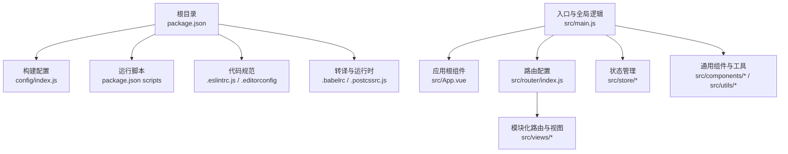
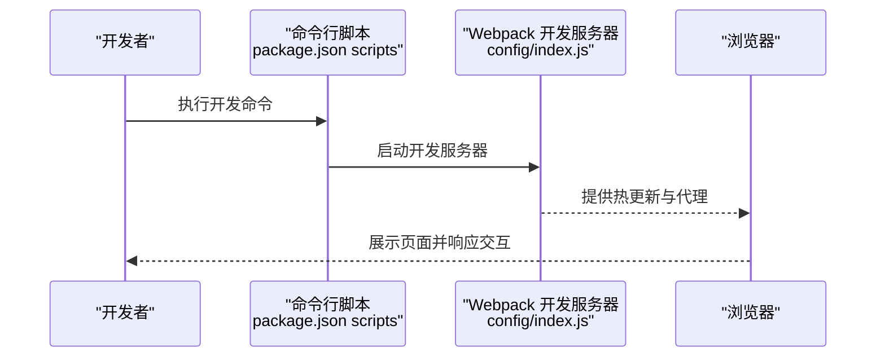
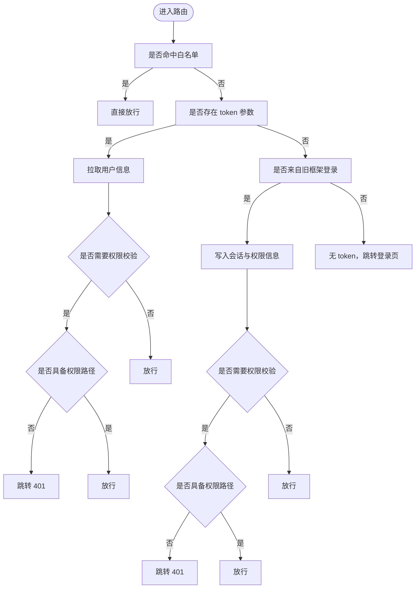
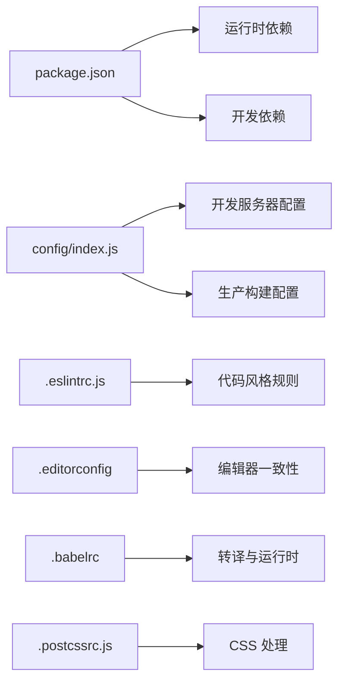

# 贡献指南

<cite>
**本文引用的文件**
- [package.json](file://package.json)
- [README.md](file://README.md)
- [.eslintrc.js](file://.eslintrc.js)
- [.editorconfig](file://.editorconfig)
- [.babelrc](file://.babelrc)
- [.postcssrc.js](file://.postcssrc.js)
- [.gitignore](file://.gitignore)
- [config/index.js](file://config/index.js)
- [src/main.js](file://src/main.js)
- [src/App.vue](file://src/App.vue)
- [src/router/index.js](file://src/router/index.js)
</cite>

## 目录
1. [简介](#简介)
2. [项目结构](#项目结构)
3. [核心组件](#核心组件)
4. [架构总览](#架构总览)
5. [详细组件分析](#详细组件分析)
6. [依赖关系分析](#依赖关系分析)
7. [性能考虑](#性能考虑)
8. [故障排查指南](#故障排查指南)
9. [结论](#结论)
10. [附录](#附录)

## 简介
本贡献指南面向希望参与校园管理系统开源项目的开发者，目标是帮助贡献者快速理解项目背景、开发环境与工具链、代码风格与规范、提交与审查流程，以及新功能开发、Bug 修复与文档更新的标准实践。通过遵循本文档，贡献者可以高效地完成从本地搭建到提交 PR 的全流程工作。

## 项目结构
该项目为基于 Vue 2.x 的前端单页应用（SPA），采用 Vue Router 进行页面路由管理，配合 Vuex 状态管理与 Element UI 组件库，构建多模块的校园管理业务界面。项目通过 Webpack 进行打包与开发服务器配置，支持开发、测试与生产三套构建脚本。

图表来源
- [config/index.js:1-72](file://config/index.js#L1-L72)
- [package.json:7-11](file://package.json#L7-L11)
- [.eslintrc.js:1-28](file://.eslintrc.js#L1-L28)
- [.editorconfig:1-10](file://.editorconfig#L1-L10)
- [.babelrc:1-16](file://.babelrc#L1-L16)
- [.postcssrc.js:1-11](file://.postcssrc.js#L1-L11)
- [src/main.js:1-221](file://src/main.js#L1-L221)
- [src/App.vue:1-183](file://src/App.vue#L1-L183)
- [src/router/index.js:1-207](file://src/router/index.js#L1-L207)

章节来源
- [README.md:5-24](file://README.md#L5-L24)
- [package.json:12-43](file://package.json#L12-L43)
- [config/index.js:8-70](file://config/index.js#L8-L70)

## 核心组件
- 构建与运行脚本：提供开发、测试与生产的构建命令，便于在不同环境下快速启动与打包。
- 代码质量工具：ESLint 与 EditorConfig 提供统一的代码风格与静态检查规则。
- 转译与兼容：Babel 与 PostCSS 配置确保跨浏览器兼容与现代化语法支持。
- 入口与全局行为：主入口负责全局插件注册、进度条、过滤器、权限校验与错误处理等。
- 路由与模块化：路由按业务模块拆分，支持常量路由与动态加载，便于扩展与维护。

章节来源
- [package.json:7-11](file://package.json#L7-L11)
- [.eslintrc.js:20-26](file://.eslintrc.js#L20-L26)
- [.editorconfig:3-9](file://.editorconfig#L3-L9)
- [.babelrc:2-13](file://.babelrc#L2-L13)
- [.postcssrc.js:3-9](file://.postcssrc.js#L3-L9)
- [src/main.js:16-55](file://src/main.js#L16-L55)
- [src/router/index.js:24-36](file://src/router/index.js#L24-L36)

## 架构总览
系统采用“入口 -> 路由 -> 视图”的前端 SPA 架构，结合 Element UI 与自定义组件实现交互；全局状态通过 Vuex 管理；权限与登录流程在路由守卫中集中处理；构建阶段通过 Webpack 完成资源打包与优化。

图表来源
- [package.json:7-11](file://package.json#L7-L11)
- [config/index.js:8-37](file://config/index.js#L8-L37)

章节来源
- [README.md:7-21](file://README.md#L7-L21)
- [config/index.js:39-70](file://config/index.js#L39-L70)

## 详细组件分析

### 开发环境搭建与运行
- 安装依赖：使用包管理器安装项目依赖。
- 启动开发：在本地启动开发服务器，支持热更新与错误覆盖。
- 构建产物：支持生产构建与打包分析报告生成。

章节来源
- [README.md:8-21](file://README.md#L8-L21)
- [package.json:7-11](file://package.json#L7-L11)

### 代码风格与规范
- ESLint 规则：启用 Vue 基础规则集，强制缩进、相等比较与引号风格；对 *.vue 文件关闭缩进重复检查以避免冲突。
- 编辑器配置：统一字符集、缩进风格与行尾设置，提升协作一致性。
- 转译与运行时：Babel 预设与插件确保现代语法与 JSX 支持；PostCSS 自动前缀与资源导入。

章节来源
- [.eslintrc.js:6-26](file://.eslintrc.js#L6-L26)
- [.editorconfig:3-9](file://.editorconfig#L3-L9)
- [.babelrc:2-13](file://.babelrc#L2-L13)
- [.postcssrc.js:3-9](file://.postcssrc.js#L3-L9)

### 权限与登录流程（路由守卫）
路由守卫集中处理登录态、白名单放行、权限路径校验与错误处理，确保访问安全与用户体验。

图表来源
- [src/main.js:58-198](file://src/main.js#L58-L198)

章节来源
- [src/main.js:58-198](file://src/main.js#L58-L198)

### 路由与模块化
- 常量路由：登录、错误页、仪表盘等固定页面。
- 模块化路由：按业务域拆分，支持懒加载与子路由组合。
- 系统与普通模块：区分系统管理与常规业务模块，便于权限与导航组织。

章节来源
- [src/router/index.js:40-199](file://src/router/index.js#L40-L199)

### 全局入口与组件注册
- 插件与组件：全局注册 Element UI、打印、上传组件、多选框、粘性头部与返回工具等。
- 过滤器与工具：注册全局过滤器与常用工具函数。
- 错误处理：生产环境配置全局错误处理器，记录错误日志。

章节来源
- [src/main.js:16-55](file://src/main.js#L16-L55)
- [src/main.js:205-214](file://src/main.js#L205-L214)

### 应用根组件与样式
- 缓存与渲染：根据 meta.isCached 控制缓存策略，提升页面切换体验。
- 样式与打印：提供打印样式与滚动条样式定制，适配不同设备与场景。

章节来源
- [src/App.vue:3-8](file://src/App.vue#L3-L8)
- [src/App.vue:98-182](file://src/App.vue#L98-L182)

## 依赖关系分析
- 运行时依赖：Vue 生态、Element UI、路由与状态管理、HTTP 请求、日期与工具库等。
- 开发依赖：Webpack 生态、Babel、Sass、ESLint、构建分析与调试工具等。
- 构建配置：开发与生产环境参数、资源路径与 SourceMap 策略、gzip 与分析开关。

图表来源
- [package.json:12-91](file://package.json#L12-L91)
- [config/index.js:8-70](file://config/index.js#L8-L70)
- [.eslintrc.js:6-26](file://.eslintrc.js#L6-L26)
- [.editorconfig:3-9](file://.editorconfig#L3-L9)
- [.babelrc:2-13](file://.babelrc#L2-L13)
- [.postcssrc.js:3-9](file://.postcssrc.js#L3-L9)

章节来源
- [package.json:12-91](file://package.json#L12-L91)
- [config/index.js:8-70](file://config/index.js#L8-L70)

## 性能考虑
- 构建优化：生产环境关闭 SourceMap 与 gzip 可按需开启；Bundle 分析报告辅助定位体积热点。
- 资源路径：生产环境静态资源路径与公共路径配置需与部署环境一致。
- 运行时优化：路由懒加载、组件按需引入、过滤器与工具函数复用，减少不必要渲染。

章节来源
- [config/index.js:54-69](file://config/index.js#L54-L69)
- [src/main.js:44-49](file://src/main.js#L44-L49)

## 故障排查指南
- 本地启动失败：确认 Node 与 NPM 版本满足引擎要求；检查端口占用与代理配置。
- ESLint 报错：根据规则提示修正缩进、相等比较与引号风格；对 *.vue 文件遵循相应规则。
- 构建异常：核对生产环境配置与资源路径；查看构建分析报告定位问题模块。
- 登录与权限：检查白名单、token 注入与权限路径匹配；关注路由守卫中的错误分支。

章节来源
- [package.json:88-91](file://package.json#L88-L91)
- [.eslintrc.js:20-26](file://.eslintrc.js#L20-L26)
- [config/index.js:16-37](file://config/index.js#L16-L37)
- [src/main.js:58-198](file://src/main.js#L58-L198)

## 结论
本指南提供了从环境搭建、代码规范、路由与权限到构建与故障排查的完整贡献路径。建议贡献者在提交任何变更前，先阅读并遵循本文档的规范与流程，确保代码质量与团队协作效率。

## 附录

### 代码贡献流程
- 准备工作：Fork 仓库，创建特性分支，同步上游变更。
- 开发与测试：在本地运行开发服务器，完成功能开发与单元/集成测试。
- 提交与推送：遵循提交信息格式，推送分支至远程仓库。
- 创建 PR：填写 PR 模板，描述变更内容、动机与影响范围。
- 代码审查：根据审查意见迭代修改，直至获得批准。
- 合并与发布：维护者合并 PR，按版本计划发布。

### Pull Request 规范
- 标题与描述：清晰说明变更类型（修复/特性/文档）与影响范围。
- 变更清单：列出涉及的文件、接口与配置项，附带截图或链接。
- 测试要求：补充或更新测试用例，确保覆盖率与稳定性。
- 文档更新：如涉及用户可见变更，同步更新 README 或内部文档。

### 代码审查标准
- 正确性：功能符合需求，边界条件与异常处理完备。
- 可读性：命名规范、注释清晰、结构合理。
- 兼容性：不破坏现有 API 与行为，必要时提供迁移指引。
- 性能：避免引入性能退化，复杂逻辑进行成本评估。
- 安全性：输入校验、权限控制与敏感信息处理符合安全基线。

### 开发环境搭建
- 环境要求：满足 Node 与 NPM 版本要求。
- 依赖安装：使用包管理器安装依赖。
- 启动服务：执行开发脚本，打开浏览器访问默认地址。
- 构建产物：按需执行生产构建与分析报告。

章节来源
- [README.md:8-21](file://README.md#L8-L21)
- [package.json:88-91](file://package.json#L88-L91)

### 测试要求
- 单元测试：针对关键函数与组件进行断言。
- 集成测试：验证路由、权限与数据流的整体行为。
- 端到端测试：在真实浏览器中验证核心业务流程。
- 覆盖率：保持关键路径与边界条件的测试覆盖。

### 文档编写指南
- 内容结构：概述、背景、安装、使用、API、最佳实践与常见问题。
- 示例与截图：提供可运行的示例与操作截图。
- 更新频率：随功能变更同步更新，确保与代码一致。

### 代码风格规范
- ESLint：遵循项目规则，统一缩进、相等比较与引号风格。
- EditorConfig：统一字符集、缩进与行尾。
- Babel 与 PostCSS：按配置启用转译与自动前缀。

章节来源
- [.eslintrc.js:6-26](file://.eslintrc.js#L6-L26)
- [.editorconfig:3-9](file://.editorconfig#L3-L9)
- [.babelrc:2-13](file://.babelrc#L2-L13)
- [.postcssrc.js:3-9](file://.postcssrc.js#L3-L9)

### 提交信息格式
- 类型：feat、fix、docs、style、refactor、perf、test、build、ci、chore、revert
- 范围：变更涉及的模块或文件范围
- 描述：简明扼要说明变更内容，必要时补充动机与影响

### 分支管理策略
- 主分支：稳定版本，仅合并经审查的 PR
- 开发分支：集成日常开发，定期与主分支同步
- 功能分支：按特性或任务创建，完成后合并回开发分支
- 发布分支：准备版本发布，修复紧急问题后合并回主分支与开发分支

### 新功能开发流程
- 需求评审：明确功能目标、范围与验收标准
- 设计与原型：输出设计稿与交互说明
- 开发与测试：实现功能并完善测试
- 文档与示例：补充使用文档与示例代码
- 回归与发布：回归测试通过后合并与发布

### Bug 修复流程
- 复现与定位：在最小化环境中复现问题并定位原因
- 修复与验证：编写修复代码并通过测试
- 回归测试：确保修复未引入新的问题
- 提交与追踪：提交修复并关联问题单据

### 文档更新流程
- 变更识别：识别需要更新的文档类型与范围
- 内容修订：更新描述、示例与注意事项
- 审查与合并：经审查后合并到主分支
- 发布与通知：随版本发布同步更新

### 社区交流与问题反馈
- 交流渠道：通过 Issue 讨论需求与问题，PR 进行代码审查
- 反馈机制：提供问题模板与反馈入口，及时响应与跟进
- 版本发布：制定发布计划与里程碑，定期发布稳定版本