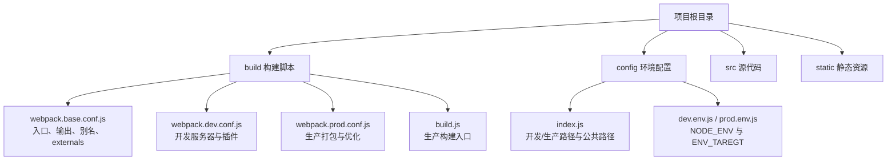
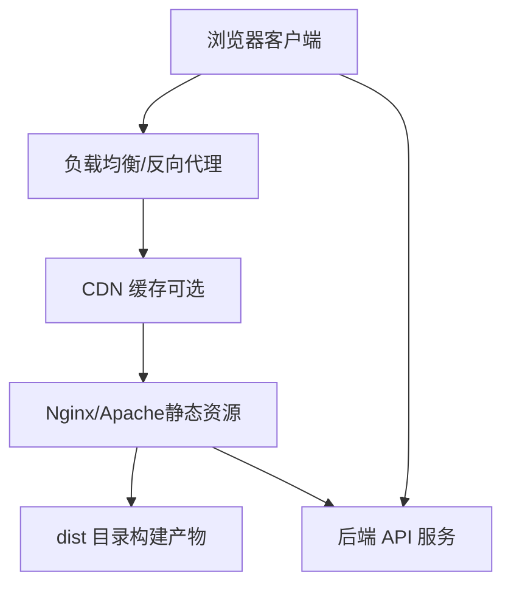
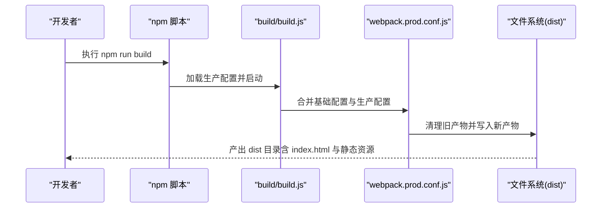
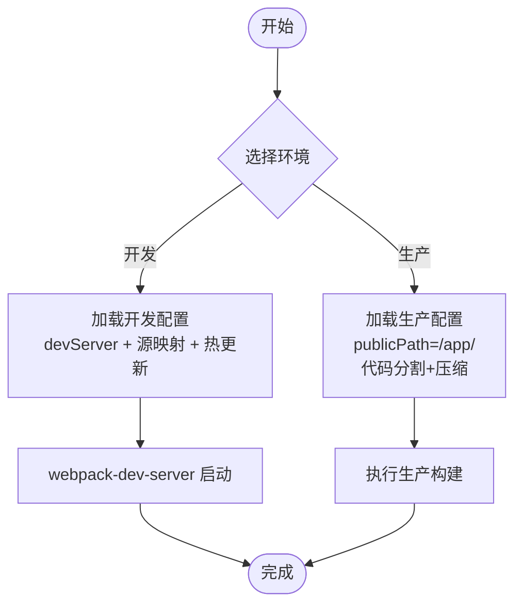
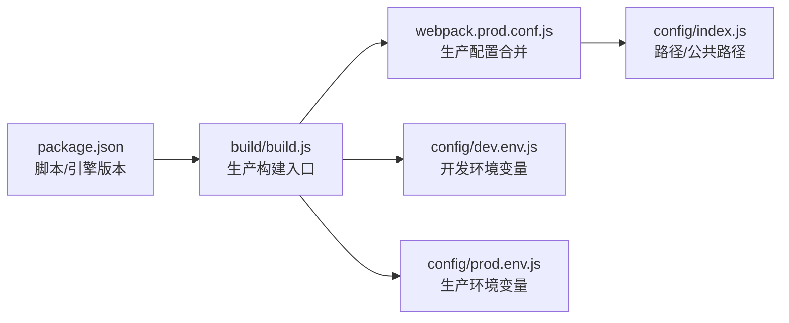

# 部署指南

<cite>
**本文引用的文件**
- [package.json](file://package.json)
- [README.md](file://README.md)
- [config/index.js](file://config/index.js)
- [config/dev.env.js](file://config/dev.env.js)
- [config/prod.env.js](file://config/prod.env.js)
- [build/build.js](file://build/build.js)
- [build/webpack.base.conf.js](file://build/webpack.base.conf.js)
- [build/webpack.dev.conf.js](file://build/webpack.dev.conf.js)
- [build/webpack.prod.conf.js](file://build/webpack.prod.conf.js)
- [build/check-versions.js](file://build/check-versions.js)
- [build/utils.js](file://build/utils.js)
</cite>

## 目录
1. [简介](#简介)
2. [项目结构](#项目结构)
3. [核心组件](#核心组件)
4. [架构总览](#架构总览)
5. [详细组件分析](#详细组件分析)
6. [依赖关系分析](#依赖关系分析)
7. [性能考虑](#性能考虑)
8. [故障排除指南](#故障排除指南)
9. [结论](#结论)
10. [附录](#附录)

## 简介
本指南面向运维与平台工程团队，帮助在生产环境中稳定、安全地部署与维护校园管理系统（Vue 前端）。内容覆盖服务器环境准备、依赖安装、构建产物与静态资源分发、不同部署场景（本地、云、容器化、集群）的实施方案、CI/CD 流程建议、自动化部署脚本思路、负载均衡与 SSL 配置、监控告警以及部署检查清单、故障排除与回滚策略。

说明：
- 本仓库为 Vue 前端项目，不包含后端服务或数据库。部署时需配合后端接口与数据库进行联调。
- 本指南以现有构建配置为基础，给出可落地的部署实践与最佳实践。

## 项目结构
该 Vue 项目采用基于 webpack 的模板，主要目录与职责如下：
- build：构建脚本与 webpack 配置
- config：开发/生产环境配置
- src：源代码
- static：静态资源（构建时复制）
- 根目录：包管理与脚本定义

图表来源
- [build/webpack.base.conf.js:12-102](file://build/webpack.base.conf.js#L12-L102)
- [build/webpack.dev.conf.js:16-96](file://build/webpack.dev.conf.js#L16-L96)
- [build/webpack.prod.conf.js:16-149](file://build/webpack.prod.conf.js#L16-L149)
- [build/build.js:14-42](file://build/build.js#L14-L42)
- [config/index.js:7-72](file://config/index.js#L7-L72)
- [config/dev.env.js:5-8](file://config/dev.env.js#L5-L8)
- [config/prod.env.js:3-5](file://config/prod.env.js#L3-L5)

章节来源
- [README.md:5-21](file://README.md#L5-L21)
- [package.json:7-11](file://package.json#L7-L11)
- [config/index.js:7-72](file://config/index.js#L7-L72)

## 核心组件
- 构建脚本与命令
  - 开发：npm run dev（或 npm run dev:test），启动 webpack-dev-server，热更新与代理由开发配置控制。
  - 生产：npm run build，执行生产构建，生成 dist 目录。
  - 测试：npm run build:test，支持通过 ENV_TAREGT 切换目标环境变量。
- 环境变量
  - NODE_ENV：区分开发/生产。
  - ENV_TAREGT：用于区分测试/预发布/生产等环境标识。
- 资源公共路径与静态资源
  - 生产环境公共路径为 /app/，静态资源路径为 /（可通过配置调整）。
  - 构建时将 static 目录复制到输出目录。

章节来源
- [package.json:7-11](file://package.json#L7-L11)
- [config/dev.env.js:5-8](file://config/dev.env.js#L5-L8)
- [config/prod.env.js:3-5](file://config/prod.env.js#L3-L5)
- [config/index.js:47-48](file://config/index.js#L47-L48)
- [build/webpack.prod.conf.js:115-121](file://build/webpack.prod.conf.js#L115-L121)

## 架构总览
前端部署架构通常由“构建产物 + 静态资源分发层（Nginx/Apache）+ 反向代理（可选）+ 后端服务”组成。下图展示从浏览器到后端 API 的典型请求链路与静态资源访问路径。

说明：
- 静态资源应配置强缓存与版本化命名，避免缓存污染。
- 建议对 HTML 设置较短缓存或不缓存，以保证路由刷新与更新生效。
- SSL/TLS 在反向代理层统一终止，便于证书管理与性能优化。

## 详细组件分析

### 构建与打包流程
- 入口与输出
  - 入口：src/main.js
  - 输出：dist 目录，publicPath 为 /app/（生产）
- 优化策略
  - 分离 vendor、manifest、app 代码块，提升缓存命中率
  - 提取 CSS、压缩 JS/CSS、模块 ID 哈希化
- 插件与特性
  - DefinePlugin 注入环境变量
  - CommonsChunkPlugin 进行代码分割
  - ExtractTextPlugin 提取 CSS
  - HtmlWebpackPlugin 生成带哈希的 index.html
  - CopyWebpackPlugin 复制 static 资源

图表来源
- [build/build.js:14-42](file://build/build.js#L14-L42)
- [build/webpack.prod.conf.js:16-149](file://build/webpack.prod.conf.js#L16-L149)
- [build/webpack.base.conf.js:16-25](file://build/webpack.base.conf.js#L16-L25)

章节来源
- [build/build.js:14-42](file://build/build.js#L14-L42)
- [build/webpack.prod.conf.js:33-122](file://build/webpack.prod.conf.js#L33-L122)
- [build/webpack.base.conf.js:16-25](file://build/webpack.base.conf.js#L16-L25)

### 开发与生产配置差异
- 开发模式
  - devServer：热更新、错误覆盖、历史路由回退到 index.html
  - 源映射：cheap-module-eval-source-map
  - 自动打开浏览器、错误通知
- 生产模式
  - publicPath：/app/
  - 关闭 source map 或使用安全映射
  - Gzip 默认关闭（如启用需额外插件）
  - 生成带哈希的 index.html 与静态资源文件名

图表来源
- [config/index.js:8-72](file://config/index.js#L8-L72)
- [build/webpack.dev.conf.js:24-46](file://build/webpack.dev.conf.js#L24-L46)
- [build/webpack.prod.conf.js:27-32](file://build/webpack.prod.conf.js#L27-L32)

章节来源
- [config/index.js:8-72](file://config/index.js#L8-L72)
- [build/webpack.dev.conf.js:24-46](file://build/webpack.dev.conf.js#L24-L46)
- [build/webpack.prod.conf.js:27-32](file://build/webpack.prod.conf.js#L27-L32)

### 外部依赖与公共资源
- externals 将部分库（如 Vue、Element-UI、jQuery、ECharts 等）外置，减少打包体积，由 CDN 或业务侧按需引入。
- 建议在生产环境通过 CDN 引入这些外部库，降低主包体积与首屏时间。

章节来源
- [build/webpack.base.conf.js:26-36](file://build/webpack.base.conf.js#L26-L36)

## 依赖关系分析
- 构建链路
  - package.json 定义脚本与引擎版本要求
  - build/build.js 作为生产构建入口
  - webpack.prod.conf.js 合并基础配置并应用生产优化
  - config/index.js 提供开发/生产路径与公共路径
- 环境变量
  - dev.env.js 与 prod.env.js 注入 NODE_ENV 与 ENV_TAREGT
  - webpack.DefinePlugin 将其注入到打包后的代码中

图表来源
- [package.json:7-11](file://package.json#L7-L11)
- [build/build.js:11-12](file://build/build.js#L11-L12)
- [build/webpack.prod.conf.js:14](file://build/webpack.prod.conf.js#L14)
- [config/index.js:41-48](file://config/index.js#L41-L48)
- [config/dev.env.js:5-8](file://config/dev.env.js#L5-L8)
- [config/prod.env.js:3-5](file://config/prod.env.js#L3-L5)

章节来源
- [package.json:7-11](file://package.json#L7-L11)
- [build/build.js:11-12](file://build/build.js#L11-L12)
- [build/webpack.prod.conf.js:14](file://build/webpack.prod.conf.js#L14)
- [config/index.js:41-48](file://config/index.js#L41-L48)
- [config/dev.env.js:5-8](file://config/dev.env.js#L5-L8)
- [config/prod.env.js:3-5](file://config/prod.env.js#L3-L5)

## 性能考虑
- 资源分发与缓存
  - 静态资源采用带哈希的文件名，HTML 不缓存或短缓存
  - CDN 缓存策略：JS/CSS 长缓存；HTML 短缓存或协商缓存
- 代码分割
  - vendor、manifest、app 分离，提升缓存复用率
- 压缩与优化
  - 生产环境默认关闭 Gzip（如启用需额外插件），建议在反向代理层开启
- 外部依赖
  - 通过 externals 与 CDN 引入大体积库，减小主包体积

章节来源
- [build/webpack.prod.conf.js:84-112](file://build/webpack.prod.conf.js#L84-L112)
- [build/webpack.prod.conf.js:48-55](file://build/webpack.prod.conf.js#L48-L55)
- [build/webpack.base.conf.js:26-36](file://build/webpack.base.conf.js#L26-L36)

## 故障排除指南
- 版本不满足
  - 构建前会校验 Node 与 npm 版本，不满足将提示并退出
- 构建失败
  - build/build.js 中若统计包含错误则退出进程
  - 检查依赖安装、权限与磁盘空间
- 开发服务器端口占用
  - webpack.dev.conf.js 使用 portfinder 动态分配端口，确保未被占用
- 路由与静态资源 404
  - 确认 Nginx/Apache 的 root 指向 dist 目录，且 publicPath 与服务器路径一致
  - 若使用子路径部署，确保 config/index.js 中的 assetsPublicPath 与实际路径匹配

章节来源
- [build/check-versions.js:27-54](file://build/check-versions.js#L27-L54)
- [build/build.js:30-33](file://build/build.js#L30-L33)
- [build/webpack.dev.conf.js:71-95](file://build/webpack.dev.conf.js#L71-L95)
- [config/index.js:47](file://config/index.js#L47)

## 结论
本指南基于现有 Vue 前端构建配置，给出了生产部署的关键步骤与最佳实践。由于本仓库为前端项目，部署时需与后端服务、数据库及运维平台协同完成。建议结合 CI/CD 实现自动化构建与发布，并在反向代理层统一处理 SSL、缓存与负载均衡。

## 附录

### 服务器环境准备
- 操作系统：Linux（推荐 CentOS/Ubuntu）
- Node.js 与 npm：满足 package.json 中 engines 要求
- 构建工具：安装依赖后执行生产构建
- 静态资源服务器：Nginx/Apache，指向 dist 目录
- 反向代理：统一处理 HTTPS、缓存与健康检查

章节来源
- [package.json:88-91](file://package.json#L88-L91)
- [build/check-versions.js:11-25](file://build/check-versions.js#L11-L25)

### 依赖安装
- 安装依赖：npm install
- 开发调试：npm run dev 或 npm run dev:test
- 生产构建：npm run build

章节来源
- [README.md:8-18](file://README.md#L8-L18)
- [package.json:7-11](file://package.json#L7-L11)

### 数据库与后端服务
- 本仓库为前端项目，不包含数据库与后端服务，请在生产环境中配套部署后端 API 与数据库，并在前端通过反向代理转发请求。

### 域名与 SSL
- 在反向代理层配置域名解析与 SSL 证书
- 建议启用 HSTS、OCSP Stapling 与现代 TLS 参数

### 负载均衡与高可用
- 前端静态资源可多节点部署至 CDN 或多台 Nginx
- 健康检查：以 200/404/500 等状态码判断
- 会话与 Cookie：根据业务需求配置

### CI/CD 流程与自动化部署
- 构建阶段：拉取代码 → 安装依赖 → 生产构建 → 产出 dist
- 发布阶段：将 dist 发布到静态资源服务器或 CDN
- 回滚策略：保留上一版本产物，切换软链接或配置即可快速回滚
- 自动化脚本建议：使用 Shell/Python 脚本封装构建与发布流程，结合 Git Tag/分支策略触发流水线

### 部署检查清单
- 服务器环境满足 Node/npm 版本要求
- 依赖安装成功，无构建警告/错误
- dist 目录可被静态服务器访问
- 反向代理已配置域名、SSL、缓存策略
- 负载均衡健康检查通过
- 监控与日志已接入
- 回滚方案已验证

### 回滚策略
- 保留最近两到三个版本的 dist 目录
- 通过切换 Nginx 配置或 CDN 配置实现快速回滚
- 回滚后进行功能与性能验证