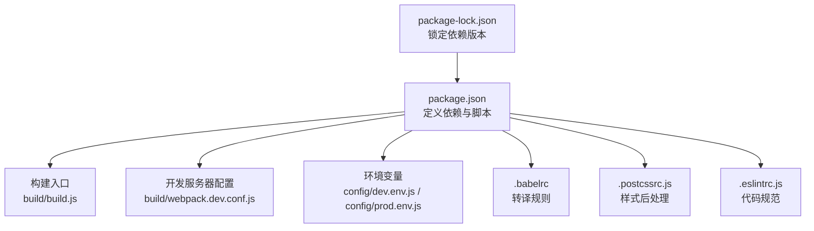
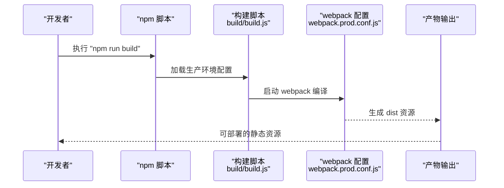
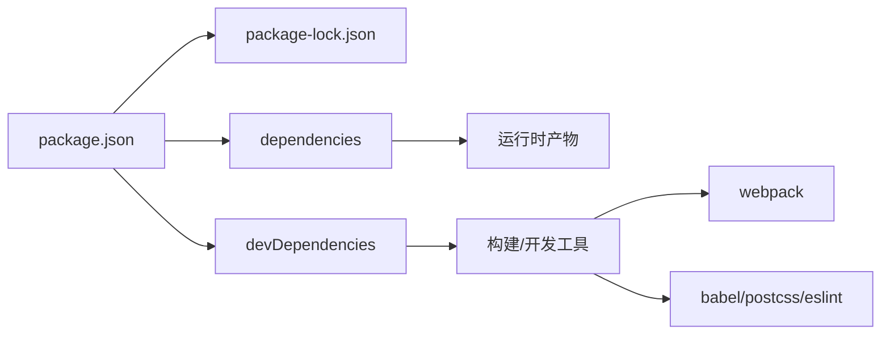

# 依赖管理

<cite>
**本文引用的文件**
- [package.json](file://package.json)
- [package-lock.json](file://package-lock.json)
- [README.md](file://README.md)
- [build/webpack.dev.conf.js](file://build/webpack.dev.conf.js)
- [build/build.js](file://build/build.js)
- [.babelrc](file://.babelrc)
- [config/index.js](file://config/index.js)
- [config/dev.env.js](file://config/dev.env.js)
- [config/prod.env.js](file://config/prod.env.js)
- [.eslintrc.js](file://.eslintrc.js)
- [.postcssrc.js](file://.postcssrc.js)
</cite>

## 目录
1. [简介](#简介)
2. [项目结构](#项目结构)
3. [核心组件](#核心组件)
4. [架构总览](#架构总览)
5. [详细组件分析](#详细组件分析)
6. [依赖关系分析](#依赖关系分析)
7. [性能考量](#性能考量)
8. [故障排查指南](#故障排查指南)
9. [结论](#结论)
10. [附录](#附录)

## 简介
本文件系统性梳理并说明本 Vue 项目的依赖管理策略与实践，覆盖以下方面：
- package.json 中 dependencies、devDependencies 的职责边界与配置要点
- scripts 命令与构建流程的衔接
- 版本管理、安全更新与冲突解决策略
- 安装、升级、卸载最佳实践
- 开发依赖与生产依赖的区别与取舍
- 新增第三方库的流程与注意事项
- 依赖审计与漏洞扫描方法（结合现有工具链）

## 项目结构
本项目采用基于 webpack 的 Vue 2.x 工程模板，通过多环境配置与脚本命令驱动开发与生产构建。关键目录与文件如下：
- 根级配置：package.json、package-lock.json、README.md、.babelrc、.eslintrc.js、.postcssrc.js
- 构建与运行：build/webpack.dev.conf.js、build/build.js、config/index.js、config/dev.env.js、config/prod.env.js

图表来源
- [package.json:1-98](file://package.json#L1-L98)
- [build/build.js:1-42](file://build/build.js#L1-L42)
- [build/webpack.dev.conf.js:1-96](file://build/webpack.dev.conf.js#L1-L96)
- [config/index.js:1-72](file://config/index.js#L1-L72)
- [.babelrc:1-16](file://.babelrc#L1-L16)
- [.postcssrc.js:1-11](file://.postcssrc.js#L1-L11)
- [.eslintrc.js:1-28](file://.eslintrc.js#L1-L28)

章节来源
- [package.json:1-98](file://package.json#L1-L98)
- [README.md:1-24](file://README.md#L1-L24)
- [build/webpack.dev.conf.js:1-96](file://build/webpack.dev.conf.js#L1-L96)
- [build/build.js:1-42](file://build/build.js#L1-L42)
- [config/index.js:1-72](file://config/index.js#L1-L72)
- [.babelrc:1-16](file://.babelrc#L1-L16)
- [.postcssrc.js:1-11](file://.postcssrc.js#L1-L11)
- [.eslintrc.js:1-28](file://.eslintrc.js#L1-L28)

## 核心组件
- 依赖清单与脚本
  - dependencies：运行期依赖，如 Vue 生态、UI 组件库、工具库等
  - devDependencies：开发期依赖，如构建工具、转译器、打包器、样式处理器、测试/校验工具等
  - scripts：统一的开发、构建与分析命令入口
- 构建与运行时配置
  - webpack 开发配置与生产配置
  - 环境变量注入与目标环境切换
  - Babel、PostCSS、ESLint 等工具链集成

章节来源
- [package.json:7-11](file://package.json#L7-L11)
- [package.json:12-43](file://package.json#L12-L43)
- [package.json:44-87](file://package.json#L44-L87)
- [config/index.js:7-71](file://config/index.js#L7-L71)
- [.babelrc:1-16](file://.babelrc#L1-L16)
- [.postcssrc.js:1-11](file://.postcssrc.js#L1-L11)
- [.eslintrc.js:1-28](file://.eslintrc.js#L1-L28)

## 架构总览
下图展示从脚本到构建再到产物的关键路径，体现依赖在不同阶段的角色。

图表来源
- [build/build.js:1-42](file://build/build.js#L1-L42)
- [config/index.js:39-71](file://config/index.js#L39-L71)

章节来源
- [build/build.js:1-42](file://build/build.js#L1-L42)
- [config/index.js:39-71](file://config/index.js#L39-L71)

## 详细组件分析

### package.json 依赖与脚本解析
- dependencies（运行时依赖）
  - 包含 Vue 核心、路由、状态管理、UI 组件库、图表库、日期时间、HTTP 请求、工具函数等
  - 这些包在生产环境中必须存在，以保证应用正常运行
- devDependencies（开发时依赖）
  - 包含 Babel 转译链、webpack 生态、样式处理、压缩与分析、热更新、类型检查等
  - 仅在开发与构建阶段使用，不打入生产包
- scripts（命令）
  - dev:test、build:test、build：分别对应不同环境的开发与构建
  - 通过 cross-env 设置环境变量，实现跨平台兼容

章节来源
- [package.json:12-43](file://package.json#L12-L43)
- [package.json:44-87](file://package.json#L44-L87)
- [package.json:7-11](file://package.json#L7-L11)

### 构建与开发配置联动
- 开发服务器配置
  - 合并基础配置，启用热更新、错误覆盖、静态资源复制、端口探测与友好提示
- 生产构建流程
  - 清理输出目录、启动 webpack 编译、输出统计信息、失败退出码控制

章节来源
- [build/webpack.dev.conf.js:16-96](file://build/webpack.dev.conf.js#L16-L96)
- [build/build.js:14-41](file://build/build.js#L14-L41)

### 环境变量与目标切换
- 环境变量注入
  - 通过 DefinePlugin 将 dev/prod 环境常量注入编译期
- 目标环境切换
  - 通过 ENV_TAREGT 控制不同业务环境的构建目标

章节来源
- [build/webpack.dev.conf.js:48-50](file://build/webpack.dev.conf.js#L48-L50)
- [config/dev.env.js:5-8](file://config/dev.env.js#L5-L8)
- [config/prod.env.js:2-5](file://config/prod.env.js#L2-L5)

### 工具链配置
- Babel
  - 预设与插件组合，适配浏览器列表与 JSX 转换
- PostCSS
  - 自动前缀、导入与 URL 处理
- ESLint
  - 推荐规则与 Vue 插件，约束缩进、比较与引号风格

章节来源
- [.babelrc:1-16](file://.babelrc#L1-L16)
- [.postcssrc.js:3-10](file://.postcssrc.js#L3-L10)
- [.eslintrc.js:1-28](file://.eslintrc.js#L1-L28)

## 依赖关系分析
- 依赖锁定与一致性
  - 使用 package-lock.json 锁定精确版本，确保团队与 CI 环境一致
- 运行时与开发时分离
  - dependencies 仅包含运行所需；devDependencies 不随应用一起发布
- 工具链耦合
  - 构建脚本依赖 webpack 生态；Babel/PostCSS/ESLint 影响编译与质量门禁

图表来源
- [package.json:12-87](file://package.json#L12-L87)
- [package-lock.json:1-10](file://package-lock.json#L1-L10)

章节来源
- [package.json:12-87](file://package.json#L12-L87)
- [package-lock.json:1-10](file://package-lock.json#L1-L10)

## 性能考量
- 体积与加载
  - 通过 webpack 分析报告定位大体积模块，优化第三方库按需引入与拆分
- 源映射与调试
  - 开发使用低开销映射，生产关闭或精简映射以减少体积
- 缓存与持久化
  - 利用长缓存策略与内容哈希，提升二次加载性能

## 故障排查指南
- 构建失败
  - 查看构建日志与错误统计，确认是否存在语法错误或模块缺失
  - 检查环境变量是否正确注入
- 端口占用
  - 开发服务器会自动寻找可用端口，若异常可手动指定或清理占用进程
- 依赖冲突
  - 使用依赖审计与可视化分析工具定位冲突模块，必要时调整版本或替换替代方案
- 代码规范问题
  - 运行 ESLint 并根据规则修正，避免提交被阻断

章节来源
- [build/build.js:19-33](file://build/build.js#L19-L33)
- [build/webpack.dev.conf.js:71-95](file://build/webpack.dev.conf.js#L71-L95)
- [.eslintrc.js:20-26](file://.eslintrc.js#L20-L26)

## 结论
本项目通过清晰的依赖分层与完善的工具链配置，实现了开发与生产的高效协同。建议持续：
- 保持依赖版本策略稳定，定期进行安全审计
- 在新增第三方库时遵循“最小可行”原则，优先选择社区活跃、维护良好的包
- 建立自动化依赖更新与安全扫描流程，降低风险

## 附录

### 依赖版本管理与安全更新策略
- 版本锁定与差异
  - 使用 package-lock.json 固定版本，避免意外升级导致的不一致
- 安全更新
  - 定期执行依赖审计，识别高危漏洞并及时修复
- 冲突解决
  - 当出现版本冲突时，优先升级上层依赖或替换为兼容版本，必要时通过别名或重定向规避

章节来源
- [package-lock.json:1-10](file://package-lock.json#L1-L10)

### 安装、升级与卸载最佳实践
- 安装
  - 使用 npm ci 或 npm install 确保锁文件一致
- 升级
  - 先在 devDependencies 中验证兼容性，再迁移至 dependencies
- 卸载
  - 删除相关依赖与引用，清理无用模块，避免冗余体积

### 开发依赖与生产依赖的区别
- 开发依赖（devDependencies）
  - 仅用于开发与构建，不打入生产包
- 生产依赖（dependencies）
  - 应用运行必需，影响最终产物体积与启动性能

章节来源
- [package.json:12-43](file://package.json#L12-L43)
- [package.json:44-87](file://package.json#L44-L87)

### 添加新的第三方库流程
- 评估与选型
  - 评估功能、体积、生态与维护状况
- 安装与验证
  - 安装到 dependencies 或 devDependencies，编写最小化示例验证
- 引入与按需
  - 按需引入与 Tree Shaking，避免整包引入
- 审计与回归
  - 执行依赖审计与回归测试，确保无安全与功能问题

### 依赖审计与漏洞扫描方法
- 依赖审计
  - 使用 npm audit 或第三方工具对依赖树进行扫描
- 漏洞修复
  - 根据报告优先修复高危与中危漏洞，必要时升级或替换依赖
- 可视化分析
  - 使用构建分析工具生成依赖图谱，识别重复与冗余模块

章节来源
- [README.md:5-21](file://README.md#L5-L21)