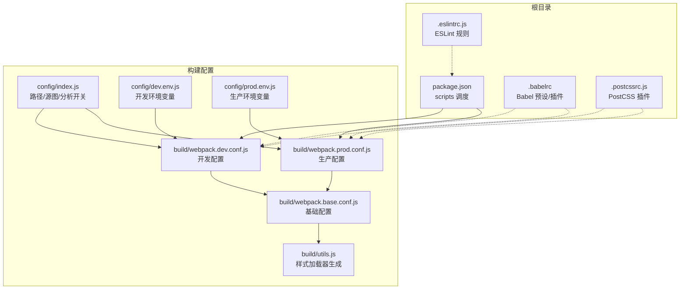
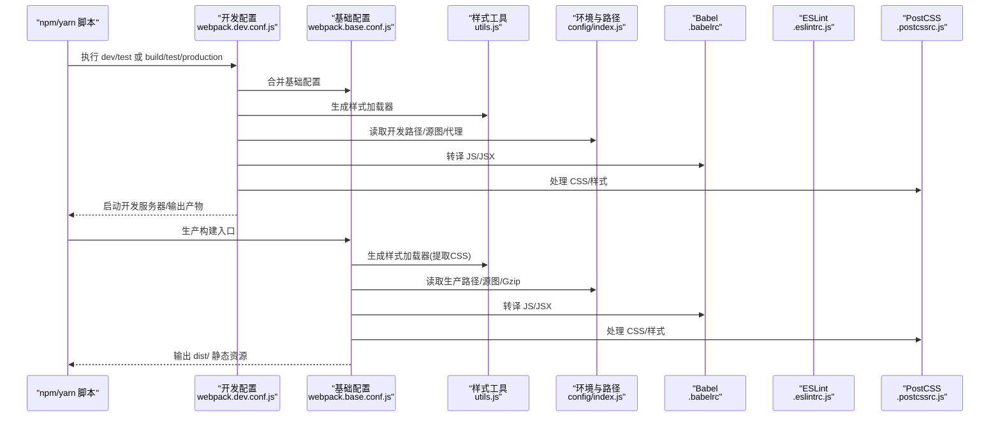
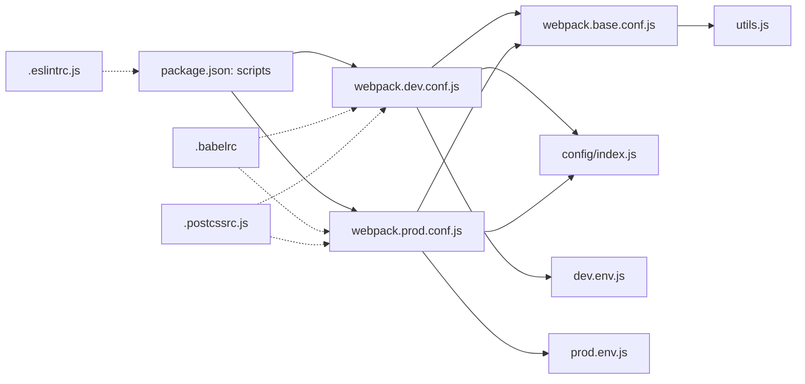
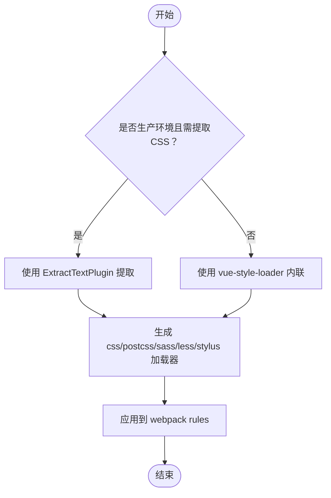

# 构建配置

<cite>
**本文引用的文件**
- [package.json](file://package.json)
- [.babelrc](file://.babelrc)
- [.eslintrc.js](file://.eslintrc.js)
- [.postcssrc.js](file://.postcssrc.js)
- [build/webpack.base.conf.js](file://build/webpack.base.conf.js)
- [build/webpack.dev.conf.js](file://build/webpack.dev.conf.js)
- [build/webpack.prod.conf.js](file://build/webpack.prod.conf.js)
- [build/utils.js](file://build/utils.js)
- [config/index.js](file://config/index.js)
- [config/dev.env.js](file://config/dev.env.js)
- [config/prod.env.js](file://config/prod.env.js)
</cite>

## 目录
1. [简介](#简介)
2. [项目结构](#项目结构)
3. [核心组件](#核心组件)
4. [架构总览](#架构总览)
5. [详细组件分析](#详细组件分析)
6. [依赖分析](#依赖分析)
7. [性能考虑](#性能考虑)
8. [故障排查指南](#故障排查指南)
9. [结论](#结论)
10. [附录](#附录)

## 简介
本文件系统性梳理并文档化该 Vue 项目的构建体系，覆盖以下方面：
- Webpack 构建配置：开发与生产环境的入口、输出、模块规则、插件与优化策略
- Babel 转译配置：目标浏览器、预设与插件
- ESLint 代码检查配置：规则与扩展
- PostCSS 样式处理配置：导入、URL 处理与自动前缀
- build 目录下各配置文件的作用与相互关系
- 构建优化策略：代码分割、资源压缩、缓存与体积分析
- 性能优化技巧与调试方法
- 自定义扩展指南与常见问题排查

## 项目结构
该工程采用“多入口 + 多环境 + 工具函数”的组织方式：
- 根级脚本通过 package.json 的 scripts 统一调度
- 开发与生产配置分别位于 build/ 下的三个核心文件
- 样式加载器生成逻辑集中在 utils.js
- 环境变量与路径配置位于 config/ 下
- 顶层配置文件 .babelrc、.eslintrc.js、.postcssrc.js 分别负责转译、检查与样式处理

图表来源
- [package.json:1-98](file://package.json#L1-L98)
- [build/webpack.base.conf.js:1-102](file://build/webpack.base.conf.js#L1-L102)
- [build/webpack.dev.conf.js:1-96](file://build/webpack.dev.conf.js#L1-L96)
- [build/webpack.prod.conf.js:1-149](file://build/webpack.prod.conf.js#L1-L149)
- [build/utils.js:1-102](file://build/utils.js#L1-L102)
- [config/index.js:1-72](file://config/index.js#L1-L72)
- [config/dev.env.js:1-9](file://config/dev.env.js#L1-L9)
- [config/prod.env.js:1-6](file://config/prod.env.js#L1-L6)
- [.babelrc:1-16](file://.babelrc#L1-L16)
- [.eslintrc.js:1-28](file://.eslintrc.js#L1-L28)
- [.postcssrc.js:1-11](file://.postcssrc.js#L1-L11)

章节来源
- [package.json:7-11](file://package.json#L7-L11)
- [config/index.js:7-72](file://config/index.js#L7-L72)

## 核心组件
- Webpack 基础配置（入口、输出、解析、资源规则、Node 兼容、外链依赖）
- 开发环境配置（热更新、源图、本地服务器、静态资源拷贝）
- 生产环境配置（压缩、提取 CSS、分包、Gzip、体积分析）
- 样式加载器工具（按需生成 CSS/Sass/Less/Stylus 加载链）
- 环境变量与路径配置（开发/生产不同输出与公共路径）

章节来源
- [build/webpack.base.conf.js:14-102](file://build/webpack.base.conf.js#L14-L102)
- [build/webpack.dev.conf.js:16-96](file://build/webpack.dev.conf.js#L16-L96)
- [build/webpack.prod.conf.js:16-149](file://build/webpack.prod.conf.js#L16-L149)
- [build/utils.js:15-83](file://build/utils.js#L15-L83)
- [config/index.js:8-70](file://config/index.js#L8-L70)

## 架构总览
下图展示从脚本到最终产物的构建流程与关键节点。

图表来源
- [build/webpack.dev.conf.js:16-69](file://build/webpack.dev.conf.js#L16-L69)
- [build/webpack.prod.conf.js:16-123](file://build/webpack.prod.conf.js#L16-L123)
- [build/webpack.base.conf.js:14-102](file://build/webpack.base.conf.js#L14-L102)
- [build/utils.js:15-83](file://build/utils.js#L15-L83)
- [config/index.js:8-70](file://config/index.js#L8-L70)
- [.babelrc:1-16](file://.babelrc#L1-L16)
- [.postcssrc.js:1-11](file://.postcssrc.js#L1-L11)

## 详细组件分析

### Webpack 基础配置（webpack.base.conf.js）
- 入口与上下文：以 src/main.js 为入口，context 指向项目根
- 输出：根据环境设置 publicPath；生产环境启用 chunkhash
- 解析与别名：支持 .js/.vue/.json；设置常用别名如 @、utils
- 资源规则：对图片、音视频、字体使用 url-loader 并设置内联阈值
- Node 兼容：禁用不必要 Node API，避免注入无意义 polyfill
- 外链依赖：将 Vue 及其生态库声明为外部依赖，减少打包体积
- 插件：注册微前端插件（registerMicroPlugin）

章节来源
- [build/webpack.base.conf.js:14-102](file://build/webpack.base.conf.js#L14-L102)

### 开发环境配置（webpack.dev.conf.js）
- 合并与扩展：基于基础配置，追加样式加载器、热更新、错误提示
- 源图与调试：使用 cheap-module-eval-source-map 提升开发速度
- 本地服务：支持主机、端口、自动打开、错误覆盖层、代理表
- 插件：DefinePlugin 注入环境变量；HotModuleReplacement；NamedModules；NoEmitOnErrors；HtmlWebpackPlugin；CopyWebpackPlugin 拷贝静态资源
- 友好错误：FriendlyErrorsPlugin 与通知回调

章节来源
- [build/webpack.dev.conf.js:16-96](file://build/webpack.dev.conf.js#L16-L96)
- [build/utils.js:85-101](file://build/utils.js#L85-L101)
- [config/index.js:8-37](file://config/index.js#L8-L37)
- [config/dev.env.js:5-8](file://config/dev.env.js#L5-L8)

### 生产环境配置（webpack.prod.conf.js）
- 样式处理：提取 CSS 到独立文件，使用 OptimizeCSSPlugin 去重压缩
- 压缩与混淆：UglifyJsPlugin 并行压缩，开启 source map
- 输出命名：JS 使用 [chunkhash]，CSS 使用 [contenthash]
- 代码分割：CommonsChunkPlugin 提取 vendor、manifest 与异步共享块
- HTML 生成：HtmlWebpackPlugin 注入并最小化输出
- 静态资源：CopyWebpackPlugin 拷贝 static 目录
- 可选优化：Gzip 压缩与 Bundle Analyzer 报告

章节来源
- [build/webpack.prod.conf.js:16-149](file://build/webpack.prod.conf.js#L16-L149)
- [config/index.js:39-70](file://config/index.js#L39-L70)
- [config/prod.env.js:2-5](file://config/prod.env.js#L2-L5)

### 样式加载器工具（utils.js）
- cssLoaders：按需生成 CSS、PostCSS、Sass/Less/Stylus 加载链
- styleLoaders：将 cssLoaders 映射为 webpack rules
- assetsPath：根据环境拼接静态资源路径
- createNotifierCallback：构建错误系统通知

章节来源
- [build/utils.js:15-83](file://build/utils.js#L15-L83)
- [build/utils.js:7-13](file://build/utils.js#L7-L13)
- [build/utils.js:85-101](file://build/utils.js#L85-L101)

### 环境与路径配置（config/index.js）
- 开发：本地 host/port、自动打开、错误覆盖、源图、缓存破坏
- 生产：输出路径、静态资源子目录、公共路径、源图、Gzip 与分析开关
- 默认 publicPath 在生产为 “/app/”，可按部署调整

章节来源
- [config/index.js:8-70](file://config/index.js#L8-L70)

### Babel 转译配置（.babelrc）
- 预设：env（目标浏览器）、stage-2
- 插件：transform-vue-jsx、transform-runtime、dynamic-import-node
- 行为：关闭注释，模块化输出由构建决定

章节来源
- [.babelrc:1-16](file://.babelrc#L1-L16)

### ESLint 代码检查配置（.eslintrc.js）
- 环境：浏览器、ES6
- 扩展：eslint:recommended、plugin:vue/essential
- 插件：vue、html
- 规则：缩进、比较运算符、引号；对 *.vue 关闭缩进校验

章节来源
- [.eslintrc.js:1-28](file://.eslintrc.js#L1-L28)

### PostCSS 样式处理配置（.postcssrc.js）
- 插件：postcss-import、postcss-url、autoprefixer
- 浏览器目标：继承 package.json 的 browserslist

章节来源
- [.postcssrc.js:1-11](file://.postcssrc.js#L1-L11)
- [package.json:92-96](file://package.json#L92-L96)

## 依赖分析
- 脚本驱动：package.json 的 scripts 作为统一入口，调用 webpack 与构建脚本
- 配置耦合：开发/生产配置均依赖基础配置与 config/index.js；utils.js 为样式加载器工厂
- 外部依赖：基础配置中对 Vue 生态与第三方库进行 external，降低包体
- 工具链：Babel、ESLint、PostCSS 通过各自配置文件参与构建流程

图表来源
- [package.json:7-11](file://package.json#L7-L11)
- [build/webpack.dev.conf.js:16-69](file://build/webpack.dev.conf.js#L16-L69)
- [build/webpack.prod.conf.js:16-123](file://build/webpack.prod.conf.js#L16-L123)
- [build/webpack.base.conf.js:14-102](file://build/webpack.base.conf.js#L14-L102)
- [build/utils.js:15-83](file://build/utils.js#L15-L83)
- [config/index.js:8-70](file://config/index.js#L8-L70)
- [config/dev.env.js:5-8](file://config/dev.env.js#L5-L8)
- [config/prod.env.js:2-5](file://config/prod.env.js#L2-L5)
- [.babelrc:1-16](file://.babelrc#L1-L16)
- [.eslintrc.js:1-28](file://.eslintrc.js#L1-L28)
- [.postcssrc.js:1-11](file://.postcssrc.js#L1-L11)

章节来源
- [package.json:7-11](file://package.json#L7-L11)
- [build/webpack.base.conf.js:26-36](file://build/webpack.base.conf.js#L26-L36)

## 性能考虑
- 代码分割
  - 生产环境通过 CommonsChunkPlugin 提取 vendor、manifest 与异步共享块，提升缓存命中率
  - 建议：将稳定第三方库放入 vendor，动态导入异步模块
- 资源压缩
  - JS：UglifyJsPlugin 并行压缩，保留 source map
  - CSS：ExtractTextPlugin 提取 + OptimizeCSSPlugin 去重压缩
  - 可选：Gzip 压缩（需安装 compression-webpack-plugin），按扩展名过滤
- 缓存策略
  - JS 使用 [chunkhash]，CSS 使用 [contenthash]，避免内容变更导致全量失效
  - HashedModuleIdsPlugin 保持模块 ID 稳定
  - ModuleConcatenationPlugin 启用作用域提升
- 源图与调试
  - 开发：cheap-module-eval-source-map 快速定位
  - 生产：可开启 source map 但注意体积与安全
- 体积分析
  - 通过 bundleAnalyzerReport 查看依赖构成，识别大体积模块

章节来源
- [build/webpack.prod.conf.js:38-146](file://build/webpack.prod.conf.js#L38-L146)
- [config/index.js:54-69](file://config/index.js#L54-L69)

## 故障排查指南
- 端口占用
  - 开发服务器会尝试寻找可用端口，若冲突可通过环境变量覆盖
- 热更新无效
  - 确认 devServer.hot 与插件已启用；检查浏览器控制台错误覆盖层
- 样式未生效或重复
  - 确认 usePostCSS 选项与 ExtractTextPlugin 提取逻辑；检查 PostCSS 插件顺序
- 外部依赖未生效
  - 检查 externals 配置与 CDN 引入顺序，确保全局变量存在
- Gzip 未生效
  - 确认已安装 compression-webpack-plugin，并在 config 中开启 productionGzip
- ESLint 报错
  - 检查 .eslintrc.js 规则与文件类型匹配；对 *.vue 文件关闭缩进冲突规则
- Babel 转译异常
  - 确认 .babelrc 预设与插件版本兼容；关注 dynamic-import-node 的运行时支持

章节来源
- [build/webpack.dev.conf.js:71-95](file://build/webpack.dev.conf.js#L71-L95)
- [build/webpack.prod.conf.js:125-146](file://build/webpack.prod.conf.js#L125-L146)
- [build/utils.js:33-54](file://build/utils.js#L33-L54)
- [build/webpack.base.conf.js:26-36](file://build/webpack.base.conf.js#L26-L36)
- [.eslintrc.js:20-26](file://.eslintrc.js#L20-L26)
- [.babelrc:2-13](file://.babelrc#L2-L13)

## 结论
该构建体系以多环境配置为核心，结合 Babel、ESLint、PostCSS 形成完整的前端工程化链路。通过合理的代码分割、资源压缩与缓存策略，可在保证开发体验的同时获得较优的生产性能。建议在团队内统一脚本与配置规范，并持续利用体积分析工具优化依赖结构。

## 附录

### 构建命令与用途
- 开发测试：dev:test（带 ENV_TAREGT）
- 构建测试：build:test（带 ENV_TAREGT）
- 生产构建：build（带 ENV_TAREGT）

章节来源
- [package.json:8-10](file://package.json#L8-L10)

### 样式处理流程（算法流）

图表来源
- [build/utils.js:15-83](file://build/utils.js#L15-L83)