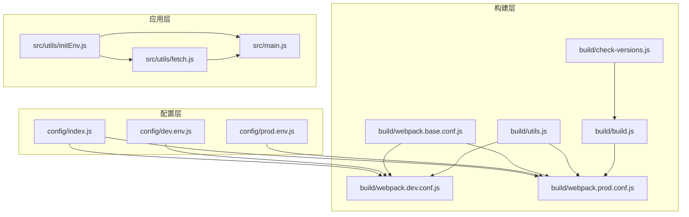
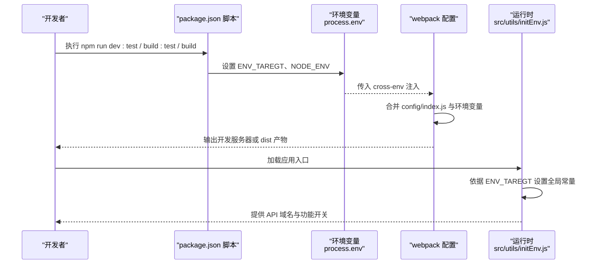
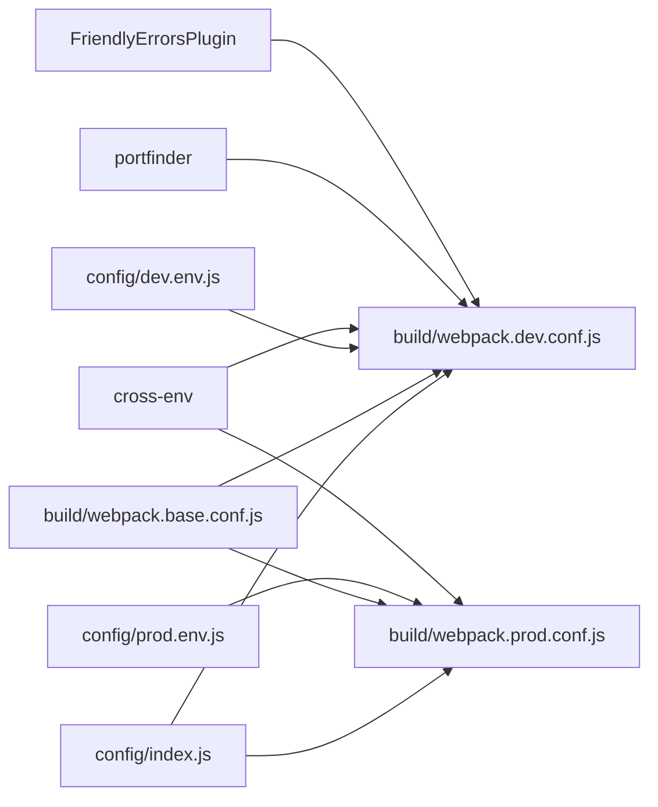

# 环境配置

<cite>
**本文引用的文件**
- [config/index.js](file://config/index.js)
- [config/dev.env.js](file://config/dev.env.js)
- [config/prod.env.js](file://config/prod.env.js)
- [package.json](file://package.json)
- [build/webpack.dev.conf.js](file://build/webpack.dev.conf.js)
- [build/webpack.prod.conf.js](file://build/webpack.prod.conf.js)
- [build/webpack.base.conf.js](file://build/webpack.base.conf.js)
- [build/utils.js](file://build/utils.js)
- [build/build.js](file://build/build.js)
- [build/check-versions.js](file://build/check-versions.js)
- [src/utils/initEnv.js](file://src/utils/initEnv.js)
- [src/utils/fetch.js](file://src/utils/fetch.js)
- [src/main.js](file://src/main.js)
</cite>

## 目录
1. [简介](#简介)
2. [项目结构](#项目结构)
3. [核心组件](#核心组件)
4. [架构总览](#架构总览)
5. [详细组件分析](#详细组件分析)
6. [依赖分析](#依赖分析)
7. [性能考虑](#性能考虑)
8. [故障排查指南](#故障排查指南)
9. [结论](#结论)
10. [附录](#附录)

## 简介
本文件面向开发与运维人员，系统化梳理本项目的环境配置体系，涵盖开发、测试与生产三类环境的配置差异与设置方法；重点解读 config/index.js 中 dev 与 build 的配置项（路径、代理、开发服务器、源码映射等），并说明环境变量 process.env.HOST、process.env.PORT、process.env.ENV_TAREGT 的来源、覆盖机制与使用方式。同时提供各环境的最佳实践、常见问题与解决方案、配置验证方法以及环境切换操作指南。

## 项目结构
围绕“配置—构建—运行”主线，项目采用分层组织：
- 配置层：config 目录集中管理开发与生产的配置对象及环境变量
- 构建层：build 目录通过 webpack 配置实现开发服务器与生产打包流程
- 应用层：src/utils/initEnv.js 基于环境变量注入全局运行时常量，供业务代码按环境选择 API 域名与功能开关

图表来源
- [config/index.js:1-72](file://config/index.js#L1-L72)
- [config/dev.env.js:1-9](file://config/dev.env.js#L1-L9)
- [config/prod.env.js:1-6](file://config/prod.env.js#L1-L6)
- [build/webpack.dev.conf.js:1-96](file://build/webpack.dev.conf.js#L1-L96)
- [build/webpack.prod.conf.js:1-149](file://build/webpack.prod.conf.js#L1-L149)
- [build/webpack.base.conf.js:1-102](file://build/webpack.base.conf.js#L1-L102)
- [build/utils.js:1-102](file://build/utils.js#L1-L102)
- [build/build.js:1-42](file://build/build.js#L1-L42)
- [build/check-versions.js:1-55](file://build/check-versions.js#L1-L55)
- [src/utils/initEnv.js:1-33](file://src/utils/initEnv.js#L1-L33)
- [src/utils/fetch.js:1-240](file://src/utils/fetch.js#L1-L240)
- [src/main.js:1-221](file://src/main.js#L1-L221)

章节来源
- [config/index.js:1-72](file://config/index.js#L1-L72)
- [build/webpack.dev.conf.js:1-96](file://build/webpack.dev.conf.js#L1-L96)
- [build/webpack.prod.conf.js:1-149](file://build/webpack.prod.conf.js#L1-L149)
- [build/webpack.base.conf.js:1-102](file://build/webpack.base.conf.js#L1-L102)
- [build/utils.js:1-102](file://build/utils.js#L1-L102)
- [build/build.js:1-42](file://build/build.js#L1-L42)
- [build/check-versions.js:1-55](file://build/check-versions.js#L1-L55)
- [src/utils/initEnv.js:1-33](file://src/utils/initEnv.js#L1-L33)
- [src/utils/fetch.js:1-240](file://src/utils/fetch.js#L1-L240)
- [src/main.js:1-221](file://src/main.js#L1-L221)

## 核心组件
- 环境配置中心：config/index.js 提供 dev 与 build 两套配置，分别控制开发服务器行为、静态资源路径、源码映射策略、生产打包产物与优化策略
- 环境变量注入：config/dev.env.js 与 config/prod.env.js 注入 NODE_ENV 与自定义 ENV_TAREGT；webpack 开发配置通过 DefinePlugin 注入到前端代码
- 构建入口：package.json scripts 定义了 dev:test、build:test、build 三类命令，分别对应不同目标环境
- 运行时环境切换：src/utils/initEnv.js 根据 ENV_TAREGT 设置全局域名与功能开关，供 fetch 等模块按环境选择 API 域名
- 开发服务器与端口：build/webpack.dev.conf.js 从 process.env.HOST/PORT 与 config.dev.host/port 合并得到最终主机与端口，并在端口占用时自动寻找可用端口
- 生产构建：build/build.js 清理输出目录、执行 webpack 生产配置、输出带哈希的静态资源与 HTML

章节来源
- [config/index.js:7-71](file://config/index.js#L7-L71)
- [config/dev.env.js:5-8](file://config/dev.env.js#L5-L8)
- [config/prod.env.js:2-5](file://config/prod.env.js#L2-L5)
- [package.json:7-11](file://package.json#L7-L11)
- [src/utils/initEnv.js:1-33](file://src/utils/initEnv.js#L1-L33)
- [build/webpack.dev.conf.js:13-95](file://build/webpack.dev.conf.js#L13-L95)
- [build/build.js:1-42](file://build/build.js#L1-L42)

## 架构总览
下图展示从命令到运行时的关键链路：脚本命令 → 环境变量 → webpack 配置 → 构建产物 → 运行时环境注入 → API 域名选择。

图表来源
- [package.json:7-11](file://package.json#L7-L11)
- [config/dev.env.js:5-8](file://config/dev.env.js#L5-L8)
- [config/prod.env.js:2-5](file://config/prod.env.js#L2-L5)
- [build/webpack.dev.conf.js:48-50](file://build/webpack.dev.conf.js#L48-L50)
- [build/webpack.prod.conf.js:35-37](file://build/webpack.prod.conf.js#L35-L37)
- [src/utils/initEnv.js:1-33](file://src/utils/initEnv.js#L1-L33)

## 详细组件分析

### 配置中心 config/index.js
- dev 配置要点
  - 资源路径：assetsSubDirectory、assetsPublicPath 控制开发时静态资源相对路径与公共前缀
  - 代理：proxyTable 可扩展为开发期跨域代理规则
  - 服务器：host、port 支持通过 process.env.HOST/PORT 覆盖；autoOpenBrowser、errorOverlay、notifyOnErrors 控制体验
  - 源码映射：devtool 使用开发友好映射；cacheBusting 与 cssSourceMap 便于调试
  - 轮询：poll 控制文件变更监听策略
- build 配置要点
  - 输出：index、assetsRoot、assetsSubDirectory、assetsPublicPath、staticPath 控制产物位置与访问前缀
  - 源码映射：productionSourceMap 关闭，devtool 使用生产映射策略
  - 压缩与体积：productionGzip、productionGzipExtensions 控制 gzip；bundleAnalyzerReport 用于可视化分析
  - 分析报告：通过 npm run build --report 触发

章节来源
- [config/index.js:8-37](file://config/index.js#L8-L37)
- [config/index.js:39-70](file://config/index.js#L39-L70)

### 环境变量与覆盖机制
- HOST 与 PORT
  - 来源：process.env.HOST、process.env.PORT
  - 覆盖顺序：优先使用环境变量，否则回退到 config.dev.host/port
  - 端口冲突：开发配置中通过 portfinder 自动选择可用端口并写回进程环境
- ENV_TAREGT
  - 作用：决定 src/utils/initEnv.js 中的全局常量集合，进而影响 API 域名与功能开关
  - 注入：开发环境由 config/dev.env.js 注入，生产环境由 config/prod.env.js 注入
  - 命令：package.json 中 dev:test、build:test、build 三类脚本分别设置不同的 ENV_TAREGT

章节来源
- [build/webpack.dev.conf.js:13-14](file://build/webpack.dev.conf.js#L13-L14)
- [build/webpack.dev.conf.js:34-35](file://build/webpack.dev.conf.js#L34-L35)
- [build/webpack.dev.conf.js:72-80](file://build/webpack.dev.conf.js#L72-L80)
- [config/dev.env.js:7-8](file://config/dev.env.js#L7-L8)
- [config/prod.env.js:4](file://config/prod.env.js#L4)
- [package.json:8-10](file://package.json#L8-L10)
- [src/utils/initEnv.js:1-33](file://src/utils/initEnv.js#L1-L33)

### 开发服务器与代理
- 合并与注入
  - devWebpackConfig 合并基础配置与开发配置，注入 styleLoaders、devtool、devServer、plugins
  - DefinePlugin 将 config/dev.env.js 注入到前端代码，使 process.env.NODE_ENV 与 ENV_TAREGT 可在前端使用
- 代理与路由回退
  - devServer.historyApiFallback 将未匹配路由回退到 index.html，适配 SPA
  - devServer.proxy 由 config.dev.proxyTable 提供，支持开发期跨域转发
- 静态资源复制
  - CopyWebpackPlugin 将 static 目录复制到开发输出目录的子目录

章节来源
- [build/webpack.dev.conf.js:16-69](file://build/webpack.dev.conf.js#L16-L69)
- [config/index.js:10-13](file://config/index.js#L10-L13)

### 生产构建与产物
- 入口与清理
  - build/build.js 设置 NODE_ENV=production，清理 dist 目标目录
- 产物与优化
  - webpack.prod.conf.js 输出带内容哈希的 JS/CSS，HtmlWebpackPlugin 生成压缩后的 index.html
  - CommonsChunkPlugin、HashedModuleIdsPlugin、ModuleConcatenationPlugin 优化缓存与打包体积
  - ExtractTextPlugin、OptimizeCSSPlugin 提取与压缩 CSS
  - 可选 gzip 与 bundle 分析插件
- 输出路径
  - config/index.js 中 build.assetsRoot、assetsPublicPath、assetsSubDirectory 决定产物存放与访问前缀

章节来源
- [build/build.js:14-41](file://build/build.js#L14-L41)
- [build/webpack.prod.conf.js:16-148](file://build/webpack.prod.conf.js#L16-L148)
- [config/index.js:41-48](file://config/index.js#L41-L48)

### 运行时环境切换与 API 域名
- 初始化逻辑
  - src/utils/initEnv.js 根据 ENV_TAREGT 设置 LoginPath、BasePath、BaseNewPath、newcharge、newcard、homeworkfetch、command、renlianPath 等全局常量
- 使用方式
  - src/utils/fetch.js 基于 global.BasePath 与多个全局域名构造不同业务域的 axios 实例
  - src/main.js 中根据 pc_login_type 与 global.command 选择跳转地址，体现运行时对环境的感知

章节来源
- [src/utils/initEnv.js:1-33](file://src/utils/initEnv.js#L1-L33)
- [src/utils/fetch.js:13-240](file://src/utils/fetch.js#L13-L240)
- [src/main.js:177-194](file://src/main.js#L177-L194)

### 环境差异与最佳实践
- 开发环境（dev）
  - 优点：热更新、源码映射、错误覆盖、自动打开浏览器
  - 最佳实践：开启代理解决跨域；合理设置 proxyTable；避免在 devtool 上过度消耗性能
- 测试环境（build:test）
  - 优点：与生产一致的打包与优化，便于回归测试
  - 最佳实践：使用独立的 ENV_TAREGT，确保 API 域名指向测试服务；如需分析体积，临时开启 bundleAnalyzerReport
- 生产环境（production）
  - 优点：关闭源码映射、启用压缩与缓存优化、输出稳定哈希
  - 最佳实践：确认 assetsPublicPath 与部署路径一致；开启 gzip 时注意服务器支持；上线前进行 bundle 分析

章节来源
- [config/index.js:8-37](file://config/index.js#L8-L37)
- [config/index.js:39-70](file://config/index.js#L39-L70)
- [package.json:7-11](file://package.json#L7-L11)
- [src/utils/initEnv.js:1-33](file://src/utils/initEnv.js#L1-L33)

## 依赖分析
- 组件耦合
  - config/index.js 是 dev 与 build 的唯一权威来源，webpack 开发/生产配置均依赖其键值
  - webpack.dev.conf.js 与 webpack.prod.conf.js 通过 webpack-merge 合并基础配置，保持一致性
  - src/utils/initEnv.js 仅依赖 ENV_TAREGT，不直接依赖 webpack 配置
- 外部依赖
  - cross-env 保证跨平台注入环境变量
  - portfinder 在端口占用时自动选择可用端口
  - FriendlyErrorsPlugin 提升开发体验

图表来源
- [config/index.js:1-72](file://config/index.js#L1-L72)
- [build/webpack.dev.conf.js:1-96](file://build/webpack.dev.conf.js#L1-L96)
- [build/webpack.prod.conf.js:1-149](file://build/webpack.prod.conf.js#L1-L149)
- [build/webpack.base.conf.js:1-102](file://build/webpack.base.conf.js#L1-L102)
- [config/dev.env.js:1-9](file://config/dev.env.js#L1-L9)
- [config/prod.env.js:1-6](file://config/prod.env.js#L1-L6)
- [package.json:7-11](file://package.json#L7-L11)

章节来源
- [config/index.js:1-72](file://config/index.js#L1-L72)
- [build/webpack.dev.conf.js:1-96](file://build/webpack.dev.conf.js#L1-L96)
- [build/webpack.prod.conf.js:1-149](file://build/webpack.prod.conf.js#L1-L149)
- [build/webpack.base.conf.js:1-102](file://build/webpack.base.conf.js#L1-L102)
- [config/dev.env.js:1-9](file://config/dev.env.js#L1-L9)
- [config/prod.env.js:1-6](file://config/prod.env.js#L1-L6)
- [package.json:7-11](file://package.json#L7-L11)

## 性能考虑
- 开发阶段
  - 使用开发源码映射与热更新提升调试效率；谨慎开启 poll 以减少 CPU 占用
  - 合理配置 proxyTable，避免不必要的代理链路
- 生产阶段
  - 关闭 productionSourceMap 降低包体与构建时间
  - 启用 CommonsChunkPlugin、ModuleConcatenationPlugin 与 ExtractTextPlugin 提升缓存命中与加载速度
  - 如需进一步优化，可开启 gzip 并配合服务器配置

## 故障排查指南
- 端口被占用
  - 现象：开发服务器启动失败
  - 处理：设置 process.env.PORT 或等待 portfinder 自动分配；确认 config.dev.port 与 HOST 是否正确
- 跨域请求失败
  - 现象：开发环境接口 404 或 CORS 报错
  - 处理：在 config.dev.proxyTable 中添加代理规则；确认 devServer.proxy 已生效
- 源码映射导致调试困难
  - 现象：断点无法命中或堆栈不准确
  - 处理：检查 config.dev.devtool 与 config.build.productionSourceMap；开发建议保留映射，生产建议关闭
- API 域名错误
  - 现象：接口返回 404 或业务异常
  - 处理：确认 ENV_TAREGT 与 src/utils/initEnv.js 的分支匹配；核对 fetch.js 中的 baseURL 选择逻辑
- 版本不兼容
  - 现象：构建报错或功能异常
  - 处理：运行版本检查脚本，确保 Node 与 npm 版本满足要求

章节来源
- [build/webpack.dev.conf.js:72-80](file://build/webpack.dev.conf.js#L72-L80)
- [config/index.js:10-13](file://config/index.js#L10-L13)
- [build/check-versions.js:27-54](file://build/check-versions.js#L27-L54)
- [src/utils/initEnv.js:1-33](file://src/utils/initEnv.js#L1-L33)
- [src/utils/fetch.js:13-240](file://src/utils/fetch.js#L13-L240)

## 结论
本项目的环境配置以 config/index.js 为核心，结合 webpack 开发/生产配置与环境变量注入，形成清晰的开发、测试、生产三段式流水线。通过 ENV_TAREGT 实现运行时的环境切换，配合 initEnv 与 fetch 的全局常量，确保 API 域名与功能开关在不同环境下正确生效。遵循本文提供的最佳实践与排障建议，可显著提升开发效率与部署稳定性。

## 附录

### 环境切换操作指南
- 开发联调
  - 使用命令：npm run dev:test
  - 作用：设置 ENV_TAREGT=dev_test，连接测试 API 与资源
- 测试发布
  - 使用命令：npm run build:test
  - 作用：设置 ENV_TAREGT=build_test，产出与生产一致的测试包
- 正式发布
  - 使用命令：npm run build
  - 作用：设置 ENV_TAREGT=production，产出最小化、带缓存优化的生产包

章节来源
- [package.json:7-11](file://package.json#L7-L11)

### 配置验证方法
- 版本检查
  - 运行构建前自动检查 Node 与 npm 版本是否满足 engines 要求
- 端口可用性
  - 开发时若指定端口被占用，自动寻找可用端口并更新 devServer 配置
- 代理连通性
  - 在 config.dev.proxyTable 中添加目标服务代理，验证接口可被转发
- 运行时域名核对
  - 在浏览器控制台检查 global.BasePath、global.LoginPath 等是否符合预期

章节来源
- [build/check-versions.js:27-54](file://build/check-versions.js#L27-L54)
- [build/webpack.dev.conf.js:72-80](file://build/webpack.dev.conf.js#L72-L80)
- [config/index.js:10-13](file://config/index.js#L10-L13)
- [src/utils/initEnv.js:1-33](file://src/utils/initEnv.js#L1-L33)