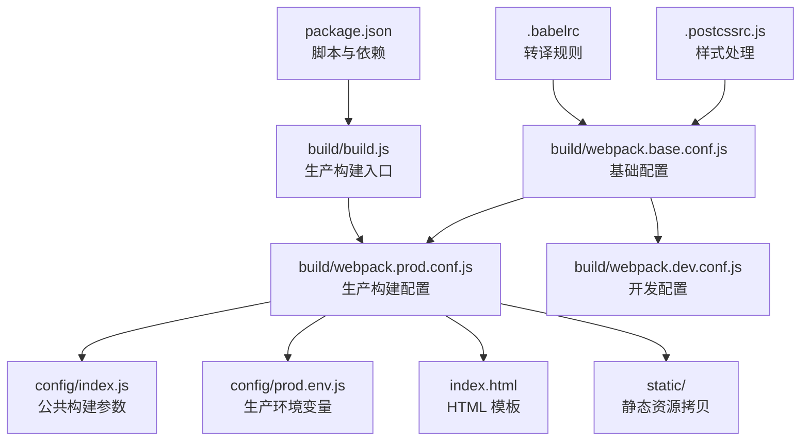
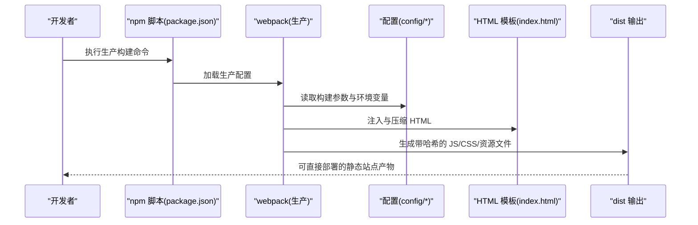
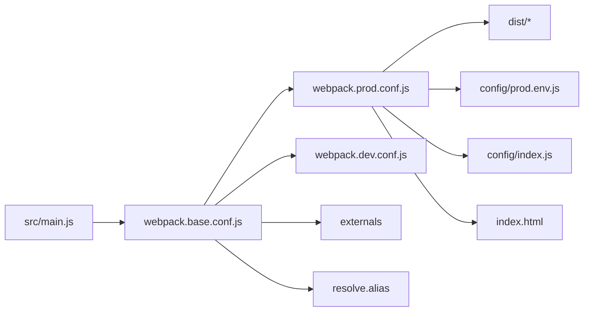

# 部署配置

<cite>
**本文引用的文件**   
- [package.json](file://package.json)
- [config/index.js](file://config/index.js)
- [config/dev.env.js](file://config/dev.env.js)
- [config/prod.env.js](file://config/prod.env.js)
- [.postcssrc.js](file://.postcssrc.js)
- [.babelrc](file://.babelrc)
- [index.html](file://index.html)
- [build/webpack.base.conf.js](file://build/webpack.base.conf.js)
- [build/webpack.dev.conf.js](file://build/webpack.dev.conf.js)
- [build/webpack.prod.conf.js](file://build/webpack.prod.conf.js)
- [build/build.js](file://build/build.js)
</cite>

## 目录
1. [简介](#简介)
2. [项目结构](#项目结构)
3. [核心组件](#核心组件)
4. [架构总览](#架构总览)
5. [详细组件分析](#详细组件分析)
6. [依赖分析](#依赖分析)
7. [性能考虑](#性能考虑)
8. [故障排查指南](#故障排查指南)
9. [结论](#结论)
10. [附录](#附录)

## 简介
本文件面向生产环境部署，系统性梳理该 Vue 项目的部署策略与配置要求，覆盖以下主题：
- 静态资源路径与 CDN 配置
- 缓存策略建议
- 构建期优化（资源压缩、代码混淆、打包分块）
- 不同部署环境（Nginx/Apache/云平台）的差异化配置要点
- 部署自动化与 CI/CD 集成思路
- 部署后验证与监控建议

## 项目结构
该工程采用基于 webpack 的多环境配置，核心目录与职责如下：
- config：开发/生产环境配置入口与变量
- build：webpack 入口与构建脚本
- src：源码
- static：第三方静态资源（未被 webpack 处理）
- 根目录模板与工具：index.html、.babelrc、.postcssrc.js、package.json

图表来源
- [package.json:1-98](file://package.json#L1-L98)
- [build/build.js:1-42](file://build/build.js#L1-L42)
- [build/webpack.prod.conf.js:1-149](file://build/webpack.prod.conf.js#L1-L149)
- [config/index.js:1-72](file://config/index.js#L1-L72)
- [config/prod.env.js:1-6](file://config/prod.env.js#L1-L6)
- [index.html:1-41](file://index.html#L1-L41)
- [build/webpack.base.conf.js:1-102](file://build/webpack.base.conf.js#L1-L102)
- [build/webpack.dev.conf.js:1-96](file://build/webpack.dev.conf.js#L1-L96)
- [.babelrc:1-16](file://.babelrc#L1-L16)
- [.postcssrc.js:1-11](file://.postcssrc.js#L1-L11)

章节来源
- [package.json:1-98](file://package.json#L1-L98)
- [config/index.js:1-72](file://config/index.js#L1-L72)

## 核心组件
- 构建脚本与环境变量
  - 生产构建命令通过环境变量切换目标环境，使用统一构建入口。
  - 开发/生产环境变量分别定义在 config 目录中，供 webpack 注入。
- 路径与公共资源
  - 生产环境 publicPath 与静态资源路径在 config 中集中管理；静态资源通过 CopyWebpackPlugin 拷贝到输出目录。
- 样式与转译
  - PostCSS/Autoprefixer/Babel 配置在根目录文件中定义，影响样式兼容与 JS 转译范围。

章节来源
- [package.json:7-11](file://package.json#L7-L11)
- [config/index.js:39-70](file://config/index.js#L39-L70)
- [config/dev.env.js:1-9](file://config/dev.env.js#L1-L9)
- [config/prod.env.js:1-6](file://config/prod.env.js#L1-L6)
- [.postcssrc.js:1-11](file://.postcssrc.js#L1-L11)
- [.babelrc:1-16](file://.babelrc#L1-L16)

## 架构总览
下图展示从源码到产物的关键流程，以及生产构建期的优化点。

图表来源
- [package.json:7-11](file://package.json#L7-L11)
- [build/build.js:1-42](file://build/build.js#L1-L42)
- [build/webpack.prod.conf.js:1-149](file://build/webpack.prod.conf.js#L1-L149)
- [config/index.js:39-70](file://config/index.js#L39-L70)
- [index.html:1-41](file://index.html#L1-L41)

## 详细组件分析

### 静态资源路径与 CDN 配置
- 资源路径
  - 生产环境 publicPath 与静态资源路径在 config 中集中定义，便于统一替换。
  - 基础配置中定义了入口输出的 publicPath，决定运行时资源加载前缀。
- CDN 引用
  - HTML 模板中已内嵌多处外部 CDN 资源（如 Vue、Element UI、Moment、jQuery、ECharts、腾讯云 COS SDK、高德地图等），这些资源不走本地构建，需确保 CDN 可用与版本匹配。
- 静态资源拷贝
  - 通过 CopyWebpackPlugin 将 static 目录下的资源原样复制到输出目录，适合第三方库或无需构建的静态文件。

建议
- 对于可替换为本地构建的外部依赖，优先纳入打包以获得更好的缓存控制与离线能力。
- 对于第三方 CDN 资源，建议在构建时进行版本校验或锁定版本号，避免因 CDN 版本漂移导致的兼容问题。

章节来源
- [config/index.js:44-48](file://config/index.js#L44-L48)
- [build/webpack.base.conf.js:19-25](file://build/webpack.base.conf.js#L19-L25)
- [build/webpack.prod.conf.js:114-121](file://build/webpack.prod.conf.js#L114-L121)
- [index.html:12-32](file://index.html#L12-L32)

### 缓存策略
- 文件指纹
  - JS/CSS 使用内容哈希命名，提升长期缓存命中率并避免更新不生效。
- 分包与稳定 ID
  - CommonsChunkPlugin 提取 vendor、manifest 与异步分包，保持第三方库与运行时的稳定哈希，降低业务代码更新对缓存的影响。
- 压缩与去重
  - CSS 压缩与重复去重，HTML 压缩，减少体积与网络传输时间。

建议
- 针对浏览器与 CDN 的缓存策略，结合实际域名与路径规划，合理设置 Cache-Control/ETag/Last-Modified。
- 对于第三方 CDN 资源，若无法控制缓存头，建议在 URL 上附加版本参数以实现失效刷新。

章节来源
- [build/webpack.prod.conf.js:30-32](file://build/webpack.prod.conf.js#L30-L32)
- [build/webpack.prod.conf.js:48-55](file://build/webpack.prod.conf.js#L48-L55)
- [build/webpack.prod.conf.js:84-112](file://build/webpack.prod.conf.js#L84-L112)

### 构建优化配置（压缩、混淆、性能）
- 代码压缩与混淆
  - JS 压缩由 UglifyJsPlugin 完成，开启并行压缩与警告过滤。
- CSS 压缩与去重
  - ExtractTextPlugin 抽取 CSS，OptimizeCSSPlugin 进一步压缩与去重。
- HTML 压缩
  - HtmlWebpackPlugin 在构建时移除注释、折叠空白与属性引号。
- 分包与模块合并
  - CommonsChunkPlugin 与 ModuleConcatenationPlugin 提升缓存命中与运行时性能。
- 资源处理
  - url-loader 对图片/媒体/字体进行小资源内联与哈希命名，控制阈值以平衡请求数与单文件大小。

建议
- 如需更现代的压缩器，可评估 terser-webpack-plugin 替代当前压缩器。
- 结合 Bundle Analyzer 生成报告定位大体积模块，持续优化依赖树。

章节来源
- [build/webpack.prod.conf.js:38-46](file://build/webpack.prod.conf.js#L38-L46)
- [build/webpack.prod.conf.js:58-62](file://build/webpack.prod.conf.js#L58-L62)
- [build/webpack.prod.conf.js:70-78](file://build/webpack.prod.conf.js#L70-L78)
- [build/webpack.prod.conf.js:84-84](file://build/webpack.prod.conf.js#L84-L84)
- [build/webpack.base.conf.js:60-83](file://build/webpack.base.conf.js#L60-L83)

### 不同部署环境的配置差异
- Nginx
  - 静态站点根目录指向 dist；publicPath 与路由模式需一致，避免 404。
  - 启用 gzip/br 压缩与合理的缓存头；对 JS/CSS 设置长缓存，对 HTML 设置短缓存。
  - 将第三方 CDN 资源回退至本地或通过反向代理统一管理，保证稳定性。
- Apache
  - 使用 .htaccess 或虚拟主机配置启用静态压缩与缓存；确保重写规则与前端路由一致。
- 云平台（对象存储/CDN）
  - 将 dist 上传至对象存储桶，配置 CDN 加速与缓存策略；注意 publicPath 与回源路径。
  - 若使用自定义域名，确保 CNAME 与 HTTPS 证书配置正确。

[本节为通用实践说明，不直接分析具体文件，故无“章节来源”]

### 部署自动化与 CI/CD 集成
- 构建阶段
  - 使用统一的生产构建脚本，按环境注入变量；可扩展为多分支构建（测试/预发布/正式）。
- 发布阶段
  - 将 dist 目录发布到目标服务器或对象存储；可结合流水线进行版本标记与回滚策略。
- 质量门禁
  - 在 CI 中加入构建产物体积阈值、安全扫描与可访问性检查。

[本节为通用实践说明，不直接分析具体文件，故无“章节来源”]

### 部署后验证与监控
- 功能验证
  - 校验首页可正常加载、路由跳转、接口连通性与第三方资源可用性。
- 性能验证
  - 使用 Lighthouse/Chrome DevTools 测量首屏时间、TTFB、资源体积与缓存命中。
- 监控告警
  - 前端埋点上报错误与性能指标；服务端日志与 CDN 访问日志联动分析。

[本节为通用实践说明，不直接分析具体文件，故无“章节来源”]

## 依赖分析
- 入口与输出
  - 入口为 src/main.js，输出受 publicPath 与分包策略影响。
- 外部依赖
  - 通过 externals 将部分大型库声明为外部，减小打包体积，但需确保运行时可加载。
- 样式与转译
  - PostCSS/Autoprefixer 与 Babel 配置影响最终产物兼容性与体积。

图表来源
- [build/webpack.base.conf.js:14-101](file://build/webpack.base.conf.js#L14-L101)
- [build/webpack.prod.conf.js:16-149](file://build/webpack.prod.conf.js#L16-L149)
- [build/webpack.dev.conf.js:16-96](file://build/webpack.dev.conf.js#L16-L96)
- [config/prod.env.js:1-6](file://config/prod.env.js#L1-6)
- [config/index.js:39-70](file://config/index.js#L39-L70)
- [index.html:1-41](file://index.html#L1-L41)

章节来源
- [build/webpack.base.conf.js:14-101](file://build/webpack.base.conf.js#L14-L101)
- [build/webpack.prod.conf.js:16-149](file://build/webpack.prod.conf.js#L16-L149)
- [build/webpack.dev.conf.js:16-96](file://build/webpack.dev.conf.js#L16-L96)

## 性能考虑
- 体积优化
  - 利用分包与哈希命名，确保缓存最大化；对非关键资源采用异步加载。
- 传输优化
  - 启用 gzip/br 压缩；合理设置缓存头；CDN 边缘节点就近分发。
- 运行时优化
  - 外部依赖外置，减少主包体积；按需引入组件与样式。

[本节为通用性能建议，不直接分析具体文件，故无“章节来源”]

## 故障排查指南
- 构建失败
  - 查看构建日志中的错误信息；确认 Node/NPM 版本满足要求；清理缓存后重试。
- 资源 404
  - 检查 publicPath 与服务器根目录是否一致；确认静态资源是否正确拷贝。
- 第三方资源异常
  - 核对 CDN 地址与版本；必要时回退至本地资源或替换为稳定镜像。
- 缓存问题
  - 清理浏览器缓存；核对服务端缓存头；对新增资源增加版本后缀。

章节来源
- [build/build.js:30-40](file://build/build.js#L30-L40)
- [config/index.js:44-48](file://config/index.js#L44-L48)
- [index.html:12-32](file://index.html#L12-L32)

## 结论
本项目已具备完善的生产构建链路与优化策略，建议在生产部署中重点关注：
- publicPath 与服务器根目录一致性
- CDN 资源的可用性与版本锁定
- 缓存策略与回源路径设计
- 自动化与可观测性建设

[本节为总结性内容，不直接分析具体文件，故无“章节来源”]

## 附录

### 关键配置清单与说明
- 构建命令与环境变量
  - 生产构建命令通过环境变量切换目标环境，统一调用构建入口。
- 路径与公共资源
  - 生产 publicPath 与静态资源路径集中于配置文件；static 目录资源通过拷贝插件输出。
- 样式与转译
  - PostCSS/Autoprefixer 与 Babel 配置位于根目录，影响兼容性与体积。

章节来源
- [package.json:7-11](file://package.json#L7-L11)
- [config/index.js:39-70](file://config/index.js#L39-L70)
- [.postcssrc.js:1-11](file://.postcssrc.js#L1-11)
- [.babelrc:1-16](file://.babelrc#L1-L16)