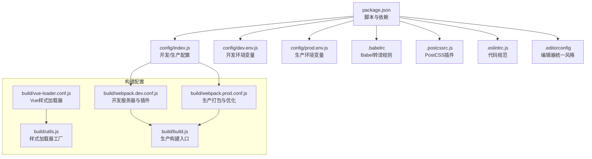
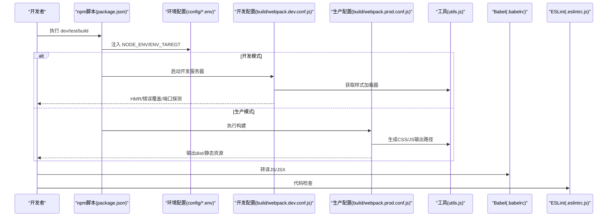
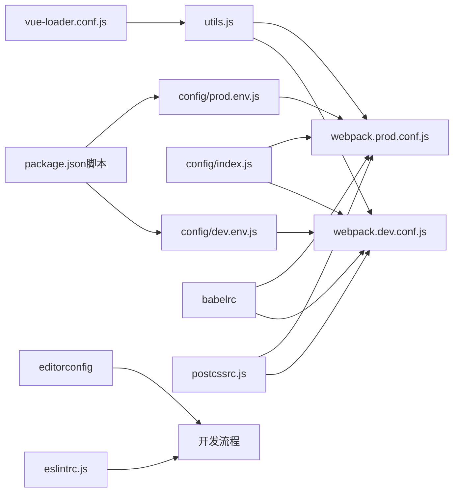

# 配置管理

<cite>
**本文引用的文件**
- [package.json](file://package.json)
- [config/index.js](file://config/index.js)
- [config/dev.env.js](file://config/dev.env.js)
- [config/prod.env.js](file://config/prod.env.js)
- [.babelrc](file://.babelrc)
- [.postcssrc.js](file://.postcssrc.js)
- [.eslintrc.js](file://.eslintrc.js)
- [.editorconfig](file://.editorconfig)
- [build/webpack.dev.conf.js](file://build/webpack.dev.conf.js)
- [build/webpack.prod.conf.js](file://build/webpack.prod.conf.js)
- [build/vue-loader.conf.js](file://build/vue-loader.conf.js)
- [build/utils.js](file://build/utils.js)
- [build/build.js](file://build/build.js)
</cite>

## 目录
1. [简介](#简介)
2. [项目结构](#项目结构)
3. [核心组件](#核心组件)
4. [架构总览](#架构总览)
5. [详细组件分析](#详细组件分析)
6. [依赖分析](#依赖分析)
7. [性能考虑](#性能考虑)
8. [故障排查指南](#故障排查指南)
9. [结论](#结论)
10. [附录](#附录)

## 简介
本文件面向运维与开发人员，系统化梳理校园管理系统在开发、测试与生产三类环境中的配置管理策略，覆盖构建工具（Webpack）、转译工具（Babel）、样式处理（PostCSS/Sass/Less/Stylus）、第三方库集成、环境变量与密钥安全、配置热更新机制、部署与性能优化、监控、配置变更流程与回滚策略、以及配置验证方法。目标是帮助团队标准化配置管理，降低变更风险，提升交付质量与可维护性。

## 项目结构
该工程采用基于 Webpack 的前端工程化方案，通过多入口配置与环境变量区分开发、测试与生产环境；构建脚本通过 cross-env 注入环境标识，配合 config 目录下的环境配置文件实现差异化行为；样式体系通过 vue-loader.conf 与 utils 统一生成加载器链路；ESLint、EditorConfig、.babelrc 等工具配置保障代码风格与兼容性。

图表来源
- [package.json:1-98](file://package.json#L1-L98)
- [config/index.js:1-72](file://config/index.js#L1-L72)
- [config/dev.env.js:1-9](file://config/dev.env.js#L1-L9)
- [config/prod.env.js:1-6](file://config/prod.env.js#L1-L6)
- [.babelrc:1-16](file://.babelrc#L1-L16)
- [.postcssrc.js](file://.postcssrc.js)
- [.eslintrc.js:1-28](file://.eslintrc.js#L1-L28)
- [.editorconfig:1-10](file://.editorconfig#L1-L10)
- [build/webpack.dev.conf.js:1-96](file://build/webpack.dev.conf.js#L1-L96)
- [build/webpack.prod.conf.js:1-149](file://build/webpack.prod.conf.js#L1-L149)
- [build/vue-loader.conf.js:1-23](file://build/vue-loader.conf.js#L1-L23)
- [build/utils.js:1-102](file://build/utils.js#L1-L102)
- [build/build.js:1-42](file://build/build.js#L1-L42)

章节来源
- [package.json:1-98](file://package.json#L1-L98)
- [config/index.js:1-72](file://config/index.js#L1-L72)

## 核心组件
- 环境脚本与变量
  - 开发/测试/生产三套构建脚本通过 cross-env 设置 ENV_TAREGT，驱动 config 下的环境变量文件注入到构建过程中。
  - 开发环境变量合并生产环境变量，保留 ENV_TAREGT 的动态值，便于在不同测试环境间切换。
- 构建配置中心
  - config/index.js 提供 dev/build 两套默认配置，包括资源目录、公共路径、源映射、Gzip、Bundle Analyzer 等开关。
- Webpack 开发配置
  - 开启热更新、错误覆盖、端口探测、静态资源拷贝、HTML 模板注入等。
- Webpack 生产配置
  - Uglify 压缩、CSS 抽取与去重、CommonsChunk 分包、运行时与清单分离、Gzip 可选开启、Bundle Analyzer 可选开启。
- 样式处理
  - vue-loader.conf 统一控制是否抽取 CSS 与启用 sourceMap；utils 生成 css/postcss/sass/scss/less/stylus 加载器链路。
- 转译与兼容
  - .babelrc 使用 env + stage-2 预设，目标浏览器为 > 1%、最近两个版本、不支持 IE<=8。
- 规范与风格
  - ESLint、EditorConfig、.postcssrc.js 共同约束代码风格与样式处理插件。

章节来源
- [package.json:7-11](file://package.json#L7-L11)
- [config/dev.env.js:1-9](file://config/dev.env.js#L1-L9)
- [config/prod.env.js:1-6](file://config/prod.env.js#L1-L6)
- [config/index.js:8-70](file://config/index.js#L8-L70)
- [build/webpack.dev.conf.js:16-96](file://build/webpack.dev.conf.js#L16-L96)
- [build/webpack.prod.conf.js:16-149](file://build/webpack.prod.conf.js#L16-L149)
- [build/vue-loader.conf.js:1-23](file://build/vue-loader.conf.js#L1-L23)
- [build/utils.js:15-83](file://build/utils.js#L15-L83)
- [.babelrc:1-16](file://.babelrc#L1-L16)
- [.eslintrc.js:1-28](file://.eslintrc.js#L1-L28)
- [.editorconfig:1-10](file://.editorconfig#L1-L10)

## 架构总览
下图展示从脚本触发到最终产物产出的关键流程，包括环境变量注入、开发服务器启动、生产打包与优化、以及样式与第三方库的集成路径。

图表来源
- [package.json:7-11](file://package.json#L7-L11)
- [config/dev.env.js:1-9](file://config/dev.env.js#L1-L9)
- [config/prod.env.js:1-6](file://config/prod.env.js#L1-L6)
- [build/webpack.dev.conf.js:16-96](file://build/webpack.dev.conf.js#L16-L96)
- [build/webpack.prod.conf.js:16-149](file://build/webpack.prod.conf.js#L16-L149)
- [build/utils.js:7-83](file://build/utils.js#L7-L83)
- [.babelrc:1-16](file://.babelrc#L1-L16)
- [.eslintrc.js:1-28](file://.eslintrc.js#L1-L28)

## 详细组件分析

### 环境配置与脚本
- 脚本设计
  - dev:test：设置 ENV_TAREGT=dev_test，启动开发服务器。
  - build:test：设置 ENV_TAREGT=build_test，执行生产构建。
  - build：设置 ENV_TAREGT=production，执行生产构建。
- 环境变量
  - dev.env 在构建时与 prod.env 合并，保留 ENV_TAREGT 的实际值，便于在 CI/CD 中按需注入。
- 差异化要点
  - 开发：启用源映射、热更新、错误覆盖、端口探测。
  - 生产：启用压缩、CSS抽取、分包、可选 Gzip 与 Bundle Analyzer。

章节来源
- [package.json:7-11](file://package.json#L7-L11)
- [config/dev.env.js:1-9](file://config/dev.env.js#L1-L9)
- [config/prod.env.js:1-6](file://config/prod.env.js#L1-L6)
- [config/index.js:8-70](file://config/index.js#L8-L70)

### Webpack 开发配置
- 关键特性
  - devServer：路由回退到 index.html、热更新、静态资源拷贝、端口探测、错误覆盖。
  - 插件：DefinePlugin 注入环境变量、HotModuleReplacement、NamedModules、NoEmitOnErrors、HtmlWebpackPlugin、CopyWebpackPlugin。
  - 样式：通过 utils.styleLoaders 与 usePostCSS=true 生成加载器链路。
- 端口与主机
  - 支持 HOST/PORT 环境变量覆盖，默认主机 localhost、端口 8080，若被占用自动寻找可用端口。

章节来源
- [build/webpack.dev.conf.js:16-96](file://build/webpack.dev.conf.js#L16-L96)
- [build/utils.js:69-83](file://build/utils.js#L69-L83)

### Webpack 生产配置
- 关键特性
  - 压缩：UglifyJsPlugin 并行压缩，保留警告关闭。
  - 样式：ExtractTextPlugin 抽取 CSS，OptimizeCSSPlugin 去重与压缩。
  - 分包：CommonsChunkPlugin 提取 vendor、manifest、app（异步共享）。
  - 输出：JS/CSS 文件名含哈希，路径由 utils.assetsPath 决定。
  - 可选：Gzip 压缩与 Bundle Analyzer 报告。
- 运行时与清单
  - HashedModuleIdsPlugin 与 ModuleConcatenationPlugin 提升缓存命中与打包效率。

章节来源
- [build/webpack.prod.conf.js:16-149](file://build/webpack.prod.conf.js#L16-L149)
- [build/utils.js:7-13](file://build/utils.js#L7-L13)

### 样式处理与第三方库集成
- 样式加载器
  - 支持 css/postcss/sass/scss/less/stylus，通过 vue-loader.conf 与 utils.cssLoaders 生成链路。
  - 生产环境默认抽取 CSS，开发环境可选择内联与 sourceMap。
- 第三方库
  - 依赖集中在 package.json，如 axios、element-ui、echarts、moment、lodash 等。
  - 通过 webpack externals 可进行外部化配置（当前为空），以减少打包体积或接入 CDN。

章节来源
- [build/vue-loader.conf.js:1-23](file://build/vue-loader.conf.js#L1-L23)
- [build/utils.js:15-67](file://build/utils.js#L15-L67)
- [package.json:12-43](file://package.json#L12-L43)
- [build/webpack.prod.conf.js:17-19](file://build/webpack.prod.conf.js#L17-L19)

### Babel 转译配置
- 预设与插件
  - env 预设结合 browserslist，目标浏览器为 > 1%、最近两个版本、不支持 IE<=8。
  - stage-2 提供实验性语法支持；transform-runtime 与 dynamic-import-node 提升兼容性与按需加载。
- 与构建集成
  - babel-loader 在 webpack 中按需转译 JS/JSX，确保兼容目标环境。

章节来源
- [.babelrc:1-16](file://.babelrc#L1-16)
- [build/webpack.dev.conf.js:18](file://build/webpack.dev.conf.js#L18)
- [build/webpack.prod.conf.js:20-25](file://build/webpack.prod.conf.js#L20-L25)

### ESLint 与 EditorConfig
- ESLint
  - 推荐规则与 Vue 插件，强制缩进、全等比较、单引号；对 *.vue 文件关闭 indent 校验以避免冲突。
- EditorConfig
  - 统一缩进、换行、编码与尾随空白处理，保证跨编辑器一致性。

章节来源
- [.eslintrc.js:1-28](file://.eslintrc.js#L1-L28)
- [.editorconfig:1-10](file://.editorconfig#L1-L10)

### PostCSS 配置
- 插件链
  - 通过 .postcssrc.js 定义 postcss-loader 与相关插件（如 autoprefixer、postcss-import、postcss-url），与 css-loader、vue-style-loader 协作生成最终样式。
- 与构建集成
  - 开发与生产均通过 usePostCSS=true 生成加载器链路，确保样式处理一致性。

章节来源
- [.postcssrc.js](file://.postcssrc.js)
- [build/webpack.dev.conf.js:18](file://build/webpack.dev.conf.js#L18)
- [build/webpack.prod.conf.js:20-25](file://build/webpack.prod.conf.js#L20-L25)

### 构建入口与产物组织
- 构建入口
  - build/build.js 清理输出目录、调用 webpack 执行生产构建、输出统计信息。
- 产物组织
  - 输出至 dist，静态资源路径由 config/index.js 控制；开发环境 assetsSubDirectory 默认 'static'，生产环境可调整。

章节来源
- [build/build.js:1-42](file://build/build.js#L1-L42)
- [config/index.js:43-48](file://config/index.js#L43-L48)

## 依赖分析
- 脚本到配置
  - npm 脚本通过 cross-env 注入 ENV_TAREGT，影响 config 下 dev/prod 环境变量文件的最终值。
- 配置到构建
  - config/index.js 的 dev/build 字段决定 webpack 开发/生产配置的行为与输出。
- 样式与转译
  - vue-loader.conf 与 utils.cssLoaders 为样式处理提供统一入口；.babelrc 为 JS/JSX 转译提供预设与插件。
- 规范与风格
  - .eslintrc.js 与 .editorconfig 保障代码风格与一致性，减少构建期与运行期问题。

图表来源
- [package.json:7-11](file://package.json#L7-L11)
- [config/dev.env.js:1-9](file://config/dev.env.js#L1-L9)
- [config/prod.env.js:1-6](file://config/prod.env.js#L1-L6)
- [config/index.js:8-70](file://config/index.js#L8-L70)
- [build/webpack.dev.conf.js:16-96](file://build/webpack.dev.conf.js#L16-L96)
- [build/webpack.prod.conf.js:16-149](file://build/webpack.prod.conf.js#L16-L149)
- [build/vue-loader.conf.js:1-23](file://build/vue-loader.conf.js#L1-L23)
- [build/utils.js:15-83](file://build/utils.js#L15-L83)
- [.babelrc:1-16](file://.babelrc#L1-L16)
- [.postcssrc.js](file://.postcssrc.js)
- [.eslintrc.js:1-28](file://.eslintrc.js#L1-L28)
- [.editorconfig:1-10](file://.editorconfig#L1-L10)

## 性能考虑
- 代码分割与缓存
  - CommonsChunkPlugin 提取 vendor、manifest、app（异步共享），提升长期缓存命中率。
  - HashedModuleIdsPlugin 与 ModuleConcatenationPlugin 优化模块 ID 与作用域提升。
- 压缩与体积
  - UglifyJsPlugin 并行压缩；可选 Gzip 压缩进一步减小传输体积。
- 样式优化
  - ExtractTextPlugin 抽取 CSS，OptimizeCSSPlugin 去重与压缩；生产环境关闭 CSS SourceMap 以减少体积。
- 开发体验
  - 开发环境启用源映射与热更新，缩短反馈周期；错误覆盖与端口探测提升可用性。

章节来源
- [build/webpack.prod.conf.js:80-112](file://build/webpack.prod.conf.js#L80-L112)
- [build/webpack.prod.conf.js:38-62](file://build/webpack.prod.conf.js#L38-L62)
- [config/index.js:54-69](file://config/index.js#L54-L69)

## 故障排查指南
- 构建失败
  - build/build.js 输出统计信息，若包含错误则退出码 1；建议查看终端输出定位具体模块。
- 端口占用
  - 开发服务器会自动寻找可用端口；可通过 PORT 环境变量指定端口。
- 样式异常
  - 确认 vue-loader.conf 与 utils.cssLoaders 的 usePostCSS 与 extract 配置与当前环境一致。
- 转译问题
  - 检查 .babelrc 预设与插件是否与目标浏览器兼容；必要时调整 browserslist。
- 代码规范
  - 运行 ESLint 检查，修正规则冲突（如 *.vue 文件的缩进）。

章节来源
- [build/build.js:17-41](file://build/build.js#L17-L41)
- [build/webpack.dev.conf.js:71-95](file://build/webpack.dev.conf.js#L71-L95)
- [build/vue-loader.conf.js:4-7](file://build/vue-loader.conf.js#L4-L7)
- [build/utils.js:15-67](file://build/utils.js#L15-L67)
- [.babelrc:1-16](file://.babelrc#L1-L16)
- [.eslintrc.js:20-26](file://.eslintrc.js#L20-L26)

## 结论
本项目通过明确的脚本与环境变量体系、集中化的构建配置与样式处理链路、以及完善的开发与生产优化策略，实现了对校园管理系统的高效配置管理。建议在后续实践中持续完善密钥与敏感配置的外部化、引入配置热更新与灰度发布机制，并建立标准化的配置变更流程与回滚预案，以进一步提升系统的安全性与稳定性。

## 附录

### 环境变量与密钥安全
- 环境变量注入
  - 通过 cross-env 注入 ENV_TAREGT，结合 config 下的 dev/prod 环境文件，实现不同环境的差异化配置。
- 密钥与敏感信息
  - 建议将密钥与数据库连接串等敏感信息置于 CI/CD 的机密变量中，不在仓库中保存明文；在运行时通过 process.env 注入。
- 配置热更新
  - 对于非打包期配置（如运行时 API 地址、功能开关），建议通过独立的配置接口或本地存储的轻量配置文件实现热更新，避免频繁重新打包。

章节来源
- [package.json:7-11](file://package.json#L7-L11)
- [config/dev.env.js:1-9](file://config/dev.env.js#L1-L9)
- [config/prod.env.js:1-6](file://config/prod.env.js#L1-L6)

### 部署配置与性能优化
- 部署路径
  - 生产环境 assetsPublicPath 与 staticPath 可根据实际部署路径调整，确保静态资源正确加载。
- 性能优化
  - 启用 Gzip 与 Bundle Analyzer 报告；合理设置分包策略与缓存策略；关闭不必要的 SourceMap 以降低体积。
- 监控
  - 建议在构建后生成并上传 SourceMap 至安全的托管服务，以便线上错误追踪与性能分析。

章节来源
- [config/index.js:47-48](file://config/index.js#L47-L48)
- [build/webpack.prod.conf.js:125-141](file://build/webpack.prod.conf.js#L125-L141)
- [build/webpack.prod.conf.js:143-146](file://build/webpack.prod.conf.js#L143-L146)

### 配置变更流程与回滚策略
- 变更流程
  - 提交变更 → 自动化测试 → 生成变更报告 → 灰度发布 → 全量发布 → 验证与监控。
- 回滚策略
  - 保留上一个版本的构建产物与 SourceMap；回滚时恢复对应版本的静态资源与配置；记录回滚原因与责任人。
- 配置验证
  - 在本地与测试环境验证关键配置项（端口、代理、资源路径、第三方 SDK 参数）；生产前进行 A/B 测试或小流量验证。

章节来源
- [build/webpack.dev.conf.js:24-46](file://build/webpack.dev.conf.js#L24-L46)
- [build/webpack.prod.conf.js:66-79](file://build/webpack.prod.conf.js#L66-L79)