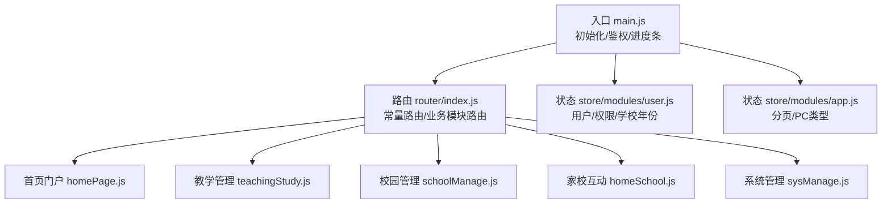
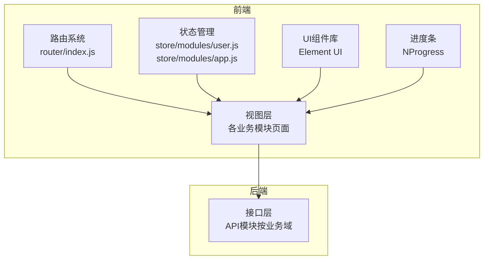
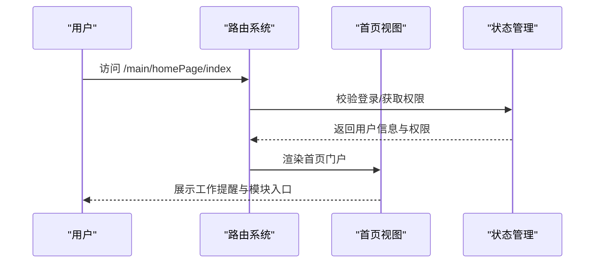
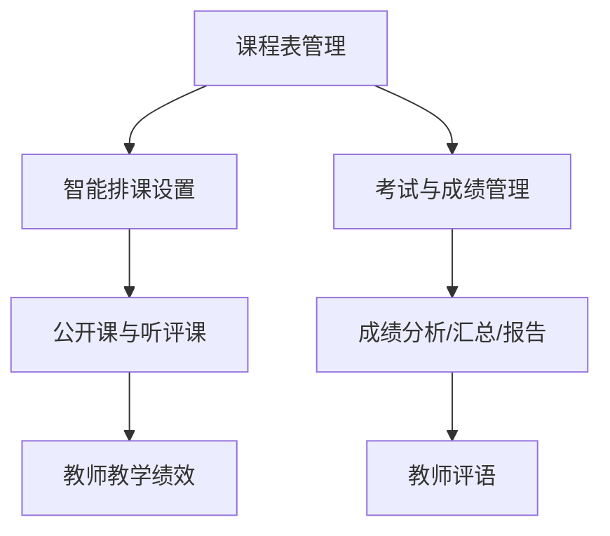
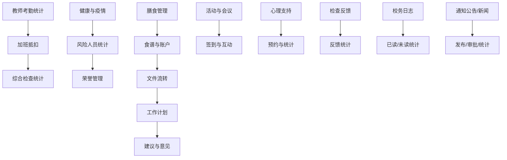
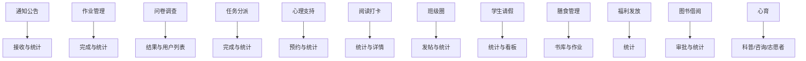
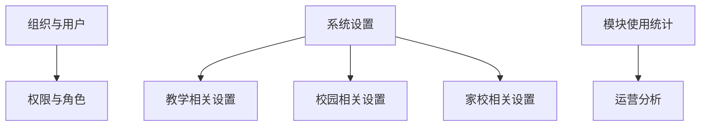
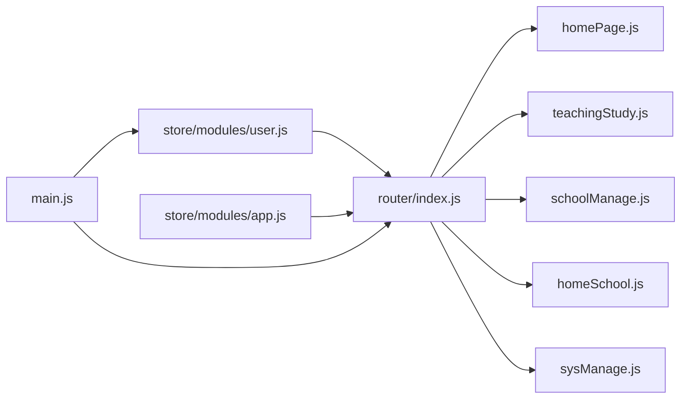

# 功能特性概览

<cite>
**本文引用的文件**
- [README.md](file://README.md)
- [router/index.js](file://src/router/index.js)
- [router/homePage.js](file://src/router/normal/homePage.js)
- [router/teachingStudy.js](file://src/router/normal/teachingStudy.js)
- [router/schoolManage.js](file://src/router/normal/schoolManage.js)
- [router/homeSchool.js](file://src/router/normal/homeSchool.js)
- [router/sysManage.js](file://src/router/normal/sysManage.js)
- [store/user.js](file://src/store/modules/user.js)
- [store/app.js](file://src/store/modules/app.js)
- [main.js](file://src/main.js)
- [views/homePage/index.vue](file://src/views/homePage/index.vue)
</cite>

## 目录
1. [引言](#引言)
2. [项目结构](#项目结构)
3. [核心组件](#核心组件)
4. [架构总览](#架构总览)
5. [详细组件分析](#详细组件分析)
6. [依赖分析](#依赖分析)
7. [性能考虑](#性能考虑)
8. [故障排查指南](#故障排查指南)
9. [结论](#结论)
10. [附录](#附录)

## 引言
本文件面向Vue.js校园管理系统，提供面向使用者与开发者的功能特性概览。系统围绕“首页门户、教学管理、校园管理、家校互动、系统管理”五大业务板块展开，覆盖课程安排、成绩管理、教师考勤统计、通知公告、成长档案、荣誉管理、综合检查、值班与进出校、膳食管理、学生请假、心理支持、阅读打卡、作业管理、问卷调查、任务分派、设备与报修、请假与加班、工作餐与停伙、护导与放学、智能排课、建议与意见、数据报表与推送、组织与权限、模块使用统计等核心能力。系统强调多角色权限控制、移动端适配、实时数据统计与可视化，并通过统一路由与状态管理实现清晰的模块化与扩展性。

## 项目结构
系统采用Vue CLI脚手架构建，前端以路由驱动模块划分，配合Vuex状态管理与Element UI组件库，形成“路由-视图-组件-API-状态”的完整链路。入口文件负责全局初始化、进度条、过滤器、第三方组件注册与鉴权守卫；路由文件按业务域拆分为首页、教学、校园、家校、系统管理等模块；状态管理包含用户信息、角色权限、学校年份、分页参数等。

图表来源
- [router/index.js:1-207](file://src/router/index.js#L1-L207)
- [main.js:1-221](file://src/main.js#L1-L221)
- [store/user.js:1-447](file://src/store/modules/user.js#L1-L447)
- [store/app.js:1-54](file://src/store/modules/app.js#L1-L54)

章节来源
- [README.md:1-24](file://README.md#L1-L24)
- [router/index.js:1-207](file://src/router/index.js#L1-L207)
- [main.js:1-221](file://src/main.js#L1-L221)

## 核心组件
- 首页门户
  - 主要职责：聚合工作提醒、通知公告、待办事项、数据看板等，提供统一入口与快捷操作。
  - 关键路径：/main/homePage/index、/main/homePage/danyangHome、/main/homePage/workReminder/index。
- 教学管理
  - 主要职责：课程表管理、智能排课、考试与成绩管理、公开课、听评课、教师教学绩效、汉字识读、英语美文、儿童研究听课、青蓝同辉、阅读平台等。
  - 关键路径：/main/teachingStudy/classScheduleCard/*、/main/teachingStudy/exam/*、/main/teachingStudy/openClass/*、/main/teachingStudy/teachingPerformance/*、/main/teachingStudy/Intelligencecourse/*。
- 校园管理
  - 主要职责：教师考勤统计、加班与抵扣、综合检查（值班表、检查项、统计）、值班与进出校、健康晨午检、疫情上报、膳食管理、学生请假、检查反馈、校务日志、活动与会议、心理支持、运动数据统计、设备库、报修、通知公告、新闻、荣誉管理、文件流转、工作计划、建议与意见、数据看板等。
  - 关键路径：/main/schoolManage/teacherAttendance/*、/main/schoolManage/overtimeDeduction/*、/main/schoolManage/compositeExam*、/main/schoolManage/onDuty/*、/main/schoolManage/healthCheck/*、/main/schoolManage/dietaryManagement/*、/main/schoolManage/studentLeave/*、/main/schoolManage/checkFeedBack/*、/main/schoolManage/schoolLog/*、/main/schoolManage/activity/*、/main/schoolManage/meeting/*、/main/schoolManage/psychological/*、/main/schoolManage/motionDataCollection/*、/main/schoolManage/equipmentLibrary/*、/main/schoolManage/repairManage/*、/main/schoolManage/notice/*、/main/schoolManage/news/*、/main/schoolManage/honorManagement/*、/main/schoolManage/documentFlow/*、/main/schoolManage/workPlan/*、/main/schoolManage/advice/*。
- 家校互动
  - 主要职责：通知公告发布与接收、家长端阅读、作业管理、问卷调查、任务分派、心理支持、阅读打卡、班级圈、学生请假、膳食管理、福利发放、图书借阅、心育科普与咨询、志愿者服务等。
  - 关键路径：/main/homeSchool/notice/*、/main/homeSchool/homework/*、/main/homeSchool/questionnaire/*、/main/homeSchool/task/*、/main/homeSchool/psychological/*、/main/homeSchool/readPunchClock/*、/main/homeSchool/classCircle/*、/main/homeSchool/studentLeave/*、/main/homeSchool/dietaryManagement/*、/main/homeSchool/benifits/*、/main/homeSchool/library/*、/main/homeSchool/mentalEducation/*、/main/homeSchool/volunteer/*。
- 系统管理
  - 主要职责：组织与用户管理、部门与班级管理、教学班设置、系统设置（就餐、工作餐、停伙、护导、放学、温度、日程、值班、通风打卡、校历、学期、请假规则、设备、建议类型、数据报表、智能排课、梧桐信用、模块管理、模块使用统计、操作日志、邀请函、德育评价、对对接考勤机、缺课统计等）。
  - 关键路径：/main/sysManage/org/*、/main/sysManage/sysSet/*、/main/sysManage/modulestatistics/*、/main/sysManage/operation/*、/main/sysManage/teacherAttendance/*、/main/sysManage/schoolDictionary/*、/main/sysManage/leaveTheSchool/*、/main/sysManage/guide/*、/main/sysManage/temperatureSetup/*、/main/sysManage/schedule/*、/main/sysManage/ventilatearoom/*、/main/sysManage/onDuty/*、/main/sysManage/schoolCalendar/*、/main/sysManage/schoolTimeList/*、/main/sysManage/teacherLeave4Setting/*、/main/sysManage/deviceManage/*、/main/sysManage/advice/*、/main/sysManage/dataReport/*、/main/sysManage/Intelligencecourse/*、/main/sysManage/wtCredit/*、/main/sysManage/teachingClass/*、/main/sysManage/evaluateCumulative/*、/main/sysManage/dockingAttendanceMachine/*、/main/sysManage/extraWork/*、/main/sysManage/deyu/*。

章节来源
- [router/homePage.js:1-18](file://src/router/normal/homePage.js#L1-L18)
- [router/teachingStudy.js:1-672](file://src/router/normal/teachingStudy.js#L1-L672)
- [router/schoolManage.js:1-1066](file://src/router/normal/schoolManage.js#L1-L1066)
- [router/homeSchool.js:1-1186](file://src/router/normal/homeSchool.js#L1-L1186)
- [router/sysManage.js:1-928](file://src/router/normal/sysManage.js#L1-L928)

## 架构总览
系统采用前后端分离架构，前端通过Vue Router进行模块化路由，Element UI提供基础交互组件，Vuex集中管理用户、权限、学校年份与分页参数，NProgress提供页面加载进度提示。登录鉴权通过路由守卫实现，支持多种登录方式与单点登录场景。

图表来源
- [router/index.js:1-207](file://src/router/index.js#L1-L207)
- [store/user.js:1-447](file://src/store/modules/user.js#L1-L447)
- [store/app.js:1-54](file://src/store/modules/app.js#L1-L54)
- [main.js:1-221](file://src/main.js#L1-L221)

## 详细组件分析

### 首页门户
- 功能要点
  - 首页布局：左侧主体内容、右侧侧边栏，支持响应式与窗口尺寸监听。
  - 工作提醒：集成提醒类业务入口，便于快速处理待办事项。
- 关联关系
  - 与教学、校园、家校、系统管理模块共享导航与权限控制。
- 数据流转
  - 首页作为入口，根据用户角色与权限动态渲染模块卡片与快捷入口。

图表来源
- [router/homePage.js:1-18](file://src/router/normal/homePage.js#L1-L18)
- [views/homePage/index.vue:1-82](file://src/views/homePage/index.vue#L1-L82)
- [store/user.js:1-447](file://src/store/modules/user.js#L1-L447)

章节来源
- [router/homePage.js:1-18](file://src/router/normal/homePage.js#L1-L18)
- [views/homePage/index.vue:1-82](file://src/views/homePage/index.vue#L1-L82)

### 教学管理
- 功能要点
  - 课程表管理：支持课程表查询、新增、编辑、设置、全校总课表、临时课表、课时统计等。
  - 智能排课：提供客户端下载与设置入口。
  - 考试与成绩：支持成绩录入、分析、汇总、报告、教师评语、学生成绩详情。
  - 公开课与听评课：支持公开课发布、审批、签到、证书查看、听评课统计与详情。
  - 教师教学绩效：支持绩效统计、列表、详情、年度统计。
  - 汉字识读、英语美文、儿童研究听课、青蓝同辉、阅读平台等专项应用。
- 关联关系
  - 与系统管理中的课程设置、考试设置、复合检查值班表设置等联动。
  - 与家校互动中的作业管理、阅读打卡等存在数据互通。
- 数据流转
  - 从课程表/考试设置到成绩管理，再到报告与评语输出；从听评课统计到领导看板展示。

图表来源
- [router/teachingStudy.js:75-137](file://src/router/normal/teachingStudy.js#L75-L137)
- [router/teachingStudy.js:151-188](file://src/router/normal/teachingStudy.js#L151-L188)
- [router/teachingStudy.js:278-343](file://src/router/normal/teachingStudy.js#L278-L343)
- [router/teachingStudy.js:357-367](file://src/router/normal/teachingStudy.js#L357-L367)

章节来源
- [router/teachingStudy.js:1-672](file://src/router/normal/teachingStudy.js#L1-L672)

### 校园管理
- 功能要点
  - 教师考勤统计：支持按日、时间段、类型、所有类型统计，以及今日统计列表。
  - 加班与抵扣：加班条申请、记录、统计与抵扣分布。
  - 综合检查：值班表设置、检查项管理、日期/周次/时间段/类型统计、问题反馈记录。
  - 值班与进出校：设置与统计。
  - 健康与疫情：晨午检统计、体温检查、风险人员统计、流动人员情况汇总。
  - 膳食管理：食谱管理、食堂管理、专家评审、银行与学校账户管理、审批流程。
  - 学生请假：请假统计、详情、离校看板。
  - 检查反馈：反馈列表、新增、详情、统计。
  - 校务日志：日志列表、新增、编辑、详情、设置、已读/未读列表。
  - 活动与会议：活动管理、签到、互动上墙、会议签到与详情。
  - 心理支持：预约列表、安排表、统计数据、验证码管理、添加预约。
  - 运动数据统计：运动数据采集与统计。
  - 设备库与报修：设备库管理、报修类型与地址设置、提醒设置。
  - 通知公告与新闻：发布、审批、统计、回复、批量打印、阅读率统计。
  - 荣誉管理：学校/教师/学生荣誉统计与详情、媒体报道管理。
  - 文件流转：流程设计、审批、统计。
  - 工作计划：计划列表、上报、汇总、新增/编辑/详情。
  - 建议与意见：建议类型管理、列表、详情、统计。
- 关联关系
  - 与系统管理中的请假设置、值班设置、温度设置、日程设置、通风打卡设置、onDuty设置、校历与学期管理、设备管理、建议类型、数据报表、对对接考勤机、缺课统计等联动。
  - 与家校互动中的通知公告、心理支持、阅读打卡、班级圈、学生请假、膳食管理、福利发放、图书借阅、心育科普与咨询、志愿者服务等存在数据互通。
- 数据流转
  - 从考勤统计到加班抵扣，再到综合检查统计与问题反馈；从膳食管理到食谱与账户管理；从活动/会议到签到与互动；从健康监测到风险统计与上报。

图表来源
- [router/schoolManage.js:272-312](file://src/router/normal/schoolManage.js#L272-L312)
- [router/schoolManage.js:419-479](file://src/router/normal/schoolManage.js#L419-L479)
- [router/schoolManage.js:658-728](file://src/router/normal/schoolManage.js#L658-L728)
- [router/schoolManage.js:730-799](file://src/router/normal/schoolManage.js#L730-L799)
- [router/schoolManage.js:800-880](file://src/router/normal/schoolManage.js#L800-L880)
- [router/schoolManage.js:881-960](file://src/router/normal/schoolManage.js#L881-L960)
- [router/schoolManage.js:961-1066](file://src/router/normal/schoolManage.js#L961-L1066)

章节来源
- [router/schoolManage.js:1-1066](file://src/router/normal/schoolManage.js#L1-L1066)

### 家校互动
- 功能要点
  - 通知公告：发布、接收、已读未读统计、批量打印、阅读率统计、回复列表、重复提醒、收件箱、所有通知、班级通知、用户阅读统计。
  - 作业管理：主页、编辑/新建、详情、完成情况列表、回复与阅读列表、班级列表、统计与详情、教师作业列表与详情。
  - 问卷调查：列表、详情、新增/编辑/复制、结果、用户问卷、单题用户、简答题结果、答卷详情、个人列表、个人详情、问卷。
  - 任务分派：发布任务列表、我的任务列表、新增/编辑/详情、任务统计、上传任务。
  - 心理支持：预约列表、详情、安排表、添加时间表、统计数据、验证码管理、添加预约。
  - 阅读打卡：周计划完成情况、打卡情况统计、学生已读书籍、班级打卡情况、个人计划完成情况。
  - 班级圈：列表、详情、发帖、统计。
  - 学生请假：请假主页、新增/详情、统计、详情、离校看板。
  - 膳食管理：书库维护、书籍介绍、作业设计、学生作业、读后感、阅读任务、打卡记录。
  - 福利发放：列表、新增/修改、详情、已读未读统计、已读未读统计。
  - 图书借阅：主页、新增/编辑/详情、审批、复制、专家评审、学校账户、复制。
  - 心育：科普与咨询、贡献与详情、咨询类型设置、其他设置、数据统计、家长通讯录、详情与回复、志愿者统计与明细、推荐与详情。
- 关联关系
  - 与校园管理中的通知公告、心理支持、阅读打卡、班级圈、学生请假、膳食管理、福利发放、图书借阅、心育等存在数据互通。
  - 与教学管理中的作业管理、阅读平台等存在数据互通。
- 数据流转
  - 从通知公告发布到接收与统计，从作业布置到完成与统计，从问卷调查到结果与用户列表，从任务分派到完成与统计，从心理支持到预约与统计，从阅读打卡到统计与详情，从班级圈到发帖与统计，从学生请假到统计与看板，从膳食管理到书库与作业，从福利发放到统计，从图书借阅到审批与统计，从心育到科普/咨询/志愿者。

图表来源
- [router/homeSchool.js:111-181](file://src/router/normal/homeSchool.js#L111-L181)
- [router/homeSchool.js:212-251](file://src/router/normal/homeSchool.js#L212-L251)
- [router/homeSchool.js:312-354](file://src/router/normal/homeSchool.js#L312-L354)
- [router/homeSchool.js:356-354](file://src/router/normal/homeSchool.js#L356-L354)
- [router/homeSchool.js:356-421](file://src/router/normal/homeSchool.js#L356-L421)
- [router/homeSchool.js:427-497](file://src/router/normal/homeSchool.js#L427-L497)
- [router/homeSchool.js:499-574](file://src/router/normal/homeSchool.js#L499-L574)
- [router/homeSchool.js:576-637](file://src/router/normal/homeSchool.js#L576-L637)
- [router/homeSchool.js:638-729](file://src/router/normal/homeSchool.js#L638-L729)
- [router/homeSchool.js:729-800](file://src/router/normal/homeSchool.js#L729-L800)

章节来源
- [router/homeSchool.js:1-1186](file://src/router/normal/homeSchool.js#L1-L1186)

### 系统管理
- 功能要点
  - 组织与用户：用户管理、部门与班级管理、教师/学生/家长档案、同步失败列表、操作日志。
  - 教学班设置：所教课程主页面、新增/编辑/详情。
  - 系统设置：就餐设置（停伙、不就餐、就餐地点、维护用户、增加用户）、工作餐地点设置、报告推送设置、智能排课设置、口算打卡设置、建议类型、成绩管理设置、课程设置、复合检查值班表设置、梧桐信用、学期与校历管理、作息时间、进出校时间、读打卡设置、生日愿望设置、相册设置、上下级配置、部门主任、模块管理、模块使用分析、用户分析、邀请函、日志管理、教师考勤设置（规则、地点、提醒、人员）、六十事设置、课堂设置（分组、评估、文案）、班级圈设置、设备管理、大事记设置、德育评价设置、对对接考勤机、缺课统计、温度设置、日程设置、通风打卡设置、值班设置、护导与放学设置、请假规则（教师4版本）、资源管理、建议类型、数据报表、智能排课、梧桐信用、模块管理、模块使用统计、操作日志、邀请函、日志管理、教师考勤设置、六十事设置、课堂设置、班级圈设置、设备管理、大事记设置、建议类型、数据报表、智能排课、梧桐信用、模块管理、模块使用统计、操作日志、邀请函、日志管理、教师考勤设置、六十事设置、课堂设置、班级圈设置、设备管理、大事记设置、建议类型、数据报表、智能排课、梧桐信用、模块管理、模块使用统计、操作日志、邀请函、日志管理、教师考勤设置、六十事设置、课堂设置、班级圈设置、设备管理、大事记设置、建议类型、数据报表、智能排课、梧桐信用、模块管理、模块使用统计、操作日志、邀请函、日志管理、教师考勤设置、六十事设置、课堂设置、班级圈设置、设备管理、大事记设置、建议类型、数据报表、智能排课、梧桐信用、模块管理、模块使用统计、操作日志、邀请函、日志管理、教师考勤设置、六十事设置、课堂设置、班级圈设置、设备管理、大事记设置、建议类型、数据报表、智能排课、梧桐信用、模块管理、模块使用统计、操作日志、邀请函、日志管理、教师考勤设置、六十事设置、课堂设置、班级圈设置、设备管理、大事记设置、建议类型、数据报表、智能排课、梧桐信用、模块管理、模块使用统计、操作日志、邀请函、日志管理、教师考勤设置、六十事设置、课堂设置、班级圈设置、设备管理、大事记设置、建议类型、数据报表、智能排课、梧桐信用、模块管理、模块使用统计、操作日志、邀请函、日志管理、教师考勤设置、六十事设置、课堂设置、班级圈设置、设备管理、大事记设置、建议类型、数据报表、智能排课、梧桐信用、模块管理、模块使用统计、操作日志、邀请函、日志管理、教师考勤设置、六十事设置、课堂设置、班级圈设置、设备管理、大事记设置、建议类型、数据报表、智能排课、梧桐信用、模块管理、模块使用统计、操作日志、邀请函、日志管理、教师考勤设置、六十事设置、课堂设置、班级圈设置、设备管理、大事记设置、建议类型、数据报表、智能排课、梧桐信用、模块管理......
- 关联关系
  - 与教学管理、校园管理、家校互动在课程设置、请假规则、值班设置、日程设置、通风打卡设置、onDuty设置、校历与学期管理、设备管理、建议类型、数据报表、对对接考勤机、缺课统计等存在强耦合。
- 数据流转
  - 从组织与用户管理到权限分配，从系统设置到业务模块联动，从模块使用统计到运营分析。

图表来源
- [router/sysManage.js:9-111](file://src/router/normal/sysManage.js#L9-L111)
- [router/sysManage.js:154-324](file://src/router/normal/sysManage.js#L154-L324)
- [router/sysManage.js:380-520](file://src/router/normal/sysManage.js#L380-L520)
- [router/sysManage.js:576-728](file://src/router/normal/sysManage.js#L576-L728)

章节来源
- [router/sysManage.js:1-928](file://src/router/normal/sysManage.js#L1-L928)

## 依赖分析
- 路由依赖
  - 主路由集中于router/index.js，按业务域拆分为normal与system两类，分别挂载至Layout或systemLayout。
  - 业务模块路由文件（homePage.js、teachingStudy.js、schoolManage.js、homeSchool.js、sysManage.js）集中管理各模块子路由。
- 状态依赖
  - store/modules/user.js管理用户信息、角色、权限、学校年份、分页参数等，是权限控制与业务数据的基础。
  - store/modules/app.js管理分页参数与PC类型等通用状态。
- 鉴权与导航
  - main.js中通过router.beforeEach实现登录态校验、权限校验、白名单放行、单点登录处理与模块切换。

图表来源
- [router/index.js:1-207](file://src/router/index.js#L1-L207)
- [store/user.js:1-447](file://src/store/modules/user.js#L1-L447)
- [store/app.js:1-54](file://src/store/modules/app.js#L1-L54)
- [main.js:1-221](file://src/main.js#L1-L221)

章节来源
- [router/index.js:1-207](file://src/router/index.js#L1-L207)
- [store/user.js:1-447](file://src/store/modules/user.js#L1-L447)
- [store/app.js:1-54](file://src/store/modules/app.js#L1-L54)
- [main.js:1-221](file://src/main.js#L1-L221)

## 性能考虑
- 路由懒加载与缓存
  - 业务模块路由普遍采用动态导入，减少首屏体积；部分页面通过meta.keepCached/isCached标记实现缓存策略，降低重复渲染成本。
- 状态管理优化
  - 将分页参数、PC类型等通用状态放入store/modules/app.js，避免重复计算与跨组件传递。
  - 用户权限与学校年份在登录后一次性拉取并缓存，减少重复请求。
- 组件与UI
  - Element UI按需引入与主题定制，结合SCSS变量与混入提升样式一致性与可维护性。
- 进度与错误处理
  - NProgress提供页面加载进度提示，main.js中对生产环境错误进行统一收集与上报，便于问题追踪。

## 故障排查指南
- 登录与权限
  - 若出现401未授权，检查路由守卫中permissionPath与用户权限匹配；确认store/modules/user.js中permissions是否正确拉取与提交。
  - 若白名单页面无法访问，检查router/index.js中的whiteList与路由配置。
- 页面空白或路由异常
  - 检查router/index.js中常量路由与业务模块路由拼接是否正确；确认Layout组件是否正确渲染。
- 数据不更新或缓存问题
  - 检查store/modules/app.js中的分页参数变更与keepCached/isCached策略；必要时清理缓存或刷新页面。
- 进度条与错误日志
  - 若NProgress不消失，检查router.afterEach是否执行；生产环境错误日志可通过main.js中的错误处理器收集。

章节来源
- [main.js:73-198](file://src/main.js#L73-L198)
- [store/user.js:87-96](file://src/store/modules/user.js#L87-L96)
- [router/index.js:58-72](file://src/router/index.js#L58-L72)

## 结论
本系统以模块化路由与状态管理为核心，围绕“首页门户、教学管理、校园管理、家校互动、系统管理”五大板块构建完整的校园业务闭环。通过多角色权限控制、统一的数据报表与推送、移动端适配与实时统计，满足不同角色的日常办公与管理需求。建议在后续迭代中持续优化路由懒加载与缓存策略、完善权限颗粒度与审计日志、增强移动端体验与离线能力。

## 附录
- 快速定位
  - 首页门户：/main/homePage/*
  - 教学管理：/main/teachingStudy/*
  - 校园管理：/main/schoolManage/*
  - 家校互动：/main/homeSchool/*
  - 系统管理：/main/sysManage/*