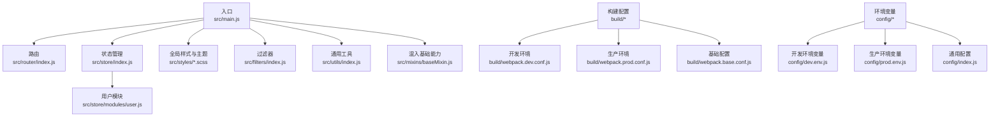
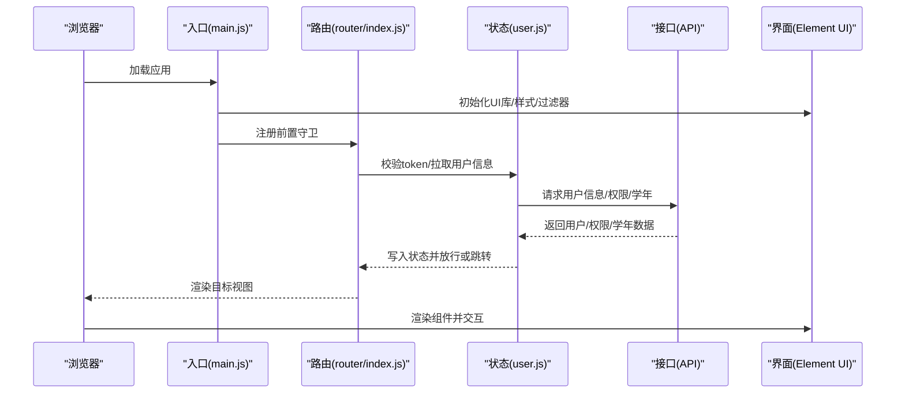
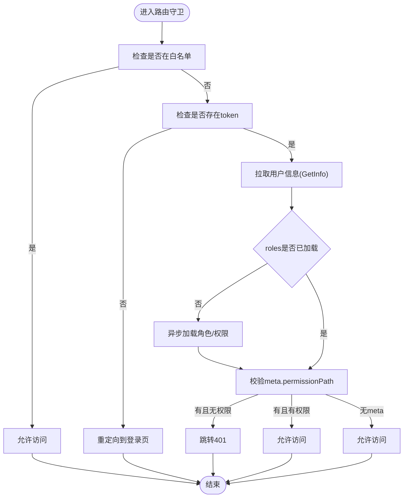
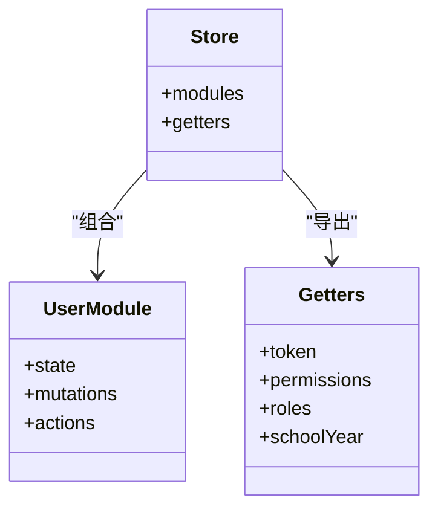
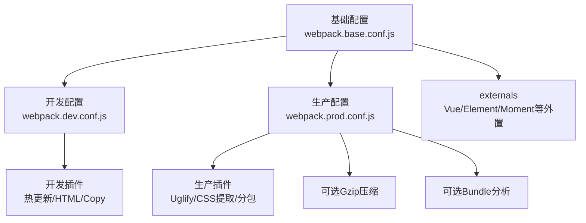
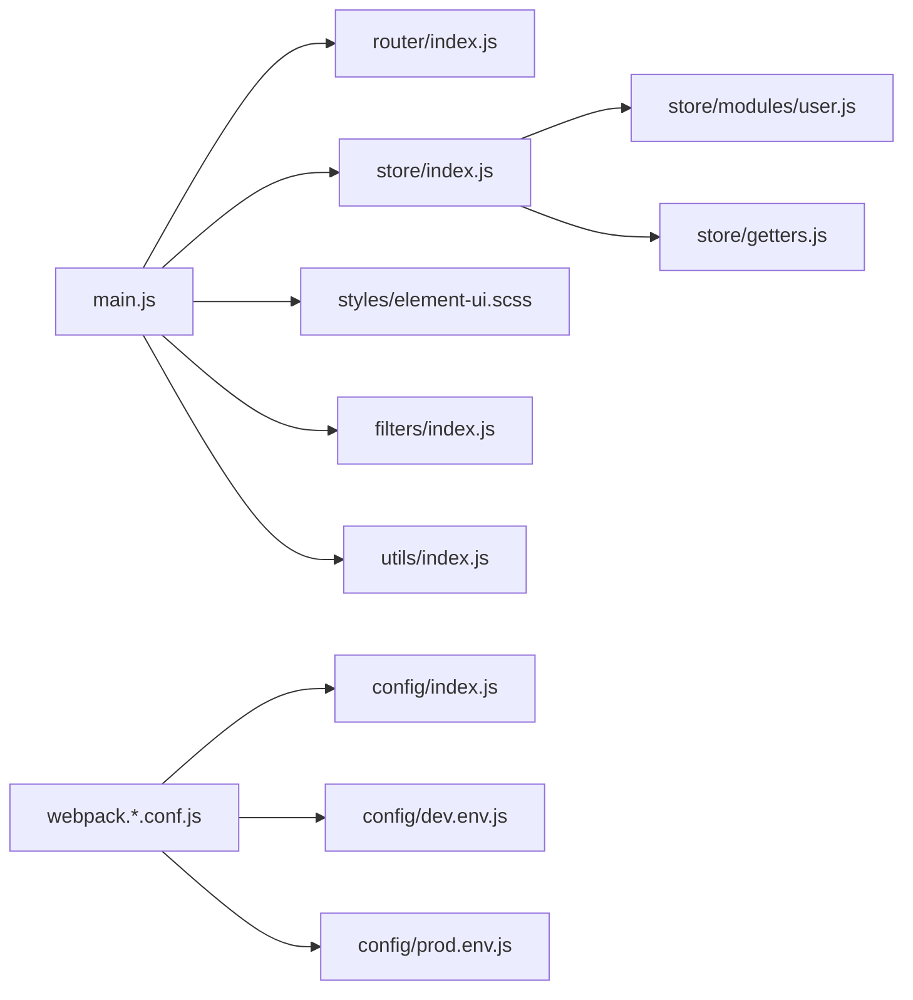

# 技术栈说明

<cite>
**本文引用的文件**
- [package.json](file://package.json)
- [.babelrc](file://.babelrc)
- [.postcssrc.js](file://.postcssrc.js)
- [config/index.js](file://config/index.js)
- [config/dev.env.js](file://config/dev.env.js)
- [config/prod.env.js](file://config/prod.env.js)
- [build/webpack.base.conf.js](file://build/webpack.base.conf.js)
- [build/webpack.dev.conf.js](file://build/webpack.dev.conf.js)
- [build/webpack.prod.conf.js](file://build/webpack.prod.conf.js)
- [src/main.js](file://src/main.js)
- [src/router/index.js](file://src/router/index.js)
- [src/store/index.js](file://src/store/index.js)
- [src/store/modules/user.js](file://src/store/modules/user.js)
- [src/store/getters.js](file://src/store/getters.js)
- [src/styles/element-ui.scss](file://src/styles/element-ui.scss)
- [src/filters/index.js](file://src/filters/index.js)
- [src/utils/index.js](file://src/utils/index.js)
- [src/mixins/baseMixin.js](file://src/mixins/baseMixin.js)
</cite>

## 目录
1. [引言](#引言)
2. [项目结构](#项目结构)
3. [核心组件](#核心组件)
4. [架构总览](#架构总览)
5. [详细组件分析](#详细组件分析)
6. [依赖关系分析](#依赖关系分析)
7. [性能考量](#性能考量)
8. [故障排查指南](#故障排查指南)
9. [结论](#结论)
10. [附录](#附录)

## 引言
本技术栈说明面向Vue.js校园管理系统，围绕前端核心框架与工具链进行系统化梳理，重点涵盖以下方面：
- 核心技术选型：Vue.js 2.5.2、Vue-Router 3.0.1、Vuex 3.1.1 的选择理由与优势
- UI框架：Element UI 2.9.1 的应用与定制化配置
- 构建工具：Webpack 3.6.0 的配置要点与优化策略
- 第三方库：Axios、Lodash、Moment.js 等工具库的集成与作用
- 开发与生产环境差异：配置与脚本差异
- 技术选型依据与替代方案对比，帮助读者理解架构取舍

## 项目结构
该项目采用“按功能域划分”的组织方式，核心入口在 src/main.js，路由与状态管理分别位于 src/router 与 src/store，样式与工具方法分布在 src/styles 与 src/utils 中。构建相关配置集中在 build 与 config 目录。

图表来源
- [src/main.js:1-221](file://src/main.js#L1-L221)
- [src/router/index.js:1-207](file://src/router/index.js#L1-L207)
- [src/store/index.js:1-20](file://src/store/index.js#L1-L20)
- [src/store/modules/user.js:1-447](file://src/store/modules/user.js#L1-L447)
- [build/webpack.dev.conf.js:1-96](file://build/webpack.dev.conf.js#L1-L96)
- [build/webpack.prod.conf.js:1-149](file://build/webpack.prod.conf.js#L1-L149)
- [build/webpack.base.conf.js:1-102](file://build/webpack.base.conf.js#L1-L102)
- [config/index.js:1-72](file://config/index.js#L1-L72)
- [config/dev.env.js:1-9](file://config/dev.env.js#L1-L9)
- [config/prod.env.js:1-6](file://config/prod.env.js#L1-L6)

章节来源
- [src/main.js:1-221](file://src/main.js#L1-L221)
- [src/router/index.js:1-207](file://src/router/index.js#L1-L207)
- [src/store/index.js:1-20](file://src/store/index.js#L1-L20)
- [build/webpack.base.conf.js:1-102](file://build/webpack.base.conf.js#L1-L102)
- [config/index.js:1-72](file://config/index.js#L1-L72)

## 核心组件
- Vue.js 2.5.2：作为渐进式框架，提供响应式数据绑定、组件化开发与虚拟DOM渲染能力；在本项目中承担视图层主体职责。
- Vue-Router 3.0.1：负责页面级路由导航与权限控制前置守卫，结合白名单机制实现登录态与权限拦截。
- Vuex 3.1.1：集中管理应用状态，包含用户信息、角色权限、学校学年等全局状态，并通过 getters 提供派生状态访问。
- Element UI 2.9.1：提供丰富的UI组件库，配合自定义样式覆盖实现统一视觉规范与交互体验。
- Axios：HTTP客户端库，用于与后端接口通信（在项目中以依赖形式引入）。
- Lodash：常用工具库，提供数组、对象、函数等操作的实用方法（在项目中以依赖形式引入）。
- Moment.js：日期时间处理库，提供解析、格式化、计算等功能（在项目中以依赖形式引入）。

章节来源
- [package.json:12-42](file://package.json#L12-L42)
- [src/main.js:16-55](file://src/main.js#L16-L55)
- [src/router/index.js:1-207](file://src/router/index.js#L1-L207)
- [src/store/index.js:1-20](file://src/store/index.js#L1-L20)
- [src/store/modules/user.js:1-447](file://src/store/modules/user.js#L1-L447)
- [src/styles/element-ui.scss:1-85](file://src/styles/element-ui.scss#L1-L85)

## 架构总览
系统采用“入口引导 -> 路由守卫 -> 状态管理 -> 组件渲染”的主流程。入口文件初始化UI库、进度条、全局过滤器与第三方插件，随后在路由守卫中完成登录态与权限校验；状态管理模块负责用户信息、权限与学校学年的获取与缓存；组件层通过Element UI与自定义样式实现交互与展示。

图表来源
- [src/main.js:73-198](file://src/main.js#L73-L198)
- [src/router/index.js:1-207](file://src/router/index.js#L1-L207)
- [src/store/modules/user.js:217-324](file://src/store/modules/user.js#L217-L324)

章节来源
- [src/main.js:1-221](file://src/main.js#L1-L221)
- [src/router/index.js:1-207](file://src/router/index.js#L1-L207)
- [src/store/modules/user.js:1-447](file://src/store/modules/user.js#L1-L447)

## 详细组件分析

### Vue.js 2.5.2
- 作用：提供组件化开发、响应式数据与生命周期管理，支撑业务视图层。
- 与项目结合：在入口文件中注册全局组件、过滤器与第三方插件，统一注入到根实例。

章节来源
- [src/main.js:16-55](file://src/main.js#L16-L55)

### Vue-Router 3.0.1
- 作用：提供路由定义、导航守卫与懒加载能力，支持权限控制与白名单机制。
- 项目实践：
  - 定义常量路由与模块化路由集合，统一挂载至路由实例。
  - 在 beforeEach 中实现登录态判断、权限路径校验、单点登录兼容与进度条控制。
  - 提供多个免登录白名单路径，便于外部系统或公开页面访问。

图表来源
- [src/main.js:73-198](file://src/main.js#L73-L198)
- [src/router/index.js:40-206](file://src/router/index.js#L40-L206)

章节来源
- [src/router/index.js:1-207](file://src/router/index.js#L1-L207)
- [src/main.js:73-198](file://src/main.js#L73-L198)

### Vuex 3.1.1
- 作用：集中管理应用状态，提供模块化状态树与派生状态访问。
- 项目实践：
  - store/index.js 组合 app、user、org 模块并通过 getters 暴露派生状态。
  - user.js 模块负责登录、登出、用户信息、权限列表、学校学年等状态与动作。
  - getters.js 提供 token、权限、角色、学年等常用派生状态，简化组件访问。

图表来源
- [src/store/index.js:1-20](file://src/store/index.js#L1-L20)
- [src/store/modules/user.js:1-447](file://src/store/modules/user.js#L1-L447)
- [src/store/getters.js:1-26](file://src/store/getters.js#L1-L26)

章节来源
- [src/store/index.js:1-20](file://src/store/index.js#L1-L20)
- [src/store/modules/user.js:1-447](file://src/store/modules/user.js#L1-L447)
- [src/store/getters.js:1-26](file://src/store/getters.js#L1-L26)

### Element UI 2.9.1 与定制化
- 作用：提供表格、表单、弹窗、按钮等常用UI组件，提升开发效率与一致性。
- 定制化：
  - 在入口文件中引入主题样式与全局样式，统一UI风格。
  - 通过 src/styles/element-ui.scss 覆盖部分组件默认样式，如对话框定位、上传区域尺寸、单元格间距等。
  - 在入口文件中调整 Dialog 默认行为（点击遮罩不关闭），提升交互体验。

章节来源
- [src/main.js:9-13](file://src/main.js#L9-L13)
- [src/main.js:42](file://src/main.js#L42)
- [src/styles/element-ui.scss:1-85](file://src/styles/element-ui.scss#L1-L85)

### 构建工具 Webpack 3.6.0
- 基础配置（webpack.base.conf.js）
  - 入口：app 指向 src/main.js
  - 输出：根据环境设置 publicPath
  - 解析：配置别名与扩展名，支持ESM与资源加载
  - 规则：处理 .vue、.js、图片/媒体/字体资源
  - 外部依赖：通过 externals 将 Vue、Element UI、Moment 等库外置，减小打包体积
- 开发环境（webpack.dev.conf.js）
  - devServer：热更新、历史路由回退、代理表为空
  - 插件：DefinePlugin、HotModuleReplacement、HtmlWebpackPlugin、CopyWebpackPlugin
  - SourceMap：cheap-module-eval-source-map，便于调试
- 生产环境（webpack.prod.conf.js）
  - 压缩：UglifyJsPlugin 并行压缩
  - CSS：ExtractTextPlugin 提取CSS，OptimizeCSSPlugin 去重压缩
  - 分包：CommonsChunkPlugin 拆分 vendor、manifest、异步chunk
  - HTML：HtmlWebpackPlugin 产出带哈希的index.html
  - SourceMap：生产环境关闭或生成source-map

图表来源
- [build/webpack.base.conf.js:14-102](file://build/webpack.base.conf.js#L14-L102)
- [build/webpack.dev.conf.js:16-96](file://build/webpack.dev.conf.js#L16-L96)
- [build/webpack.prod.conf.js:16-149](file://build/webpack.prod.conf.js#L16-L149)

章节来源
- [build/webpack.base.conf.js:1-102](file://build/webpack.base.conf.js#L1-L102)
- [build/webpack.dev.conf.js:1-96](file://build/webpack.dev.conf.js#L1-L96)
- [build/webpack.prod.conf.js:1-149](file://build/webpack.prod.conf.js#L1-L149)

### 第三方库集成
- Axios：HTTP客户端（依赖引入），用于与后端接口通信（在项目中以依赖形式引入）。
- Lodash：工具库（依赖引入），提供数组/对象/函数等常用方法（在项目中以依赖形式引入）。
- Moment.js：日期时间处理（依赖引入），在入口文件中挂载为全局原型属性，便于组件内使用（在项目中以依赖形式引入）。
- 其他：NProgress（进度条）、Normalize.css（样式重置）、Swiper、ECharts、JSZip、FileSaver 等按需引入，服务于不同业务场景。

章节来源
- [package.json:12-42](file://package.json#L12-L42)
- [src/main.js:10-25](file://src/main.js#L10-L25)

### 开发与生产环境差异
- 环境变量：config/dev.env.js 与 config/prod.env.js 分别导出开发与生产环境常量，供构建脚本使用。
- 通用配置：config/index.js 统一管理 dev/build 的路径、publicPath、SourceMap、Gzip、Bundle分析等。
- 构建脚本：package.json 中提供 dev:test、build:test、build 三种脚本，通过 cross-env 设置 ENV_TAREGT 控制构建目标。

章节来源
- [config/dev.env.js:1-9](file://config/dev.env.js#L1-L9)
- [config/prod.env.js:1-6](file://config/prod.env.js#L1-L6)
- [config/index.js:1-72](file://config/index.js#L1-L72)
- [package.json:7-11](file://package.json#L7-L11)

### 技术选型依据与替代方案对比
- Vue.js 2.5.2
  - 依据：生态成熟、组件化理念清晰、与Element UI高度契合；项目已稳定使用。
  - 替代：Vue 3.x 具备更好的性能与Composition API，但升级成本较高；短期内保持2.x稳定更合适。
- Vue-Router 3.0.1
  - 依据：与Vue 2.x完美匹配，路由守卫与懒加载能力满足本项目需求。
  - 替代：Vue Router 4.x 适配Vue 3，若升级需同步调整路由与权限逻辑。
- Vuex 3.1.1
  - 依据：状态管理成熟稳定，与项目现有模块化结构契合。
  - 替代：Pinia 作为轻量替代方案，具备更好的TypeScript支持与更少样板代码，但迁移需要评估成本。
- Element UI 2.9.1
  - 依据：组件丰富、文档完善、与项目UI风格一致；定制化覆盖满足业务需求。
  - 替代：Naive UI、Vant 等新一代组件库，但替换涉及大量样式与交互改动。
- Webpack 3.6.0
  - 依据：项目长期稳定运行，构建流程成熟；升级到Webpack 5将带来性能与生态变化。
  - 替代：Webpack 5/6 具备Tree Shaking、缓存、模块联邦等新特性，但需评估迁移成本与兼容性。

章节来源
- [package.json:12-42](file://package.json#L12-L42)
- [build/webpack.base.conf.js:14-102](file://build/webpack.base.conf.js#L14-L102)
- [src/main.js:1-221](file://src/main.js#L1-L221)

## 依赖关系分析
- 入口依赖：main.js 依赖 router、store、Element UI、全局样式与过滤器。
- 路由依赖：router/index.js 依赖 Layout 与各模块路由集合，定义常量路由与系统路由。
- 状态依赖：store/index.js 组合 user、org 模块；user.js 依赖 API 与 Cookie；getters 导出派生状态。
- 工具与样式：filters 与 utils 提供全局过滤器与通用方法；element-ui.scss 覆盖UI样式。
- 构建依赖：webpack.*.conf.js 依赖 config/* 与 package.json 中的 devDependencies。

图表来源
- [src/main.js:1-221](file://src/main.js#L1-L221)
- [src/router/index.js:1-207](file://src/router/index.js#L1-L207)
- [src/store/index.js:1-20](file://src/store/index.js#L1-L20)
- [src/store/modules/user.js:1-447](file://src/store/modules/user.js#L1-L447)
- [src/store/getters.js:1-26](file://src/store/getters.js#L1-L26)
- [src/styles/element-ui.scss:1-85](file://src/styles/element-ui.scss#L1-L85)
- [src/filters/index.js:1-121](file://src/filters/index.js#L1-L121)
- [src/utils/index.js:1-385](file://src/utils/index.js#L1-L385)
- [build/webpack.dev.conf.js:1-96](file://build/webpack.dev.conf.js#L1-L96)
- [build/webpack.prod.conf.js:1-149](file://build/webpack.prod.conf.js#L1-L149)
- [build/webpack.base.conf.js:1-102](file://build/webpack.base.conf.js#L1-L102)
- [config/index.js:1-72](file://config/index.js#L1-L72)
- [config/dev.env.js:1-9](file://config/dev.env.js#L1-L9)
- [config/prod.env.js:1-6](file://config/prod.env.js#L1-L6)

章节来源
- [src/main.js:1-221](file://src/main.js#L1-L221)
- [src/router/index.js:1-207](file://src/router/index.js#L1-L207)
- [src/store/index.js:1-20](file://src/store/index.js#L1-L20)
- [src/store/modules/user.js:1-447](file://src/store/modules/user.js#L1-L447)
- [src/store/getters.js:1-26](file://src/store/getters.js#L1-L26)
- [build/webpack.base.conf.js:1-102](file://build/webpack.base.conf.js#L1-L102)
- [config/index.js:1-72](file://config/index.js#L1-L72)

## 性能考量
- 代码分割与分包：生产环境通过 CommonsChunkPlugin 拆分 vendor、manifest 与异步chunk，降低首屏体积并提升缓存命中率。
- 压缩与去重：UglifyJsPlugin 并行压缩JS；ExtractTextPlugin 提取CSS并配合 OptimizeCSSPlugin 去重，减少重复样式。
- SourceMap：开发环境采用 cheap-module-eval-source-map，便于快速定位问题；生产环境关闭或生成source-map，平衡调试与体积。
- 外部依赖：通过 externals 将 Vue、Element UI、Moment 等库外置，避免重复打包，显著减小bundle体积。
- 资源处理：url-loader 对图片/媒体/字体设置阈值，合理控制内联与文件输出，兼顾请求次数与缓存策略。

章节来源
- [build/webpack.prod.conf.js:34-122](file://build/webpack.prod.conf.js#L34-L122)
- [build/webpack.base.conf.js:26-36](file://build/webpack.base.conf.js#L26-L36)
- [config/index.js:29](file://config/index.js#L29)
- [config/index.js:54-56](file://config/index.js#L54-L56)

## 故障排查指南
- 登录与权限
  - 若出现“无权限”跳转401，检查路由 meta.permissionPath 与用户权限列表匹配关系。
  - 若登录后无法拉取用户信息，确认 token 是否写入Cookie，以及 GetInfo 接口返回是否正常。
- 构建问题
  - 开发环境无法热更新：检查 devServer 配置与端口占用，确认 FriendlyErrorsPlugin 是否启用。
  - 生产环境包体过大：核查 externals 配置是否生效、是否误将外部库打包进bundle。
- UI样式
  - Element UI 样式冲突：检查 src/styles/element-ui.scss 的覆盖规则是否正确引入与优先级。
- 工具方法
  - 时间格式化异常：核对 filters 与 utils 中的时间处理方法，确保传参类型与边界值处理一致。

章节来源
- [src/main.js:73-198](file://src/main.js#L73-L198)
- [src/router/index.js:40-206](file://src/router/index.js#L40-L206)
- [src/store/modules/user.js:217-324](file://src/store/modules/user.js#L217-L324)
- [build/webpack.dev.conf.js:24-46](file://build/webpack.dev.conf.js#L24-L46)
- [build/webpack.prod.conf.js:85-112](file://build/webpack.prod.conf.js#L85-L112)
- [src/styles/element-ui.scss:1-85](file://src/styles/element-ui.scss#L1-L85)

## 结论
本项目以 Vue.js 2.5.2 为核心，结合 Vue-Router 3.0.1 与 Vuex 3.1.1 实现了清晰的路由与状态管理；Element UI 2.9.1 提供了稳定的UI基础，并通过定制化样式满足业务需求。Webpack 3.6.0 的配置在开发与生产环境间实现了良好的平衡，借助 externals、分包与压缩等策略有效控制了包体与加载性能。整体技术栈成熟稳定，适合在校园管理类系统中持续演进。

## 附录
- 浏览器兼容：browserslist 指定 > 1%、last 2 versions，不支持 IE <= 8。
- Babel与PostCSS：.babelrc 与 .postcssrc.js 提供语法转换与自动前缀处理，保证跨浏览器一致性。

章节来源
- [package.json:92-96](file://package.json#L92-L96)
- [.babelrc:1-16](file://.babelrc#L1-L16)
- [.postcssrc.js:1-11](file://.postcssrc.js#L1-L11)