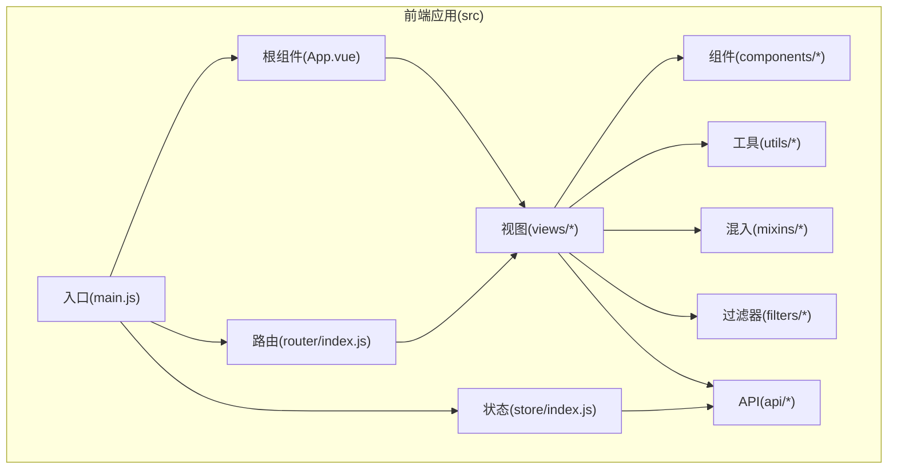
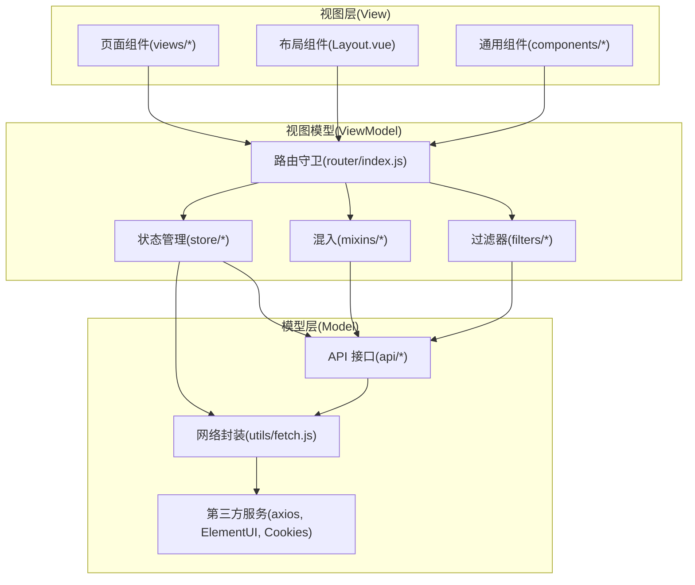
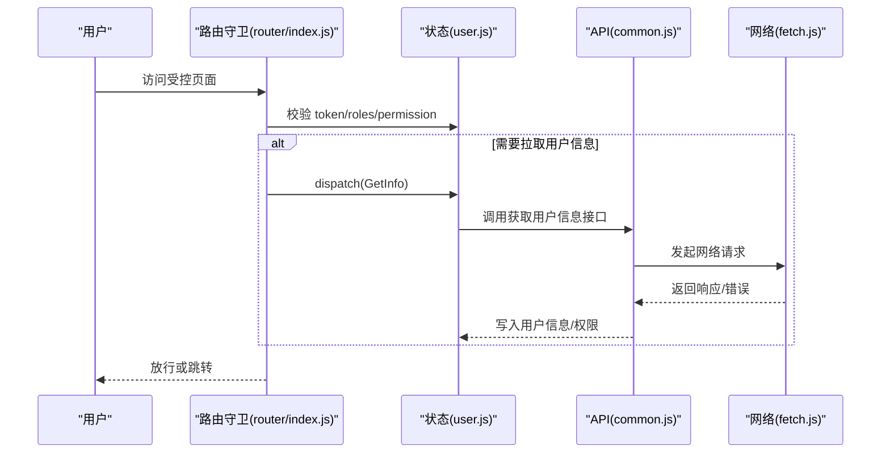
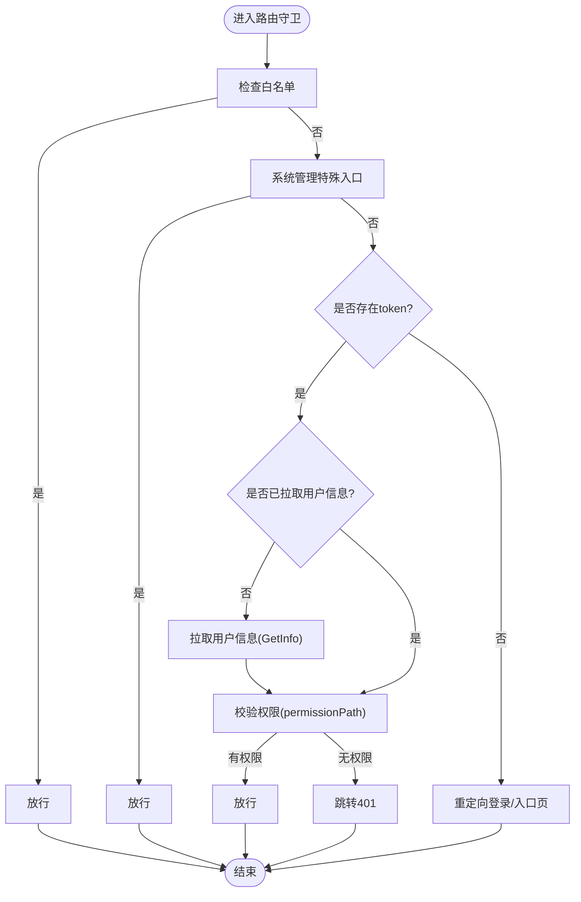
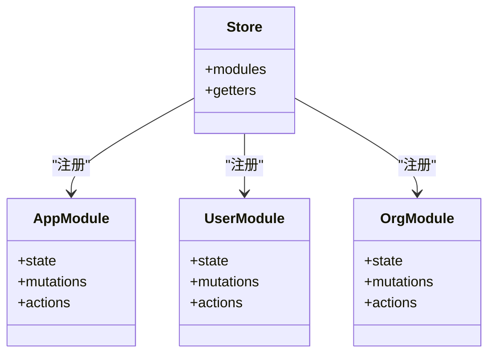
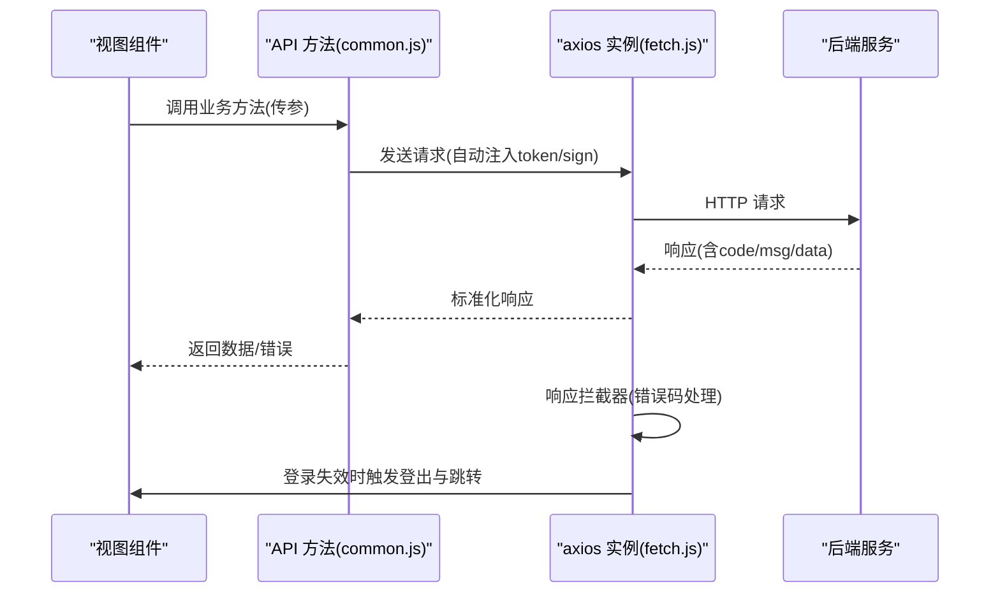
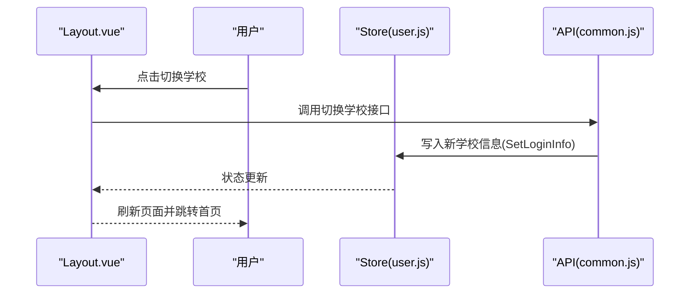
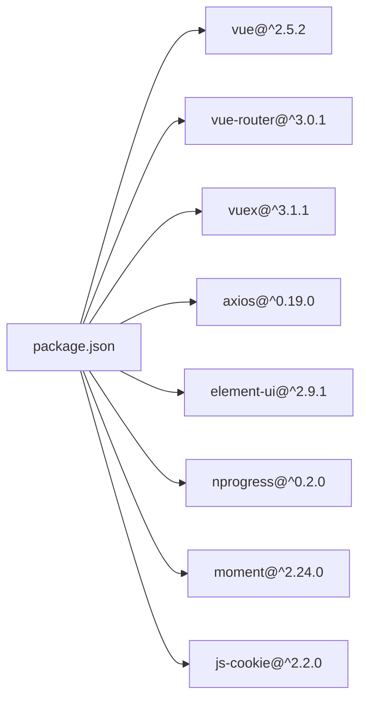

# 架构设计理念

<cite>
**本文引用的文件**
- [src/main.js](file://src/main.js)
- [src/App.vue](file://src/App.vue)
- [src/router/index.js](file://src/router/index.js)
- [src/store/index.js](file://src/store/index.js)
- [src/store/modules/user.js](file://src/store/modules/user.js)
- [src/store/modules/app.js](file://src/store/modules/app.js)
- [src/utils/fetch.js](file://src/utils/fetch.js)
- [src/api/common/common.js](file://src/api/common/common.js)
- [src/views/layout/Layout.vue](file://src/views/layout/Layout.vue)
- [src/mixins/baseMixin.js](file://src/mixins/baseMixin.js)
- [src/filters/index.js](file://src/filters/index.js)
- [src/components/Icon-svg/index.js](file://src/components/Icon-svg/index.js)
- [config/index.js](file://config/index.js)
- [package.json](file://package.json)
- [README.md](file://README.md)
</cite>

## 目录
1. [引言](#引言)
2. [项目结构](#项目结构)
3. [核心组件](#核心组件)
4. [架构总览](#架构总览)
5. [详细组件分析](#详细组件分析)
6. [依赖关系分析](#依赖关系分析)
7. [性能考量](#性能考量)
8. [故障排查指南](#故障排查指南)
9. [结论](#结论)
10. [附录](#附录)

## 引言
本项目采用 Vue.js 技术栈构建的校园管理系统前端，围绕 MVVM 架构模式进行设计，强调模块化、组件化与状态管理的协同。系统通过路由驱动页面导航，借助 Vuex 统一管理全局状态，利用封装的网络层与 API 模块实现前后端解耦的数据交互，并以布局组件与混入、过滤器等基础设施提升开发效率与一致性。

## 项目结构
项目采用“按功能域划分”的目录组织方式，核心模块包括：
- src/api：按业务域拆分的接口层，统一对外暴露方法，隐藏底层网络细节
- src/views：页面视图层，按业务模块组织页面组件
- src/components：通用可复用组件库
- src/router：路由配置与权限控制入口
- src/store：Vuex 状态管理，按领域拆分为多个模块
- src/utils：工具库，包含网络请求封装、常量、打印、校验等
- src/mixins：通用混入，提供分页、导出、日期等通用能力
- src/filters：全局过滤器，统一数据展示格式
- config：构建配置，区分开发与生产环境路径与资源发布策略

图表来源
- [src/main.js:1-221](file://src/main.js#L1-L221)
- [src/App.vue:1-183](file://src/App.vue#L1-L183)
- [src/router/index.js:1-207](file://src/router/index.js#L1-L207)
- [src/store/index.js:1-20](file://src/store/index.js#L1-L20)

章节来源
- [src/main.js:1-221](file://src/main.js#L1-L221)
- [src/router/index.js:1-207](file://src/router/index.js#L1-L207)
- [src/store/index.js:1-20](file://src/store/index.js#L1-L20)
- [config/index.js:1-72](file://config/index.js#L1-L72)

## 核心组件
- 入口与引导：在入口文件中完成 UI 框架初始化、全局组件注册、进度条、错误日志、路由守卫与全局过滤器挂载，形成统一的启动流程
- 根组件：通过 keep-alive 缓存与路由视图结合，支持页面级缓存策略
- 路由系统：集中声明常量路由与业务路由，配合 beforeEach 实现登录态与权限校验
- 状态管理：以模块化 Store 管理用户、应用、组织等状态，提供统一的 getters 与 actions
- 网络层：基于 axios 的服务工厂，统一注入 token、签名、归档年份等参数，集中处理错误码与登出逻辑
- API 层：按业务域拆分，统一暴露方法，便于页面直接调用并保持一致的参数与返回结构
- 视图与布局：Layout 组件承载顶部导航、用户信息、切换学校等功能，支撑多模块导航与权限控制
- 基础设施：混入提供分页、导出、日期等通用能力；过滤器统一时间、数字等展示格式；图标组件自动注册

章节来源
- [src/main.js:1-221](file://src/main.js#L1-L221)
- [src/App.vue:1-183](file://src/App.vue#L1-L183)
- [src/router/index.js:1-207](file://src/router/index.js#L1-L207)
- [src/store/index.js:1-20](file://src/store/index.js#L1-L20)
- [src/store/modules/user.js:1-447](file://src/store/modules/user.js#L1-L447)
- [src/store/modules/app.js:1-54](file://src/store/modules/app.js#L1-L54)
- [src/utils/fetch.js:1-240](file://src/utils/fetch.js#L1-L240)
- [src/api/common/common.js:1-459](file://src/api/common/common.js#L1-L459)
- [src/views/layout/Layout.vue:1-507](file://src/views/layout/Layout.vue#L1-L507)
- [src/mixins/baseMixin.js:1-103](file://src/mixins/baseMixin.js#L1-L103)
- [src/filters/index.js:1-121](file://src/filters/index.js#L1-L121)
- [src/components/Icon-svg/index.js:1-12](file://src/components/Icon-svg/index.js#L1-L12)

## 架构总览
系统遵循 MVVM 分层思想：
- Model：由 API 层与 Vuex Store 提供，封装数据访问与状态变更
- View：由 Vue 组件与视图层构成，负责渲染与用户交互
- ViewModel：由路由守卫、Store Actions/Mutations、混入与过滤器共同承担，协调 Model 与 View 的数据流

图表来源
- [src/views/layout/Layout.vue:1-507](file://src/views/layout/Layout.vue#L1-L507)
- [src/router/index.js:1-207](file://src/router/index.js#L1-L207)
- [src/store/index.js:1-20](file://src/store/index.js#L1-L20)
- [src/store/modules/user.js:1-447](file://src/store/modules/user.js#L1-L447)
- [src/store/modules/app.js:1-54](file://src/store/modules/app.js#L1-L54)
- [src/mixins/baseMixin.js:1-103](file://src/mixins/baseMixin.js#L1-L103)
- [src/filters/index.js:1-121](file://src/filters/index.js#L1-L121)
- [src/api/common/common.js:1-459](file://src/api/common/common.js#L1-L459)
- [src/utils/fetch.js:1-240](file://src/utils/fetch.js#L1-L240)

## 详细组件分析

### MVVM 架构在项目中的应用
- Model 层：通过 API 模块与网络封装统一数据访问，支持多域名、多签名策略与错误码处理
- View 层：页面组件与布局组件清晰分离，布局组件承载导航与用户操作，页面组件专注业务展示
- ViewModel 层：路由守卫负责鉴权与权限控制；Store 提供状态与派发；混入与过滤器提供通用行为与格式化

图表来源
- [src/router/index.js:73-198](file://src/router/index.js#L73-L198)
- [src/store/modules/user.js:217-238](file://src/store/modules/user.js#L217-L238)
- [src/api/common/common.js:1-459](file://src/api/common/common.js#L1-L459)
- [src/utils/fetch.js:104-169](file://src/utils/fetch.js#L104-L169)

章节来源
- [src/router/index.js:73-198](file://src/router/index.js#L73-L198)
- [src/store/modules/user.js:217-238](file://src/store/modules/user.js#L217-L238)
- [src/api/common/common.js:1-459](file://src/api/common/common.js#L1-L459)
- [src/utils/fetch.js:104-169](file://src/utils/fetch.js#L104-L169)

### 路由与权限控制流程
- 白名单放行：对无需登录的页面直接放行
- 单点登录与旧框架迁移：支持从旧框架携带 token 进入系统并写入状态
- 权限校验：根据 meta.permissionPath 与用户权限集合比对决定放行
- 登录态维护：未登录时根据登录类型跳转至不同入口

图表来源
- [src/router/index.js:58-198](file://src/router/index.js#L58-L198)
- [src/store/modules/user.js:217-238](file://src/store/modules/user.js#L217-L238)

章节来源
- [src/router/index.js:58-198](file://src/router/index.js#L58-L198)
- [src/store/modules/user.js:217-238](file://src/store/modules/user.js#L217-L238)

### 状态管理与模块化组织
- Store 模块划分：app、user、org 三个模块分别管理应用配置、用户信息与组织相关状态
- 用户模块职责：登录、登出、获取用户信息、权限拉取、学年切换、地图密钥初始化等
- Getter 与 Mutations：统一暴露 getters 与 mutations，保证状态变更可追踪与可预测

图表来源
- [src/store/index.js:1-20](file://src/store/index.js#L1-L20)
- [src/store/modules/app.js:1-54](file://src/store/modules/app.js#L1-L54)
- [src/store/modules/user.js:1-447](file://src/store/modules/user.js#L1-L447)

章节来源
- [src/store/index.js:1-20](file://src/store/index.js#L1-L20)
- [src/store/modules/app.js:1-54](file://src/store/modules/app.js#L1-L54)
- [src/store/modules/user.js:1-447](file://src/store/modules/user.js#L1-L447)

### 网络层与数据交互模式
- 服务工厂：基于 axios 创建服务实例，支持 baseURL、超时、请求/响应拦截器
- 参数注入：自动注入 token、签名、归档年份等参数；支持 GET/POST 与 JSON 提交
- 错误处理：集中处理 401/1000 等错误码，触发登出与跳转
- 多域名适配：提供 systemFetch、xjlyuanFetch、newcharge 等专用服务

图表来源
- [src/api/common/common.js:1-459](file://src/api/common/common.js#L1-L459)
- [src/utils/fetch.js:13-171](file://src/utils/fetch.js#L13-L171)
- [src/utils/fetch.js:104-169](file://src/utils/fetch.js#L104-L169)

章节来源
- [src/api/common/common.js:1-459](file://src/api/common/common.js#L1-L459)
- [src/utils/fetch.js:13-171](file://src/utils/fetch.js#L13-L171)
- [src/utils/fetch.js:104-169](file://src/utils/fetch.js#L104-L169)

### 布局与导航体系
- 顶部导航：根据模块权限动态显示，支持外部链接与内部路由跳转
- 用户下拉：个人信息、切换学校、退出登录
- 首次加载优化：针对首次进入场景进行路由重定向，确保侧边菜单正确展开
- 切换学校：调用 API 完成切换并刷新页面

图表来源
- [src/views/layout/Layout.vue:198-232](file://src/views/layout/Layout.vue#L198-L232)
- [src/store/modules/user.js:326-362](file://src/store/modules/user.js#L326-L362)
- [src/api/common/common.js:1-459](file://src/api/common/common.js#L1-L459)

章节来源
- [src/views/layout/Layout.vue:198-232](file://src/views/layout/Layout.vue#L198-L232)
- [src/store/modules/user.js:326-362](file://src/store/modules/user.js#L326-L362)
- [src/api/common/common.js:1-459](file://src/api/common/common.js#L1-L459)

### 组件化与可复用性
- 图标组件：自动注册目录内所有组件，减少重复注册
- 通用组件：如上传、编辑器、图表、弹窗等，统一风格与行为
- 页面组件：按业务域组织，页面内组合通用组件与业务组件

章节来源
- [src/components/Icon-svg/index.js:1-12](file://src/components/Icon-svg/index.js#L1-L12)

### 可扩展性与模块化组织策略
- API 按业务域拆分：每个业务域一个模块，新增功能仅需在对应目录新增文件
- 路由按模块聚合：normal/system/misc 等分类清晰，便于扩展与维护
- Store 模块化：app/user/org 各司其职，避免状态耦合
- 工具与混入：将通用能力下沉，降低页面复杂度
- 过滤器与全局组件：统一展示格式与交互行为

章节来源
- [src/router/index.js:24-36](file://src/router/index.js#L24-L36)
- [src/store/index.js:3-6](file://src/store/index.js#L3-L6)
- [src/mixins/baseMixin.js:1-103](file://src/mixins/baseMixin.js#L1-L103)
- [src/filters/index.js:1-121](file://src/filters/index.js#L1-L121)

## 依赖关系分析
- 运行时依赖：Vue 生态、Element UI、Vuex、Vue Router、Axios、NProgress、Moment、Cookies 等
- 构建配置：Webpack 相关插件与脚本，区分开发与生产环境资源路径
- 环境变量：通过 global.BasePath、global.command 控制运行时行为

图表来源
- [package.json:12-42](file://package.json#L12-L42)

章节来源
- [package.json:12-42](file://package.json#L12-L42)
- [config/index.js:47-48](file://config/index.js#L47-L48)

## 性能考量
- 路由缓存：通过 App.vue 中的 keep-alive 与路由 meta.isCached 控制页面缓存，减少重复渲染
- 请求拦截：统一注入 token 与签名，避免重复参数传递
- 错误快速反馈：响应拦截器统一提示与登出，减少无效请求
- 构建优化：生产环境关闭 source map，启用压缩与分析报告开关

章节来源
- [src/App.vue:3-6](file://src/App.vue#L3-L6)
- [src/utils/fetch.js:66-101](file://src/utils/fetch.js#L66-L101)
- [src/utils/fetch.js:104-169](file://src/utils/fetch.js#L104-L169)
- [config/index.js:54-56](file://config/index.js#L54-L56)

## 故障排查指南
- 登录态异常：检查路由守卫中的白名单、token 注入与权限校验逻辑
- 数据请求失败：查看网络拦截器对错误码的处理与登出逻辑
- 页面空白或组件未注册：确认全局组件注册与图标组件自动注册流程
- 构建路径问题：核对 config 中生产环境静态资源路径与 publicPath

章节来源
- [src/router/index.js:58-198](file://src/router/index.js#L58-L198)
- [src/utils/fetch.js:104-169](file://src/utils/fetch.js#L104-L169)
- [src/components/Icon-svg/index.js:1-12](file://src/components/Icon-svg/index.js#L1-L12)
- [config/index.js:47-48](file://config/index.js#L47-L48)

## 结论
本项目以 MVVM 为核心，结合模块化、组件化与状态管理，实现了前后端分离下的高内聚低耦合架构。通过路由守卫与权限控制保障安全，通过网络层与 API 模块实现数据交互标准化，通过布局与混入提升开发效率与一致性。整体设计具备良好的可扩展性与可维护性，适合在校园管理场景下持续演进。

## 附录
- 快速开始：安装依赖、本地开发、构建打包与查看分析报告
- 环境变量：BasePath、command 用于控制运行时行为与资源路径

章节来源
- [README.md:5-21](file://README.md#L5-L21)
- [config/index.js:47-48](file://config/index.js#L47-L48)