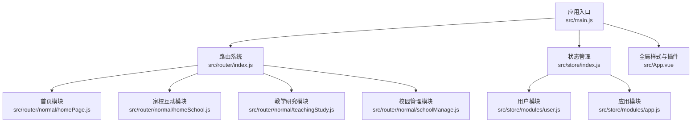
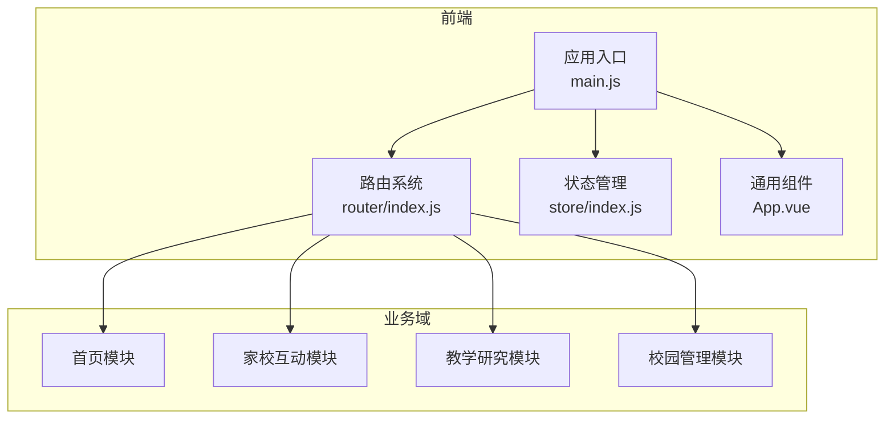
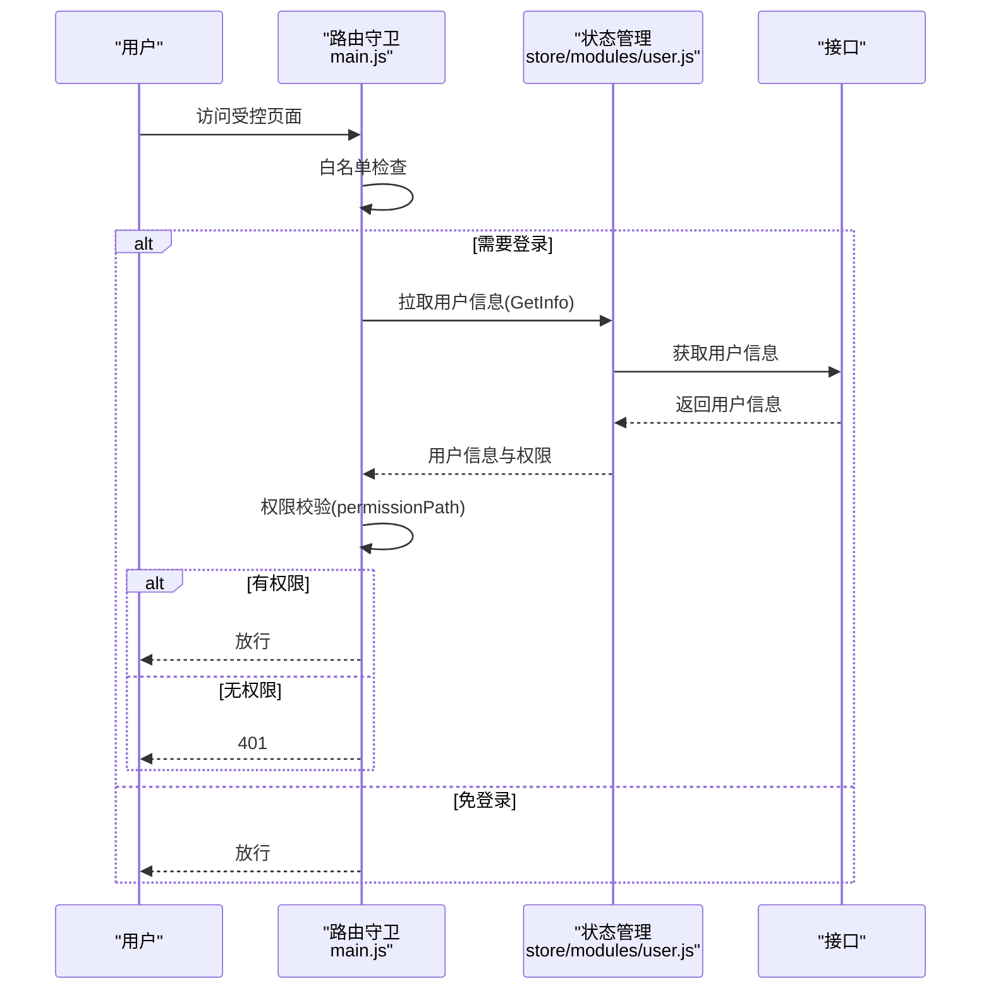
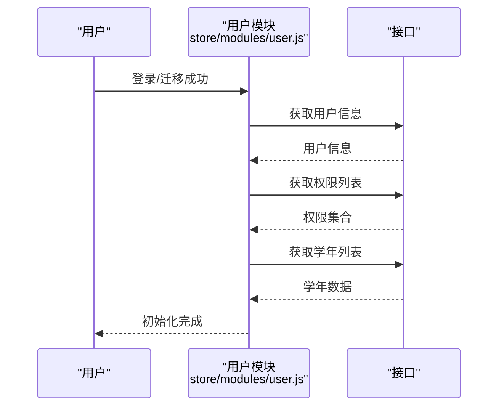

# 项目介绍

<cite>
**本文引用的文件**
- [README.md](file://README.md)
- [package.json](file://package.json)
- [main.js](file://src/main.js)
- [App.vue](file://src/App.vue)
- [router/index.js](file://src/router/index.js)
- [router/normal/homePage.js](file://src/router/normal/homePage.js)
- [router/normal/homeSchool.js](file://src/router/normal/homeSchool.js)
- [router/normal/teachingStudy.js](file://src/router/normal/teachingStudy.js)
- [router/normal/schoolManage.js](file://src/router/normal/schoolManage.js)
- [store/index.js](file://src/store/index.js)
- [store/modules/user.js](file://src/store/modules/user.js)
- [store/modules/app.js](file://src/store/modules/app.js)
</cite>

## 目录
1. [引言](#引言)
2. [项目结构](#项目结构)
3. [核心组件](#核心组件)
4. [架构总览](#架构总览)
5. [详细组件分析](#详细组件分析)
6. [依赖分析](#依赖分析)
7. [性能考虑](#性能考虑)
8. [故障排查指南](#故障排查指南)
9. [结论](#结论)
10. [附录](#附录)

## 引言
本项目是一个基于 Vue.js 的校园管理系统，面向现代教育信息化场景，旨在通过统一平台支撑教学管理、校园管理、家校互动、教师发展、课程安排、考勤统计、健康监测、费用管理、活动组织、心理服务等多个业务域，帮助学校实现流程标准化、数据可视化与协同高效化。系统以“用户为中心”，覆盖学校管理者、教师、学生家长等多角色，提供统一入口、权限控制与模块化能力，助力提升教育管理效率与治理水平。

## 项目结构
项目采用典型的前端工程化结构，核心由入口应用、路由配置、状态管理、通用组件与视图页面组成，并通过模块化路由组织教学、管理、家校等业务域。

- 应用入口与全局配置
  - 入口文件负责初始化 UI 框架、进度条、过滤器、全局组件注册、路由守卫与错误日志等。
  - 全局样式与第三方库在入口集中引入，确保一致的视觉与交互体验。
- 路由体系
  - 主路由按业务域拆分为首页、家校互动、教学研究、校园管理等模块，结合权限控制与缓存策略，保障访问安全与性能。
- 状态管理
  - 采用 Vuex，按模块划分用户信息、应用状态与组织信息，集中管理登录态、权限、学校年度等关键数据。
- 视图与组件
  - 视图层以功能模块为单位组织页面；通用组件封装常用交互与展示能力，提升复用性与一致性。

图表来源
- [main.js:1-221](file://src/main.js#L1-L221)
- [router/index.js:1-207](file://src/router/index.js#L1-L207)
- [store/index.js:1-20](file://src/store/index.js#L1-L20)

章节来源
- [main.js:1-221](file://src/main.js#L1-L221)
- [router/index.js:1-207](file://src/router/index.js#L1-L207)
- [store/index.js:1-20](file://src/store/index.js#L1-L20)

## 核心组件
- 路由守卫与鉴权
  - 在进入路由前进行白名单判断、单点登录、权限校验与用户信息拉取，确保访问安全与功能可用。
- 进度条与错误日志
  - 集成进度条组件，优化页面切换体验；生产环境配置全局错误捕获并推送至错误日志。
- 状态管理
  - 用户模块负责登录态、角色、权限、学校信息与学年选择；应用模块负责页面分页与缓存策略。
- 全局组件与样式
  - 注册多选、粘性头部、打印工具等通用组件；统一样式与主题，保证跨模块一致性。

章节来源
- [main.js:51-221](file://src/main.js#L51-L221)
- [store/modules/user.js:1-447](file://src/store/modules/user.js#L1-L447)
- [store/modules/app.js:1-54](file://src/store/modules/app.js#L1-L54)
- [App.vue:1-183](file://src/App.vue#L1-L183)

## 架构总览
系统采用前后端分离架构，前端通过 Vue.js 提供统一界面与交互，后端提供 REST 接口与数据服务。路由与权限控制贯穿整个应用，状态管理集中处理用户与系统上下文，模块化路由将教学、管理、家校等业务域解耦，便于扩展与维护。

图表来源
- [router/index.js:1-207](file://src/router/index.js#L1-L207)
- [store/index.js:1-20](file://src/store/index.js#L1-L20)
- [main.js:1-221](file://src/main.js#L1-L221)
- [App.vue:1-183](file://src/App.vue#L1-L183)

## 详细组件分析

### 路由与权限控制流程
系统在路由守卫中完成登录态校验、权限匹配与用户信息加载，确保仅授权用户可访问对应功能。

图表来源
- [main.js:73-198](file://src/main.js#L73-L198)
- [store/modules/user.js:218-237](file://src/store/modules/user.js#L218-L237)

章节来源
- [main.js:58-198](file://src/main.js#L58-L198)
- [store/modules/user.js:120-324](file://src/store/modules/user.js#L120-L324)

### 用户信息与权限加载序列
用户登录或从旧框架迁移后，系统会加载用户信息、权限与学年数据，并设置地图密钥等上下文。

图表来源
- [store/modules/user.js:120-324](file://src/store/modules/user.js#L120-L324)

章节来源
- [store/modules/user.js:120-324](file://src/store/modules/user.js#L120-L324)

### 业务域概览与典型模块
系统按业务域划分模块路由，涵盖首页、家校互动、教学研究、校园管理等，每个模块包含若干页面与功能。

- 首页模块
  - 提供首页与工作提醒等入口，便于快速进入常用功能。
- 家校互动模块
  - 涵盖通知公告、作业管理、问卷调查、心理服务、班级圈、学生请假、膳食管理、校园收费等，支撑家校沟通与日常事务。
- 教学研究模块
  - 涵盖课程表管理、公开课、听评课、教学绩效、阅读平台、教师发展等，服务教学过程与质量提升。
- 校园管理模块
  - 涵盖考勤统计、健康监测、值班管理、通知公告、文件流转、综合检查、工作计划、校务日志、荣誉管理、活动管理等，支撑校园运行与治理。

章节来源
- [router/normal/homePage.js:1-18](file://src/router/normal/homePage.js#L1-L18)
- [router/normal/homeSchool.js:1-800](file://src/router/normal/homeSchool.js#L1-L800)
- [router/normal/teachingStudy.js:1-672](file://src/router/normal/teachingStudy.js#L1-L672)
- [router/normal/schoolManage.js:1-1066](file://src/router/normal/schoolManage.js#L1-L1066)

## 依赖分析
- 前端技术栈
  - Vue 生态：Vue、Vue Router、Vuex、Element UI、Axios 等，提供组件化开发与状态管理能力。
  - 工具库：Moment、NProgress、js-cookie、lodash、xlsx 等，增强时间处理、进度条、Cookie、数据处理与导出能力。
  - 媒体与上传：WebUploader、COS SDK、ECharts 等，支撑文件上传与可视化展示。
- 构建与脚手架
  - 基于 Webpack 与 Vue Loader，提供热更新、打包与分析能力，适配多环境构建。

章节来源
- [package.json:12-42](file://package.json#L12-L42)
- [package.json:44-86](file://package.json#L44-L86)
- [README.md:5-21](file://README.md#L5-L21)

## 性能考虑
- 路由与渲染优化
  - 使用 keep-alive 缓存页面，减少重复渲染与请求；对部分高频页面开启 isCached/keepCached，降低刷新成本。
- 状态与数据加载
  - 将用户信息、权限与学年数据集中管理，避免重复请求；在路由守卫中统一拉取，减少页面内分散逻辑。
- 上传与可视化
  - 采用分片上传与 CDN 签名机制，提升大文件传输稳定性；ECharts 图表按需渲染，避免全量计算。
- 样式与资源
  - 统一主题与样式，减少重复样式定义；按需引入第三方组件，避免全量打包。

章节来源
- [App.vue:3-6](file://src/App.vue#L3-L6)
- [store/modules/app.js:26-47](file://src/store/modules/app.js#L26-L47)
- [main.js:73-198](file://src/main.js#L73-L198)

## 故障排查指南
- 登录与权限问题
  - 若出现 401 或无法访问功能，检查路由守卫中的权限路径与用户权限集合；确认登录后是否正确拉取权限与用户信息。
- 页面空白或组件异常
  - 检查全局组件注册与样式引入是否生效；确认 keep-alive 缓存策略是否影响页面生命周期。
- 错误日志
  - 生产环境启用全局错误捕获，可在错误日志模块查看堆栈与上下文，辅助定位问题。
- 构建与运行
  - 参考构建脚本与依赖版本，确保 Node 与 npm 版本满足要求；使用分析报告定位体积与依赖问题。

章节来源
- [main.js:196-214](file://src/main.js#L196-L214)
- [router/index.js:40-207](file://src/router/index.js#L40-L207)
- [README.md:5-21](file://README.md#L5-L21)

## 结论
本项目以模块化路由与集中式状态管理为核心，围绕教学、管理、家校三大业务域提供完整解决方案，具备良好的扩展性与可维护性。通过统一鉴权、缓存策略与可视化能力，系统能够有效提升校园管理效率与用户体验，是现代教育信息化的重要基础设施。

## 附录
- 项目安装与运行
  - 安装依赖：npm install
  - 开发运行：npm run dev
  - 生产构建：npm run build
  - 体积分析：npm run build --report
- 关键文件索引
  - 应用入口：src/main.js
  - 路由配置：src/router/index.js
  - 状态管理：src/store/index.js
  - 用户模块：src/store/modules/user.js
  - 应用模块：src/store/modules/app.js
  - 业务路由示例：src/router/normal/homeSchool.js、src/router/normal/teachingStudy.js、src/router/normal/schoolManage.js

章节来源
- [README.md:5-21](file://README.md#L5-L21)
- [package.json:7-11](file://package.json#L7-L11)