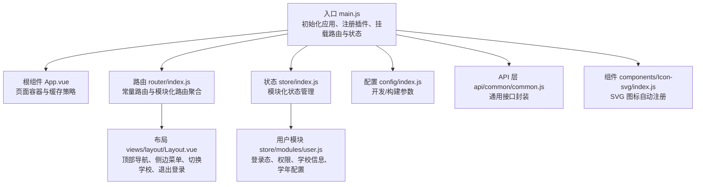
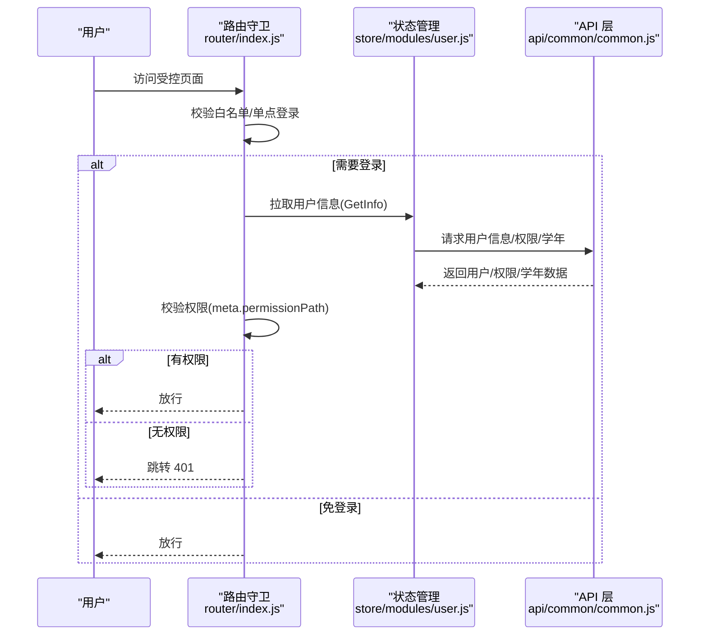
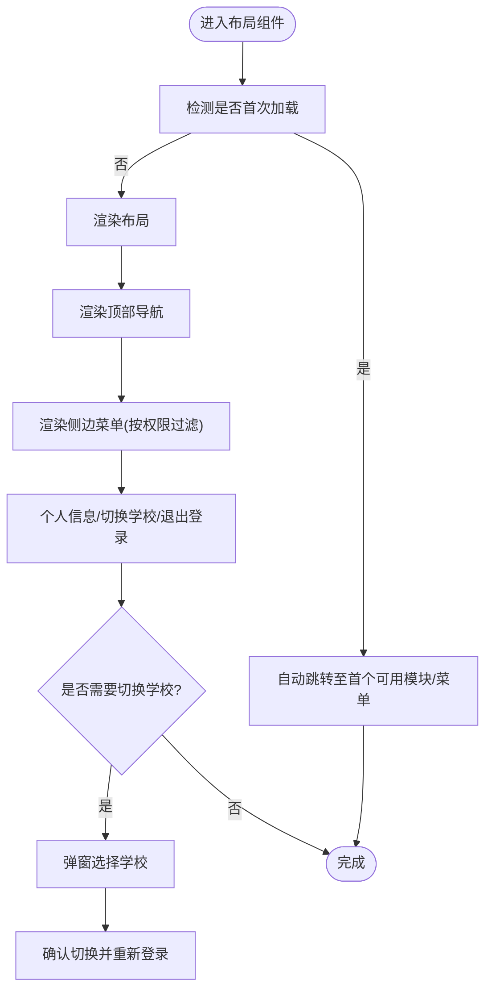
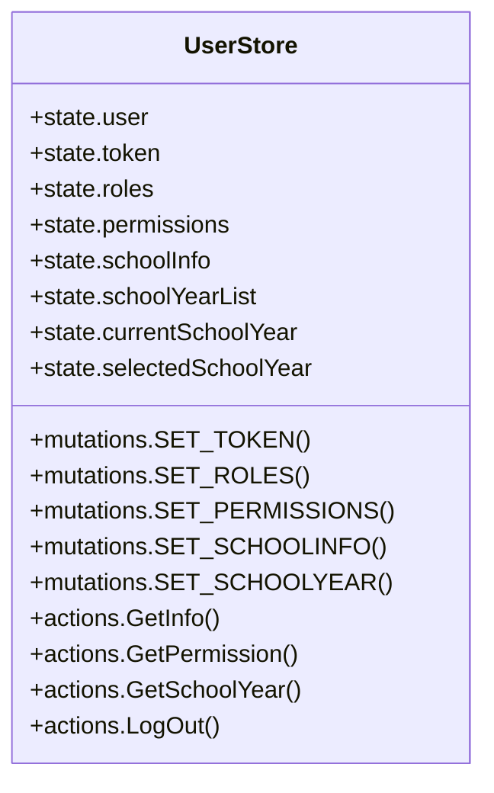
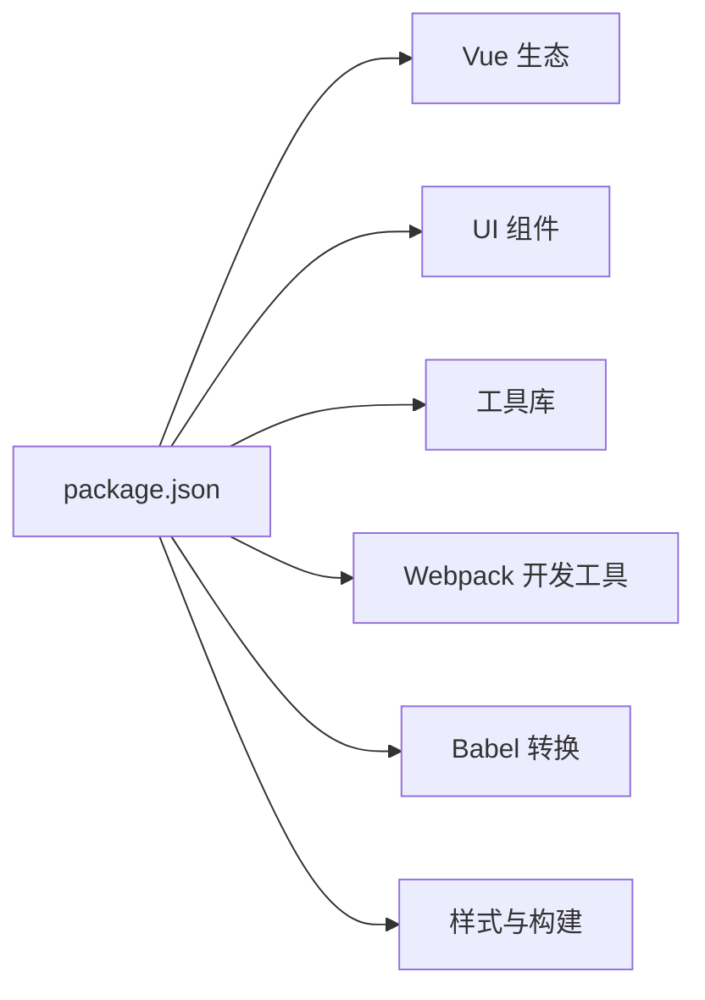

# 项目概述

<cite>
**本文引用的文件**
- [README.md](file://README.md)
- [package.json](file://package.json)
- [main.js](file://src/main.js)
- [App.vue](file://src/App.vue)
- [index.js](file://config/index.js)
- [router/index.js](file://src/router/index.js)
- [store/index.js](file://src/store/index.js)
- [store/modules/user.js](file://src/store/modules/user.js)
- [utils/constants.js](file://src/utils/constants.js)
- [api/common/common.js](file://src/api/common/common.js)
- [router/normal/homePage.js](file://src/router/normal/homePage.js)
- [router/normal/schoolManage.js](file://src/router/normal/schoolManage.js)
- [router/normal/teachingStudy.js](file://src/router/normal/teachingStudy.js)
- [views/layout/Layout.vue](file://src/views/layout/Layout.vue)
- [components/Icon-svg/index.js](file://src/components/Icon-svg/index.js)
</cite>

## 目录
1. [引言](#引言)
2. [项目结构](#项目结构)
3. [核心组件](#核心组件)
4. [架构总览](#架构总览)
5. [详细组件分析](#详细组件分析)
6. [依赖分析](#依赖分析)
7. [性能考虑](#性能考虑)
8. [故障排查指南](#故障排查指南)
9. [结论](#结论)
10. [附录](#附录)

## 引言
本项目是一个基于 Vue.js 的校园管理系统前端工程，服务于教育信息化场景，覆盖教学管理、校园办公、家校互动、总务后勤、学生评价、系统管理等多个业务域。系统通过统一的权限体系与模块化路由组织，实现多角色、多校区的协同办公与数据治理，支撑从课程安排、考试评价、教师发展到校园检查、健康上报、活动管理等全链路业务流程。

在教育数字化转型背景下，本系统强调“以用户为中心”的交互体验与“以流程为导向”的业务编排，既满足初学者快速上手的易用性，也为有经验的开发者提供可扩展的架构与清晰的模块边界。

## 项目结构
项目采用典型的 Vue 单页应用（SPA）结构，结合 Vue Router 实现多模块路由，Vuex 提供全局状态管理，Axios 作为 HTTP 客户端，Element UI 作为基础 UI 组件库，并辅以多种工具库与插件提升开发效率与用户体验。



图表来源
- [main.js:1-221](file://src/main.js#L1-L221)
- [App.vue:1-183](file://src/App.vue#L1-L183)
- [router/index.js:1-207](file://src/router/index.js#L1-L207)
- [store/index.js:1-20](file://src/store/index.js#L1-L20)
- [store/modules/user.js:1-447](file://src/store/modules/user.js#L1-L447)
- [config/index.js:1-72](file://config/index.js#L1-L72)
- [api/common/common.js:1-459](file://src/api/common/common.js#L1-L459)
- [components/Icon-svg/index.js:1-12](file://src/components/Icon-svg/index.js#L1-L12)
- [views/layout/Layout.vue:1-507](file://src/views/layout/Layout.vue#L1-L507)

章节来源
- [README.md:1-24](file://README.md#L1-L24)
- [package.json:1-98](file://package.json#L1-L98)
- [config/index.js:1-72](file://config/index.js#L1-L72)

## 核心组件
- 应用入口与生命周期
  - 初始化进度条、全局过滤器、第三方上传组件、对话框行为修正、打印能力、资源请求库等。
  - 全局前置守卫：白名单放行、单点登录适配、权限校验、角色信息拉取与缓存。
- 根组件与页面缓存
  - 通过 keep-alive 对特定路由进行缓存，减少重复渲染与数据拉取成本。
- 路由与模块化组织
  - 常量路由集中管理，业务模块路由按领域拆分，支持权限路径控制与页面缓存标记。
- 状态管理
  - 用户信息、角色权限、学校信息、学年配置、地图密钥等集中维护，支持跨组件共享与持久化。
- 布局与导航
  - 顶部模块导航、侧边菜单、个人信息、切换学校、退出登录等一体化交互。
- API 与工具
  - 通用字典、课程、班级、教师、学生、通知、公告、文件上传、视频点播等接口封装。
  - 常量映射：教师类型、岗位、荣誉、政治面貌、学历、学籍等标准化字典。

章节来源
- [main.js:1-221](file://src/main.js#L1-L221)
- [App.vue:1-183](file://src/App.vue#L1-L183)
- [router/index.js:1-207](file://src/router/index.js#L1-L207)
- [store/index.js:1-20](file://src/store/index.js#L1-L20)
- [store/modules/user.js:1-447](file://src/store/modules/user.js#L1-L447)
- [views/layout/Layout.vue:1-507](file://src/views/layout/Layout.vue#L1-L507)
- [api/common/common.js:1-459](file://src/api/common/common.js#L1-L459)
- [utils/constants.js:1-275](file://src/utils/constants.js#L1-L275)

## 架构总览
系统采用“前端 SPA + 后端服务”架构，前端通过 Axios 与后端进行数据交互，使用 Element UI 提供一致的交互体验，配合 Vue Router 实现模块化导航与权限控制，Vuex 管理全局状态与用户上下文。

```mermaid
graph TB
subgraph "前端"
V["Vue 应用<br/>main.js"] --> R["路由系统<br/>router/index.js"]
V --> S["状态管理<br/>store/index.js"]
V --> L["布局组件<br/>views/layout/Layout.vue"]
V --> A["API 接口层<br/>api/common/common.js"]
V --> U["工具与常量<br/>utils/constants.js"]
V --> C["图标组件注册<br/>components/Icon-svg/index.js"]
end
subgraph "后端"
B["业务服务"]
D["认证与权限中心"]
E["静态资源与文件存储"]
end
R --> B
S --> B
L --> B
A --> B
B <- --> D
B <- --> E
```

图表来源
- [main.js:1-221](file://src/main.js#L1-L221)
- [router/index.js:1-207](file://src/router/index.js#L1-L207)
- [store/index.js:1-20](file://src/store/index.js#L1-L20)
- [views/layout/Layout.vue:1-507](file://src/views/layout/Layout.vue#L1-L507)
- [api/common/common.js:1-459](file://src/api/common/common.js#L1-L459)
- [utils/constants.js:1-275](file://src/utils/constants.js#L1-L275)
- [components/Icon-svg/index.js:1-12](file://src/components/Icon-svg/index.js#L1-L12)

## 详细组件分析

### 路由与权限控制
- 常量路由：登录页、错误页、仪表板、数据看板、访客看板、请假看板等。
- 主模块路由：首页、家校互动、教学教务、校园办公、总务后勤、学生评价、系统管理等。
- 权限控制：通过 meta.permissionPath 与用户权限集合比对，未授权跳转 401。
- 白名单：无需登录即可访问的页面，如扫码登录、预登录页、部分公开页面等。



图表来源
- [router/index.js:1-207](file://src/router/index.js#L1-L207)
- [store/modules/user.js:1-447](file://src/store/modules/user.js#L1-L447)
- [api/common/common.js:1-459](file://src/api/common/common.js#L1-L459)

章节来源
- [router/index.js:1-207](file://src/router/index.js#L1-L207)
- [store/modules/user.js:1-447](file://src/store/modules/user.js#L1-L447)

### 布局与导航
- 顶部导航：模块化入口（家校互动、教学教务、校园办公、总务后勤、学生评价、系统管理），支持外部链接与内部路由。
- 侧边菜单：根据模块权限动态展示，支持首屏加载后的自动跳转。
- 个人信息：支持切换学校、退出登录、返回旧版等操作。
- 切换学校：当用户具备多校权限时，弹窗选择目标学校并重新登录。



图表来源
- [views/layout/Layout.vue:1-507](file://src/views/layout/Layout.vue#L1-L507)

章节来源
- [views/layout/Layout.vue:1-507](file://src/views/layout/Layout.vue#L1-L507)

### 状态管理与用户上下文
- 用户信息：token、角色、部门、头像、姓名等。
- 权限集合：后端返回的权限 URL 列表与名称映射。
- 学校信息：当前学校 ID、名称、Logo 等。
- 学年配置：学校学年列表、当前学年、选中学年。
- 地图密钥：高德地图安全配置，按需注入。



图表来源
- [store/modules/user.js:1-447](file://src/store/modules/user.js#L1-L447)

章节来源
- [store/modules/user.js:1-447](file://src/store/modules/user.js#L1-L447)

### 业务模块概览
- 首页与工作提醒：模块首页、省丹中首页、工作提醒等。
- 校园办公：加班统计、文件流转、荣誉管理、新闻/公告、校务日志、建议、疫情防控、值班统计、健康晨午检、日程、教师请假、代课调课、课程表、智能排课、考试管理、汉字识读、记分册、公开课、教学绩效、英语美文、儿童研究听课、教师评语、青蓝工程、听课统计等。
- 教学教务：听课本预约统计、代课调课、课程表、智能排课、考试管理、汉字识读、记分册、公开课、教学绩效、英语美文、儿童研究听课、教师评语、青蓝工程、听课统计等。
- 家校互动：个人中心、班级圈、校园卡、校园圈、通知公告、活动管理、会议签到、建议、访客看板、请假看板、数据看板等。
- 总务后勤：设备管理、维修管理、费用管理、电话卡充值、巡检、检查反馈、物品管理、资产盘点、能耗统计等。
- 学生评价：综合素质评价、成长档案、奖惩记录、班级统计、年级统计等。
- 系统管理：模块管理、角色管理、系统设置、字典管理、组织机构、权限配置等。

章节来源
- [router/normal/homePage.js:1-18](file://src/router/normal/homePage.js#L1-L18)
- [router/normal/schoolManage.js:1-1066](file://src/router/normal/schoolManage.js#L1-L1066)
- [router/normal/teachingStudy.js:1-672](file://src/router/normal/teachingStudy.js#L1-L672)

## 依赖分析
- 运行时依赖
  - Vue 生态：vue、vue-router、vuex、vue-resource、babel-polyfill、moment、js-cookie、normalize.css、nprogress 等。
  - UI 组件：element-ui、element-china-area-data、vue-multiselect、swiper、ueditor 等。
  - 工具库：lodash、interactjs、jquery、qrcode、echarts、html2canvas、file-saver、jszip、xlsx、vod-js-sdk-v6、cos-js-sdk-v5 等。
- 开发依赖
  - Webpack 相关：webpack、webpack-dev-server、webpack-merge、webpack-bundle-analyzer、optimize-css-assets-webpack-plugin、uglifyjs-webpack-plugin 等。
  - Babel 与脚手架：babel-core、babel-loader、babel-plugin-*、babel-preset-*、vue-template-compiler、vue-loader 等。
  - 样式与构建：node-sass、sass-loader、postcss-*、autoprefixer、cross-env、eslint 等。



图表来源
- [package.json:1-98](file://package.json#L1-L98)

章节来源
- [package.json:1-98](file://package.json#L1-L98)

## 性能考虑
- 页面缓存：通过 keep-alive 对高频访问页面进行缓存，降低重复渲染与请求开销。
- 路由懒加载：使用动态 import 减少首屏包体积，提升初始加载速度。
- 进度条与错误日志：NProgress 提升用户感知，生产环境错误日志上报便于问题追踪。
- 组件复用：统一图标注册、全局过滤器、打印能力、上传组件等，减少重复代码。
- 资源优化：按需引入第三方库，避免全局污染；合理使用 CDN 与静态资源路径配置。

## 故障排查指南
- 登录与权限
  - 若出现 401，请检查 meta.permissionPath 是否在用户权限列表中，或尝试刷新权限。
  - 若白名单页面无法访问，请核对白名单数组与路由路径匹配规则。
- 切换学校
  - 切换失败或未生效时，确认目标学校 ID 与当前学校不同，且具备切换权限。
- 数据拉取
  - 用户信息、权限、学年等数据未更新时，尝试重新登录或清除本地缓存后重试。
- 错误日志
  - 生产环境错误日志会自动上报，可在后台查看异常堆栈与上下文信息。

章节来源
- [main.js:1-221](file://src/main.js#L1-L221)
- [views/layout/Layout.vue:1-507](file://src/views/layout/Layout.vue#L1-L507)

## 结论
本项目以模块化路由与状态管理为核心，结合统一权限体系与布局导航，构建了覆盖教学、办公、家校、总务、评价、系统管理的完整校园管理前端框架。通过合理的缓存策略、权限控制与组件复用，兼顾了易用性与可扩展性。建议后续持续完善模块化拆分、接口契约与自动化测试，进一步提升系统的稳定性与可维护性。

## 附录
- 快速开始
  - 安装依赖：npm install
  - 开发运行：npm run dev
  - 生产构建：npm run build
  - 生成包分析：npm run build --report
- 技术栈
  - 前端：Vue 2.x、Vue Router、Vuex、Element UI、Axios、Moment、ECharts、Swiper、UEditor 等。
  - 构建：Webpack 3.x、Babel、PostCSS、Sass、ESLint 等。
- 项目定位
  - 面向中小学校与教育机构的综合管理平台，支持多角色、多校区、多业务域的统一入口与数据治理。